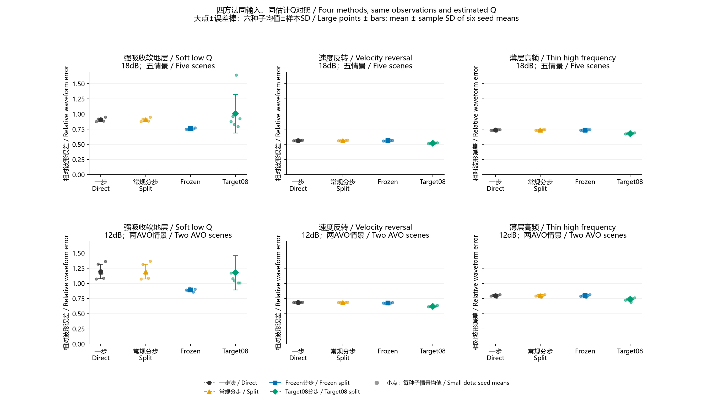
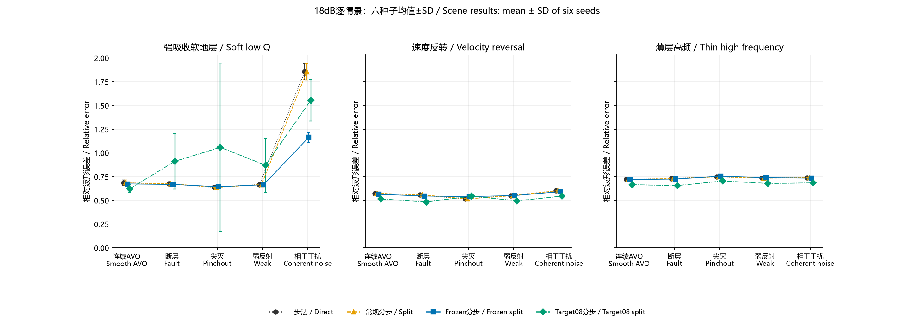
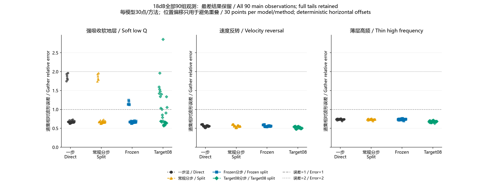
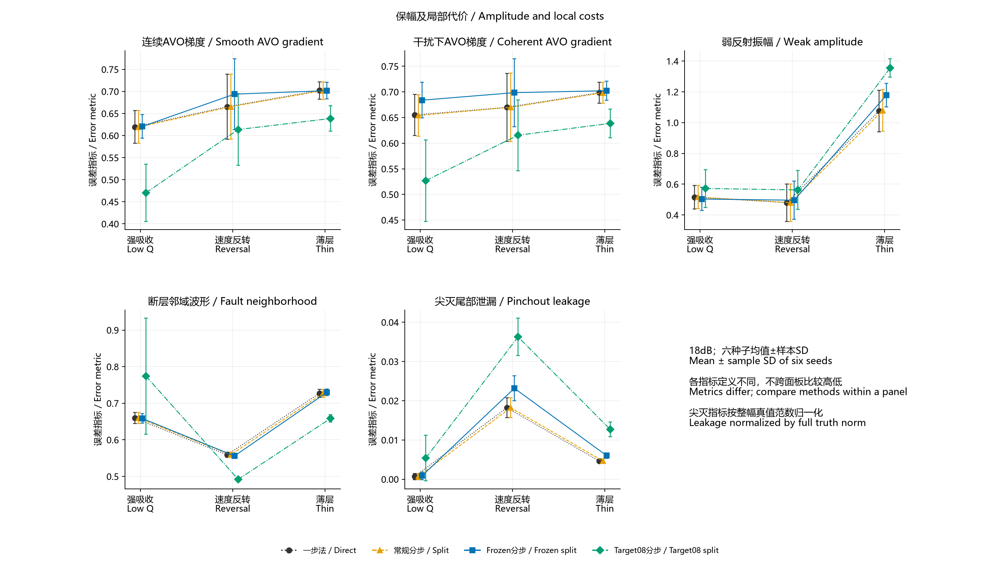
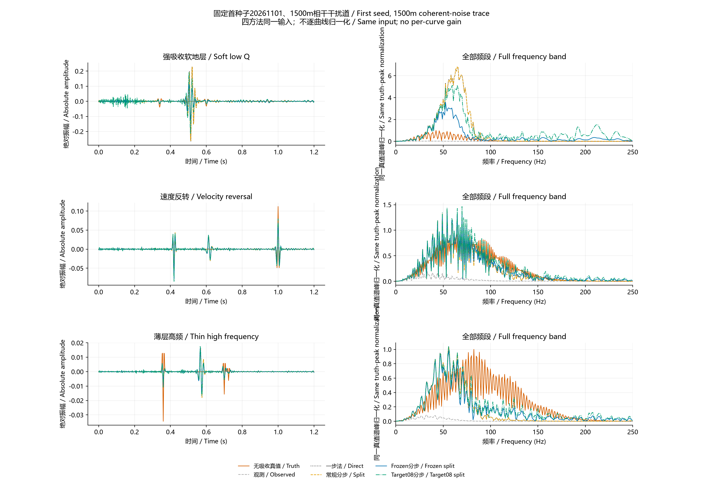
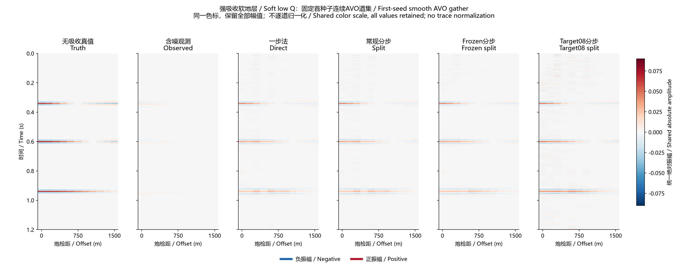
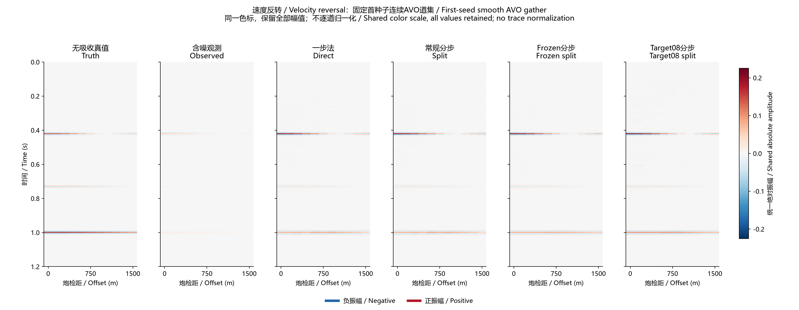
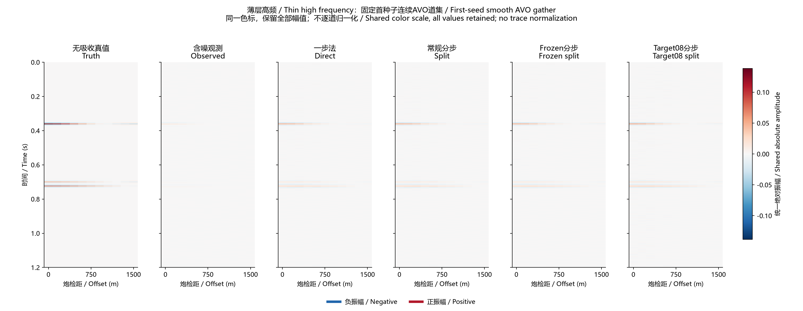
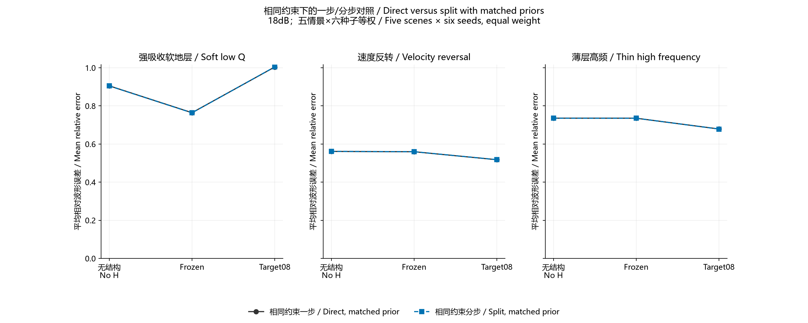

# 一步、常规分步、Frozen、Target08：同条件对比 / Four-method paired comparison

## Material Passport

- 状态：已完成已有MATLAB输出的配对重分析，未重新执行MATLAB。
- 原实验：ResearchMATLAB，R2024b Update 6；756条方法/路线记录、126组含噪观测，最终求解标志均为0。
- 本次四方法提取504行：主试验90组、12dB压力36组，每组四种方法均齐全；保留其余252行作相同先验一步法对照。
- 既有测试结果此前已经查看；本次没有新调参、没有删样本，不把这次整理称为新的独立验证。

## 先看结果

**没有一个版本在三套模型及所有局部指标上都最好。强吸收优先Frozen；速度反转和薄层模型的整体波形优先Target08。常规一步和分步结果非常接近。**

## 四种方法究竟比什么

| 方法 / Method | 定义 / Definition | 结构γ / Gamma | 先导λ倍数 / Pilot multiplier | 噪声残差目标倍数 / Target multiplier |
| --- | --- | ---: | ---: | ---: |
| 一步 / Direct | 完整G一步反演，无多道结构约束 / Full G, no H | 0 | — | 1 |
| 常规分步 / Split | 炮检距后深度补偿，传播协方差白化，无H / Offset then depth, covariance whitening | 0 | — | 1 |
| Frozen分步 / Frozen split | 保守先导学H，炮检距域AVO保护 / Pilot H, AVO protection in offset domain | 10 | 4 | 1 |
| Target08分步 / Target08 split | 与Frozen同结构及先导，更积极残差目标 / Same H and pilot, lower residual target | 10 | 4 | 0.8 |

常规分步是自动选第二步参数的无结构版本；第一步lambda_x仍固定。它不是最初两步均固定参数的旧实现，也不是论文完整叠前到成像流程。剖面域Frozen/Target08只用先导H，不施加AVO投影。

## 公平性核对

同一观测在run_unknown_q_test中生成一次，随后全部方法共用D。真实分层Q只用于合成与事后评分；四者共用独立校准所得有效Q、估计主频和逐道噪声估计。当前有效Q约27.75、67.74、49.34，估计主频39.00、76.52、65.64Hz。已知速度和层厚、受限子波族与独立校准道集仍是先验。

逐道初始lambda由同一完整算子及噪声规则给出；每种预设再按其残差目标选择整体kappa。kappa依据一步路线残差选择，并给对应分步路线共用；不是两路线各自按真值寻优。结构惩罚与残差目标是有意保留的算法差异。Frozen/Target08的相同约束一步法附在后面，避免把结构收益全归因于分步。

## 主试验：18dB / Main

每模型5情景×6种子=30组观测。先对五情景等权，再对六种子平均；相对波形误差越小越好。定义为‖恢复−无吸收真值‖F/‖真值‖F。

| 模型 / Model | 一步法 / Direct | 常规分步 / Split | Frozen分步 / Frozen split | Target08分步 / Target08 split |
| --- | --- | --- | --- | --- |
| 强吸收软地层 / Soft low Q | 0.905270 | 0.904653 | 0.763758 | 1.004657 |
| 速度反转 / Velocity reversal | 0.561138 | 0.561334 | 0.559791 | 0.518034 |
| 薄层高频 / Thin high frequency | 0.735614 | 0.735339 | 0.735211 | 0.678583 |

## 三模型等权汇总 / Equal-model summary

| 方法 / Method | 三模型等权误差 / Equal-model mean |
| --- | --- |
| 一步法 / Direct | 0.734007 |
| 常规分步 / Split | 0.733775 |
| Frozen分步 / Frozen split | 0.686253 |
| Target08分步 / Target08 split | 0.733758 |

本次三模型等权时Frozen平均误差最低；Target08与普通分步的汇总均值几乎相同，但逐模型差异很大。这个汇总权重不代表实测地质的出现频率，不能替代分模型和局部指标。

## 每类情景都保留 / All scenes

| 模型 / Model | 情景 / Scene | 一步法 / Direct | 常规分步 / Split | Frozen分步 / Frozen split | Target08分步 / Target08 split |
| --- | --- | --- | --- | --- | --- |
| 强吸收软地层 / Soft low Q | 相干干扰 / Coherent noise | 1.857932 | 1.855289 | 1.164892 | 1.555632 |
| 强吸收软地层 / Soft low Q | 断层 / Fault | 0.676539 | 0.676790 | 0.669103 | 0.912586 |
| 强吸收软地层 / Soft low Q | 尖灭 / Pinchout | 0.638574 | 0.637725 | 0.644961 | 1.058952 |
| 强吸收软地层 / Soft low Q | 连续AVO / Smooth AVO | 0.685771 | 0.685540 | 0.674239 | 0.624544 |
| 强吸收软地层 / Soft low Q | 弱反射 / Weak | 0.667535 | 0.667919 | 0.665596 | 0.871569 |
| 薄层高频 / Thin high frequency | 相干干扰 / Coherent noise | 0.739328 | 0.739123 | 0.735308 | 0.685128 |
| 薄层高频 / Thin high frequency | 断层 / Fault | 0.730926 | 0.730718 | 0.726226 | 0.657284 |
| 薄层高频 / Thin high frequency | 尖灭 / Pinchout | 0.749664 | 0.749194 | 0.754831 | 0.704854 |
| 薄层高频 / Thin high frequency | 连续AVO / Smooth AVO | 0.722345 | 0.722191 | 0.719961 | 0.666010 |
| 薄层高频 / Thin high frequency | 弱反射 / Weak | 0.735804 | 0.735470 | 0.739728 | 0.679642 |
| 速度反转 / Velocity reversal | 相干干扰 / Coherent noise | 0.603464 | 0.603525 | 0.592982 | 0.546400 |
| 速度反转 / Velocity reversal | 断层 / Fault | 0.559130 | 0.559312 | 0.547010 | 0.484396 |
| 速度反转 / Velocity reversal | 尖灭 / Pinchout | 0.516788 | 0.517328 | 0.541437 | 0.546156 |
| 速度反转 / Velocity reversal | 连续AVO / Smooth AVO | 0.574944 | 0.575041 | 0.565428 | 0.516411 |
| 速度反转 / Velocity reversal | 弱反射 / Weak | 0.551363 | 0.551462 | 0.552097 | 0.496808 |

## 12dB压力 / Lower SNR

只包含连续AVO、相干干扰AVO两情景；不与五情景主均值混比。Q点估计和已选预设固定。

| 模型 / Model | 一步法 / Direct | 常规分步 / Split | Frozen分步 / Frozen split | Target08分步 / Target08 split |
| --- | --- | --- | --- | --- |
| 强吸收软地层 / Soft low Q | 1.195977 | 1.194304 | 0.892977 | 1.176436 |
| 速度反转 / Velocity reversal | 0.685235 | 0.685233 | 0.675363 | 0.622337 |
| 薄层高频 / Thin high frequency | 0.798099 | 0.797984 | 0.796037 | 0.735203 |

## 最差结果与退化计数 / Tails

误差>1表示误差平方和超过真值平方和，不等于所有反射都不可见。计数单位是情景/种子道集；不当作独立地质重复。

| 模型 / Model | 方法 / Method | 最差误差 / Worst | 误差>1 / Above 1 | 误差>2 / Above 2 | 观测数 / Inputs |
| --- | --- | --- | --- | --- | --- |
| 强吸收软地层 / Soft low Q | 一步法 / Direct | 1.964117 | 6 | 0 | 30 |
| 强吸收软地层 / Soft low Q | Frozen分步 / Frozen split | 1.247793 | 6 | 0 | 30 |
| 强吸收软地层 / Soft low Q | 常规分步 / Split | 1.962903 | 6 | 0 | 30 |
| 强吸收软地层 / Soft low Q | Target08分步 / Target08 split | 2.855816 | 12 | 1 | 30 |
| 薄层高频 / Thin high frequency | 一步法 / Direct | 0.757702 | 0 | 0 | 30 |
| 薄层高频 / Thin high frequency | Frozen分步 / Frozen split | 0.764067 | 0 | 0 | 30 |
| 薄层高频 / Thin high frequency | 常规分步 / Split | 0.757238 | 0 | 0 | 30 |
| 薄层高频 / Thin high frequency | Target08分步 / Target08 split | 0.716286 | 0 | 0 | 30 |
| 速度反转 / Velocity reversal | 一步法 / Direct | 0.611193 | 0 | 0 | 30 |
| 速度反转 / Velocity reversal | Frozen分步 / Frozen split | 0.602238 | 0 | 0 | 30 |
| 速度反转 / Velocity reversal | 常规分步 / Split | 0.611256 | 0 | 0 | 30 |
| 速度反转 / Velocity reversal | Target08分步 / Target08 split | 0.560500 | 0 | 0 | 30 |

## 保幅与局部结构 / Local metrics

AVO梯度相对误差使用模板振幅对sin²θ回归；弱反射误差对应第二反射振幅；断层指标评价邻域第5–8道；尖灭评价第9–11道第二事件附近窗口，并按整幅真值范数归一化。数值尺度不同，不跨指标比大小。全部定义沿用MATLAB评分代码；评分真值不进入参数选择。

### 连续AVO梯度 / Smooth AVO gradient

| Model | 一步法 / Direct | 常规分步 / Split | Frozen分步 / Frozen split | Target08分步 / Target08 split |
| --- | --- | --- | --- | --- |
| 强吸收软地层 / Soft low Q | 0.619601 | 0.619381 | 0.620544 | 0.470274 |
| 速度反转 / Velocity reversal | 0.665183 | 0.665354 | 0.693929 | 0.613672 |
| 薄层高频 / Thin high frequency | 0.702035 | 0.701931 | 0.701712 | 0.638665 |

### 干扰下AVO梯度 / Coherent AVO gradient

| Model | 一步法 / Direct | 常规分步 / Split | Frozen分步 / Frozen split | Target08分步 / Target08 split |
| --- | --- | --- | --- | --- |
| 强吸收软地层 / Soft low Q | 0.655050 | 0.654022 | 0.683894 | 0.526989 |
| 速度反转 / Velocity reversal | 0.669895 | 0.670065 | 0.698557 | 0.615510 |
| 薄层高频 / Thin high frequency | 0.698461 | 0.698310 | 0.702362 | 0.638694 |

### 弱反射振幅 / Weak amplitude

| Model | 一步法 / Direct | 常规分步 / Split | Frozen分步 / Frozen split | Target08分步 / Target08 split |
| --- | --- | --- | --- | --- |
| 强吸收软地层 / Soft low Q | 0.515842 | 0.516303 | 0.503485 | 0.571946 |
| 速度反转 / Velocity reversal | 0.480143 | 0.480252 | 0.495932 | 0.562748 |
| 薄层高频 / Thin high frequency | 1.075041 | 1.079361 | 1.178977 | 1.355316 |

### 断层邻域波形 / Fault neighborhood

| Model | 一步法 / Direct | 常规分步 / Split | Frozen分步 / Frozen split | Target08分步 / Target08 split |
| --- | --- | --- | --- | --- |
| 强吸收软地层 / Soft low Q | 0.659300 | 0.659497 | 0.658556 | 0.774247 |
| 速度反转 / Velocity reversal | 0.559161 | 0.559344 | 0.555947 | 0.491981 |
| 薄层高频 / Thin high frequency | 0.727143 | 0.726986 | 0.729560 | 0.658395 |

### 尖灭尾部泄漏 / Pinchout leakage

| Model | 一步法 / Direct | 常规分步 / Split | Frozen分步 / Frozen split | Target08分步 / Target08 split |
| --- | --- | --- | --- | --- |
| 强吸收软地层 / Soft low Q | 0.000693 | 0.000691 | 0.000870 | 0.005383 |
| 速度反转 / Velocity reversal | 0.018216 | 0.018205 | 0.023183 | 0.036261 |
| 薄层高频 / Thin high frequency | 0.004638 | 0.004633 | 0.006006 | 0.012675 |

## 固定首种子波形与道集 / Fixed examples

例子固定20261101；频谱使用1500m相干干扰道，0–250Hz全部保留，每模型各曲线除以同一个真值谱峰。不是按方法各自归一化。

## 相同结构信息也给一步法 / Matched-prior control

四组主比较的一步法无H，而Frozen/Target08带H，所以它们的差异包含结构先验与选参差异。下面让一步法使用对应相同H、lambda和kappa；仍保留G与XA的非稳态矩阵复合误差。

| 模型 / Model | 约束 / Prior | 一步均值 / Direct mean | 分步均值 / Split mean | 分步减一步 / Split−direct | 最大配对绝对差 / Max paired gap |
| --- | --- | --- | --- | --- | --- |
| 强吸收软地层 / Soft low Q | Baseline | 0.905270 | 0.904653 | -0.000618 | 0.003799 |
| 强吸收软地层 / Soft low Q | Frozen | 0.764336 | 0.763758 | -0.000577 | 0.002831 |
| 强吸收软地层 / Soft low Q | Tuned | 1.004118 | 1.004657 | 0.000539 | 0.006517 |
| 薄层高频 / Thin high frequency | Baseline | 0.735614 | 0.735339 | -0.000274 | 0.000507 |
| 薄层高频 / Thin high frequency | Frozen | 0.735460 | 0.735211 | -0.000249 | 0.000486 |
| 薄层高频 / Thin high frequency | Tuned | 0.678974 | 0.678583 | -0.000390 | 0.000920 |
| 速度反转 / Velocity reversal | Baseline | 0.561138 | 0.561334 | 0.000196 | 0.000623 |
| 速度反转 / Velocity reversal | Frozen | 0.559599 | 0.559791 | 0.000192 | 0.000612 |
| 速度反转 / Velocity reversal | Tuned | 0.517731 | 0.518034 | 0.000303 | 0.000985 |

这些同先验路线差距很小。现有证据主要支持某些场景中结构约束和补偿强度的价值，不支持分步形式普遍优于完整算子一步法。

## 解释及使用判断

- 强吸收：Frozen主均值及最差结果更好；Target08降低残差目标后可能把模型误差与相干干扰当成可恢复成分，最差2.8558。
- 速度反转、薄层：Target08整体波形与AVO梯度更好；但相对Frozen，三模型弱反射振幅和尖灭泄漏均更差。
- 相对普通方法，多道约束的收益依模型和场景而变；不能把平均改善等同于每个事件改善。
- 不提供按真值选择每道最优方法的“混合结果”，那会泄露评分答案。当前程序也没有已验证的自动可靠回退机制。

## 数值与数据审计

- 四方法键一一齐全，126组观测每组均为四行；Q、主频、噪声估计逐键完全一致。
- 24个保存例子/方法波形误差用NumPy从601×11波形重新计算，与MATLAB记录差异<1e-12；这不是完整反演重新求解。
- 3次原始kappa选择触及下界；本次四组提取包含其中3行；最差一例目标失配4.414%，保留且未按0.5%容限排除。
- 原实验求解最大法方程相对残差约1e-7；求解收敛不等于恢复物理可信。
- 原始数据及来源代码快照、SHA256见inputs/与SOURCE_MANIFEST.json；重分析只写本独立目录。

## 能支持到哪里

这是三套有限合成模型、固定有效Q估计下的新噪声测试。没有重采样校准Q，没有任意未知子波、实际NMO/偏移或实测资料验证。仍采用Shuey两项、理想NMO和列时变吸收矩阵。图中SD表示六噪声种子条件变化，不是置信区间，也不含Q估计和地质不确定性。所有配对比例仅作描述统计，不作显著性推断。

## 复核方式

在具备numpy、pandas、matplotlib、Pillow的Python中执行本脚本，使用--source指定原未知Q工程、--output指定新目录；输出不能覆盖已交付报告。源数据只读。无需连接或启动MATLAB。所有PNG与PDF均有中英图例；不是期刊排版认证。
