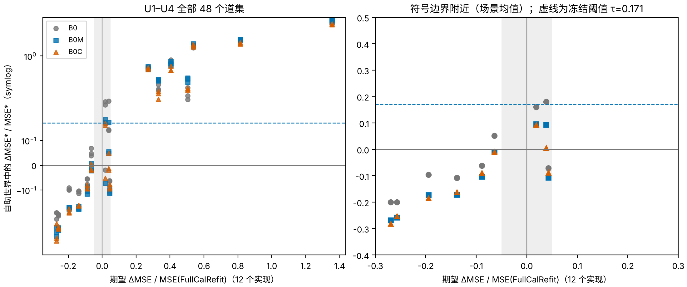

# B0M 在未见模型上得到确认：所用 Q 正确时，判断“QScan 是否会让 FullCalRefit 变差”的无真值检查成立

**结论：在新生成的 U1–U4（16 个场景、48 个诊断道集）上，冻结的 B0M 规则（自助均值作世界真值，阈值 τ = 0.171）在全部 39 个明确道集上判对，C1、C2 都通过。按结论规则：在所用 Q 可信时，这一无真值检查在未见模型上得到确认。**

适用范围有两点限制，与暂停时的顾虑相同：

1. 被确认的是 FullCalRefit 层面的判断，即 c=1 与 c=ĉ 哪个误差更小，不是“相干标准版是否还应叠加 QScan”。第 3 节的组合层面对照（描述）显示：B0M 判“更差”时，在组合层面也总是对的（24/24）；判“不更差”时多半是错的（9/12）。拿它当开关，平均起来并不比“始终不叠加”更好。
2. 前提是所用 Q 正确。Q 有误时 B0 系列会误报（上一轮在 Q 误差 −30% 时 8/12 误报），本轮没有检验。

## Material Passport

- 类型：预先登记的确认，按 [PLAN_ZH.md](PLAN_ZH.md) 冻结方案执行。U1–U4 在方案冻结之后生成，此前从未用于求解、诊断或评分。
- 平台：GNU Octave 8.4.0（Linux，OpenBLAS 单线程），加兼容层 `octave_compat_20261025`。这是唯一的偏离，在接触 U1–U4 之前登记于 [RESUME_ZH.md](RESUME_ZH.md)。
  - 等价性检验在 44 个开发道集上进行：B0 与 B0M 的最大差 5e-14，B0M 的 44 个判定全部相同。
  - 真值所需的重复噪声由重建的 MATLAB `randn` 生成，与存档诊断道集的相对差 ≤3.3e-15。
- 时间（2026-10-25 本地时间）：
  - 11:49 冻结恢复记录；
  - 11:50–12:01 诊断 48 个道集（4 个 worker）；
  - 12:01 封存预测：`predictions/SEALED_SHA256.json` 与 `SEALED_OCTAVE_SHA256.json`；
  - 12:01–12:08 计算真值。
- 运行中的问题：
  - 4 个 worker 中有 2 个在启动时撞上同时创建输出目录（`mkdir: File exists`），还没诊断任何道集就退出了。已原样重启，旧日志保留为 `logs/run_confirm_oct_{3,4}_4_attempt1_mkdir_race.log`。
  - 评分用的作图包装 `scripts_octave/analyze_confirm_fonts.py` 在任何评分之前就因 KeyError 退出，换成 `analyze_confirm_cjk.py`。两者都只给图补中文字体；评分脚本 `scripts/analyze_confirm.py` 未改动，并在评分前逐个核对了封存文件的哈希。
- 规模：48 个诊断道集，每个做 3 × K=6 次自助模拟；真值为每个场景 12 个实现，共 192 个。

## 1. 主判定

| 判定 | 结果 |
|---|---|
| **C1**：明确场景（\|期望 ΔMSE\|/MSE ≥5%）道集上冻结规则的正确率 ≥0.80 | **39/39 = 1.00，通过** |
| **C2**：不低于原 B0（阈值 0）、只看方差 V、第三轮门限 G | **通过**：B0 36/39、V 24/39、G 9/39 |

描述：

- 边界场景（明确场景中 5–20% 的那些）：12/12 判对。
- 全部 48 个道集：42/48 判对。6 个错判都落在 3 个不明确场景里（期望差只有 +1.9% 到 +4.3%），B0M 判为“不变差”。
- 16 个场景的均值与期望 ΔMSE 的 Spearman：B0 0.944、B0M 0.953、B0C 0.959。

## 2. 逐场景

ΔMSE 为 QScan（c=ĉ）减去 FullCalRefit（c=1）的期望，除以 FullCalRefit 的 MSE，12 个实现。B0M 列为 3 个诊断道集的均值，“> τ”即判为 QScan 更差。

| 模型 | 宏观 Q（上尺度） | 场景 | ĉ | 期望 ΔMSE/MSE | 明确 | B0M |
|---|---|---|---:|---:|:---:|---:|
| U1 | 45 → 117，递增 | 8 dB | 1.43 | +0.04 | | +0.09 |
| | | 11 dB | 1.59 | +0.41 | ✓ | +0.78 |
| | | 14 dB | 1.59 | +0.81 | ✓ | +1.76 |
| | | 17 dB | 1.59 | +1.36 | ✓ | +3.45 |
| U2 | 80 → 33，递减，碳酸盐 | 8 dB | 0.93 | +0.51 | ✓ | +0.44 |
| | | 11 dB | 0.93 | +0.33 | ✓ | +0.44 |
| | | 14 dB | 1.03 | +0.04 | | −0.11 |
| | | 17 dB | 1.03 | −0.09 | ✓ | −0.10 |
| U3 | 35 → 97，反转 | 8 dB | 1.15 | −0.14 | ✓ | −0.17 |
| | | 11 dB | 1.28 | +0.02 | | +0.10 |
| | | 14 dB | 1.28 | +0.27 | ✓ | +0.67 |
| | | 17 dB | 1.28 | +0.54 | ✓ | +1.47 |
| U4 | 55 → 92，碳酸盐 | 8 dB | 1.15 | −0.26 | ✓ | −0.26 |
| | | 11 dB | 1.28 | −0.27 | ✓ | −0.27 |
| | | 14 dB | 1.28 | −0.19 | ✓ | −0.17 |
| | | 17 dB | 1.28 | −0.06 | ✓ | −0.01 |

- 明确场景中，6 个是 QScan 更好，7 个是 QScan 更差，两类都有，而且都全部判对。
- U2 在 8–11 dB 时 QScan 选 0.93，即进一步过补偿，FullCalRefit 本身的误差已经大于 1（MSE 2.3 与 1.2）。B0M 也判对了。

## 3. 组合层面的对照（描述，不作门槛）

按 RESUME_ZH.md 的登记，在同样的 12 个实现上，另算相干标准版在 Q0 处（B）与在 QScan 因子处（D = QScan＋标准版）的误差。这部分在预测封存之后运行，12:08–12:36。脚本为 `scripts_octave/run_combo_truth_oct.m` 与 `analyze_combo_oct.py`，数据在 [combo_expected_truth.csv](analysis/combo_expected_truth.csv) 与 [combo_decisions.json](analysis/combo_decisions.json)。

| 模型 | 8 dB | 11 dB | 14 dB | 17 dB |
|---|---:|---:|---:|---:|
| U1 | +0.23 | +0.54 | +0.88 | +1.38 |
| U2 | +0.40 | +0.24 | +0.03 | −0.04 |
| U3 | +0.03 | +0.20 | +0.42 | +0.64 |
| U4 | **−0.13** | −0.05 | +0.06 | +0.15 |

表中为组合层面的期望 (D − B)/B，正值表示叠加 QScan 更差。

- **Q 正确时，叠加 QScan 在组合层面几乎总是更差**：
  - 16 个场景中 13 个更差。12 个明确场景（|差| ≥5%）中 11 个更差，只有 U4/8 dB 更好（−13%）。
  - 这与 `combo_bias_variance_20261024` 阶段 1 的结论一致：相干收缩已经取代了 QScan 的降方差作用。
- **FullCalRefit 层面的标签与组合层面在 3 个场景上符号相反**：U3/8 dB、U4/14 dB、U4/17 dB。在 FullCalRefit 层面 QScan 更好（−6% 到 −19%），到了组合层面却更差（+3% 到 +15%）。
- **冻结的 B0M 判定作为组合层面的开关是单向可靠的**（36 个明确道集）：
  - 判“QScan 更差”的 24 个道集全部正确；
  - 判“不更差”的 12 个道集中只有 3 个正确，9 个在组合层面其实更差。
  - 总正确率 0.75。阈值取 0 时，B0 为 0.89，B0M 为 0.83。
- 场景均值的排序仍然一致：B0M 与组合层面期望差的 Spearman 为 0.97。但组合层面的零点更偏向“不要叠加”，所以 FullCalRefit 层面开发出来的阈值偏松。

**对实用的含义**：在 48 个诊断道集上，用冻结的 B0M 判定当开关（判“更差”就只用标准版，否则叠加 QScan），与“始终不叠加”相比：

- 平均 MSE 高 1.1%；
- 12 个道集更好（U2/14–17 dB、U4/8–11 dB，−2% 到 −13%），12 个更差（最坏 +25%，U1/8 dB）；
- “始终叠加”平均高 30%。

所以，Q 可信时默认不叠加 QScan（`compensation_package_20261024` 的现行建议）仍然合适。B0M 开关能避开大部分损失，但没有带来净收益。

## 4. 解读

- **确认的内容**：在 Q 可信的前提下，用“自助均值作世界真值”的参数自助法预测 QScan 会不会让 FullCalRefit 变差，这一做法在 4 个新地质模型上判对了全部明确场景。它不需要真值，只用观测道集、噪声模型和两次求解。
- **阈值比世界真值的选择更关键**：三种世界真值各自使用开发阈值时（B0 0.163、B0M 0.171、B0C 0.135），在明确道集上都是 39/39。阈值取 0 时，B0 降到 36/39，B0M 与 B0C 为 38/39。本轮数据无法区分三种世界真值的优劣。
- **不能直接当作组合方法的开关**：在组合层面，它只在判“更差”时可靠，见第 3 节。
- **数据用途**：U1–U4 已用于本次确认，今后不再是未见数据。

数据：
- [confirm_scored.csv](analysis/confirm_scored.csv)：逐道集的判定与真值；
- [confirm_expected_truth.csv](analysis/confirm_expected_truth.csv)、[confirm_conditions.csv](analysis/confirm_conditions.csv)；
- [confirm_decisions.json](analysis/confirm_decisions.json)；
- `analysis/truth_U*.csv`：192 个实现。
