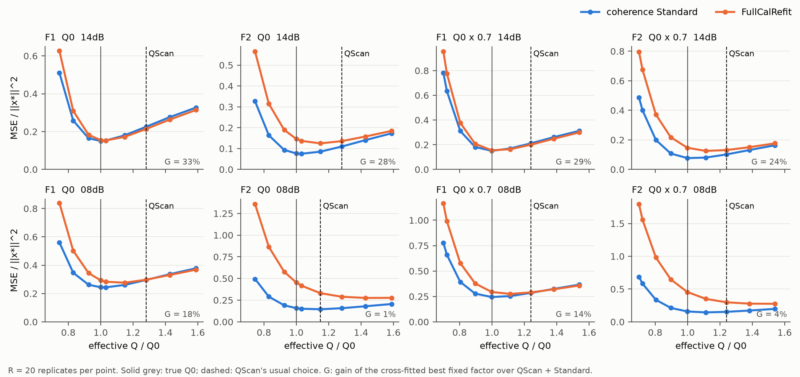

# 阶段 2：完整流程的最优补偿就在真 Q 处，QScan 的选择偏差是确定性的

**结论：有了相干标准版之后，最终输出误差最小的有效 Q 就是真 Q0（14 dB 下有效 Q 比为 1.00–1.03）。QScan 稳定地选在 1.24–1.28×Q0。只要选择器能找回 Q0，组合的 MSE 就能降低 24–33%。**

- **K1 改进空间大**：在 4 个主场景中，交叉拟合最优固定因子相对 QScan＋标准版的改进 G 为 0.33、0.28、0.29、0.24，平均 0.286，远高于阈值 0.05。判为“选择机制值得研究”。
- **K2 QScan 系统性地选高了 Q**：4 个主场景中，两半各自选出的 q* 都低于 QScan 的选择（1.00–1.03 对 1.24–1.28）。判为“QScan 系统性地选择了过高的 Q（补偿不足）”。
- **偏差是确定性的，不是噪声造成的**：在每个场景里，误差最小的因子在 20 个实现上都相同，所以逐实现最优与固定最优完全相同，“逐实现选择”比“固定因子”没有额外收益。QScan 本身在 F1 Q0、F1 Q×0.7、F2 Q×0.7 中 20/20 选同一个网格点，在 F2 Q0 中为 16 次 1.280、4 次 1.149；平均 J 的最小点与其众数选择一致。问题只在于选择的目标位置。
- **Q 低估 30% 时也一样**：最优有效 Q 比为 0.999，即恰好补回到 Q0；QScan 则落在 1.24×Q0。只要能找回 Q0，组合在 Q0 与 Q×0.7 下的误差相同（F1 0.150、F2 0.075–0.077），与 Q 是否有误无关。
- **相干收缩把最佳补偿强度拉回到真 Q**：14 dB 时，FullCalRefit 的最优有效 Q 比为 1.00–1.15，标准版为 1.00–1.03；8 dB 时分别为 1.11–1.54 与 1.00–1.15。没有相干收缩时，少补偿是一种有用的降方差手段；有了相干收缩，这部分方差已被压掉，最佳补偿就回到真 Q。QScan 的选择位置甚至高于 FullCalRefit 的最优点。
- **8 dB 只作描述**：F1 的 G 为 0.18、0.14；F2 为 0.01、0.04。F2/8 dB 的最优有效 Q 比本身就是 1.11–1.15，QScan 恰好接近它。这与阶段 1 中“F2/8 dB 是唯一例外”一致。

## Material Passport

- 类型：已见合成模型（F1/F2，独立 Kennett 细层正演）上的重复噪声因子扫描。MATLAB R2024b 与 Python 实际运行。
- 日期：2026-10-25 01:04–01:47（本地时间）；项目根目录 `D:\ChatGPT\研究`。
- 方案：[PLAN_STAGE2_ZH.md](PLAN_STAGE2_ZH.md)，在 r=1 冒烟复现之后、扫描之前冻结，哈希见 `logs/PRE_STAGE2_HASHES.json`（提交 ae23748）。评分前逐文件核对 SHA-256，全部一致；冻结后没有改动方案、阈值或判定代码。冻结后唯一改动的文件是 `scripts/make_figures.py`，只追加了阶段 2 的作图。本文档由两个会话先后编辑，已合并为同一版本。
- 规模：8 个场景 × 21 个实现（r=0 无噪声，r=1–20 含噪）× 14 个因子 × 2 个估计量。2 个 worker × 4 线程，约 43 分钟。全部优化标志为 0。
- 复现：每个含噪实现在 f=1 处的标准版、FullCalRefit，以及所选因子处的 QScan＋标准版，都与阶段 1 缓存逐位相同（single），所选因子也与阶段 1 相同。
- 局限：只用了 F1/F2 两个开发模型和一种 Q 误差（低估 30%）。最优固定因子用到了真值，只用来度量改进空间，不是可用的方法。

## 1. 主判定（14 dB）

| 场景 | D：QScan＋标准版 | 最优固定因子（交叉拟合） | G | q*（两半） | q_QScan | 无噪声最优 q | FullCalRefit 最优 q | J 最小处 q |
|---|---:|---:|---:|---|---:|---:|---:|---:|
| F1 Q0 | 0.225 | 0.150 | **0.33** | 1.000 / 1.000 | 1.280 | 1.000 | 1.031 | 1.280 |
| F2 Q0 | 0.105 | 0.075 | **0.28** | 1.031 / 1.031 | 1.280 | 1.000 | 1.149 | 1.280 |
| F1 Q×0.7 | 0.211 | 0.150 | **0.29** | 0.999 / 0.999 | 1.240 | 0.999 | 0.999 | 1.240 |
| F2 Q×0.7 | 0.101 | 0.077 | **0.24** | 0.999 / 0.999 | 1.240 | 0.999 | 1.113 | 1.240 |

q 为有效 Q 与 Q0 之比（因子 × 所用 Q / Q0）；MSE 除以 ‖x⋆‖²，R=20。同批最优与逐实现最优在全部 8 个场景中都与交叉拟合结果相同。

## 2. 附加场景（8 dB，只描述）

| 场景 | D | 最优固定因子 | G | q* | q_QScan | FullCalRefit 最优 q |
|---|---:|---:|---:|---:|---:|---:|
| F1 Q0 | 0.296 | 0.244 | 0.18 | 1.031 | 1.280 | 1.149 |
| F2 Q0 | 0.147 | 0.145 | 0.01 | 1.149 | 1.149 | 1.427 |
| F1 Q×0.7 | 0.284 | 0.244 | 0.14 | 0.999 | 1.240 | 1.113 |
| F2 Q×0.7 | 0.150 | 0.144 | 0.04 | 1.113 | 1.240 | 1.540 |

噪声越强，最优点越向少补偿移动（F2 最明显），QScan 的偏差就越接近“恰好合适”。

## 3. K3：振幅与误差曲线的形状

强反射区平均输出的振幅增益 g（定义同阶段 1）：

| 场景 | g 在最优 q* 处 | g 在 QScan 选择处 | MSE 在 q* | MSE 在 q_QScan |
|---|---:|---:|---:|---:|
| F1 Q0 14 dB | 0.86 | 0.66 | 0.150 | 0.225 |
| F2 Q0 14 dB | 0.97 | 0.82 | 0.075 | 0.110 |
| F1 Q×0.7 14 dB | 0.86 | 0.68 | 0.150 | 0.211 |
| F2 Q×0.7 14 dB | 1.00 | 0.84 | 0.077 | 0.101 |

- 在最优点处，标准版的方差只占 MSE 的 27–54%，其余是偏差；越往高 Q 走，偏差增长远快于方差下降（曲线右支几乎与偏差² 重合）。
- 在 QScan 的位置，MSE 比最优点高 32–50%。
- 误差曲线向过补偿一侧更陡。以扫描序列中相邻的两个点计（14 dB 主场景）：
  - 向低 Q 走两点，MSE 上升 72%、25%、107%、160%；
  - 向高 Q 走两点，MSE 上升 20%、46%、40%、32%。
  - 4 个场景中有 3 个是低 Q 一侧更陡；F2 Q0 的最优点在 1.031，低 Q 方向的第一点就是 1.000，因此例外。
  - 所以可用的选择器应宁可略高，不可偏低。
- 无噪声曲线的最小点在 8 个场景中都是 q=1.000（或 0.999），说明在没有噪声时，这条流程的误差最小点就是真 Q，不存在模型本身导致的偏移。

数据：[sweep_curves.csv](analysis/sweep_curves.csv)（每个场景、因子、估计量的 MSE、偏差²、方差、g、无噪声 MSE 与被 QScan 选中的次数）、[sweep_summary.csv](analysis/sweep_summary.csv)、[stage2_decisions.json](analysis/stage2_decisions.json)。

## 4. 解读与下一步

1. **问题从“偏差—方差权衡”变成了“辨识真 Q”。** 在没有相干收缩时，QScan 偏向少补偿恰好起到降方差的作用（FullCalRefit 的最优 q 也大于 1），所以过去看不出问题。有了相干收缩，降方差不再需要它，这个偏向就成了纯代价。偏向从何而来，本轮没有检验。`qscan_criterion_20261024` 曾直接检验“ℓ1 罚项造成偏差”的假设，结论是没有得到支持：只看残差的 A1 并没有更好。所以不能简单归因于 ℓ1 罚项。
2. **这个偏差在 F1/F2 上很稳定**：Q0 与 Q×0.7、14 dB 与 8 dB 下，QScan 都落在真 Q 的 1.24–1.28 倍（唯一的例外是 F2 Q0/8 dB，为 1.15）；`qcriteria_20261024` 中 F3、F4 的含噪 QScan 也偏高（c_sel/c_opt = 1.11、1.18）。这提示可以对 QScan 做一个**常数去偏**：把所选因子除以一个固定的 κ。前面的“换选择准则”路线（C1–C4）已经结束，但去偏不需要换准则，只是平移选择位置。
3. **去偏的风险在于 κ 随模型变化**（F3 约 1.11，F1/F2 约 1.24–1.28），而误差曲线对过补偿更敏感。所以 κ 应取得保守（偏小），并在未见数据上确认。这将作为阶段 3 另行登记：开发数据用 F1–F4，确认数据用 U1–U4（见 `b0_world_truth_20261024/PAUSED_ZH.md`，需要先冻结确认方案）。

**后续更新（2026-10-25）**：第 2、3 条的提议已被后续结果否定，常数去偏这条线已经结束，详见 [DECISION_KAPPA_ZH.md](DECISION_KAPPA_ZH.md)。主要依据有三条：
- `qscan_offset_20261025` 在 8 个新开发模型上发现，偏移从 −4 到 +4 步不等，方向会反过来；
- `qscan_predictor_20261025` 没有找到能预测偏移的无真值特征；
- U1–U4 已用于 B0M 确认（3f3c36c），不再是未见数据。

上面第 2、3 条保留原文，作为当时的判断记录。
