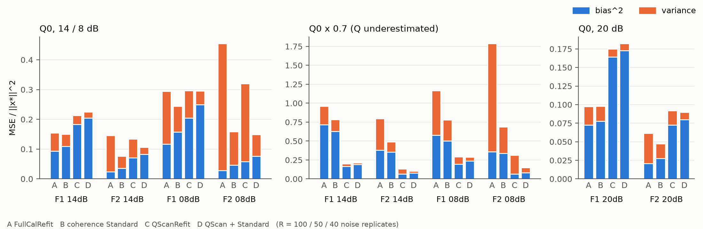

# 完整组合的偏差—方差分解：相干收缩替代了 QScan 的方差收益，偏差代价全部保留

**结论：在 QScan＋相干标准版中，QScan 只在 Q 有误时有用。Q 可信时，它的降噪作用基本已被相干收缩取代，剩下的是让强反射振幅变小的偏差。**

- **J1 替代**：在 4 个 Q0 主场景中，QScan 在相干收缩之后的方差收益只剩没有相干收缩时的 25–67%（ρ_V = 0.67、0.31、0.47、0.25）。
- **J2 偏差代价保留**：QScan 带来的偏差² 增量几乎不受相干收缩影响（ρ_B = 1.01–1.07）。
- **交互作用在全部 10 个场景中都为正**，即两者互相替代而非互补，而且这部分几乎全部来自方差。
- **Q0 下组合比单用标准版差**：F1/14 dB +50%，F2/14 dB +38%，F1/8 dB +21%（MSE 相对差），这三个场景中 100% 的实现都更差。唯一的例外是 F2/8 dB：组合好 6.5%，仍有 88% 的实现更好。
- **J3 成立**：Q 低估 30% 时，组合相对标准版的 MSE 降低 63–79%，每个实现都更好；4 个场景的偏差² 都下降。
- **J4 成立**：20 dB 下，组合在 F1、F2 上都比标准版差（+86%、+90%）。
- **J5 强反射振幅欠补偿**：Q0 下组合相对标准版多出的 MSE，按区域合计后 131% 落在强反射区（其他区域为负，部分抵消），其中主要是偏差。强反射的振幅增益从标准版的 0.80–1.00 降到组合的 0.62–0.86。

## Material Passport

- 类型：已见合成模型（F1/F2，独立 Kennett 细层正演）上的重复噪声机制诊断。MATLAB R2024b 与 Python 实际运行。
- 日期：2026-10-24 至 25；项目根目录 `D:\ChatGPT\研究`。
- 方案：[PLAN_ZH.md](PLAN_ZH.md)，在阶段 0 通过之后、任何阶段 1 实现运行之前冻结，哈希见 `logs/PRE_RUN_HASHES.json`（提交 408295c）。冻结后没有改动方案、阈值或判定代码。
- 规模：680 个噪声实现 × 6 个估计量，2 个 worker × 4 线程，约 75 分钟。全部优化标志为 0。
- 复现：A（FullCalRefit）与 C（QScanRefit）的偏差²、方差与上一轮 `qscan_bias_variance_20261024` 的 Q0 14/8 dB 和 20 dB 结果在 4 位小数内完全相同（同一种子）。阶段 0 逐位复现第三轮归档（≤5e-15）。
- 局限：F1/F2 是开发数据，本轮是机制诊断，不是确认；只覆盖 1D 正入射细层模型与一种 Q 误差（低估 30%）。

## 1. 2×2 析因的四个估计量

MSE、偏差²、方差都除以 ‖x⋆‖²，用全部 99 道、全时段计算。

| 场景 | A FullCalRefit | B 标准版 | C QScanRefit | D QScan＋标准版 | D/B（MSE） | D 比 B 差的实现比例 |
|---|---|---|---|---|---:|---:|
| F1 Q0 14 dB | 0.155 = 0.093 + 0.061 | 0.150 = 0.109 + 0.041 | 0.213 = 0.183 + 0.030 | 0.225 = 0.204 + 0.020 | **1.50** | 100% |
| F2 Q0 14 dB | 0.146 = 0.024 + 0.122 | 0.077 = 0.036 + 0.041 | 0.134 = 0.071 + 0.064 | 0.106 = 0.083 + 0.023 | **1.38** | 100% |
| F1 Q0 8 dB | 0.295 = 0.117 + 0.178 | 0.244 = 0.158 + 0.086 | 0.297 = 0.205 + 0.092 | 0.295 = 0.249 + 0.046 | **1.21** | 100% |
| F2 Q0 8 dB | 0.454 = 0.029 + 0.426 | 0.159 = 0.046 + 0.113 | 0.320 = 0.058 + 0.262 | 0.149 = 0.076 + 0.073 | 0.94 | 12% |
| F1 Q×0.7 14 dB | 0.958 = 0.715 + 0.242 | 0.784 = 0.627 + 0.157 | 0.201 = 0.168 + 0.033 | 0.212 = 0.189 + 0.022 | 0.27 | 0% |
| F2 Q×0.7 14 dB | 0.796 = 0.379 + 0.417 | 0.487 = 0.355 + 0.132 | 0.131 = 0.067 + 0.065 | 0.102 = 0.079 + 0.023 | 0.21 | 0% |
| F1 Q×0.7 8 dB | 1.166 = 0.579 + 0.588 | 0.779 = 0.502 + 0.278 | 0.292 = 0.194 + 0.098 | 0.288 = 0.239 + 0.049 | 0.37 | 0% |
| F2 Q×0.7 8 dB | 1.786 = 0.360 + 1.426 | 0.687 = 0.338 + 0.349 | 0.311 = 0.063 + 0.248 | 0.150 = 0.081 + 0.069 | 0.22 | 0% |
| F1 Q0 20 dB | 0.097 = 0.073 + 0.025 | 0.098 = 0.078 + 0.020 | 0.175 = 0.164 + 0.011 | 0.182 = 0.173 + 0.009 | **1.86** | 100% |
| F2 Q0 20 dB | 0.062 = 0.021 + 0.041 | 0.047 = 0.028 + 0.020 | 0.092 = 0.072 + 0.020 | 0.090 = 0.080 + 0.010 | **1.90** | 100% |

数据：[decomposition.csv](analysis/decomposition.csv)（含 5 批标准误）、[replicates.csv](analysis/replicates.csv)。

## 2. QScan 在相干收缩前后的效应（J1、J2）

Δ_raw = C − A，Δ_coh = D − B，交互作用 I = Δ_coh − Δ_raw。

| 场景 | Δ_raw MSE（偏差² / 方差） | Δ_coh MSE（偏差² / 方差） | I MSE（偏差² / 方差） | ρ_V | ρ_B |
|---|---|---|---|---:|---:|
| F1 Q0 14 dB | +0.058（+0.089 / −0.031） | +0.074（+0.095 / −0.021） | +0.016（+0.006 / +0.010） | 0.67 | 1.07 |
| F2 Q0 14 dB | −0.012（+0.047 / −0.059） | +0.029（+0.048 / −0.018） | +0.041（+0.001 / +0.040） | 0.31 | 1.01 |
| F1 Q0 8 dB | +0.002（+0.088 / −0.086） | +0.051（+0.091 / −0.040） | +0.049（+0.003 / +0.045） | 0.47 | 1.04 |
| F2 Q0 8 dB | −0.134（+0.029 / −0.163） | −0.010（+0.030 / −0.040） | +0.124（+0.001 / +0.123） | 0.25 | 1.02 |

- 批标准误：Δ_coh MSE ≤0.001，I ≤0.0023，远小于上述效应。见 [factorial.csv](analysis/factorial.csv)。
- **机制**：QScan 选 c≈1.28，补偿变少，于是偏差增加、方差减小。相干收缩已经压掉了大部分本可由“少补偿”压掉的方差，但不会抵消少补偿造成的偏差。所以 QScan 在 FullCalRefit 上还能带来的净收益（F2），到了标准版之后就变成净损失；只有方差特别大的 F2/8 dB 还剩一点收益。
- 交互作用几乎完全落在方差项上（I 的偏差² 部分 ≤0.006），在 Q×0.7 场景也一样（I 方差 +0.07 至 +0.90）。

## 3. Q0 代价落在哪里（J5）

4 个 Q0 主场景合计，各区域的 Δ_coh 之和等于全道值：

| 区域 | 目标能量占比 | Δ_coh MSE | 其中偏差² | 其中方差 | 占全道 Δ_coh |
|---|---:|---:|---:|---:|---:|
| 强反射（L ≥ 0.25 max） | 93.9% | +0.189 | +0.233 | −0.044 | **131%** |
| 弱信号 | 6.1% | −0.044 | +0.031 | −0.075 | −31% |
| 安静区 | 0.0% | −0.000 | −0.000 | −0.000 | 0% |
| 0–0.30 s | 13.5% | +0.064 | +0.064 | +0.000 | 44% |
| 0.30–0.80 s | 55.7% | +0.092 | +0.115 | −0.023 | 64% |
| 0.80–1.20 s | 11.6% | +0.003 | +0.029 | −0.026 | 2% |
| 1.20 s 以后 | 19.2% | −0.015 | +0.055 | −0.070 | −11% |

强反射区内平均输出的振幅增益 g = ⟨x̄, x⋆⟩/⟨x⋆, x⋆⟩：

| 场景 | A | B | C | D |
|---|---:|---:|---:|---:|
| F1 Q0 14 dB | 0.89 | 0.86 | 0.68 | 0.66 |
| F2 Q0 14 dB | 1.00 | 1.00 | 0.83 | 0.83 |
| F1 Q0 8 dB | 0.85 | 0.80 | 0.66 | 0.62 |
| F2 Q0 8 dB | 0.99 | 0.99 | 0.86 | 0.86 |
| F1 Q×0.7 14 dB | 1.35 | 1.30 | 0.70 | 0.68 |
| F2 Q×0.7 14 dB | 1.42 | 1.42 | 0.84 | 0.84 |

- Q0 的代价是**早、中时段强反射的振幅被系统性压低**；晚时段和弱信号区里，QScan 仍在降方差，局部是收益。
- **QScan 自己也带来振幅偏低。** Q×0.7 时，名义 Q 让强反射过补偿 30–42%，QScan 选 c≈1.77，有效 Q 约为 1.24×Q0，又转成欠补偿 16–32%。在 Q0 和 Q×0.7 下，QScan 最终落到的有效 Q 都约为 1.24–1.28×Q0。也就是说，选择器在这两个模型上都偏向“补偿不足”，并不能找回 Q0。
- 相干标准版对 F2 的强反射振幅没有影响（g≈1.00），对 F1 略有压低（0.86 对 0.89，0.80 对 0.85）。

数据：[amplitude_strong.csv](analysis/amplitude_strong.csv)；判定原文与数值：[decisions.json](analysis/decisions.json)。

## 4. 按冻结方案的结论与下一步

J1 替代、J2 偏差代价保留、J3 成立，对应方案中的第一行：**相干收缩之后，QScan 只在 Q 有误时有用；Q0 时只剩偏差代价。** 再加上 J5，可以得到三个方向：

1. **是否启用 QScan，应由“Q 是否有误”决定，而不是由方差大小决定。** 无真值诊断的标签应改为 D 与 B 的比较。B0M 的标签比较的是 A 与 C，在这里会给出误导性的结论：F2/14 dB 时 C 优于 A，D 却劣于 B。
2. **先做阶段 2（选择器的改进空间）**，结果见 [RESULTS_STAGE2_ZH.md](RESULTS_STAGE2_ZH.md)：最优固定因子就是真实 Q，比 QScan 的选择好 24–33%。
3. **保幅设计的着力点是强反射。** 例如只在可信的强反射上保留名义补偿，或让 ĉ 只作用于弱信号和晚时段。这些都需要另行登记，并在未见数据（U1–U4，见 `b0_world_truth_20261024/PAUSED_ZH.md`）上确认。

另外，F2/8 dB 是唯一的例外。在噪声极强的场景，QScan 在相干收缩之后仍有净收益，所以“Q0 时关闭 QScan”不是在所有信噪比下都最优。

## 附：数值性质

阶段 0 发现，相干标准版的输出在 1 线程与 4 线程之间相差约 3e-3（相对），道集误差最多相差 2.4e-4，原因是相干评分对浮点求和顺序敏感。本轮固定使用 4 线程，结果可与第三轮逐位比较。见 `scripts/diag_threads.m` 与 `logs/diag_threads.log`。这一性质值得单独研究。
