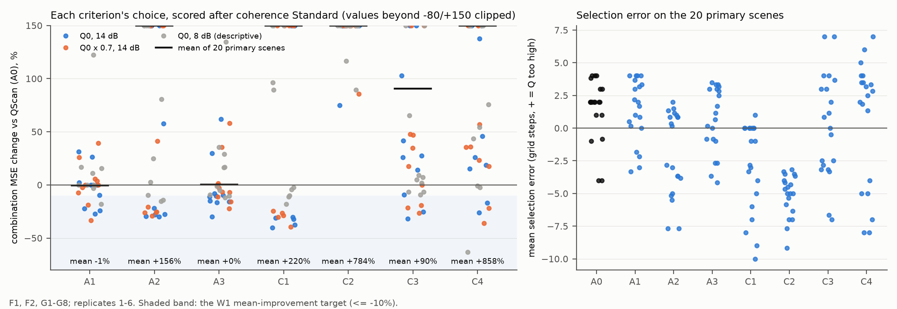

# 已有选 Q 准则在组合层面也不能替代 QScan

**结论：把 A1–A3、C1–C4 的选择接到相干标准版上、按最终误差计，没有一个准则通过 W1。A1、A3 平均与 QScan 持平，但都有比 QScan 差 39–62% 的场景；其余准则平均差 90%–860%。选择准则这条路线在组合层面同样结束。**

- **W1 全部不通过**（20 个主场景；门槛：平均 ≤ −10%、最坏 ≤ +10%、≥14 个场景改善）：
  - A3 去偏 AIC：平均 +0.2%，中位数 −9%，14/20 个场景改善，但最坏 +62%（G2）；
  - A1 只看残差：平均 −0.6%，8/20 改善，最坏 +39%（G5）；
  - A2、C1–C4：平均 +90%–+858%。
- **各准则只是换了出错的地方**：
  - A3 的平均偏移比 QScan 小（+0.6 步对 +1.5 步）。它在 QScan 偏高的 F1、F2、G1、G3、G7 上好 3–30%，在 G6 上好 16%；
  - 但它把 G2 推到偏低约 4 步，过补偿使误差上升 58–62%；在 G5 上又比 QScan 更偏高，误差上升 30–35%；
  - A1 的失败场景也是 G2、G5。
- **所有准则的选择误差都在 2 步以上**：
  - 平均绝对偏离：A0 2.48 步，A3 2.21，A1 2.39，A2 2.90，C1–C4 为 3.06–5.11；
  - 最优固定因子仍比 QScan＋标准版好 27%，这部分改进空间没有任何已有准则能拿到。
- **只有 A 系列保住了 Q 有误时的稳健性**：
  - Q0×0.7 下，A0、A1、A3 在 10/10 个模型上都胜过名义 Q 的标准版（B）；
  - C 系列在部分模型上比直接用错误的 Q 还差得多（C1 最坏 +542%，C4 最坏 +1940%）。
- **Q0/14 dB 时，B 仍是最好的选择**：B 在 8–10/10 个模型上胜过任何一个准则。这与阶段 1 和 `qscan_offset_20261025` 一致。

## Material Passport

- 类型：已见开发数据（F1、F2、G1–G8）上的预登记重评。MATLAB R2024b 与 Python 实际运行。
- 日期：2026-10-25 16:24–17:44 计算准则，17:44 评分（本地时间）；项目根目录 `D:\ChatGPT\研究`。
- 方案：[PLAN_ZH.md](PLAN_ZH.md)，在任何准则计算之前冻结（提交 eb27e94，哈希 `logs/PRE_RUN_HASHES.json`）。评分前逐文件核对，全部一致；用到的 192 个扫描缓存文件的 SHA-256 也与 `cache/SNAPSHOT.json` 一致。冻结后只新增了作图脚本 `scripts/make_figure.py` 和本文档与 README。
- 规模：30 个场景 × 6 个实现 = 180 个道集，每个道集 13 个因子 × 8 个准则。1 个 worker × 4 线程，约 79 分钟。全部优化标志为 0。
- 复现：180 个道集上，A0 的选择都与缓存中的 QScan 选择逐位相同；C 准则内部的 C0 与 A0 目标的相对差都 ≤1e-9。
- 没有使用 U1–U4。
- 局限：
  - 因子网格限于 QScan 的 13 点；C1–C4 用全部 99 道而非原研究的 33 道（见方案）。
  - 每个场景只有 6 个实现；但失败场景的误差变化（+30% 以上）远大于实现间的波动。

## 1. W1 判定（20 个主场景：Q0/14 dB 与 Q0×0.7/14 dB）

rel = MSE(准则) / MSE(A0) − 1，负值表示比 QScan＋标准版好。选择误差为所选网格序号减最优网格序号的平均值，正值表示选的 Q 偏高。

| 准则 | 平均 rel | 中位数 | 最坏 rel | 改善数 | 平均偏移（步） | 平均绝对偏移 | 8 dB 平均 / 最坏 | W1 |
|---|---:|---:|---:|---:|---:|---:|---|---|
| A0 QScan | 0 | 0 | 0 | — | +1.50 | 2.48 | — | 参照 |
| A1 只看残差 | −0.6% | 0% | +39% | 8 | +1.36 | 2.39 | +14% / +122% | 不通过 |
| A2 去偏 BIC | +156% | +10% | +628% | 10 | −1.90 | 2.90 | +260% / +1085% | 不通过 |
| A3 去偏 AIC | +0.2% | −9% | +62% | 14 | +0.63 | 2.21 | +19% / +135% | 不通过 |
| C1 高斯证据 | +220% | +71% | +1007% | 10 | −2.96 | 3.06 | +193% / +1256% | 不通过 |
| C2 岭回归 GCV | +784% | +430% | +5434% | 0 | −5.11 | 5.11 | +402% / +881% | 不通过 |
| C3 留出预测 | +90% | +27% | +502% | 6 | +0.20 | 3.38 | +159% / +847% | 不通过 |
| C4 频谱斜率 | +858% | +36% | +9656% | 4 | +0.65 | 4.52 | +233% / +965% | 不通过 |

- A2、C1、C2 系统性地选低了 Q（平均 −1.9 到 −5.1 步），过补偿会把噪声放大很多倍，所以误差上升最大。这与它们在 FullCalRefit 层面的偏向一致（`qcriteria_20261024`）。
- C3、C4 平均偏移接近 0，但离散极大（±7 步），经常撞到网格两端。

## 2. A1、A3 与 A0 的逐场景比较（主场景）

| 场景 | A0 偏移 | A1 rel | A1 偏移 | A3 rel | A3 偏移 |
|---|---:|---:|---:|---:|---:|
| F1 Q0 | +2.0 | 0% | +2.0 | −16% | +1.2 |
| F1 Q×0.7 | +2.0 | +4% | +2.2 | −6% | +1.7 |
| F2 Q0 | +2.0 | −22% | +1.0 | −30% | +0.2 |
| F2 Q×0.7 | +2.0 | −7% | +1.7 | −22% | +0.7 |
| G1 Q0 | +3.8 | +2% | +4.0 | −11% | +3.0 |
| G1 Q×0.7 | +4.0 | 0% | +4.0 | −11% | +3.2 |
| G2 Q0 | +1.0 | +31% | −3.3 | **+62%** | −4.2 |
| G2 Q×0.7 | +1.0 | +26% | −3.0 | **+58%** | −3.7 |
| G3 Q0 | +3.0 | 0% | +3.0 | −8% | +2.5 |
| G3 Q×0.7 | +3.0 | +6% | +3.3 | −3% | +2.8 |
| G4 Q0 | −0.8 | −10% | +0.2 | −10% | 0.0 |
| G4 Q×0.7 | −1.0 | −2% | 0.0 | 0% | −1.0 |
| G5 Q0 | +2.0 | +26% | +3.2 | +30% | +3.3 |
| G5 Q×0.7 | +2.0 | **+39%** | +3.7 | +35% | +3.5 |
| G6 Q0 | −4.0 | −27% | −2.2 | −16% | −2.7 |
| G6 Q×0.7 | −4.0 | −33% | −1.8 | −16% | −2.7 |
| G7 Q0 | +4.0 | 0% | +4.0 | −10% | +3.0 |
| G7 Q×0.7 | +4.0 | 0% | +4.0 | −7% | +3.3 |
| G8 Q0 | +2.0 | −24% | +0.5 | −15% | −0.8 |
| G8 Q×0.7 | +2.0 | −19% | +0.8 | +2% | −0.8 |

- 在 QScan 偏得最远的 G1、G7（+4 步）上，A1 完全不动，A3 也只往回拉约 1 步。
- G2 上，QScan 只偏高 1 步，A1、A3 却把它推到偏低 3–4 步。
- 规律与 `qscan_offset_20261025` 一样：每个准则的偏差都因模型而异，换准则只是换了出错的模型。

## 3. 与名义 Q 的标准版（B）比较

| 准则 | Q0/14 dB：胜过 B 的模型数 | Q0×0.7：胜过 B 的模型数 | Q0×0.7：相对 B 最坏 |
|---|---:|---:|---:|
| A0 | 1/10 | 10/10 | −32% |
| A1 | 2/10 | 10/10 | −45% |
| A2 | 0/10 | 7/10 | +100% |
| A3 | 1/10 | 10/10 | −43% |
| C1 | 2/10 | 6/10 | +542% |
| C2 | 0/10 | 1/10 | +1232% |
| C3 | 0/10 | 8/10 | +29% |
| C4 | 0/10 | 7/10 | +1940% |

Q×0.7 一列的“相对 B 最坏”为负，表示即使在最坏的模型上也比 B 好。A0、A1、A3 在 Q 低估 30% 时都能可靠地挽回大部分误差。

数据：[criteria_scores.csv](analysis/criteria_scores.csv)（每个场景、准则的 MSE、rel、选择误差与众数选择）、[replicate_mse.csv](analysis/replicate_mse.csv)（每个实现）、[decisions.json](analysis/decisions.json)。

## 4. 按冻结方案的结论与下一步

没有准则通过 W1，对应结论规则第二行：**已有准则在组合层面也不能替代 QScan，选择准则这条路线（A0–A3、C1–C4）在组合层面同样结束。**

综合本轮、`qscan_offset_20261025`（常数去偏）与 `qscan_predictor_20261025`（特征平移）：

1. 在只有地面反射资料、单一共同因子的条件下，已试过的三类修正都无法稳定地比 QScan 更接近真 Q：
   - 换准则；
   - 固定平移；
   - 按无真值特征平移。
   它们的失败都集中在少数模型上（G2、G4、G5、G6），而且失败方向因模型而异。
2. **实用推荐不变**：
   - Q 可信时用相干标准版，不叠加 QScan；
   - Q 只来自粗略标定时用 QScan＋标准版（A0）。A1、A3 的稳健性与 A0 相当，但并不更好，没有理由替换。
3. 剩下约 27% 的改进空间，需要选择器之外的 Q 信息，例如 VSP、井震标定或更多道的联合约束。`fd2d_20261025` 正在二维正演上复验“组合最优在真 Q”与“QScan 偏移因模型而异”这两条结论。
