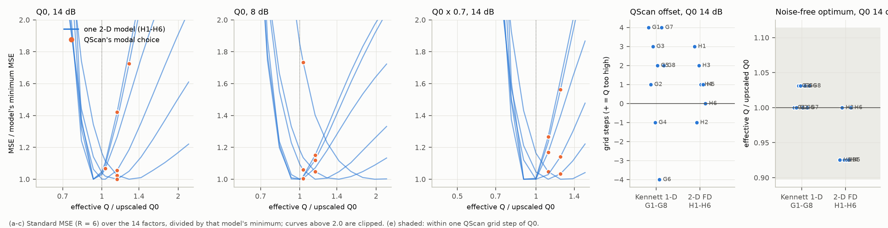
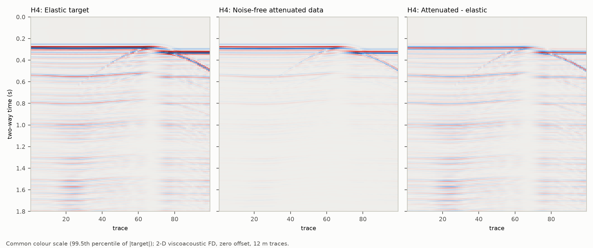

# 二维黏声有限差分正演下的复验：结果

**结论：E1 判为“偏移不稳定”，E2 成立。按结论规则，两条结论在独立的二维有限差分正演（GSLS 流变、断层绕射）下复现，不是 Kennett 一维生成器的特性：**
1. QScan 的选择偏移随模型变化；
2. 补偿到上尺度 Q0 附近就是最优。

**E3、E4 也都成立：名义 Q 下相干标准版在 6/6 个模型上优于 FullCalRefit；Q 正确时不叠加 QScan 更好（4/6），Q 低估 30% 时叠加 QScan 更好（6/6）。**

## Material Passport

- 日期：2026-10-25。方案 `PLAN_ZH.md`（1d8c949）；正演前哈希 `logs/PRE_RUN_HASHES.json`；模型生成后、扫描前哈希 `logs/PRE_SWEEP_HASHES.json`。写第二次哈希时复核过，方案与全部冻结脚本自冻结以来都没有改动。
- Verification Status：ANALYZED。6 个模型 × 100 炮（每炮约 36 s，每个模型约 1 h），`assemble_models`、18 组扫描（6 个模型 × 3 个场景 × 7 个实现，2 个 worker，4 线程，每组 108–461 s），`summarize_fd`。126 个实现的优化警告均为 0。
- 正演和模型生成由原会话完成，扫描、汇总与本报告由另一会话按同一冻结方案接续完成，没有改动任何设计。
- 不使用 U1–U4。

## 判定

| 判定 | 结果 | 依据 |
|---|---|---|
| **E1 偏移稳定性** | **不稳定** | Q0/14 dB 下偏移依次为 H1 +3、H2 −1、H3 +2、H4 +1、H5 +1、H6 0；极差 4 步，出现最多的值（+1）只有 2 次，正负都出现 |
| **E2 无噪声最优在上尺度 Q0** | **成立（6/6）** | 无噪声最优有效 Q 比：H1、H3、H4、H5 为 0.925，H2、H6 为 1.000，都在一个网格步长（ln 1.1145）以内 |
| **E3 相干收缩的收益** | **成立（6/6）** | 名义 Q 下标准版 B 相对 FullCalRefit A：−6% 到 −61% |
| **E4（Q 正确）** | **成立（4/6）** | B 比 D 好：H1 −40%、H3 −26%、H4 −11%、H5 −3.5%；D 更好的是 H2（B 差 12%）和 H6（差 1.6%） |
| **E4（Q 低估 30%）** | **成立（6/6）** | 标准版 B 比 QScan＋标准版 D 差 131%–231% |

## 描述性结果

- **向下平移不安全**（18 个模型 × 场景）：
  - 平移 1 步：12/18 改善，中位数 −7.3%，最坏 +29%；
  - 平移 2 步：9/18 改善，中位数 −2.8%，最坏 +73%；
  - 最坏都出现在碳酸盐模型 H2：QScan 在那里已经选低了 Q，再往下平移就过补偿。这与 Kennett G1–G8 的结果（最坏 +34% / +90%）一致。
- **偏移与模型特征**：
  - 无碳酸盐的 H1、H3、H5 偏移为 +3、+2、+1，即 QScan 选的 Q 偏高、补偿不足；
  - 含碳酸盐的 H2、H4、H6 为 −1、+1、0。
  - 这与 Kennett 上“碳酸盐模型 G4、G6 偏移为负”的分组一致。偏移与断距、Q 形态之间看不出单调关系。
- **QScan 的落点是模型的属性**：同一场景内，6 个噪声实现中多数选同一个网格点（众数次数 3–6，14 dB 下 H1、H2、H3、H5 为 5–6 次）。
- **无噪声最优比 Kennett 略低一步**：
  - H1/H3/H4/H5 的最优在 0.925，G1–G8 在 1.000 或 1.031；
  - Q0×0.7 时，H1/H3/H5 的最优在 0.896（=0.7×1.28），H2/H4/H6 在 0.999；
  - 一种可能的解释是 GSLS 与字典的 Kjartansson 常 Q 之间的流变差别：验证 T3 中，1 s 以后两种流变本身就差 17%。这只是推测，本轮没有检验。
- **含噪最优**：14 dB 时 H2、H6 的最优在 1.149–1.280（宁可少补偿）。8 dB 时最优点上移：H2 1.97、H6 1.43、H4 1.15，其余在 1.00–1.03。这与 Kennett 上“噪声越强，少补偿越有用”一致。
- **强反射振幅增益**：QScan＋标准版为 0.70–1.01，最优因子处为 0.81–1.04。
- **断层附近的误差**：方案把它列为描述项，但冻结的 `summarize_fd.m` 没有计算这个量。本轮按“不改脚本”的规则没有补算，留作空缺。

## 对研究方向的含义

- 研究线的两条机制发现，即“QScan 偏移因模型而异”和“补偿到真 Q 就是最优”，现在都在两种独立的正演上成立：一维 Kennett（Kjartansson Q）和二维黏声有限差分（GSLS、断层绕射）。
- 使用规则“Q 可信时不叠加 QScan、Q 有误时叠加”在二维正演上也成立。不过 Q 正确时，在两个碳酸盐模型上叠加 QScan 反而略好，所以这条规则在 Q 正确时并非每个模型都成立。

## 文件

- `models/H1–H6.mat`（公开配置与无噪声道集）、`truth/H1–H6_truth.mat`（弹性目标）。
- `analysis/verification.json`（正演验证）、`analysis/fd_curves.csv`（14 个因子的误差曲线）、`analysis/fd_summary.csv`（D/S1/S2/B/A/最优、偏移、增益）、`analysis/decisions.json`（E1–E4）。
- `figures/fd_curves.png/pdf`、`figures/fd_gathers.png`：由 `scripts/make_figure.py` 生成，只作描述；它在方案冻结后加入，不在冻结哈希之内。
- `logs/`：各阶段日志、执行记录与两次冻结哈希。`cache/`（不上传）：每炮原始记录与每个实现的扫描输出。
