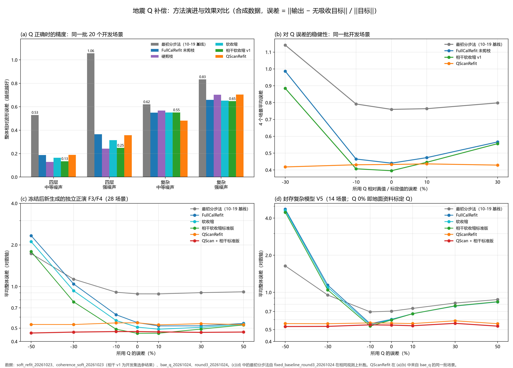

# 研究进度总结（2026-10-19 → 2026-10-24）

只读汇总已归档的 CSV/JSON 与 RESULTS 报告，未重跑任何实验。对比图由 [make_summary_figure.py](make_summary_figure.py) 从 git HEAD 中的指标表直接生成。

## 一、做了什么

课题：地震衰减（Q）补偿，即把被吸收衰减的道集恢复成无吸收的弹性响应。评分统一用整体相对波形误差 ‖输出 − 目标‖/‖目标‖，越低越好。

| 阶段 | 日期 | 内容 | 结果 |
|---|---|---|---|
| 起点 | 10-19 | 交接包 `attenuation_research_handoff`：Frozen **分步法**（最初方法）为默认 | 基线 |
| 联合反演 | 10-21–22 | p1_fixed / p1_guarded、joint_refactor、universal_method、adaptive_joint_cv | 得到 **FullCalRefit**（完整校准＋反射系数估计＋振幅重拟合）与剪枝版；其余候选未过门槛 |
| 复杂模型 | 10-23 | complex_fieldlike、changed_models、denoise_and_field、field_pilot、q_error_stability | 复杂地层选未剪枝 FullCalRefit；实测 Q 门槛未过 |
| 收缩 | 10-23 | soft_refit：组系数软收缩 | 保住弱反射，折中于未剪枝与硬剪枝之间 |
| 相干收缩 | 10-23/24 | coherence_soft v1：按邻道相干度调收缩强度 | **5/5 预登记门槛通过**（30 个新场景），比软收缩误差低 8.2% |
| v2 | 10-24 | coherence_soft v2 标准版 / 稳健版 | 比 v1 再低 2.1%，未达 3% 门槛；v1 仍为推荐 |
| 文献实验 | 10-24 | bae_q：BAE-Q、QScan、SBL-TVD、Wang 反 Q 滤波、独立 Kennett 细层正演 | **QScanRefit 在验证集和独立集都通过全部门槛**；BAE-Q、SBL-TVD 淘汰 |
| 实测 | 10-24 | U1320A VSP + 两条过井测线 | VSP 的 Q 不可识别，两条线结论相反，**无结论** |
| 第三轮 | 10-24 | 子波相位诊断、QScan + 相干收缩组合、门限 QScan、新确认集 F3/F4 | 子波相位只贡献约 2%；组合方法在新数据上误差最低 |
| 机制 | 10-24 | qscan_bias_variance、qscan_criterion | QScan 确定性地选 c≈1.28（少补偿约 22%），原因在“全道集共同因子”的模型假设；换准则无改进 |

## 二、效果最好的方法

**按误差数值：QScan + 相干软收缩标准版**（先用 QScan 扫描全道集共同的 Q 校正因子，再做相干软收缩）。它在冻结后新生成的独立数据上误差最低，图 (c)(d) 中的红线。

| 数据 | 指标 | FullCalRefit | 相干标准版 | QScanRefit | **QScan + 标准版** |
|---|---|---:|---:|---:|---:|
| F3/F4 独立正演，28 场景 | 平均误差 | 0.875 | 0.713 | 0.536 | **0.468** |
| | 最坏单场景 | 2.935 | 2.329 | 0.837 | **0.678** |
| | Q 正确时 | 0.548 | **0.458** | 0.546 | 0.472 |
| V5 封存复杂模型，14 场景 | 平均误差 | 1.331 | 1.276 | 0.564 | **0.540** |
| | Q=标定值时 | 0.605 | 0.597 | 0.563 | **0.543** |

注意：

- 这个组合**没有作为预登记门槛对象**，属于“仅报告”的结果，不算正式通过验收。
- 在 Q 本身正确时，它比单用相干标准版差约 3%（0.472 对 0.458）。原因是 QScan 有约 1.28 倍的系统性少补偿偏差。
- 通过了正式门槛的是两个组成部分：**相干软收缩 v1**（Q 可信时）和 **QScanRefit**（Q 可能有误时）。

**使用建议（沿用 round3 报告）：**

- Q 来自测井或 VSP 等可信参考时，用相干软收缩。
- Q 只来自地面资料标定、可能有误时，用 QScan + 相干标准版。

## 三、和最初方法相比好在哪

对比分两部分：
- **新数据，图 (c)(d)**：最初分步法已在 F3/F4、V5 上按相同观测补跑，见 [fixed_baseline_round3_20261024](../fixed_baseline_round3_20261024/RESULTS_ZH.md)。
- **开发场景，图 (a)(b)**：20 个场景（四层、复杂 × 中等、强噪声 × Q −30…+30%）。

### 冻结后的新数据（F3/F4 28 场景、V5 14 场景）

| 数据 | 方法 | 平均误差 | Q 正确时 | 最坏 | 优于最初方法 |
|---|---|---:|---:|---:|---:|
| F3/F4 | 最初分步法 | 1.051 | 0.884 | 1.730 | — |
| | FullCalRefit | 0.875 | 0.548 | 2.331 | 22/28 |
| | **QScan + 相干标准版** | **0.468** | 0.472 | **0.479** | **28/28** |
| V5 | 最初分步法 | 0.918 | 0.704 | 1.640 | — |
| | FullCalRefit | 1.331 | 0.605 | 4.727 | 10/14 |
| | **QScan + 相干标准版** | **0.540** | **0.543** | **0.564** | **14/14** |

- **相对最初方法：**
  - F3/F4：平均误差降 55%，Q 正确时降 47%，最坏情况降 72%；
  - V5：平均误差降 41%，Q 为标定值时降 23%；
  - 42 个场景全部更好。
- **不加 QScan 时的反例**：Q 低估 30–50% 时，FullCalRefit 和相干标准版会失控。V5 上它们的平均误差反而高于最初方法。可见稳定的收益需要 QScan 这一步。

### 开发场景（20 场景）

| 方法 | 20 场景平均误差 | 相对最初方法 | 优于最初方法 | 最坏单场景 |
|---|---:|---:|---:|---:|
| 最初分步法 | 0.851 | — | — | 1.525 |
| FullCalRefit | 0.586 | −31% | 19/20 | 1.146 |
| 相干软收缩 v1 | 0.538 | −37% | 19/20 | 1.010 |
| **QScanRefit** | **0.429** | **−50%** | **20/20** | **0.721** |

1. **Q 正确时精度大幅提高**，提升主要在四层模型上：
   - 强噪声：1.056 → 0.249（相干 v1），降 76%；
   - 中等噪声：0.529 → 0.135，降 74%。
   - 这来自反射系数估计＋振幅重拟合取代了分步滤波，相干收缩又压掉了孤立噪声。
2. **复杂模型提升较小**：Q 正确时 0.62 → 0.55（中等噪声）、0.83 → 0.65（强噪声）。阶段 B 和第三轮诊断显示，剩余误差主要来自 60 层薄层调谐、四层 Q 标定代替横向变化的 Q、子波横向变化。收缩规则修不了这部分。
3. **对 Q 误差不再失控**：最初方法在 Q 低估 30% 时平均误差 1.14。QScanRefit 在 −30% 到 +30% 之间基本平坦（0.42–0.43）。在独立数据 Q −50% 时，FullCalRefit 为 2.3，QScan + 标准版仍只有 0.46。
4. **一处反例**：复杂模型、中等噪声、Q −30% 时，最初分步法（0.829）优于 FullCalRefit 和相干 v1（0.925–0.985）。只有加了 QScan 后（0.475）才反超。这与新数据上的反例一致。

## 四、没有成功或尚未解决的

- **淘汰的方向**：
  - BAE-Q：Q 正确时误差翻倍；
  - SBL-TVD：对 Q 误差更敏感；
  - Wang 反 Q 滤波：Q 正确时精度差；
  - 子波相位估计：只贡献约 2%；
  - 门限 QScan：门限过保守；
  - QScan 准则替换（残差、BIC、AIC）：没有改进。
- **QScan 的偏差**：在细层独立正演上它系统性地选 1.28 倍因子。高信噪比（20/26 dB）时这个偏差让误差变大 50–150%。在 Q 随深度变化的 F4 上，因子平均偏离理想值约 1.7 倍。下一步方向是按深度分段校正 Q。
- **实测**：U1320A 资料的 VSP 太浅，Q 不可识别，两条测线的井震标定结论相反。至今**没有任何实测证据**说明哪个方法更好。
- **数据的独立性**：全部定量结论来自合成数据（准一维卷积或一维 Kennett 正演），场景之间共享模型，不报告显著性。

## 五、相关图件

- 汇总图：[figures/method_comparison.png](figures/method_comparison.png)（另有 PDF）。
- 道集对比：
  - `round3_20261024/figures/F4_Q-30_Strong.png`：FullCalRefit、标准版、QScanRefit、门限组合的道集与残差；
  - `coherence_soft_v2_20261024/figures/`：V4、V5 道集；
  - `soft_refit_20261023/figures/`：未剪枝、硬剪枝、软收缩的高分辨率道集。
