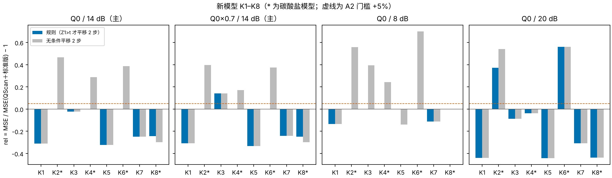

# “有把握才修正”的 QScan 规则：新模型上未通过确认（A1 通过，A2 未通过）

**结论：按冻结方案，规则不确认。** 在 8 个新模型 K1–K8 的 16 个主场景上，平均误差比 QScan＋标准版低 13.4%，A1（≤ −5%）通过。但有一个场景变差 14.1%（K3，Q0×0.7），A2（≤ +5%）未通过。按结论规则，“用单个道集的特征修正 QScan”这一方向结束。

- **大部分时候规则是对的**：
  - 16 个主场景中 9 个改善（−2% 到 −33%）；
  - 6 个场景 Z1 低于阈值，规则不修正，误差与 QScan 相同；
  - 只有 1 个场景变差。
  - 对照：无条件平移 2 步，平均只改善 1%，最坏 +47%。所以“有把握才修正”确实避开了大部分危险。
- **失败的场景**：K3 在 Q0 下 QScan 只偏高约 1 步。从 Q0×0.7 出发时，QScan 又落低了一个网格点（有效 Q 比 1.11，而从 Q0 出发时为 1.15）。再平移 2 步就过补偿了（+14%）。Z1 只能看出“属于偏移大的那一类”，看不出偏移具体是几步。
- **20 dB 下规则不安全**：SNR 越高，Z1 越大。碳酸盐模型 K2、K6 的 Z1 越过阈值（72–86），被误修正，误差上升 37% 与 56%。这正是方案中预先列为压力检验的风险。
- **8 dB 下规则安全**：Z1 普遍降到阈值以下，大多不修正，最坏为 0，平均 −3%。
- **Z1 分团与碳酸盐层基本对应**：主场景中 Z1 > t 的 10 个场景，是全部 8 个无碳酸盐场景，加上碳酸盐模型 K8 的 2 个场景（Z1 73.6，刚过阈值；它的偏移本来就是正的，修正后改善 24–25%）。Z1 ≤ t 的 6 个场景都是碳酸盐模型 K2、K4、K6，对它们无条件平移会变差 17–47%。
- **Q 正确时仍不如名义 Q 的标准版**：在 Q0/14 dB 下，规则比标准版（B）平均差 6.4%。这与现行建议一致：Q 可信时不叠加 QScan。规则只在 Q 有误、不得不用 QScan 时才有意义。

## Material Passport

- 类型：预先登记的确认，新生成的未见模型 K1–K8。GNU Octave 8.4 + `octave_compat_v2_20261025` 实际运行。
- 时间（2026-10-25 本地时间）：
  - 16:27 冻结方案并推送（提交 68da007）；
  - 16:28 生成 K1–K8；
  - 16:30–17:03 计算决定与输出（4 个进程）；
  - 17:03 封存（`decisions/SEALED_SHA256.json`，244 个文件），随后评分。
- 冻结后没有改动规则、阈值、场景或判定代码。评分前 `analyze.py` 逐个核对了封存文件的哈希。冻结后新增的文件只有描述图脚本 `scripts/make_figure.py` 和本文档。
- 生成器检验：在 Octave 上重新生成 G1–G8，与存档的 MATLAB 模型一致（`analysis/generator_check.json`），所以 K1–K8 可在 MATLAB 上用同样的种子复现。
- 规模：8 个模型 × 4 个场景 × 6 个实现，共 192 个道集。每个道集计算 3 个相干标准版输出。
- 没有使用 U1–U4，也没有读写 `fd2d_20261025`。
- 局限：只用了一种正演（一维细层 Kennett）；R = 6；规则只来自 10 个开发模型的事后分组。

## 主要数值

rel = MSE(规则) / MSE(QScan＋标准版) − 1，每个模型×场景取 6 个实现的平均；“修正数”为 6 个实现中被平移的个数。

| 模型 | 碳酸盐 | Q0/14 dB rel | 修正数 | Q0×0.7/14 dB rel | 修正数 | 8 dB rel | 20 dB rel |
|---|:---:|---:|---:|---:|---:|---:|---:|
| K1 | | −0.311 | 6 | −0.308 | 6 | −0.134 | −0.440 |
| K2 | ✓ | 0 | 0 | 0 | 0 | 0 | **+0.372** |
| K3 | | −0.023 | 6 | **+0.141** | 6 | 0 | −0.087 |
| K4 | ✓ | 0 | 0 | 0 | 0 | 0 | −0.037 |
| K5 | | −0.323 | 6 | −0.333 | 6 | 0 | −0.441 |
| K6 | ✓ | 0 | 0 | 0 | 0 | 0 | **+0.561** |
| K7 | | −0.247 | 6 | −0.241 | 6 | −0.111 | −0.308 |
| K8 | ✓ | −0.244 | 5 | −0.249 | 5 | 0 | −0.437 |

| 判定 | 结果 |
|---|---|
| A1：主场景平均 rel ≤ −0.05 | −0.134，通过 |
| A2：主场景最坏 rel ≤ +0.05 | +0.141（K3，Q0×0.7），**未通过** |
| 对照：无条件平移 2 步 | 平均 −0.010，最坏 +0.467 |

数据：[scene_scores.csv](analysis/scene_scores.csv)、[gather_scores.csv](analysis/gather_scores.csv)、[decisions.json](analysis/decisions.json)、`decisions/K*.csv`（封存的逐道集决定）。

## 对方向的含义

1. 单个道集的特征能判断偏移属于“大”还是“小”的一类，但判断不出具体几步，而且这个判断依赖 SNR。在过补偿代价很陡的情况下，这不足以构成安全的修正。
2. 实用推荐不变：
   - Q 可信时用相干标准版；
   - Q 只来自粗略标定时用 QScan＋标准版。
3. 进一步缩小差距需要独立的 Q 信息（VSP、测井、井震标定），这与之前几轮的结论一致。
