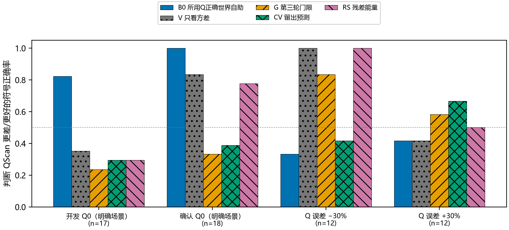
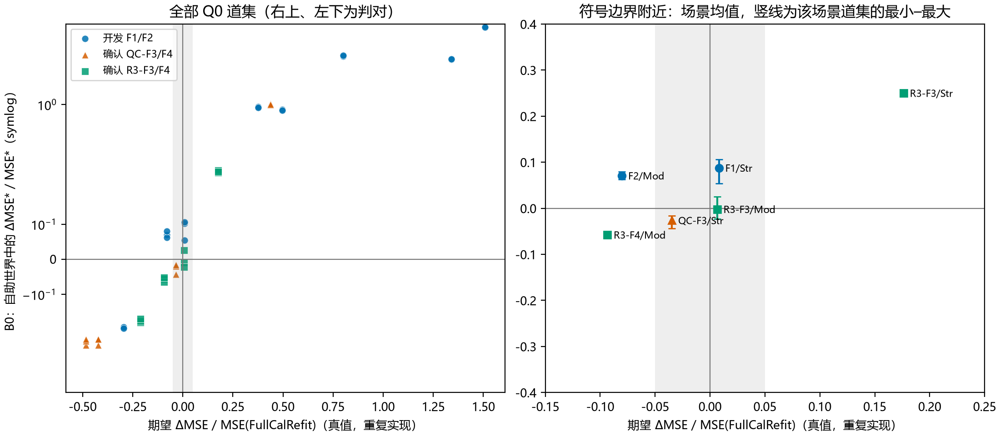
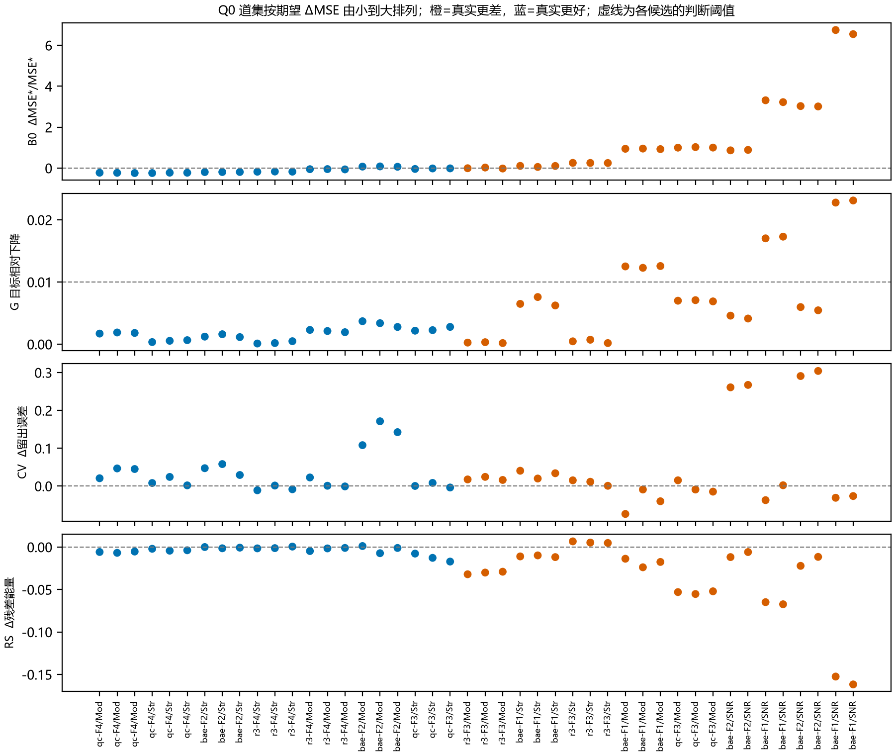
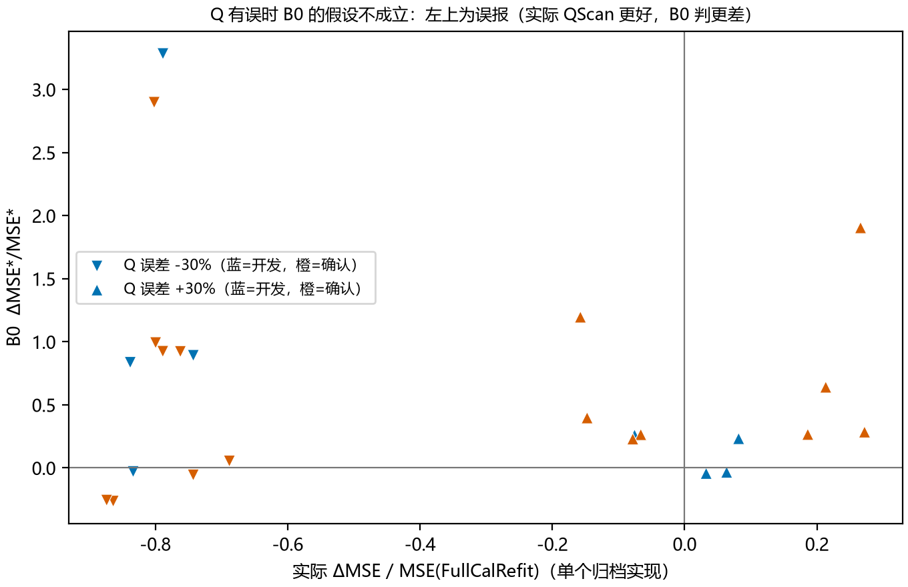

# 无真值偏差诊断：B0 能提前识别多数退化，但没有通过预先登记的 F2/Moderate 门槛

**结论：只用观测和公开配置，“所用 Q 正确世界”的参数自助（B0）能提前识别 QScan 的大多数退化；但它在 F2/Moderate 上判错方向，按冻结规则不晋级。**

- **E1 不通过**：B0 正确地把 F1/Moderate 的 3 个道集判为“更差”（+0.93 至 +0.95），却把 F2/Moderate 的 3 个道集也判为“更差”（+0.06 至 +0.08），而真值是改善 8.0%。
- **E2 通过**：在从未用于开发的两套新地质（QC-F3/F4、R3-F3/F4）上，明确场景的 18 个道集 B0 全部判对。对照：只看方差 0.83，残差能量 0.78，留出预测 0.39，第三轮门限 0.33。
- **13 个明确的 Q0 场景中，B0 判对 12 个**；场景均值与期望 ΔMSE 的 Spearman 相关为 0.98。唯一的错误是边界附近的 F2/Moderate。
- **只看数据拟合的指标在 Q 正确时比随机还差**：门限、留出预测都在 QScan 有害时偏向 QScan，在 QScan 有益时反对它。这与上一轮“拟合项本身偏好 c≈1.28”一致。
- **Q 有误时 B0 的前提不成立**：Q 误差 −30% 时 QScan 实际改善 69–87%，B0 有 8/12 次误报；第三轮门限在这里判对 10/12。两者互补。
- **事后分析**：换成真实噪声水平后，F2/Moderate 仍未翻正（−0.003、+0.037、+0.016），所以错误不来自噪声估计。可能的原因是 F2 的 FullCalRefit 输出能量比目标多 9–38%，B0 把其中的噪声能量当作信号。这是待验证的假设。

## Material Passport

- 类型：已有合成模型上的无真值诊断评估。MATLAB R2024b 与 Python 实际运行。
- 模式：run；项目根目录 `D:\ChatGPT\研究`；日期 2026-10-24。
- 方案：[PLAN_ZH.md](PLAN_ZH.md) 在诊断任何清单道集之前冻结，哈希见 `logs/PRE_RUN_HASHES.json`。
- 封存：68 个道集的预测在读取任何真值前封存于 `predictions/SEALED_SHA256.json`（102 个文件）。
- 封存后的改动：只改评分侧脚本，见 [POST_SEAL_CHANGES.md](logs/POST_SEAL_CHANGES.md)；分析脚本逐一核对其余封存文件的哈希。
- 状态：E1 未通过，E2 通过，结论按冻结规则为“不晋级”。F1/F2 是开发数据；确认数据由另一会话生成，我此前看过 QC-F3/F4 在 Q0 的汇总比值，没有看过 R3 的逐场景结果。

## 设计

| 候选 | 只用观测算出的量 | 判“QScan 更差”的条件 |
|---|---|---|
| **B0** | 以 FullCalRefit 输出为真值、用所用 Q 正演，再加估计的 AR(1) 噪声，模拟 6 次；比较 c=1 与 c=ĉ 的 MSE* | ΔMSE*>0 |
| V | 同一自助世界中的方差变化 | Δ方差*>0 |
| G | 第三轮门限：[J(1.031)−J(ĉ)]/J(1.031) | ≤0.01 |
| CV | 每五个 20 ms 块留出一个，在其余样本上拟合后预测留出数据 | Δ留出误差>0 |
| RS | 残差能量高于噪声底的部分 | Δ>0 |

- **噪声模型**：开发时发现原 0.02–0.25 s 噪声窗末端混入第一反射，AR 系数被估成 0.48–0.77（真值 0.45）。冻结前改为在第一个公开界面时间前 1.5 个主周期截止，估计值变为 0.39–0.45。
- **规模**：机器同时被另一会话的 7 个 MATLAB 作业占用，冻结前把规模缩为 K=6、单折留出、68 个道集。单线程比四线程快约三倍。
- **真值标签**：Q0 道集用该场景的期望 ΔMSE。开发场景来自上一轮 100/40 个实现；确认场景来自封存后新算的 12 个实现。|期望 ΔMSE| / MSE ≥ 5% 的场景记为明确场景。Q 误差道集用单个归档实现的实际 ΔMSE。

## 1. 预先判定

| 判定 | 结果 | 依据 |
|---|---|---|
| E1：开发 F1/Moderate 三个都判“更差”、F2/Moderate 三个都判“更好” | **不通过** | F1/M：+0.925、+0.951、+0.941；F2/M：+0.070、+0.062、+0.080 |
| E2：确认明确场景的 B0 正确率 ≥0.75，且高于 G 与 V | **通过** | B0 1.00（18/18），V 0.83，G 0.33 |

结论规则写明“E1 不通过：放弃 B0”，所以本轮不把 B0 作为可用诊断。下面的结果只作描述。

## 2. 各候选的符号正确率

| 子集 | 道集 | 真值“更差” | B0 | V | G | CV | RS |
|---|---:|---:|---:|---:|---:|---:|---:|
| 开发 Q0（明确） | 17 | 11 | **0.82** | 0.35 | 0.24 | 0.29 | 0.29 |
| 确认 Q0（明确） | 18 | 6 | **1.00** | 0.83 | 0.33 | 0.39 | 0.78 |
| Q 误差 −30% | 12 | 0 | 0.33 | 1.00 | 0.83 | 0.42 | 1.00 |
| Q 误差 +30% | 12 | 7 | 0.42 | 0.42 | 0.58 | 0.67 | 0.50 |

- V 和 RS 在确认集上看起来不错，是因为那里多数场景是“QScan 更好”，而它们几乎总判“更好”；在以“更差”为主的开发集上，它们只有 0.29–0.35。
- 数据：[accuracy_summary.csv](analysis/accuracy_summary.csv)、[scored_gathers.csv](analysis/scored_gathers.csv)。

## 3. 逐场景（Q0）

| 场景 | 期望 ΔMSE / MSE | 明确 | B0 均值（最小–最大） | QScan 主要选择 | B0 判断 |
|---|---:|---|---|---:|---|
| QC-F4/Moderate | −48.5% | 是 | −0.235（−0.244…−0.229） | 1.280 | 对 |
| QC-F4/Strong | −42.3% | 是 | −0.233（−0.245…−0.227） | 1.149 | 对 |
| F2/Strong | −29.5% | 是 | −0.195（−0.197…−0.193） | 1.149 | 对 |
| R3-F4/Strong | −21.2% | 是 | −0.176（−0.180…−0.170） | 1.149 | 对 |
| R3-F4/Moderate | −9.3% | 是 | −0.058（−0.065…−0.051） | 1.149 | 对 |
| **F2/Moderate** | **−8.0%** | 是 | **+0.071（+0.062…+0.080）** | 1.280 | **错** |
| QC-F3/Strong | −3.5% | 否 | −0.026 | 1.149 | （对） |
| R3-F3/Moderate | +0.6% | 否 | −0.002（−0.023…+0.026） | 1.149 | （不定） |
| F1/Strong | +0.8% | 否 | +0.088 | 1.280 | （对） |
| R3-F3/Strong | +17.6% | 是 | +0.250 | 0.925 | 对 |
| F1/Moderate | +37.6% | 是 | +0.939 | 1.280 | 对 |
| QC-F3/Moderate | +43.8% | 是 | +1.007 | 1.280 | 对 |
| F2/SNR20、F1/SNR20、F2/SNR26、F1/SNR26 | +49.5% 至 +150.8% | 是 | +0.88 至 +6.64 | 1.280 | 对 |

- R3-F3/Strong 是新的退化类型：QScan 选了 c=0.925，即补偿过度。B0 同样识别出来（方差增加、偏差增加）。
- B0 的数值比真实相对变化大，因为自助世界没有正演失配，基线 MSE* 偏小；判断只用符号。场景均值与期望的 Spearman 相关：开发 0.95，确认 1.00，合计 0.98。

## 4. 数据拟合类指标为什么失败

- **G**：门限只在 F1/Moderate（1.25%）和 F1 高信噪比（1.7–2.3%）超过 1%，恰好都是 QScan 有害的场景；QScan 有益的场景增益都低于 0.4%。
- **CV**：F1/Moderate 上 QScan 预测留出数据更好（−0.9% 至 −7.4%），F2/Moderate 上更差（+11% 至 +17%）。两个方向都与真值相反。
- **RS**：QScan 的残差几乎总是更小，所以它几乎总判“QScan 更好”。
- 上一轮已经发现，细层数据上拟合项本身就在 c≈1.28 处最小。所以“对数据拟合得更好”不代表“对目标更准”；凡是只衡量数据拟合的量，都无法看出这种偏差。

## 5. Q 有误时

- Q 误差 −30% 时，QScan 在全部 12 个归档实现上大幅改善（−69% 至 −87%）。
- B0 假设所用 Q 正确，在其中 8 个上误报“更差”，与登记时的预期一致。
- G 在这里判对 10/12：真实 Q 误差通常带来较大的拟合增益（12 个中 10 个超过 1%，最高 10%）。
- Q 误差 +30% 时，QScan 选 0.75–1.03，结果有好有坏，所有候选都接近随机。

## 6. 事后分析：B0 为什么判错 F2/Moderate

以下在 E1 失败后进行，不参与判定。

| 开发场景 | σ̂ / 真 σ | φ̂（真值） | 输出能量 / 目标能量 | B0 | 用真实噪声水平重算的 B0 |
|---|---|---|---|---|---|
| F1/Moderate | 0.97–0.98 | 0.40–0.42（0.44–0.45） | 0.90–0.91 | +0.93…+0.95 | +0.85…+0.89 |
| F1/Strong | 0.94–1.01 | 0.40–0.42（0.44–0.45） | 0.96–0.97 | +0.05…+0.11 | +0.045…+0.069 |
| **F2/Moderate** | 0.94–0.97 | 0.39–0.42（0.45） | **1.09–1.10** | +0.06…+0.08 | **−0.003…+0.037** |
| F2/Strong | 0.97–0.99 | 0.40–0.42（0.45） | **1.38–1.39** | −0.20…−0.19 | −0.22…−0.20 |

- **噪声模型基本准确**：σ̂ 与真值相差 −6% 至 +1%，AR 系数偏低约 0.04。换成真实噪声水平后，F2/Moderate 的 B0 降到 0 附近，3 个中仍有 2 个为正。所以噪声估计只是次要原因。
- **候选机制（未检验）**：F2 的 FullCalRefit 输出能量比目标多 9–38%，多出的部分是噪声产生的伪事件。B0 把这个输出当作自助世界的真值，于是 QScan 少补偿时压掉这些伪事件，被算成“偏差增加”；实际上这是在减少误差。这会让 B0 在输出被噪声抬高时偏向“QScan 更差”。F2/Strong 的方差收益足够大，符号仍对；F2/Moderate 的真实余量只有 8%，于是翻号。

## 7. 回答与下一步

**能否在无真值时提前发现 F1/Moderate 这类退化？**

- 部分可以。所用 Q 可信时，B0 识别出了全部明确的退化（F1/Moderate、QC-F3/Moderate、R3-F3/Strong、高信噪比各例），在新地质上没有误报。
- 它对“QScan 只是略好”的场景偏悲观，F2/Moderate 判错了方向，所以按冻结规则不晋级。
- 只看数据拟合的量（门限、留出预测、残差能量）不能用于这个目的。

**下一步（仅建议）：**

1. 修正 B0 的“世界真值”：用压掉噪声伪事件的参考，例如自助均值或相干收缩后的输出，代替原始 FullCalRefit 输出。先在 F2/Moderate 上检验，再在新生成、从未用过的模型上确认。F3/F4 两套数据已用作本轮确认，不能再当未见数据。
2. 与 Q 可靠性的证据组合：B0 回答“Q 可信时 QScan 值不值得”，G 类证据回答“Q 是否明显有误”。组合规则需要对信噪比归一化后再登记，因为同一门限在不同信噪比下含义不同。
3. 另一会话正在开发按深度分段的 Q 校正（`qscan_layered_20261024`），B0 可以作为它的安全检查一起评估。

## 范围与限制

- 一维法向入射细层正演；噪声为原生成器（AR(1)、固定能量）；6 种地质（F1–F4 两套）× 两档噪声。
- K=6 的自助、单折留出，是机器满载下的折中。B0 在同一场景的道集之间很稳定：Q0 场景极差 ≤0.05，高信噪比场景数值大，极差 ≤0.2、相对差 ≤3%。F2/Moderate 三个道集为 +0.062…+0.080，错误不是抽样噪声。
- 确认场景的期望来自 12 个实现，明确场景的标准误都远小于效应。
- Q 误差道集只有单个实现。
- B1（QScan 的 Q 正确的镜像世界）因计算量在冻结前去掉，两世界分类没有实现。

## 复现与交付

- 方案：[PLAN_ZH.md](PLAN_ZH.md)；清单：[manifest.csv](predictions/manifest.csv)；封存：[SEALED_SHA256.json](predictions/SEALED_SHA256.json)。
- 代码：[scripts/](scripts/)，用法见 [README.md](README.md)。
- 结果表：[decisions.json](analysis/decisions.json)、[accuracy_summary.csv](analysis/accuracy_summary.csv)、[q0_conditions.csv](analysis/q0_conditions.csv)、[scored_gathers.csv](analysis/scored_gathers.csv)、[expected_truth.csv](analysis/expected_truth.csv)、`truth_replicates_*.csv`、[posthoc_b0_noise.csv](analysis/posthoc_b0_noise.csv)。
- 开发记录：[probe_feasibility.csv](analysis/probe_feasibility.csv)（旧噪声窗）、[input_checks.csv](analysis/input_checks.csv)、`logs/timing_test*`、`logs/smoke_test*`。
- 每个道集的两个输出与输入快照留在本地 `cache/`（不上传，可由脚本重建；哈希已记录在封存收据中）。
- 运行时间：68 个道集用 4 个单线程进程约 38 分钟；8 个确认场景的真值重复实现，每个场景 6.5–11 分钟，4 个进程并行；事后噪声检查约 11 分钟。机器同时被其他会话占用，单个道集用时约 1.5–4 分钟。
