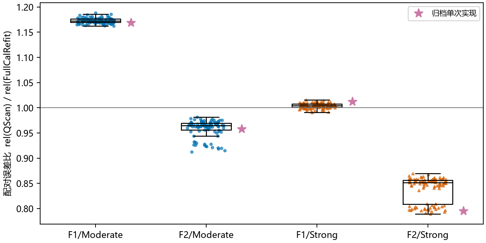
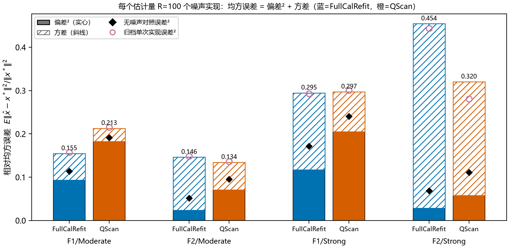
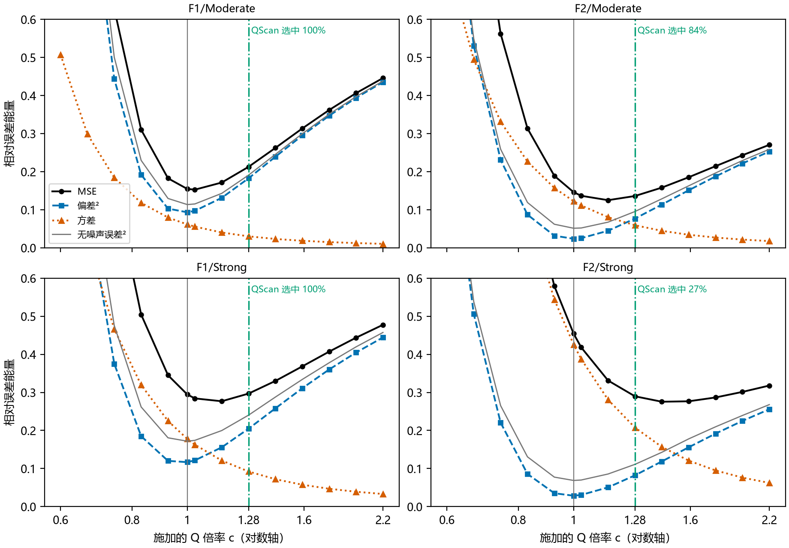
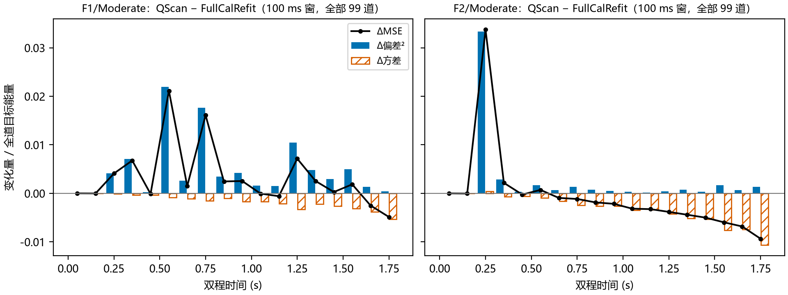
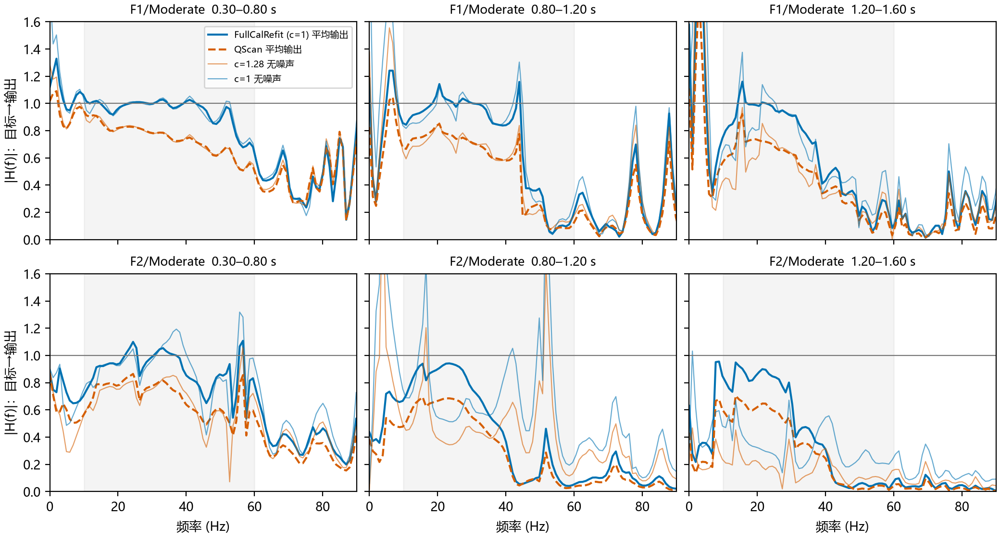
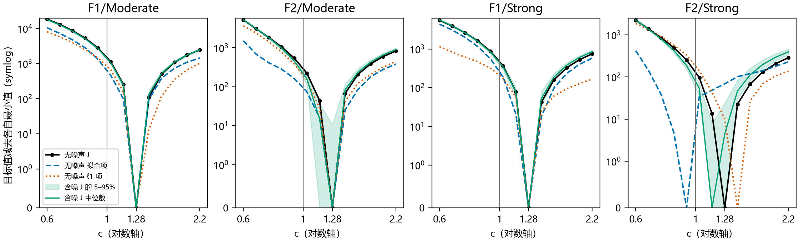
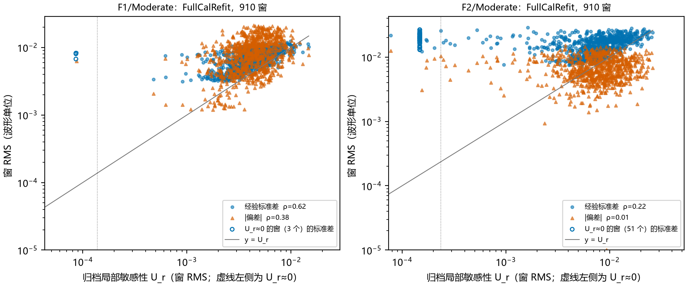
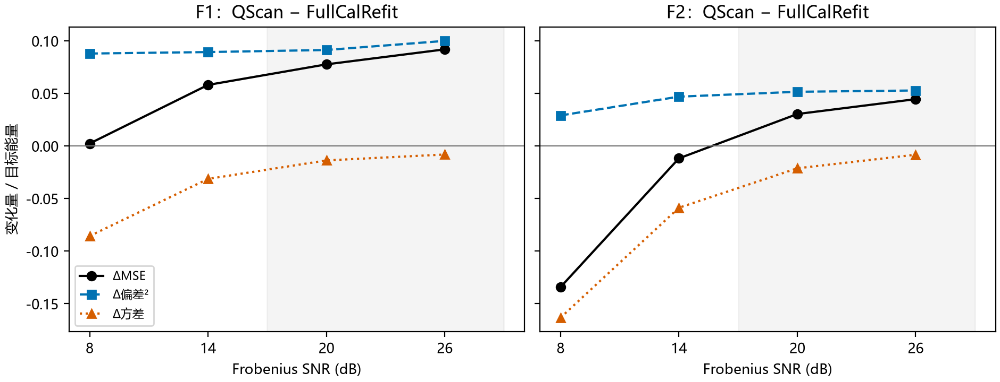

# QScan 误差为什么变大：重复噪声的偏差—方差分解

**结论：同一次少补偿，在两个模型里得到相反的结局。**

- QScan 在 F1/F2 上**确定性地**选 c≈1.28：无噪声数据也选这个值，而目标误差最小的 c 是 1.0。
- 这次少补偿在两个模型里都让偏差变大、方差变小。
- F1/Moderate 偏差增加占优：偏差² +0.089，方差 −0.031，MSE +37.6%，100/100 个实现都变差。
- F2/Moderate 方差下降占优：偏差² +0.047，方差 −0.059，MSE −8.0%，0/100 个实现变差。
- 两个模型偏差最小都在 c=1.0。相反效果来自 FullCalRefit 自身方差的大小：F2 的目标能量集中在早期碳酸盐强反射，晚时段的输出主要是被放大的噪声。
- 把 SNR 提高到 20/26 dB 后，F2 也 40/40 退化。预先登记的 P-A 成立。
- 局部敏感性指标**准确预测了方差的下降**（F2/Moderate：预测 log 比 −0.327，经验 log 标准差比 −0.327），但其中没有中心解偏差的项，所以把 F1/Moderate 评为风险下降。

## Material Passport

- 类型：已见合成模型上的重复噪声机制诊断。MATLAB R2024b 与 Python 实际运行。
- 模式：run；项目根目录 `D:\ChatGPT\研究`；日期 2026-10-24。
- 数据：`bae_q_20261024` 的 F1、F2 细层模型（独立 Kennett 正演），Moderate（14 dB）和 Strong（8 dB）各 100 个新噪声实现；补充登记 A 的 20/26 dB 探针各 40 个实现。
- 状态：冻结方案 [PLAN_ZH.md](PLAN_ZH.md)（含补充登记 A）。阶段 0 复现通过。D1–D5 与 P-A 按登记原文判定，结果写在 [decisions.json](analysis/decisions.json)。F1/F2 历史结果已知，本轮不是盲测。冻结后改动见 [POST_FREEZE_CHANGES.md](logs/POST_FREEZE_CHANGES.md)。

## 设计

| 符号 | 含义 |
|---|---|
| x⋆ | 目标：同一细层模型的无吸收弹性响应 |
| x̂ₖ | 第 k 个噪声实现上的输出，k=1…R |
| x̄ | R 个输出的平均，近似 E x̂ |
| ‖·‖ | 全部 99 道、全时段的 Frobenius 范数，与旧评分同口径 |

均方误差的精确分解：

E‖x̂−x⋆‖² = ‖E x̂−x⋆‖² + tr Cov(x̂) = 偏差² + 方差

有限 R 的处理：方差取逐样本无偏估计之和 V，偏差² 取 ‖x̄−x⋆‖² − V/R，两者相加严格等于 R 个实现的平均平方误差（逐场景核对，相对差 <1e-9）。表中数值都除以 ‖x⋆‖²。

- **噪声**：原生成器逐句复用（时间 AR(1) 系数 0.45，10% 道间共模，固定 Frobenius SNR），种子与归档种子不重叠。每个实现按原窗口 MAD 重新估计 σ。
- **配对设计**：同一个观测上同时运行 QScan、FullCalRefit（c=1）和 13 个固定因子的 FullCalRefit。
- **无噪声对照**：纯净 D0 加归档 σ，λ 不变。

## 1. 复现核验

| 场景 | 原种子噪声 | σ | FullCalRefit 与归档 | QScan 与归档 | 拆分 QScan 与原函数 | 旧评分 |
|---|---:|---:|---:|---:|---:|---:|
| F1/Moderate | 0 | 0 | 2.53e-08 | 2.62e-08 | 0 | 8.9e-11 |
| F1/Strong | 0 | 0 | 2.53e-08 | 2.60e-08 | 0 | 2.4e-10 |
| F2/Moderate | 0 | 0 | 2.52e-08 | 2.40e-08 | 0 | 2.2e-10 |
| F2/Strong | 0 | 0 | 2.49e-08 | 2.45e-08 | 0 | 1.4e-10 |

噪声和 σ 为最大相对差，逐位一致。输出为相对 Frobenius 差，归档按 single 保存，所以约 2.5e-8。拆分 QScan 指“选择＋所选因子重拟合”，为最大绝对差，逐位一致。主实验 5,600 次 FullCalRefit 求解（4 场景 × 100 实现 × 14 个因子）和无噪声对照的优化标志均为 0，正规方程残差 ≤1.6e-14。数据：[reproduction_check.csv](analysis/reproduction_check.csv)。

## 2. 归档的单次结果有代表性（D1）

| 场景 | FullCalRefit 平均误差 | QScan 平均误差 | 配对比值中位数（5–95%） | QScan 更差 | 归档单次比值 | QScan 选择 |
|---|---:|---:|---|---:|---:|---|
| F1/Moderate | 0.393 | 0.461 | 1.173（1.165–1.182） | 100/100 | 1.169 | 1.280：100 次 |
| F2/Moderate | 0.382 | 0.367 | 0.964（0.921–0.976） | 0/100 | 0.958 | 1.280：84；1.149：16 |
| F1/Strong | 0.543 | 0.545 | 1.004（0.995–1.012） | 79/100 | 1.013 | 1.280：100 次 |
| F2/Strong | 0.674 | 0.566 | 0.851（0.796–0.862） | 0/100 | 0.796 | 1.280：27；1.149：73 |

- **D1**：F1/Moderate、F2/Moderate、F2/Strong 判为系统性（同号 ≥90%）。F1/Strong 只有 79% 同号，判为噪声主导，它的 ΔMSE 只有 +0.8%。
- 归档的 +16.91% 与 −4.18% 都落在新实现的分布内，不是噪声运气。
- F2 的比值呈两簇，对应 QScan 选 1.149 或 1.280。F2/Moderate 中选 1.149 的 16 个实现平均比值 0.924，选 1.280 的为 0.966。

## 3. 偏差—方差分解（D2、D3）

| 场景 | FullCalRefit：MSE = 偏差² + 方差 | QScan：MSE = 偏差² + 方差 | Δ偏差² | Δ方差 | ΔMSE / 基线 | 偏差占比 |
|---|---|---|---:|---:|---:|---|
| F1/Moderate | 0.1546 = 0.0933 + 0.0613 | 0.2128 = 0.1827 + 0.0301 | **+0.0894** | −0.0313 | **+37.6%** | 60% → 86% |
| F2/Moderate | 0.1461 = 0.0237 + 0.1224 | 0.1344 = 0.0707 + 0.0637 | +0.0470 | **−0.0587** | **−8.0%** | 16% → 53% |
| F1/Strong | 0.2946 = 0.1168 + 0.1778 | 0.2969 = 0.2048 + 0.0922 | +0.0880 | −0.0856 | +0.8% | 40% → 69% |
| F2/Strong | 0.4542 = 0.0286 + 0.4256 | 0.3201 = 0.0577 + 0.2623 | +0.0291 | −0.1633 | −29.5% | 6% → 18% |

- **D2 成立**：F1/Moderate 方差下降 0.031，偏差增加 0.089，增加更多。
- **D3 不成立**：F2/Moderate 的改善**不是**偏差减小。偏差反而增加 0.047，只是方差下降了 0.059。
- 在四个场景里，QScan 的方向都是“偏差增，方差减”，差别只在两项谁大。

**无噪声解不等于平均解。** 黑色菱形（D0、λ 不变）的误差²都大于重复噪声平均输出的偏差²。例如 F2/Moderate 中 FullCalRefit 为 0.051 对 0.024，F1/Moderate 为 0.114 对 0.093。

稀疏支持选择是非线性的：噪声有时把弱的真实事件推过阈值，平均下来反而更接近目标。因此，不能把无噪声解或某一次实现的中心解当作偏差的代表。

## 4. 两个模型需要的补偿强度相同（D4）

在同一批实现上，对 c=1 与 13 个网格因子分别计算偏差²、方差与 MSE：

| 场景 | 偏差最小的 c | 无噪声误差最小的 c | MSE 最小的 c | QScan 主要选择 |
|---|---:|---:|---:|---:|
| F1/Moderate | 1.000 | 1.000 | 1.031 | 1.280 |
| F2/Moderate | 1.000 | 1.000 | 1.149 | 1.280 |
| F1/Strong | 1.000 | 1.000 | 1.149 | 1.280 |
| F2/Strong | 1.000 | 1.000 | 1.427 | 1.149 |

- **D4 不成立**：两个模型的偏差都在公开 Q0（c=1）处最小，并不是 F2 需要更弱的补偿。
- 区别在方差。方差随 c 单调下降；方差越大，MSE 最小点越往 c>1 移。
- F1/Moderate 的 MSE 最小点几乎就在 c=1，所以 1.28 必然变差。F2 的 MSE 最小点在 1.149 附近，1.28 恰好仍在 MSE 低于 c=1 的区间内。

## 5. 误差在哪里变化

| 场景 | 偏差增加最多的窗 | 该窗占 Δ偏差² | 该窗占目标能量 | 1.0 s 后占 Δ方差 | 1.0 s 后 FullCalRefit 方差 | 1.0 s 后目标能量 |
|---|---|---:|---:|---:|---:|---:|
| F1/Moderate | 0.5–0.6 s | 25% | 27% | 78% | 0.046 | 0.236 |
| F2/Moderate | 0.2–0.3 s | 71% | 77% | 81% | 0.093 | 0.037 |

- 能量和方差都除以全道目标能量。
- **F2**：目标能量 77% 集中在 0.2–0.3 s 的碳酸盐强反射。QScan 增加的偏差也有 71% 落在这里。1.0 s 之后只剩 3.7% 的目标能量，FullCalRefit 在那里的方差却是这部分信号能量的 2.5 倍，输出主要是被放大的噪声，少补偿在这里砍掉了大部分方差。
- **F1**：1.0 s 之后仍有 24% 的目标能量，FullCalRefit 的方差只有其 1/5。偏差增加分布在整个剖面（0.5 s 之前只占 13%），砍掉的方差不够抵消。
- Frobenius SNR 是按全道能量定标的，F2 的能量集中在一个早期事件，所以晚时段的局部信噪比远低于 14 dB。这是两个模型方差差异的直接来源。

**频谱复核（平均输出，0.30–0.80 s）。** 15–45 Hz 内，FullCalRefit 的 |H(f)| 中位数在 F1 为 1.00、F2 为 0.95；QScan 分别为 0.79、0.78，并随频率下降，是少补偿的形状。10–60 Hz 对数斜率换算的残余吸收为：

- F1/Moderate：0.0012 s → 0.0030 s；
- F2/Moderate：0.0020 s → 0.0035 s。

更晚的时段两者在 40 Hz 以上都远低于 1：稀疏估计的平均输出本身恢复不了这些频率，残余吸收斜率因此不再只反映 Q 因子。数据：[residual_attenuation.csv](analysis/residual_attenuation.csv)。

## 6. QScan 为什么选 1.28

- 无噪声 D0 上，四个场景都选 1.2803。所以选择偏差是确定性的，不是噪声造成的。
- 有噪声时，F1 全部选 1.2803；F2/Moderate 84% 选 1.2803；F2/Strong 只有 27%，其余选 1.149。
- 无噪声时，F1/Moderate、F1/Strong、F2/Moderate 的选择目标 J 的两项（拟合项 ½‖D−Bx‖²/σ² 和 ℓ1 项 λ‖x‖₁/σ²）**各自**都在 1.28 处最小。只有 λ 最大的 F2/Strong 两项分开：拟合项在 0.925 最小，ℓ1 项在 1.427 最小。
- 因此，bae_q 报告中“ℓ1 项惩罚补偿后振幅”的推测不完整。在这些细层数据上，稀疏拟合本身就偏好较弱的吸收。仅把准则换成不惩罚振幅的残差，在 Moderate λ 下预计仍会选 1.28，但这一点本轮没有单独实验。
- 同源数据（V1–V3）上 QScan 几乎无偏，说明偏差与正演和字典的差别（细层反射、多次波等）有关。本轮没有分解具体是哪一项。

## 7. 敏感性指标为什么漏报（D5）

**场景级**：封存的预测分数是窗口中位数 log(U_scan/U_base)，经验值取 ½·log(方差比)。

| 场景 | 预测 log 比 | 经验 log 标准差比 | 预测方向与方差变化一致 | 预测方向与 MSE 变化一致 |
|---|---:|---:|---|---|
| F1/Moderate | −0.257 | −0.356 | 是 | **否** |
| F2/Moderate | −0.327 | −0.327 | 是 | 是 |
| F1/Strong | −0.266 | −0.329 | 是 | 否 |
| F2/Strong | −0.269 | −0.242 | 是 | 是 |

- 指标在 4/4 个场景都正确预测了方差下降，F2/Moderate 的数值完全吻合。
- 它与 MSE 方向一致只有 2/4，恰好错在偏差增加占优的两个 F1 场景。
- 漏报 F1/Moderate 的直接原因是：指标衡量中心解附近的可变化程度，不含中心解相对目标的偏移。

**窗口级**（910 窗，Spearman）：

| 场景 | U_r 与 FullCalRefit 标准差 | U_r 与 FullCalRefit |偏差| | U_scan 与 QScan 标准差 | U_scan 与 QScan |偏差| | 经验标准差 / U_r 中位数 |
|---|---:|---:|---:|---:|---:|
| F1/Moderate | 0.62 | 0.38 | 0.17 | 0.69 | 1.53 |
| F2/Moderate | 0.22 | 0.01 | −0.05 | 0.28 | 1.87 |
| F1/Strong | 0.46 | 0.32 | 0.12 | 0.58 | 1.76 |
| F2/Strong | 0.26 | 0.11 | 0.07 | 0.29 | 2.09 |

- **D5 按冻结规则不成立**：规则要求两种中心都“与标准差相关更高”。
- FullCalRefit 中心的仅反射系数 U_r 在四个场景都与标准差相关更高，是方差型指标。
- QScan 中心的 U_scan 是含 Q、主频、相位的完整指标，在窗口级反而与 |偏差| 相关更高。原因是这些干扰参数方向的输出变化与局部信号成比例，而少补偿的偏差也集中在强信号窗口。

**线性化的局限。**

- 经验标准差的中位数是 U_r 的 1.5–2.1 倍。按 AR(1) 系数 0.45 的谱计算，时间相关噪声在 10–40 Hz 的功率高于同方差白噪声，折合标准差约 1.05–1.55 倍，只能解释一部分。
- F2/Moderate 有 51 个窗、F2/Strong 有 63 个窗在中心解附近没有支持，U_r≈0，但经验标准差与其他窗相当。支持选择的随机性不在固定支持的线性化之内。

**窗口标签本身有噪声。**

- 归档单次实现的窗口“退化”标签与 100 个实现的期望方向只有 72–77% 一致。F2/Moderate 单次实现中 33.5% 的窗退化，期望只有 10.4%。
- 改用期望标签后，预测分数的窗口 AUROC 仍为 0.50、0.55、0.51、0.66（顺序同上表）。窗口级定位失败不只是标签噪声造成的。

数据：[window_label_agreement.csv](analysis/window_label_agreement.csv)、[window_index_check.csv](analysis/window_index_check.csv)。

## 8. 补充登记 A：高信噪比探针（P-A）

| 模型 | SNR | 实现数 | FullCalRefit：MSE（偏差², 方差） | QScan：MSE（偏差², 方差） | ΔMSE / 基线 | QScan 更差 |
|---|---:|---:|---|---|---:|---:|
| F1 | 8 | 100 | 0.2946（0.1168, 0.1778） | 0.2969（0.2048, 0.0922） | +0.8% | 79/100 |
| F1 | 14 | 100 | 0.1546（0.0933, 0.0613） | 0.2128（0.1827, 0.0301） | +37.6% | 100/100 |
| F1 | 20 | 40 | 0.0972（0.0726, 0.0246） | 0.1749（0.1640, 0.0109） | +80.0% | 40/40 |
| F1 | 26 | 40 | 0.0610（0.0490, 0.0120） | 0.1529（0.1490, 0.0039） | +150.8% | 40/40 |
| F2 | 8 | 100 | 0.4542（0.0286, 0.4256） | 0.3201（0.0577, 0.2623） | −29.5% | 0/100 |
| F2 | 14 | 100 | 0.1461（0.0237, 0.1224） | 0.1344（0.0707, 0.0637） | −8.0% | 0/100 |
| F2 | 20 | 40 | 0.0615（0.0208, 0.0407） | 0.0919（0.0724, 0.0196） | +49.5% | 40/40 |
| F2 | 26 | 40 | 0.0333（0.0183, 0.0150） | 0.0779（0.0711, 0.0067） | +134.1% | 40/40 |

- **P-A 成立**。F2 在 20 dB 下平均误差 0.248 → 0.303，在 26 dB 下 0.182 → 0.279。
- Δ偏差² 几乎不随 SNR 变（F1 约 0.09–0.10，F2 约 0.03–0.05），Δ方差随 SNR 升高趋于 0。ΔMSE 的正负由噪声水平决定。
- 20/26 dB 下 QScan 仍选 1.2803（F2/20 dB 有 1/40 次例外）。

## 9. 回答与下一步

**误差为什么变大：**

1. QScan 的选择准则在细层数据上确定性地偏向 c≈1.28，少补偿了约 22% 的 ∫dt/Q。
2. 少补偿在有信号处增加偏差，在噪声主导处减少方差。
3. F1/Moderate 的信号分布在全剖面、方差小，偏差项占优，所以变差。F2/Moderate 的晚时段几乎只有噪声，方差项占优，所以变好。
4. 局部敏感性指标只描述方差项，所以给两者相同的“风险下降”判断。

**对后续工作的约束：**

- 不宜据当前完整指标调补偿强度。它对方差的预测可用，但对偏差没有信息。
- 需要能感知偏差的可观测量，才能在没有真值时识别 F1/Moderate 这类退化。候选方向（本轮未做，仅列出）：
  - 选择目标对 λ 的敏感性：F2/Strong 两项分离；
  - 强事件与弱信号时段分别扫描时 c 是否一致；
  - 留出道或留出频带的预测误差。
- 若最终目标是 MSE，补偿强度的最优值依赖噪声水平和能量分布，不等于偏差最优的 c=1。这一点需要在方法确定后，用未见模型再验证。

## 范围与限制

- F1/F2 是已见模型；一维法向入射细层正演。不同噪声实现不是不同地质模型。
- 每场景 100 个实现（探针 40 个）足以稳定场景级量，但窗口级偏差估计仍有噪声。窗口之间不独立。
- 噪声沿用原生成器（AR(1)＋共模、固定能量），不覆盖其他噪声类型；σ 仍由原窗口 MAD 估计，逐道变异系数约 17%。
- 无噪声对照使用归档 σ，它只代表“同 λ、无噪声”的确定性输出，不是平均解。
- U 指标来自 `theory_predict_diagnostic_20261024` 的封存值，中心是归档那一次实现；经验方差来自新实现。
- U_scan 与 U_r 的参数集合不同，D5 的窗口级比较受此影响，已在第 7 节说明。

## 复现与完整交付

- 冻结方案与补充登记：[PLAN_ZH.md](PLAN_ZH.md)；哈希：[PRE_RUN_HASHES.json](logs/PRE_RUN_HASHES.json)、[ADDENDUM_A_HASHES.json](logs/ADDENDUM_A_HASHES.json)、[UPSTREAM_HASHES.json](UPSTREAM_HASHES.json)。
- 代码：[scripts/](scripts/)。`check_reproduction` → `run_clean` → `run_replicates`（4 场景并行）→ `summarize`；`run_snr_probe` → `summarize_snr`；最后 `analyze.py`。用法见 [README.md](README.md)。
- 主要表格：[decomposition.csv](analysis/decomposition.csv)（全部估计量与因子）、[qscan_vs_base.csv](analysis/qscan_vs_base.csv)、[replicates.csv](analysis/replicates.csv)、[time_profile.csv](analysis/time_profile.csv)、[window_moments.csv](analysis/window_moments.csv)、[snr_trend.csv](analysis/snr_trend.csv)、[decisions.json](analysis/decisions.json)。
- 原始累加量：`results/rep_*.mat`（逐样本一阶/二阶和、逐实现误差与 QScan 目标），`results/clean_*.mat`，`results/snr_*.mat`。
- 运行记录：[logs/](logs/)。
  - 运行期间另一会话的 MATLAB 作业占用 CPU，墙钟时间约 2.5 小时。
  - `summarize_snr` 首次运行已写出结果，但 MATLAB 未退出，被我终止，记录保留为 `summarize_snr_attempt1*`；重跑结果相同，状态 COMPLETED。
  - `summarize_2_3*` 是 F1/Moderate 未完成时的流程检查，其输出已被最终运行覆盖。
- 环境：MATLAB R2024b；Python 3.12，NumPy 2.5.4，pandas 3.0.6，Matplotlib 3.11.2。
