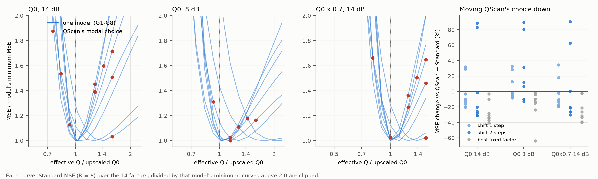

# QScan 的选择偏移随模型变化，常数去偏不可行

**结论：在 8 个新开发模型上，QScan 选择相对组合最优 Q 的偏移从 −4 到 +4 个网格步长不等，方向也会反过来。向下平移 1 步或 2 步都不安全，“常数去偏”这条路可以结束。阶段 2 的另一个结论则得到了推广：8/8 个模型的无噪声最优都在上尺度 Q0 处。**

- **O1 偏移不稳定**：Q0/14 dB 下，偏移依次为 G1 +4、G2 +1、G3 +3、G4 −1、G5 +2、G6 −4、G7 +4、G8 +2（正值表示 QScan 选的 Q 偏高、补偿不足）。极差 8 步，出现最多的值（+2）只有 2 次。判为“偏移跨模型不稳定”。
- **O2 两种平移都不安全**（24 个模型×场景）：
  - 平移 1 步：17/24 改善，中位数 −6.6%，最坏 +34%（G6）。
  - 平移 2 步：14/24 改善，中位数 −10%，最坏 +90%（G6）。
  - 在 QScan 本来就选低了 Q 的 G4、G6 上，再往下平移会进一步过补偿，误差上升 18–90%。
- **O3 最优就在上尺度 Q0**：Q0/14 dB 下，8 个模型的无噪声最优有效 Q 比都是 1.000 或 1.031；Q0×0.7 下都是 0.999。阶段 2 在 F1/F2 上的发现可以推广：在这条流程里，补偿到真 Q 就是最好的，问题全在于找到它。
- **QScan 的落点是模型的属性**：同一模型内，6 个实现几乎都选同一个网格点（24 个场景中 22 个为 5–6 次，G2、G8 的 8 dB 为 3 次），而且从 Q0 或 Q0×0.7 出发，偏移完全相同（8/8 个模型）。所以误差不是噪声造成的，也不取决于起始 Q，而是 QScan 对每个模型都有一个确定的、因模型而异的偏差。
- **组合的取舍在 8 个模型上都成立**：
  - Q0/14 dB：名义 Q 的标准版（B）在 7/8 个模型上比 QScan＋标准版（D）好，唯一的例外是 G2。
  - Q0×0.7：D 在 8/8 个模型上比 B 好，B 的误差高出 47–357%。
  - 这与阶段 1 的结论一致：Q 可信时不叠加 QScan；Q 有误时叠加 QScan。

## Material Passport

- 类型：新生成开发模型上的重复噪声因子扫描（Kennett 一维细层黏声正演，与 F1/F2、U1–U4 同一生成器）。MATLAB R2024b 与 Python 实际运行。
- 日期：2026-10-25 01:56–02:36（本地时间）；项目根目录 `D:\ChatGPT\研究`。
- 方案：[PLAN_ZH.md](PLAN_ZH.md)，在 G1–G8 生成之后、任何扫描之前冻结，哈希见 `logs/PRE_RUN_HASHES.json`（提交 5214482，已推送）。评分前逐文件核对 SHA-256，全部一致；冻结后没有改动方案、阈值或判定代码。
- 规模：8 个模型 × 3 个场景 × 7 个实现（r=0 无噪声，r=1–6）× 14 个因子 × 2 个估计量。2 个 worker × 4 线程，约 33 分钟。全部优化标志为 0。
- 没有使用 U1–U4，也没有读取它们的输入或真值。
- 局限：
  - R=6，每条曲线的标准误比阶段 2（R=20）大，但偏移是按网格步长计的，模型间差异（最多 8 步）远大于同模型内的选择波动（最多 1 步）。
  - 只覆盖一种正演（一维、正入射、细层）和一种 Q 误差（低估 30%）。

## 1. 主要数值（Q0/14 dB）

MSE 除以 ‖x⋆‖²，99 道全时段，R=6。q 为有效 Q 与上尺度 Q0 之比。

| 模型 | 特征 | 无噪声能量比 | q_QScan | q* | 偏移（步） | D | B | 最优 | 最优相对 D | 平移 1 步 | 平移 2 步 |
|---|---|---:|---:|---:|---:|---:|---:|---:|---:|---:|---:|
| G1 | Q 递增 | 0.399 | 1.590 | 1.000 | +4 | 0.285 | 0.170 | 0.170 | −40% | −13% | −26% |
| G2 | Q 递减，碳酸盐 | 0.673 | 1.590 | 1.427 | +1 | 0.115 | 0.143 | 0.112 | −3% | −3% | −2% |
| G3 | Q 反转 | 0.320 | 1.427 | 1.031 | +3 | 0.313 | 0.197 | 0.196 | −37% | −16% | −31% |
| G4 | Q 中等，碳酸盐 | 0.577 | 0.925 | 1.031 | −1 | 0.110 | 0.101 | 0.099 | −10% | +29% | +89% |
| G5 | Q 整体低 | 0.286 | 1.280 | 1.031 | +2 | 0.267 | 0.184 | 0.184 | −31% | −20% | −31% |
| G6 | Q 高、递减，碳酸盐 | 0.763 | 0.830 | 1.280 | −4 | 0.087 | 0.063 | 0.057 | −35% | +32% | +83% |
| G7 | Q 反转 | 0.433 | 1.590 | 1.031 | +4 | 0.313 | 0.207 | 0.207 | −34% | −10% | −20% |
| G8 | Q 递增，碳酸盐 | 0.490 | 1.280 | 1.031 | +2 | 0.086 | 0.063 | 0.062 | −28% | −20% | −28% |
| *F1（阶段 2）* | | *0.319* | *1.280* | *1.000* | *+2* | *0.225* | *0.150* | *0.150* | *−33%* | | |
| *F2（阶段 2）* | 碳酸盐 | *0.417* | *1.280* | *1.031* | *+2* | *0.105* | *0.077* | *0.075* | *−28%* | | |

- 最优固定因子相对 D 的改进，8 个模型平均为 27%（3–40%），与阶段 2 在 F1/F2 上的 28.6% 相当。改进空间普遍存在，但所需的修正方向和大小因模型而异。
- Q0 下，B 在 G1、G3、G5、G7、G8 上与最优几乎相同（差距 ≤1%），在 G4 上差 2%；G6 差 12%，G2 差 29%。G2、G6 的含噪最优点高于 Q0（q* = 1.43、1.28）：它们衰减弱（能量比 0.67、0.76），少补偿能换来较多的降方差。

## 2. 其他场景

| 模型 | Q0/8 dB 偏移 | Q0/8 dB：B 相对 D | Q0×0.7/14 dB 偏移 | Q0×0.7：B 相对 D | Q0×0.7：最优相对 D |
|---|---:|---:|---:|---:|---:|
| G1 | +3 | −15% | +4 | +99% | −39% |
| G2 | −4 | +103% | +1 | +264% | −2% |
| G3 | +2 | −8% | +3 | +274% | −34% |
| G4 | −3 | −12% | −1 | +183% | −3% |
| G5 | +1 | −1% | +2 | +357% | −26% |
| G6 | −8 | −48% | −4 | +47% | −40% |
| G7 | +3 | −11% | +4 | +82% | −32% |
| G8 | 0 | +0.4% | +2 | +316% | −21% |

- 8 dB 下，衰减弱的模型（G2、G4、G6）含噪最优点上移到 q = 1.28–2.2，偏移变成更大的负值；其余模型的偏移比 14 dB 小 1–2 步。
- G2 Q0/8 dB 是 B 明显差于 D 的唯一场景（+103%），与阶段 1 中“F2/8 dB 是唯一例外”同类：强噪声、弱衰减时，少补偿的降方差收益大于偏差代价。
- 振幅：QScan 选高 Q 的模型，强反射振幅增益在 QScan 处为 0.56–0.88，在最优处为 0.70–1.01；G4、G6 在 QScan 处为 1.02–1.09（过补偿）。见 [offset_summary.csv](analysis/offset_summary.csv) 的 `gain_*` 列。

数据：[offset_curves.csv](analysis/offset_curves.csv)（每个模型、场景、因子的 MSE、标准误、FullCalRefit MSE、无噪声 MSE、振幅增益与被 QScan 选中的次数）、[offset_summary.csv](analysis/offset_summary.csv)、[decisions.json](analysis/decisions.json)。

## 3. 探索性观察（未预先登记）

偏移与道集的衰减能量损失有关，但与 Q 本身的路径衰减无关。以下 n=10（G1–G8 加 F1/F2），都是事后分析。

- **与能量比相关**：用无噪声道集的衰减/弹性能量比（越小衰减越强）与 Q0/14 dB 偏移做 Spearman 秩相关，G1–G8 为 ρ = −0.71，加上 F1/F2 为 −0.60。能量比 ≤0.49 的 7 个模型，偏移都为 +2 到 +4；≥0.58 的 G4、G2、G6，偏移为 −1、+1、−4。
- **与路径衰减无关**：用公开的宏观速度、厚度和上尺度 Q0 算双程路径衰减 t* = Σ τᵢ/Qᵢ（到记录末端 1.8 s），它与偏移的秩相关只有 ρ = −0.06。
- 所以偏移不是由“Q 有多低”决定的。更可能由反射能量在时间上的分布与衰减的配合决定：能量比同时取决于 Q 和强反射落在哪个深度。
- **用 QScan 自己的 Q 算 t* 是循环论证**：这样算出的 t* 与偏移的 ρ = −0.77，但它等于真 t* 除以 QScan 的选择因子，而偏移本身就由这个因子决定，所以这个相关是机械产生的，不能用。
- 能量比要用真值计算，不能直接作为校正量；目前还没有找到能替代它、又不依赖真值的量。

## 4. 按冻结方案的结论与下一步

O1 不稳定，对应结论规则第二行：**常数去偏不可行**。QScan 对每个模型都有确定的偏差，但偏差的大小和方向因模型而异，任何固定的 κ 都会在一部分模型上大幅变差（本轮最坏 +34% 与 +90%）。

对后续方向的含义：

1. **实用推荐不变**：Q 可信时用相干标准版，不叠加 QScan；Q 只来自粗略标定时用 QScan＋标准版。后者在 Q 低估 30% 时对 8/8 个模型都比名义 Q 好得多，代价是平均约 27% 的改进空间没有拿到。
2. **改进空间仍然存在，但要的是一个能辨识真 Q 的选择器，而不是对 QScan 的固定修正。** 已有的 A0–A3、C1–C4 在 FullCalRefit 层面都失败了；它们在组合层面能否更好，是另一会话提出的选项 (a)，尚待决定。
3. 第 3 节的探索性线索：偏移与能量比相关，但与路径衰减 t* 无关，而用 QScan 自身结果构造的量会循环论证。“模型自适应修正”目前没有现成的、不依赖真值的依据。若要继续，需要先找到一个可观测的量能预测偏移，并在新开发数据上预先登记检验。
4. U1–U4 的用途仍由用户决定。本轮没有动用它们。
