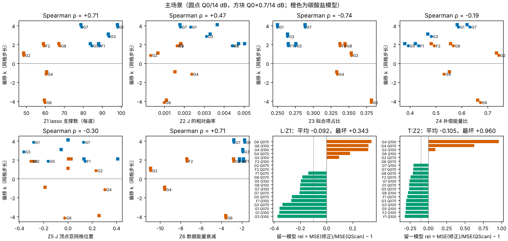

# 不依赖真值的特征不能预测 QScan 的偏移（开发门槛 P1 未通过）

**结论：6 个不依赖真值的特征（Z1–Z6）都不能可靠地预测 QScan 因模型而异的偏移。** 在留一模型交叉验证中，13 个候选规则没有一个同时满足三条门槛：平均改善 ≥10%、最坏不变差超过 10%、≥14/20 个主场景改善。按冻结方案，这个方向在当前特征集上结束，不进入确认。

- **最好的两个候选**：
  - L:Z1（按 lasso 支撑数做线性平移）：平均 −9.2%，最坏 +34%；
  - T:Z2（按 J 的曲率做两段平移）：平均 −10.5%，最坏 +96%。
- **失败的原因很集中**：两个弱衰减的碳酸盐模型 G4、G6 的偏移为 −1、−4（QScan 已经选低了 Q）。它们的特征值与偏移为 +2 的 F2、G8 几乎一样，没有一个特征能把它们分开。对它们再往下平移就是过补偿，误差会上升 18–96%。
- **相关不等于可用**：Z1、Z3、Z6 与偏移的秩相关有 |ρ| ≈ 0.71–0.74，方向上确实有信息；但交叉验证中的最坏情况决定了它们不能用。
- **复现**：Octave 上 30 个场景 × 6 个实现的 QScan 选择，与归档的 MATLAB 结果全部相同。

## Material Passport

- 类型：已见开发模型（G1–G8、F1、F2）上的预登记开发检验。GNU Octave 8.4 + `octave_compat_20261025` 实际运行。
- 时间：2026-10-25 11:39（本地时间）冻结方案，哈希见 `logs/PRE_RUN_HASHES.json`（已随提交 3f3c36c 推送）。12:12–12:24 计算特征，随后评分。冻结后没有改动方案、特征、规则或门槛。
- 冻结后新增的文件只有：描述图脚本 `scripts/make_figure.py` 和本文档。
- 规模：10 个模型 × 3 个场景 × 6 个实现，共 180 个道集。每个道集做一次 QScan 选择，加一次在所选因子处的 FullCalRefit。
- 没有使用 U1–U4；没有读取任何评分目标。误差曲线引自 `qscan_offset_20261025` 与 `combo_bias_variance_20261024` 的归档结果。
- 局限：
  - 开发阶段的误差用归档的平均误差曲线、在众数选择处计算，不是逐实现重算。在 G1 上与逐实现结果相差约 0.1%。
  - 只有 10 个模型。

## 1. 交叉验证结果（20 个主场景：Q0/14 dB 与 Q0×0.7/14 dB）

rel = MSE(修正后) / MSE(QScan＋标准版) − 1，负值表示更好。

| 候选 | 平均 rel | 最坏 rel | 改善数 | 8 dB 平均 | 8 dB 最坏 |
|---|---:|---:|---:|---:|---:|
| C 常数平移 | +0.042 | +0.960 | 16 | +0.155 | +0.893 |
| **L:Z1** | **−0.092** | +0.343 | 12 | −0.008 | +0.325 |
| T:Z1 | −0.077 | +0.612 | 10 | −0.004 | +0.238 |
| L:Z2 | +0.084 | +0.960 | 12 | +0.088 | +0.893 |
| **T:Z2** | **−0.105** | +0.960 | 14 | +0.127 | +0.803 |
| L:Z3 | −0.050 | +0.475 | 8 | +0.175 | +0.607 |
| T:Z3 | +0.019 | +0.960 | 11 | +0.143 | +0.541 |
| L:Z4 | +0.033 | +0.960 | 12 | +0.265 | +0.893 |
| T:Z4 | +0.046 | +0.960 | 9 | +0.166 | +0.803 |
| L:Z5 | −0.001 | +0.904 | 14 | +0.118 | +0.893 |
| T:Z5 | −0.016 | +0.904 | 13 | +0.223 | +0.893 |
| L:Z6 | −0.047 | +0.904 | 12 | +0.101 | +0.893 |
| T:Z6 | −0.015 | +0.904 | 12 | +0.107 | +0.893 |

门槛 P1：平均 ≤ −0.10、最坏 ≤ +0.10、改善 ≥14/20，**无一通过**。

## 2. 特征的描述

| 特征 | 与偏移 k 的 Spearman（20 个主场景） | Q0 与 Q0×0.7 之间的变化（中位数） |
|---|---:|---:|
| Z1 lasso 支撑数 | +0.71 | 0.4% |
| Z2 J 的相对曲率 | +0.47 | 12% |
| Z3 拟合项占比 | −0.74 | 0.1% |
| Z4 补偿能量比 | −0.19 | 2.2% |
| Z5 J 顶点的亚网格位置 | −0.30 | 0.29 步 |
| Z6 数据能量衰减 | +0.71 | 0（只用数据） |

- Z1、Z3、Z4 对所用 Q 是否有误几乎不敏感。这与“偏移是模型属性”一致：从 Q0 或 Q0×0.7 出发，QScan 落在同一个有效 Q 上。
- **Z4 本想替代真值能量比，但被偏移本身污染了**：
  - 在 10 个 Q0/14 dB 场景上，Z4 与真值能量比的秩相关为 0.84；真值能量比与偏移的相关为 −0.60；但 Z4 与偏移的相关只有 −0.19（20 个主场景）。
  - 原因是 Z4 在 QScan 所选的 Q 处计算，偏移越大，补偿越不足，Z4 就越偏高。G1、G7（偏移 +4）因此被抬高到和碳酸盐模型一样的位置。

## 3. 探索性观察（事后，未登记，不作结论）

- 图中蓝色（无碳酸盐）与橙色（有碳酸盐）在 Z1、Z3、Z6 上各自成团：
  - 无碳酸盐的 5 个模型（G1、G3、G5、G7、F1）的 Z1 都 ≥79，偏移都在 +2 到 +4；
  - 有碳酸盐的 5 个模型的 Z1 都 ≤68，偏移从 −4 到 +2 不等。
- 如果只对 Z1 高的那一团平移 2 步、其余保持 QScan 的选择，开发数据上的结果是：
  - 无碳酸盐模型在 14 dB 下改善 20–32%；8 dB 下改善 10–18%，但 G5 变差 12%；
  - 碳酸盐模型保持不变。
- 这种“有把握才修正”的规则，最多只能改善一半的场景，在设计上就不可能满足 P1 的“≥14/20 改善”。这是本方案门槛的一个缺陷，但判定按冻结规则不变。
- 这只是 10 个模型上的事后分组。要检验它，必须另行登记，并在新生成的模型上确认。

## 4. 对方向的含义

1. 用单个道集、单个全局因子的特征预测 QScan 的偏移，在当前特征集上不可行。困难集中在弱衰减、含强反射层（碳酸盐）的模型：这类模型的 QScan 偏移可正可负，从数据特征上看不出来。
2. 实用推荐不变：
   - Q 可信时，用相干标准版，不叠加 QScan；
   - Q 只来自粗略标定时，用 QScan＋标准版，接受约 27% 的改进空间拿不到。
3. 可能的后续，需要用户决定：
   - (a) 把第 3 节的“有把握才修正”规则登记下来，生成新模型确认。可以采用的门槛例如：平均改善 ≥5%，且任何场景变差不超过 5%。
   - (b) 引入独立的 Q 信息（VSP、测井），这是之前几轮的共同结论。
   - (c) 停止这个方向。

数据：`analysis/features_*.csv`（逐实现特征）、[scene_features.csv](analysis/scene_features.csv)、[cv_results.csv](analysis/cv_results.csv)、[cv_summary.csv](analysis/cv_summary.csv)、[decisions.json](analysis/decisions.json)。
