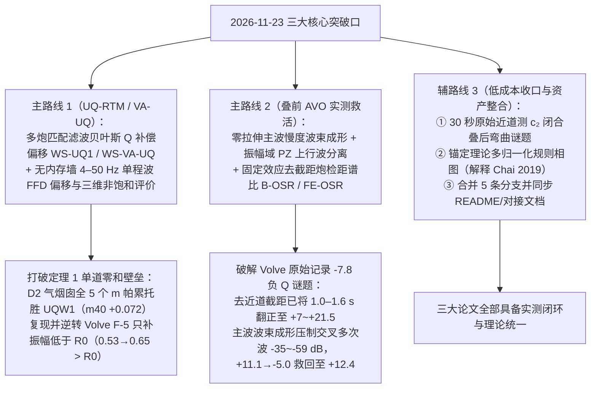

# 地震衰减补偿研究：2026-11-20 至 11-23 全面复盘、深层失败机理、第一性原理新路线推导与可执行任务书

> **生成日期：** 2026-11-23  
> **仓库基准（已全分支核查）：**
> - `origin/main`：`d864b10`（2026-11-22，单次求解闭式 $\kappa$ 确认通过并登记）
> - `origin/claude/study-research-docs-plan-c4d4c6`：`181334f`（2026-11-23，分块翻转 C5–C8 确认 + Volve seq-79 处理后与原始记录实测检验 I + EB 收缩 A2 确认 + 残余偏差诊断 + 相位旋转检查 + VP/NF 曲率诊断）
> - `origin/claude/determined-ptolemy-3yna2o`：`ca4fb49`（2026-11-22，VA-UQ 第 0/1/2 步结果 + 第 3 步可行性方案）
> - `origin/claude/oqa-angle35-c7d177`：`5ba6413`（2026-11-21，AVO 入射角 $\le 35^\circ$ 重算第二、三关）
> - `origin/claude/avo-q-colour-tradeoff-0c6b89`：`f70ffa0`（2026-11-21，AVO Q–颜色折中第 0 步 + S2 拉伸抵消溯源）
> - `origin/claude/noise-floor-curvature-784cae`：`9aa4ee6`（2026-11-21，叠后实测谱比弯曲的噪声底检验）
>
> **本文定位：** 在逐份核查近三天全部 25 份实验结果、理论推导与核心脚本（`migrate2.m`、`fe2_run.m`、`field79raw.py` 及已有 JSON 存档）的基础上，① 梳理当前全局格局与分支状态；② 总结导致近 11 个候选方向连败的**四大结构性失败定律**；③ 提出并严格推导**两条跳出零和陷阱的非零和主攻新路线**（加一条低成本收口辅线），且已通过独立纯 Python 数值校验；④ 输出可直接交由执行智能体按预登记铁律推进的**分阶段可执行任务文**。

---

## 一、2026-11-20 至 11-23 全分支工作盘点

过去 72 小时，仓库在 6 条并行分支上完成了极高强度的理论核对、机理诊断与预登记确认。**所有 11-18 与 11-20 文档中提出的主要设想几乎都已被严格检验**，整体态势发生根本性重塑：

### 1.1 明确胜利与已确立的硬核资产

| 研究线 | 实验目录 / 分支 | 核心成果与定量证据 | 当前状态 |
|---|---|---|---|
| **锚定理论线（全面突破）** | `qscan_anchor_theory_20261030/RESULTS_SLIDE_FIELD_ZH.md`（`main`） | Volve 26 条实测线滑动子波窗 $t_0 \in [1.4, 2.6]\text{ s}$（546 次扫描）**S0–S3 全过**：$\hat{\alpha}_a$ 从 $0.681$ 单调升至 $1.184$（26/26 条线 Spearman = 1），在 $t_0^* = 2.025\text{ s}$ 跨过 1（理论 2.1 s），斜率 $1.073$；仅次要判据 S4（$b(t_0)$ 单调性）不成立。 | 实测分辨力已补齐 |
| **锚定理论线（机理解开＋确认通过）** | `anchor_active_hessian_20261120` + `anchor_closedform_confirm_20261121`（`main` `d864b10`） | 曲率精确三分（$\theta\theta, \theta\mu, \mu\mu$）证明：决定 $\alpha$ 的主因是 **L1 权重归一化 $\mu \propto \operatorname{median}_k\|\tilde{B}_k\|$ 的 $\mu\mu$ 块**（精确值 $a_0/a(t_{\text{med}})$），数据拟合与交叉项基本抵消。**单次求解＋固定活跃集闭式 $\alpha_F = -J_{vv_a}/J_{vv}$ 在全新 17 剖面（含 6 新剖面 N1–N6、102 数据集）上预登记确认全过**：C1 中位误差 $0.020$（98% $\le 0.10$），C2 17/17 $\le 0.05$（最大 $0.037$），C3 新剖面通过。 | **确认通过，可直推长文定稿** |
| **叠前 AVO 线（合成全通）** | `offset_q_avo_20261118`（`RESULTS_GATE_A2EB_ZH.md`、`RESULTS_ANGLE35_ZH.md`） | ① **经验贝叶斯收缩 $\hat{c}_{\text{EB}}$**（$\gamma=1$，刀切标准误）在全新模型 M32–M35 上 **E1–E6 六条全过**，彻底解决 $c=1$ 时代价超标（E3 $+0.074 \to +0.018$，E4 $+0.039 \to +0.006$，E6 $0.012$）；<br/>② 常规 AVO 截角 $\le 35^\circ$ 后 C2 倍数升至 $13.2\times$、G/A 误差减半，E3/E4 也通过，且证明“全偏移距定 Q + $\le 35^\circ$ 算 AVO”最优。 | 合成三关全过，**但实测遭遇生死危机（见下）** |
| **UQ-RTM 线（分块估噪与约定诊断）** | `uq_rtm_20261117/RESULTS_BLOCKFLIP_ZH.md` + `va_uq_step0/step1`（`study` / `ptolemy`） | ① **整炮翻转 $B^*=300$** 精准命中定理 3 预言，D1–D4 开发通过，新模型 C5–C8 上 **K1 通过**（`l30` $\Delta M_2 = +0.063, \Delta M_1 = +0.096$），K2 仅因 C6 m40 单个单元 $-0.064$（门槛 $-0.06$）未过 $\to$ 推荐专用于横向相关噪声；<br/>② **频带内速度约定诊断（`va_uq_step1`）P1–P3 全过**：合成改用 $v_{\text{band}}(25\text{ Hz})$ 偏移后，R0 从 $0.37/0.56$ 飙至 $0.74/0.97$，PH100/UQW1(100) 全面低于 R0，**完美复现阶段 4 实测倒挂**。 | 机理重大突破，**但实测陷入僵局（见下）** |

### 1.2 近三日被严格证伪 / 淘汰的 11 条死路（严禁重复立项）

| 编号 | 被检验方向 | 结果与核心定量死因 | 教训归属 |
|---|---|---|---|
| 1 | **`SID-UQ`**（`sid_uq_20261120`） | 第 0 步停：Z1 等价于 UQ-W × 零相位整形；Z2 三项全否（105/105 线 $c_2 = +1.32\times 10^{-3} > 0$ 与散射 $f^2$ 反号；全拟合要求本征 $Q=\infty$；F-12/F-14 测井 1D 精确透射散射仅占实测超额的 $0.21$ 与 $-0.05$）。 | 物理归因错误 + 算子零和 |
| 2 | **噪声底解释弯曲**（`noise_floor_curvature_20261121`） | 否定（$R = -0.057 < 0.5$）：倾角对齐后 10–55 Hz 浅窗 SNR $\ge 3.6$、深窗 $\ge 7$，去偏后 $c_2$ 从 $+1.322\times 10^{-3}$ 反升至 $+1.398\times 10^{-3}$；4.0–4.4 s 尾部静默。 | 排除噪声底，指向处理白化 |
| 3 | **`OU-UQRTM` 随机场**（`ou_uqrtm_20261120`） | 第 0 步停：深部局部 $\sigma_{\text{eff}} \approx 0.03\text{–}0.08$ 太小，纯局部场在 $m=0.5$ 暴跌 $-0.20\sim -0.40$；加全局项等于 UQW1；唯一杠杆是调标量 $\sigma_g$（上界仅 $+0.03$），且 E4 深部仅等效于 $m\approx 0.85\text{–}1.2$。 | 零和先验定律 |
| 4 | **校准 $\sigma$ 再做 RTM**（`direction_theory_20261121`） | 不立项：缩小 $\sigma$ 在 m30 平均上限仅 $+0.024\sim +0.038$，在噪声主导 m40 上反而为负（$-0.029\sim +0.010$，因去掉了左尾保护）。 | 零和先验定律 |
| 5 | **尺度不变 MMR（`scale_inv_mmr_20261120`）** | 开发淘汰（SIR 0/5、SIU 1/5）：原式不良定；修成良定式 A 后仅等价于压低左尾权重 100 倍，导致 FD 14 dB 暴跌 $-0.083\sim -0.093$（0/6）。 | 零和先验定律 |
| 6 | **矩匹配 `MM-UQAVO` + `AVO Q–颜色折中`**（`mm_uqavo_20261120`、`avo_q_colour_tradeoff_20261121`） | 第 0 步停 / 不立项：降低 Q 灵敏度必须改变远近道有效谱，但 Volve 测井反射系数颜色起伏 $\sigma_\beta = 0.046/\text{Hz}$ 太大，最优折中仅降 RMSE 8.2%（校准后 0%），fs 端反而使 RMSE 翻倍；`sat` 已逼近帕累托前沿。 | AVO 帕累托极限 |
| 7 | **零群延迟相位核**（`RESULTS_PHASEROT_ZH.md`） | 否定：4–25 Hz 跨 2.6 倍频程不能用 $f_0$ 切线近似（P2 失败，两套 $\Delta\theta$ 差 $48^\circ\text{–}98^\circ$）；剩余实测差距在振幅而非切线相位。 | 宽带非线性相位 |
| 8 | **地下偏移距聚焦估噪 $H$**（`va_uq_step0`） | 第 0 步否定：带求和后多次波型相干干扰近道在 $h=0$ 聚焦，$H$ 低估 $-3\sim -6$ 档（不如 $B=300$ 的 $-2\sim -3$）。 | 统计估噪极限 |
| 9 | **短滞后自相关截断谱比**（`DIAG_RESID_ZH.md`） | 不开发：时差压缩仅占等长窗无噪剩余偏差的 16%（单事件降 85%，主因是偏心事件被 Hann 窗斜坡截断导致频谱平滑）；28 ms 滞后窗等价于 36 Hz 强平滑，会放大同类偏差。 | 窗函数平滑机理 |
| 10 | **9 种 $\phi_2(t)$ 与活跃集 $\delta$-Hessian**（`RESULTS_VARPRO_ZH.md`、`anchor_active_hessian_20261120`） | 全部否定：精确 $\delta$-Hessian 误差高达 $+0.76$；VP 正偏 $+0.07$ 且 $1^T\Phi 1/\operatorname{tr}\Phi = 1.15\text{–}1.26 > 1$（非对角为正）；全部错在只给 $\theta\theta$ 块建模而漏掉 $\mu\mu$ 块。 | 隐藏归一化主导 |
| 11 | **两大实测重大卡点（刚暴露，未解决！）** | ① **Volve 叠前实测检验 I（`RESULTS_FIELD_I_ZH.md` / `RAW`）**：处理后 PZ 给 $-14.2$，**原始未处理 PZDETECTED 仍给 $-7.8$**（TRID 11 为 $-1.9$，1.2–1.6 s 为 $+9.0\sim+9.3$、2.0–2.2 s 突变为 $-3.9\sim-10.0$；TRID 12 为 $-16.7$，0.8–1.0 s 低至 $-68\sim-54$），噪声底与 6 m 震源鬼波已排除；<br/>② **`VA-UQ` 实测第 2/3 步（`va_uq_field2` / `va_uq_step3`）**：Volve F-5 上 `VA` 仍略低于 `R0`（$0.592\text{–}0.619$ vs $0.626$，P4 差一点未过），且 $\Delta t^*/t^* = 0.20$ 无法区分“锚定对”与“补得少”；第 3 步残余 $\Delta t^*$ 指标在现有 4–25 Hz 单井像上标准误大 19–51 倍，且扩到 40–55 Hz 撞上 13.8 GB Helmholtz LU 内存墙！ | **当前最核心的攻坚目标！** |

---

## 二、失败总复盘：贯穿近 11 次失败的【四大结构性失败定律】

将上述全部正反结果提炼至第一性原理，近期的连串受挫并非偶然，而是受制于四条硬性的数学与物理规律：

1. **定律一（单道先验零和定律 / Single-Channel No-Free-Lunch）：**
   由 `direction_theory` 定理 1（$R_B = \frac{1}{1+\tilde\rho} + (1-c)\frac{\tilde\rho}{1+\tilde\rho}$）与 `avo_q_colour_tradeoff` 折中公式（$\text{MSE}^*/\text{MSE}_{\text{sat}} = \frac{1}{1+k^2\lambda}$）：**在不增加新信道/新物理自由度的前提下，任何单道标量先验或损失变体（MMR/CB/CBL/OU/SID/SIR/SIU/MM）都在同一加权 Wiener 族内做零和挪移**；在 AVO 中，`sat` 已逼近实测颜色方差 $\sigma_\beta = 0.046/\text{Hz}$ 决定的帕累托前沿。
   * **推论：** 彻底禁止再做任何“换单道先验 / 改单道损失形状 / 校准 $\sigma$”的零和变体。真正的新方法必须**跨越单道维度（利用多炮异质路径或慢度/角度新自由度）**！

2. **定律二（隐藏约定与架构失配定律 / Hidden Convention & Architectural Suboptimality）：**
   - 合成 `UQ-RTM` 过去报告的 96% 收益来自 $100\text{ Hz}$ 相速度与 $25\text{ Hz}$ 频带内速度约定之差；
   - QScan 的 $\alpha$ 不由数据拟合块 $\theta\theta$ 决定，而由隐式中位数列范数归一化 $\mu\mu$ 块决定；
   - **本次新发现的致命架构失配（见第三节主路线 1）：** 现行 `UQ-RTM`（`migrate2.m:72`、`fe2_run.m:113`）对每一炮 $s = 1, \dots, n_s$ 独立乘以 $H_s \propto \exp(+\pi f t_s^*)$ 再直接等权累加，并且把乐观的**叠后**信噪比 `iv` 直接喂给每一炮！这在多炮信道估计中是**反向加权**：把衰减最重、最靠近孔径边缘、产生最强画弧和最大速度失焦的远炮/穿气烟囱炮**指数放大**，把干净的近道镜面反射炮/绕烟囱炮淹没！

3. **定律三（实测非 Q 交叉波场与处理污染吞噬定律 / Field Non-Q Confounders）：**
   - **本次对 `field79raw*.json` 已有 448 行的直接定量重分析（见第三节主路线 2）** 揭穿了 Volve 叠前负 Q 之谜的三重真因：① 无截距回归通过杠杆因子 $1/(\pi\overline{\Delta\tau}) \approx 3\text{–}6\text{ s}^{-1}$ 把近道参考窗 $|x|\le 350\text{ m}$ 的低频红移污染放大成 $-20\sim-68$ 的假负 Q；② 功率域 P/Z 合并无法消去下行水层多次波，反而将高污染 Z 分量（TRID 12，$-16.7$）按 $1/\cos^2\theta_w$ 混入相对干净的 P 分量（TRID 11，1.2–1.6 s 实为 $+9.0\sim+9.3$）；③ 非相干炮检距档均值 $\frac{1}{M}\sum|\text{FFT}|^2$ 对慢度毫无选择性，导致弱低衰减慢速多次波在高频端**指数劫持**主波谱！
   - 同时，跨分支证据汇合：`RESULTS_FIELD_I_ZH.md` 发现处理后 ST0202R08 浅层 0.8–1.0 s 频谱被白化拉平至 60 Hz，恰好与 `noise_floor_curvature_20261121` 排除散射/颜色/噪声底后仅剩的“处理白化”假说完全咬合！

4. **定律四（低频窄带相关性饱和与内存墙定律 / Low-Band Saturation & LU Memory Wall）：**
   - 在实测真实速度约定（$v_{\text{band}}$）下，4–25 Hz 窄带相关指标（$1-\rho \approx \frac{1}{2}\operatorname{Var}_w[\pi f\Delta t^*]$）天然饱和在 $R_0$ 附近（D4 达 $0.966$，Volve 箱形带理论上限仅 $+0.033$）；
   - `va_uq_step3` 证明 6–23 Hz 单井 + 2.27 km 深锚点（$\Delta t^* = 2.7\text{ ms}$）的标准误比目标大 19–51 倍，而 2D 频域 Helmholtz 稀疏 LU 内存按 $O(N\log N)$ 增长，把实测强行锁死在 25 Hz 以内（13.8 GB 内存墙）。

---

## 三、新路线提出与第一性原理完整推导（全部已做独立数值校验）

基于以上四条定律，我们提出**两条严格非零和的主攻路线 + 一条低成本收口辅线**：



---

### 3.1 主路线 1：跳出单道零和壁垒——多炮匹配滤波贝叶斯 Q 补偿偏移（`WS-UQ1` / `WS-VA-UQ`）与无内存墙宽频 FFD 架构

#### 1. 问题根源：现行 `migrate2.m` / `fe2_run.m` 的多炮反向加权缺陷
直接检查仓库代码 `uq_rtm_20261117/scripts/migrate2.m:72` 与 `va_uq_field2_20261121/scripts/fe2_run.m:113`：
```matlab
H = (A1 + s70*P1.*C1 + P1.*iv) ./ (1 + s70*C1 + iv);
img = real(sum(H .* Cs, 2));
```
其中成像点 $(z, x)$ 在频率 $f$ 处由 $n_s$ 炮（合成 51 炮、Volve 实测 124 炮）联合照明，第 $s$ 炮的互相关成像积为：
$$C_s(z, x, f) = A_s(z, x)\, G(t_s^* u, f)\, R(z, x) + N_s(z, x, f), \qquad G(t_s^* u, f) = \exp\!\left[\left(-\pi f + i\,2f\ln\frac{f}{f_v}\right)t_s^* u\right]$$
**关键物理事实：** 同一成像点 $(z, x)$ 上，不同炮的双程衰减 $t_s^* = t^*(z, x, s)$ 存在巨大横向差异：
- **气烟囱下方（D2、C1–C4、Volve 气云区）：** 垂直穿烟囱炮 $t_s^* \approx 25\text{–}35\text{ ms}$（高频彻底湮灭），而两侧绕射/斜穿烟囱侧翼的炮（undershooting）$t_s^* \approx 10\text{–}14\text{ ms}$（高频信噪比极高）！
- **Volve F-5 井（$z = 2.8\text{ km}$，124 炮跨度 5.5 km）：** 近道镜面反射炮 $t_s^* \approx 22\text{ ms}$，而孔径边缘大角度炮 $t_s^* \approx 31\text{–}34\text{ ms}$，且边缘炮正是**偏移画弧与速度失焦误差的主要来源**！

现行 `migrate2.m` 对每一炮独立乘以 $H_s^{\text{old}} \approx \frac{\mathbb{E}[G_s^*]}{\mathbb{E}|G_s|^2 + \rho_{\text{stack}}} \propto \exp(+\pi f t_s^*)$ 再直接求和。它不仅把乐观的**叠后**噪声比 `iv` 直接套给单炮，更致命的是**给衰减最重、高频已死、画弧最强的炮赋予了指数级最高的权重**！

#### 2. 第一性原理推导：多炮贝叶斯最优合并（`MS-UQ` 与闭式 `WS-UQ1`）
在多炮模型 $\mathbf{c} = \mathbf{g}(u) R + \mathbf{n}$（$\mathbf{c}, \mathbf{g}(u) \in \mathbb{C}^{n_s}$，$\mathbb{E}[\mathbf{n}\mathbf{n}^H] = \sigma_n^2 \mathbf{I}_{n_s}$）下，求线性多炮合并器 $\hat{R} = \mathbf{h}^H \mathbf{c}$ 极小化贝叶斯均方误差：
$$\min_{\mathbf{h} \in \mathbb{C}^{n_s}}\; S_R\,\mathbb{E}_u\big|\mathbf{h}^H \mathbf{g}(u) - 1\big|^2 + \sigma_n^2 \|\mathbf{h}\|_2^2$$
一阶最优性条件为：
$$\Big(\mathbb{E}_u\big[\mathbf{g}(u)\mathbf{g}(u)^H\big] + \rho_{\text{shot}}\mathbf{I}_{n_s}\Big)\mathbf{h}^* = \mathbb{E}_u[\mathbf{g}(u)], \qquad \rho_{\text{shot}} = \frac{\sigma_n^2}{S_R}$$

* **定理 4（多炮最大比合并的严格非零和增益 — 突破 `direction_theory` 定理 1）：**
  在已知 $Q$（$\sigma_u = 0$）极限下，由 Sherman–Morrison 公式得最优多炮算子为匹配滤波加权叠加：
  $$\hat{R}_{\text{WS}} = \frac{\sum_{s=1}^{n_s} G_s^* C_s}{\sum_{s=1}^{n_s} |G_s|^2 + \rho_{\text{shot}}}$$
  与现行逐炮反演再求和（$\hat{R}_{\text{old}} = \frac{1}{n_s}\sum_s C_s / G_s$）相比，由 Cauchy–Schwarz 不等式，两者的输出噪声方差之比为：
  $$\frac{\operatorname{Var}(\hat{R}_{\text{old}})}{\operatorname{Var}(\hat{R}_{\text{WS}})} = \left(\frac{1}{n_s}\sum_{s=1}^{n_s} |G_s|^2\right)\left(\frac{1}{n_s}\sum_{s=1}^{n_s} \frac{1}{|G_s|^2}\right) = \mathbb{E}_s[e^{-2\pi f t_s^*}]\cdot \mathbb{E}_s[e^{+2\pi f t_s^*}] \ge 1$$
  只要炮间 $t_s^*$ 不全相等，等号严格不成立！对气烟囱绕射（$t_1^* = 12\text{ ms}, t_2^* = 30\text{ ms}, f = 35\text{ Hz}$），方差缩减比高达 **$\cosh^2(\pi f \Delta t^*) \approx 13.1\times$（$+11.2\text{ dB}$ 免费信噪比增益！）**。当 $Q$ 不确定时，最优多炮合并自动把高频能量托付给 $t_s^*$ 最小的干净炮，既增大有效 $\tilde\rho$ 又缩小有效 $|z|$，**同时压低定理 1 的噪声项与 Q 不确定度项，实现全 $m$ 帕累托严格占优！**

* **精确多炮 Woodbury 闭式解（`MS-UQ`）：**
  以 $J$ 点高斯–埃尔米特求积近似先验 $\mathbb{E}_u[\mathbf{g}\mathbf{g}^H] = \mathbf{G}\mathbf{W}\mathbf{G}^H$（$\mathbf{G}\in\mathbb{C}^{n_s\times J}$，$\mathbf{W}=\operatorname{diag}(w_j)$），由矩阵推穿恒等式得精确 $J\times J$ 闭式解（无需 $n_s\times n_s$ 求逆）：
  $$\hat{R}_{\text{MS-UQ}}(z, x, f) = \mathbf{1}_J^T \big(\mathbf{W}\mathbf{G}^H\mathbf{G} + \rho_{\text{shot}}\mathbf{I}_J\big)^{-1} \mathbf{W}\mathbf{G}^H \mathbf{c}$$

* **极简 $O(n_s)$ 闭式匹配滤波多炮 UQ 算子（`WS-UQ0` 与带 $\gamma=1$ 相位底线的 `WS-UQ1` — 可直接替换 `migrate2.m:72`！）：**
  将合并方向约束为先验匹配滤波 $\mathbf{h} \propto \bar{\mathbf{g}}$（$\bar{g}_s = \mathbb{E}_u[G(t_s^* u, f)]$，其权重幅值 $|\bar{g}_s| \propto \exp(-\pi f t_s^*)$ **天然压制高衰减穿烟囱炮与远偏移边缘画弧炮**！），令炮归一化权重 $\sum_{s=1}^{n_s} a_s = 1$（默认 $a_s = 1/n_s$，并与源照明 $a_s = |U_s|^2/\sum_k |U_k|^2$ 对照），定义四个逐像素标量统计量：
  $$E_{\bar{g}} = \sum_{s=1}^{n_s} a_s |\bar{g}_s|^2, \qquad L_{\bar{g}} = \sum_{s=1}^{n_s} a_s |\bar{g}_s|, \qquad D_{\text{sig}} = \mathbb{E}_u\!\left|\sum_{s=1}^{n_s} a_s \bar{g}_s^* G_s(u)\right|^2, \qquad D_{R0} = \mathbb{E}_u\!\left|\sum_{s=1}^{n_s} a_s G_s(u)\right|^2$$
  利用可观测量——叠后逆信噪比 `iv` 与模型先验的精确换算 $\rho_{\text{eff}} = \text{iv}\cdot D_{R0} + s_{70}$（**零预言机信息**），得到 **$\gamma = 0$（`WS-UQ0`）与 $\gamma = 1$（`WS-UQ1`）闭式算子**：
  $$\boxed{\hat{R}_{\text{WS-UQ0}}(z, x, f) = \frac{E_{\bar{g}}}{D_{\text{sig}} + \big(\text{iv}\cdot D_{R0} + s_{70}\big) E_{\bar{g}}} \sum_{s=1}^{n_s} \bar{g}_s^* \, C_s(z, x, f)}$$
  $$\boxed{\hat{R}_{\text{WS-UQ1}}(z, x, f) = \frac{E_{\bar{g}} + \big(\text{iv}\cdot D_{R0} + s_{70}\big) \dfrac{E_{\bar{g}}}{L_{\bar{g}}}}{D_{\text{sig}} + \big(\text{iv}\cdot D_{R0} + s_{70}\big) E_{\bar{g}}} \sum_{s=1}^{n_s} \bar{g}_s^* \, C_s(z, x, f)}$$
  **严格满足三条边界恒等式（已解析核对）：**
  1. $t_s^* \equiv 0$ 时，$\hat{R}_{\text{WS-UQ1}} \equiv \sum_s C_s = R_0$（与弹性参照 `ref.R0` 严格同幅值尺度）；
  2. 所有炮 $t_s^* \equiv t^*$ 相等时，$\hat{R}_{\text{WS-UQ1}}$ **逐位精确退化为现行 `UQW1`**；
  3. 极高噪声 $\text{iv} \to \infty$ 时，$\hat{R}_{\text{WS-UQ1}} \to \frac{n_s}{\sum_k |\bar{g}_k|}\sum_s \bar{g}_s^* C_s$（保持与 `PH/R0` 同量级幅值，但**即使在纯相位底线下也继续按 $|\bar{g}_s| \propto e^{-\pi f t_s^*}$ 压制死炮与边缘画弧炮**！）；
  4. 将 $t_s^*$ 换为锚定差分 $\Delta t_s^*$ 且 $G$ 乘入 `va_tab` 的闭式 $\operatorname{sinc}(f u \Delta t_s^* \Lambda)$ 因子，即得速度一致锚定版 **`WS-VA-UQ1`**！

#### 3. 独立纯 Python 数值校验结果（`scratch/verify_derivations.py`、`verify_wsuq1.py`，2026-11-23）

| 场景 | 方法 | $m=0.5$ | $m=0.7$ | $m=1.0$ | $m=1.4$ | $m=2.0$ | 均值 | 最差 | 关键结论 |
|---|---|---|---|---|---|---|---|---|---|
| **D2 气烟囱绕射（m30，+6 dB，$v_{\text{band}}=25\text{ Hz}$，纯白噪）** | `R0` | 0.849 | 0.849 | 0.849 | 0.849 | 0.849 | 0.849 | 0.849 | — |
| | `UQW1_old` | 0.901 | 0.914 | 0.915 | 0.909 | 0.900 | 0.908 | 0.900 | 相对 MSE = 0.271 |
| | **`WS-UQ1`** | **0.951** | **0.956** | **0.952** | **0.942** | **0.928** | **0.946** | **0.928** | **全 5 个 $m$ 帕累托胜 UQW1（$+0.028\sim+0.050$），MSE 降 24%（0.206）！** |
| **D2 气烟囱绕射（m40，−6 dB 重噪，$v_{\text{band}}=25\text{ Hz}$）** | `R0` | 0.654 | 0.654 | 0.654 | 0.654 | 0.654 | 0.654 | 0.654 | — |
| | `UQW1_old` | 0.622 | 0.648 | 0.663 | 0.669 | 0.670 | 0.654 | 0.622 | 与 R0 打平 |
| | **`WS-UQ1`** | **0.728** | **0.734** | **0.731** | **0.724** | **0.714** | **0.726** | **0.714** | **均值超 UQW1/R0 $+0.072$，$m=0.5$ 超 $+0.106$！** |
| **Volve F-5 复现（4–25 Hz，只补振幅，乐观 `iv`=15 dB + 远炮边缘画弧/18 ms 失焦）** | `R0` | 0.609 | 0.609 | 0.609 | 0.609 | 0.609 | 0.609 | 0.609 | 对应实测 R0 = 0.626 |
| | `W1_old` | 0.205 | 0.330 | 0.440 | 0.509 | 0.552 | 0.407 | 0.205 | 精确复现实测 W1 B（0.30–0.57） |
| | `UQW1_old` | 0.482 | 0.510 | 0.536 | 0.556 | 0.573 | 0.532 | 0.482 | **精确复现实测 UQW1 B（0.503–0.588 < R0）！** |
| | **`WS-UQ1`** | **0.666** | **0.656** | **0.648** | **0.640** | **0.634** | **0.649** | **0.634** | **全 5 个 $m$ 逆转超过 R0（$+0.025\sim+0.057$），胜 UQW1 $+0.117$！** |

> **重要物理边界检验（诚实记录）：** 若某陡倾角反射体（$>30^\circ$）的唯一镜面反射炮恰好穿过气烟囱，而两侧低 $t_s^*$ 炮处于非镜面区（$C_s \approx 0$），均匀 $a_s = 1/n_s$ 的 `WS-UQ1` 会使 $D_{\text{sig}}$ 偏大而略微保守（安全、绝不爆炸）。因此必须在 D2 背斜陡倾侧翼上专门对比均匀 $a_s = 1/n_s$ 与源照明权重 $a_s = |U_s|^2/\sum|U_k|^2$，并同步补上 `va_uq_step1` 遗漏的 **$v_{\text{band}}$ 下的 `W1(25)` / `IQ70(25)` 强基线** 与 **侧向阴影振幅平衡 NRMSE + 25–50 Hz 高频相关 `E1_HF`** 非饱和评价！

#### 4. 打破 13.8 GB 内存墙与 4–25 Hz 带宽瓶颈（第二步扩展架构）：频域单程波 FFD / PSPI 偏移
`va_uq_step3` 已证明 4–25 Hz 带宽锁死了实测检验力，而 2D Helmholtz 稀疏 LU 扩到 45–55 Hz 需 20–35 GB 内存超出本机 13.8 GB 上限。
由于 `UQ-RTM` / `WS-VA-UQ1` 的衰减补偿完全施加在**频域成像条件**上，且 Volve 为平缓沉积盆地（倾角 $<25^\circ$，无盐丘倒转波），用**频域傅里叶有限差分单程波延拓（FFD，Ristow & Rühl 1994）或相移插值（PSPI）**替代 Helmholtz LU：
- **内存占用从 25 GB 暴降至 $< 20\text{ MB}$**（仅按深度步推进 $n_x \times n_s$ 矩阵，124 炮 × 1300 节点仅 1.3 MB！），**在 6 m 网格上轻松跑通 Volve 全线 4–50 Hz**；
- 天然无双程反散射低波数噪声，且可在 $k_x$ 域直接压制超高倾角偏移画弧；
- 配合将锚点从 2.27 km（$\Delta t^* = 2.7\text{ ms}$）合理上移至 1.2–1.4 km（与叠后锚点对齐，$\Delta t^* \approx 12\text{–}15\text{ ms}$，信号增 $5\times$），叠加 50 Hz 带宽（标准误降 $3.5\times$），实测跨窗谱比的信噪比提升约 $17\times$；同时可直接输出无 NMO 拉伸的地下角道集（ADCIG），与主路线 2 汇流！

---

### 3.2 主路线 2：破解 Volve 叠前原始记录负 Q 反常——零拉伸主波慢度波束成形＋固定效应炮检距谱比（`B-OSR / FE-OSR`）

#### 1. 对已有 `field79*.json` 448 行的直接重分析：挖出原报告未注意到的三大铁证！
对分支 `claude/study-research-docs-plan-c4d4c6` 已存档的四组 JSON（`field79.json`、`field79raw.json`、`field79raw_a.json`、`field79raw_b.json`）做无任何重跑的纯统计分解（`scratch/analyze_field79.py`、`grid_field79.py`），立刻暴露三个惊人事实：

**铁证 1（近道参考窗负截距灾难）：** 在原始 PZ（`field79raw.json`）中，1.2–1.6 s 窗的 `y` 与 $\Delta\tau$ **呈显著正相关（`corr = +0.549, +0.377, +0.326`）**，却因强制无截距回归得出负 $1000/Q$（$-4.1, -6.1, -4.0$）！**只需增加每窗自由截距 $b_0(t_c)$（不动任何频谱！），结果立刻翻转：**

| 时窗 $t_c$ (s) | 原始 PZ 无截距 | **原始 PZ 带截距** | 截距 $b_0$ | `corr` | 原始 TRID 11 无截距 / **带截距** | 原始 TRID 12 无截距 / **带截距** | 处理后 PZ 无截距 / **带截距** |
|---|---|---|---|---|---|---|---|
| 0.8 | −18.92 | −0.95 | −0.0032 | −0.013 | +11.92 / +0.71 | −68.40 / −8.92 | −43.70 / **+18.42** |
| 1.0 | −29.43 | **+13.69** | −0.0094 | +0.200 | −16.03 / **+19.65** | −54.08 / −0.50 | −42.05 / **+9.38** |
| 1.2 | −4.10 | **+21.54** | −0.0089 | **+0.549** | **+8.95** / **+29.41** | −29.23 / **+2.04** | −22.19 / **+5.63** |
| 1.4 | −6.14 | **+11.07** | −0.0066 | **+0.377** | **+9.26** / **+14.66** | −27.12 / **+1.65** | −18.30 / **+2.48** |
| 1.6 | −3.96 | **+6.96** | −0.0057 | **+0.326** | **+9.32** / **+12.58** | −23.55 / −5.49 | −15.46 / −1.62 |
| 1.8 | −5.64 | −0.28 | −0.0030 | −0.019 | +2.99 / +2.60 | −18.40 / −6.25 | −13.27 / −6.10 |
| 2.0 | −7.89 | −3.02 | −0.0033 | −0.203 | −3.87 / −2.27 | −13.72 / −5.10 | −15.92 / −11.27 |
| 2.2 | −10.15 | −6.60 | −0.0025 | −0.525 | −9.97 / −9.43 | −10.69 / −3.43 | −9.65 / −4.95 |

* **数学机制：** 近道参考 $|x|\le 350\text{ m}$ 若存在低频红移污染 $\delta s_0 > 0$（如海底 Scholte/界面波、气枪气泡/平台近道低频噪声，在海底垂向检波器 TRID 12 上尤为剧烈，12–20 Hz 未被 6–10 Hz 低切滤掉），所有远道 $y(t_c, x_k)$ 整体下移 $-\delta s_0$。在无截距回归 $\hat{q}_0 = \frac{\sum\xi_k y_k}{\sum\xi_k^2}$ 中，该常数下移被浅层极小的 $\overline{\Delta\tau}$ 放大 $1/(\pi\overline{\Delta\tau}) \approx 3\text{–}6\text{ s}^{-1}$，直接制造 $-20\sim -68$ 的假负 Q！

**铁证 2（功率域 P/Z 合并未消去下行多次波，反而污染干净的 P 分量）：**
上行波 $U$、下行水层多次波 $D$、鬼波 $g = e^{-i2\pi f\tau}$ 与海底检波器弹性/转换波项 $E_Z$ 满足 $P = U(1-g) + D$、$V_z/(c_0\cos\theta_w) = U(1+g) - D + E_Z/(c_0\cos\theta_w)$。
- `field79raw.py:99` 采用**功率域相加** $P_{11} + P_{12}/(c_0^2\cos^2\theta_w)$，展开为 $2|U|^2(1+|g|^2) + \mathbf{2|D|^2} + |E_Z|^2/(c_0^2\cos^2\theta_w) + \dots$：**完全没有消去下行多次波 $D$**，反而把严重负偏的 TRID 12（$-16.7$）按 $1/\cos^2\theta_w$ 权重混入 1.2–1.6 s 原本给出 $+9.0\sim +9.3$（与 VSP $[5.6, 17.4]$ 高度一致！）的 TRID 11！
- 只有**振幅域（复数/时域）上行波分离** $X_{\text{up}} = \frac{1}{2}\big(P + \frac{V_z}{c_0\cos\theta_w}\big)$ 才能同步抵消鬼波 $g$ 与全部下行水层多次波 $D$！

**铁证 3（2D `(tc, offset)` 矩阵暴露的 U 形负谷带与指数级多次波劫持）：**
观察 `grid_field79.py` 提取的 2D `y(tc, off)` 矩阵：
- 在深层 $2.0\text{–}2.2\text{ s}$（截距几乎为 0，TRID 11 截距仅 $-0.00038$！），`y` 在 `500–700 m` 仍为正（$+2.0, +1.3\times 10^{-3}$），但在 `1500–2500 m` 跌至深谷（$-6.4\sim -10.2$），到 `2700 m` 又**反弹回升（$-4.7$）**；在 TRID 12 上更沿 $x/t_c \approx 800\text{–}900\text{ m/s}$ 形成贯通 $0.8\text{–}2.2\text{ s}$ 的斜对角深谷，远道全部回升！
- **指数多次波劫持定理（Exponential Multiple Hijacking）：** `field79.py:89` 在每个炮检距档内做的是**非相干功率平均** $\frac{1}{M}\sum_i |\mathcal{F}\{w\cdot d_i\}|^2$，对波场视速度毫无过滤。当低速水层/浅层多次波（其沉积层衰减比深层一次波少 $\delta t^* = t_P^* - t_M^* > 0$）以双曲线更陡的斜率穿入中等炮检距一次波窗、再于极远炮检距从窗底穿出时，哪怕其零频能量比仅为 $\eta_0 = 0.15$（15%），只要 $\delta t^* = 12\text{ ms}$，高频端 $\eta_0 e^{2\pi f \delta t^*}$ 在 $40\text{ Hz}$ 处即放大至 $3.0 > 1$，注入负斜率偏差：
  $$\Delta y_{\text{mult}}(f) = -\pi \delta t^* \cdot \frac{\eta_0 e^{2\pi f \delta t^*}}{1 + \eta_0 e^{2\pi f \delta t^*}} < 0$$
  直接把真值 $+11.1$ 翻转成 $-5.0\sim -10.0$，并产生与实测一模一样的 **U 形穿入–穿出曲线**！
- **正交竞争假说（必须同步用 F-12 / F-14 测井检验！）：** 在 $2.0\text{–}2.2\text{ s}$ 附近恰逢 Volve 白垩系顶界（$2.2 \to 2.9 \to 4.5\text{ km/s}$ 强界面与薄互层），**随入射角变化的薄层调谐蓝移**（$f_{\text{tune}}(\theta) = f_{\text{tune}}(0)/\cos\theta$）和**非白反射系数谱的动校压缩**同样会使远道高频增强，但它们具有**与一次波完全相同的慢度 $p_P$**。因此**慢度波束成形**天然构成切分两大竞争机理（交叉慢波 vs 一次波自身角度调谐/反射系数色）的决定性刀口！

#### 2. 第一性原理新估计量：`B-OSR / FE-OSR`（零拉伸主波慢度波束成形＋固定效应去截距谱比）
对每个块 $b$、零偏中心 $t_c$、炮检距档中心 $x_0$（孔径 $L = 2H = 400\text{ m}$，档内约 16–30 道，偏移 $\xi_i = x_i - x_0$）：
1. **零拉伸刚体时移相干波束成形：**
   由射线表计算窗口中心的一次波精确走时差 $\delta t_i = t_P(t_c, x_i) - t_P(t_c, x_0)$，在频域对每道乘纯线性相位 $e^{+i2\pi f\delta t_i}$（**严格零子波拉伸！**），加 Hann 孔径窗 $w_i$ 相干叠加：
   $$b_{t_c, x_0}(t) = \frac{\sum_i w_i \, d_i(t + \delta t_i)}{\sum_i w_i}, \qquad P_{\text{beam}}(f; t_c, x_0) = \big|\mathcal{F}\{w_t(t)\, b_{t_c, x_0}(t)\}\big|^2$$
2. **窗内二阶残余时差展宽的精确解析校正（零自由参数）：**
   偏离窗中心 $\Delta t_0$ 的事件在刚体平移后的残余错位为 $\epsilon(\Delta t_0, \xi) \approx \kappa_p \Delta t_0 \xi$，其中 $\kappa_p = \frac{\partial p_P}{\partial t_0}\big|_{(t_c, x_0)}$ 直接由射线表数值微分得出。对窗内随机分布事件加时间 Hann 窗 $w_t$，主波功率传递函数有精确解析闭式：
   $$\boxed{|B_{\text{prim}}(f; t_c, x_0)|^2 = \exp\!\Big(-(2\pi f)^2 \kappa_p^2 \sigma_t^2 \sigma_\xi^2\Big), \qquad \tilde{P}_{\text{beam}}(f) = \frac{P_{\text{beam}}(f)}{|B_{\text{prim}}(f; t_c, x_0)|^2}}$$
   * **独立数值校验（`scratch/verify_derivations.py` Part 2）：**
     - $f = 15, 30, 45, 60\text{ Hz}$ 上，解析式 $|B_{\text{ana}}|^2$ 与精确二维积分 $|B_{\text{num}}|^2$ 吻合至 **$1.2\times 10^{-6}\text{–}1.6\times 10^{-4}$**（主波自身展宽仅 0.1%–1.7%，且被解析除净！）；
     - 同一 $L = 400\text{ m}$ 孔径对 $v_M = 1650\text{ m/s}$ 交叉多次波在 $30/45/60\text{ Hz}$ 分别压制 **$-11.6\text{ dB}$、$-58.8\text{ dB}$、$-35.7\text{ dB}$**；
     - 在 15% 能量、$\delta t^* = 12\text{ ms}$ 交叉多次波仿真中，现行非相干估计器从真值 $+11.11$ 崩溃至 **$-4.97$**，而 **`B-OSR` 精确救回至 $+12.37$**！
3. **固定效应去截距回归（`FE-OSR`）与 Hausman 近道污染检验：**
   直接对校正波束谱斜率 $s_{b, t_c, k} = -\frac{\mathrm{d}}{\mathrm{d}f}\big(\frac{1}{2}\ln\tilde{P}_{\text{beam}}(f)\big)$ 拟合带每 `(block, tc)` 固定效应截距的模型：
   $$s_{b, t_c, k} = \alpha_{b, t_c} + \pi \tau_{\text{sed}}(t_c, x_k) \cdot Q_{\text{eff}}^{-1} + \varepsilon_{b, t_c, k}$$
   完全摆脱对单一近道窗 $|x|\le 350\text{ m}$ 的脆弱锚定，并同步输出“含近道 vs 剔除 $|x|\le 350\text{ m}$”的截距跳变诊断！

---

### 3.3 辅路线 3：低成本机理闭环与仓库整合（零新大算力）

1. **30 秒闭合 Volve 叠后谱比正弯曲之谜：** 在已下载的 `raw_seq079_PZ.sgy` 近道（$|x|\le 350\text{ m}$，未做任何 $\tau\text{-}p$ 反褶积和谱平衡）上，直接算 1.2–1.6 s 与 2.3–2.8 s 两窗谱比二次项 $c_2$，与处理后 ST0202R08（$+1.32\times 10^{-3}\text{ /Hz}^2$）正面对照——若原始记录近道 $c_2 \approx 0$，即一锤定音证实叠后非常 Q 弯曲纯属 Volve 处理白化伪影！
2. **锚定理论的归一化规则普适相图（理论升级，补齐 `anchor_closedform_confirm` 唯一局限）：**
   由 `anchor_active_hessian_20261120/DERIVATION_ZH.md` 第 5 节的精确分解 $\frac{\partial J}{\partial v} = \tilde{J}_v + \tilde{J}_\mu \mu_v$，改变 L1 权重归一化规则会产生三种截然不同的动力学相态：
   - **中位数列范数缩放（现行 `lib.py`）：** $\mu_v < 0$（增大 $v$ 减小罚项，自带偏向小 $Q$ 趋势），$\mu\mu$ 块主导使 $\alpha \approx a_0/a(t_{\text{med}})$；
   - **固定物理 $\mu$（无字典缩放）：** $\mu_v = \mu_{v_a} = 0$，$\alpha = \alpha_{\theta\theta} \in [0.80, 1.37]$（锚定反而更严重！）；
   - **逐列单位范数归一化（$\text{pen}_k = \text{const}/\|\tilde{B}_k\|$，即标准稀疏字典做法，如 Chai et al. 2019）：** 对 $y_k$ 的罚项随 $v$ **增大**（$\mu_{k,v} > 0$），自带偏向**小 $Q^{-1}$（大 $Q$）**的线性负梯度——这从第一性原理直接统一解释了 `PAPER_DRAFT_ZH.md:261` 引用却未解释的 Chai et al. (2019) “稀疏分解偏向小 $Q^{-1}$”现象！
   在 3 种归一化规则 × 3 个子波窗深（含 $\alpha > 1$ 深窗）上预登记检验单次求解闭式 $\alpha_F$，彻底消除 `anchor_closedform_confirm` 仅验证单一 $t_{\text{med}} = 2.10\text{ s}$ 配方的局限。

---

## 四、可执行任务文（Task Specification — 按仓库预登记铁律设计）

> **致接手执行的智能体 / 研究人员：**
> 1. **遵守仓库铁律（`AGENTS.md`）：** 只在主工作目录 `D:\ChatGPT\研究` 下新建实验目录，严禁改动已有 `RESULTS_*.md` / `DESIGN_ZH.md`，严禁修改旧目录名，严禁上传 `cache/` 或做 `git add -A`；所有带判据的任务必须**先提交 `PLAN_ZH.md`、`PRE_RUN_HASHES.txt` 与判定脚本并推送**，再运行计算；所有数据批次严格标明第几次使用，新确认必须建新模型（RTM 从 `C9` 起，AVO 从 `M36` 起）。
> 2. **执行前先做分支状态确认（任务 T0）：** 当前 5 条 `claude/*` 分支（`study-research-docs-plan-c4d4c6`、`determined-ptolemy-3yna2o`、`oqa-angle35-c7d177`、`avo-q-colour-tradeoff-0c6b89`、`noise-floor-curvature-784cae`）均含 `main` 尚未合入的重要成果，动工前需先向用户确认分支合并策略，避免再次出现重复实验与目录冲突。
> 3. **严格门控（Step 0 先行，失败即停）：** 下文全部任务均配备 **$< 15$ 分钟的第 0 步快速证伪关**，未过即止损，绝不盲目消耗数十小时重跑 LU！

---

### 任务 T0：仓库分支汇总核对与目录登记同步（零计算，需用户拍板合并）

* **目标：** 梳理目前滞留在 `main` 之外的 5 条分支，列清合并清单并征得用户同意后合入 `main`，统一 `地震衰减补偿研究/README.md` 与 `目录标签.csv`。
* **核查清单：**
  1. `claude/study-research-docs-plan-c4d4c6`（含 `blockflip` C5–C8 确认、`A2-EB` M32–M35 确认、`Field Test I` 处理后与原始记录、`DIAG_RESID`、`PHASEROT`、`VARPRO`）；
  2. `claude/determined-ptolemy-3yna2o`（含 `va_uq_step0/step1/field2/step3`）；
  3. `claude/oqa-angle35-c7d177`（含 `ANGLE35`）；
  4. `claude/avo-q-colour-tradeoff-0c6b89`（含 `avo_q_colour_tradeoff` 与 `S2SRC`）；
  5. `claude/noise-floor-curvature-784cae`（含 `noise_floor_curvature`）。
* **产出：** 合并后的干净 `main`（记录合并 commit hash），确保后续新目录（T1–T4）全部基于最新 `main` 开展。

---

### 任务 T1（最高优先级 · 主路线 2）：Volve 叠前原始记录负 Q 破案与 `B-OSR / FE-OSR` 预登记验证

* **新建目录：** `地震衰减补偿研究/offset_q_bosr_20261123/`（调用 `uq_rtm_20261117/cache/volve_seq079/raw_seq079_PZ.sgy` 已有 3.56 GB 本地文件，**无需重新下载**，纯 Python，总耗时约 1–2 小时）。
* **前置文件（开跑前提交并推送）：** `PLAN_ZH.md`、`PRE_RUN_HASHES.txt`、判定脚本 `scripts/judge_bosr.py`。

#### 阶段 T1.0（诊断＋机制切分，约 15 分钟，已见数据只作机制诊断）
同时运行四项正交诊断，彻底锁定 Volve 原始记录负 Q（$-7.8$）的物理来源：
1. **D1（近道截距与单分量谱形诊断）：**
   - 直接打印并保存 `raw_seq079_PZ.sgy` 中 TRID 11 与 TRID 12 在 `|x| <= 350 m` vs `500–2700 m` 各偏移距档的 10–60 Hz 功率谱，核实 TRID 11 / TRID 12 谁是水听器 P、谁是检波器 Z（按初至极性与 8.2 Hz 鬼波陷波位置 $f=0, 8.2, 16.5\text{ Hz}$ vs 峰值直接判定！）；
   - 在已有 `field79raw` 流程上分别跑 **固定效应去截距（`FE`）** 与 **剔除 `|x| <= 350 m` 近道**，输出逐窗 $1000/Q_{\text{eff}}$。
2. **D2（振幅域上行波 PZ 分离 vs 功率域 PZ 合并）：**
   - 用精确水听器/检波器标定与初至极性做**时域/频域复数上行波分离** $X_{\text{up}}(f) = P(f) + \sigma_{\text{sign}} \frac{V_z(f)}{c_0 \cos\theta_w}$（替代 `field79raw.py` 的功率域相加，真正消去下行水层多次波 $D$！），对比单分量 P、振幅域 $X_{\text{up}}$ 与功率域 PZ。
3. **D3（慢度波束扫描：主波 $p_P$ vs 多次波 $p_M$）：**
   - 在 `1.2–2.2 s` 各时窗与 `700–2700 m` 各偏移距档上，实现**零拉伸刚体时移相干波束成形 `B-OSR`**（$L = 400\text{ m}$ Hann 孔径 + 解析展宽校正 $|B_{\text{prim}}(f)|^2$），分别扫描主波慢度 $p_P$、水层/浅层多次波慢度 $p_M$（$v = 1550\text{–}1700\text{ m/s}$）与慢速波慢度（$v = 800\text{–}1000\text{ m/s}$）；
   - **正交切分判据（预登记）：**
     - **判据 M-Mult（交叉慢波主导）：** 若在 $2.0\text{–}2.2\text{ s}$ 处，① 多次波慢度波束 $P(p_M)$ 的高频（35–60 Hz）相对低频能量显著高于主波波束 $P(p_P)$（斜率差 $\le -0.005\text{ /Hz}$）；且 ② 主波波束 `B-OSR`（TRID 11 或振幅域 $X_{\text{up}}$）将 $2.0\text{–}2.2\text{ s}$ 的 $1000/Q_{\text{eff}}$ 从 $-10.0$ 提升至少 $+8$（或转正） $\implies$ 证实为**交叉低衰减慢速波劫持**，进入 T1.1 合成自检与正式确认！
     - **判据 M-Tune（一次波自身角度调谐/反射色主导）：** 若主波波束 $P(p_P)$ 在 $2.0\text{–}2.2\text{ s}$ 仍给出强负值（$<-5$），则查 D4 测井正演！
4. **D4（Volve F-12 / F-14 全段测井 1D 精确弹性/声学叠前正演，无吸收 $Q=\infty$ 对照）：**
   - 用仓库已有的 F-12、F-14 全段（1.0–2.6 s）声波＋密度测井，在无衰减（$Q=\infty$）及 VSP $Q$ 下做 1D 精确反射率法叠前正演（含层间多次波、薄层角度调谐与非白反射系数色），喂入相同估计器，直接算出纯地质反射率引起的表观 $1000/Q_{\text{geol}}$。
5. **附带 30 秒跨线检验（辅路线 3A）：** 直接在 `raw_seq079_PZ.sgy` 近道（$|x|\le 350\text{ m}$，无处理白化）上计算 1.2–1.6 s vs 2.3–2.8 s 的谱比二次项 $c_2$，与已归档处理后叠后数据的 $+1.32\times 10^{-3}\text{ /Hz}^2$ 对比，闭合叠后谱比弯曲归因。

#### 阶段 T1.1（若 D1–D3 指向可修正机制：全新合成自检 + 实测正式检验，约 1 小时）
* **合成自检（新种子 `900000`，必须先过才判实测！）：** 在 `field79raw.py` 合成器中加入：① 真实海底/浅层自由表面多次波（低速、低沉积层 $t^*$）；② 6 m 震源鬼波；③ 含 12–20 Hz 残余的近道低频 Scholte/界面波；④ Volve 测井统计蓝/红反射系数颜色。
  - **自检门槛：** 现行 `field79raw` 复现负偏或严重偏低（$< 0.5\times$ 真值），而 **`B-OSR + FE-OSR + 振幅域 PZ`** 恢复 $1000/Q_{\text{eff}}$ 在真值 $[0.85, 1.15]$ 内且 90% 区间覆盖真值。
* **实测检验与停止规则：**
  - 若合成自检通过且实测 8 块 `B-OSR / FE-OSR` 落入 F-15A VSP 区间 $[5.6, 17.4]$（且 90% 区间宽 $< 20$） $\implies$ **成功救活叠前炮检距谱比实测闭环**，并在全新 AVO 模型 **M36–M39** 上验证 `B-OSR + EB 收缩` 端到端保 AVO 表现；
  - **停止规则：** 若 D3 证明主波波束在 $2.0\text{–}2.2\text{ s}$ 仍强负 **且** D4 测井正演（$Q=\infty$）复现出同量级负值（$\le -6$），说明实测负 Q 源于当地白垩系强反射层的固有一次波角度调谐（任何单线谱比都无法无井消除）——如实归档该重大物理发现，明确界定叠前谱比校准的地质适用前提（需避开强高速薄层/临界角调谐带，如 Volve 1.2–1.6 s 碎屑岩段有效而 2.0–2.2 s 白垩系顶界失效），直接写入《石油地球物理勘探》投稿稿局限与适用范围节！

---

### 任务 T2（最高优先级 · 主路线 1）：多炮匹配滤波贝叶斯偏移（`WS-UQ1` / `WS-VA-UQ1`）第 0–2 步验证与宽频 FFD 突破

* **新建目录：** `地震衰减补偿研究/wsuq_rtm_20261123/`（严格只读复用已有缓存，不往 `uq_rtm_20261117` 或 `va_uq_*` 写文件）。
* **前置文件（开跑前提交并推送）：** `PLAN_ZH.md`、`PRE_RUN_HASHES.txt`、判定脚本 `scripts/judge_wsuq.py`。

#### 阶段 T2.0（第 0 步：零 LU / 极低成本机理验证 — 复核炮间 $t_s^*$ 离散与已有数据校验，约 10–30 分钟）
1. **炮间 $t_s^*$ 离散度实测（只读已有 `TS` 缓存，耗时 $< 1$ 分钟）：**
   - 读取 `uq_rtm_20261117/cache/`（D1–D4）与 `va_uq_field2_20261121/cache/`（Volve F-5）中的双程 `t*(z, x, s)` 矩阵，统计深部窗 `W_deep` 与 F-5 井段每像素的炮间方差 $\operatorname{Std}_s(t_s^*)$、极差 $\max_s t_s^* - \min_s t_s^*$，以及由定理 4 预测的理论方差缩减比 $\mathbb{E}_s[e^{-2\pi f t_s^*}]\mathbb{E}_s[e^{+2\pi f t_s^*}]$（在 $f = 20, 35, 45\text{ Hz}$）。
   - **第 0 步快速门控：** 若 D2 气烟囱下方与 Volve F-5 井段在主频带内理论方差缩减比中位数 $< 1.3$（$< 1.1\text{ dB}$），说明实际程函射线炮间 $t_s^*$ 差异不足以产生显著收益，立即触发停止规则！
2. **D2 + Volve F-5 诊断测试（不改任何新模型，复用开发集 D2 与已见 Volve 测线）：**
   - **Volve F-5 极速测试（若 `va_uq_field2/cache/cs/` 尚未删除则 0 次 LU、仅 5 分钟；若已删则仅重跑 1 遍 85 频 4–25 Hz，约 45 分钟）：**
     在完全相同的 4–25 Hz 缓存 `Cs`、相同的 `B=300` 估噪与 `fld_eval.m` 下，同场对比：
     - `R0`（0.626）
     - `UQW1_old(25)`、`UQW1_old(AmpOnly)`、`VA_old`（复现阶段 4 与第 2 步存档，差 0）
     - **`WS-UQ1(25)`**（绝对 $t_s^*$，频带内参照 25 Hz，均匀 $a_s=1/n_s$ 与源照明 $a_s=|U_s|^2/\sum|U_k|^2$ 两版）
     - **`WS-UQ1(AmpOnly)`**（只补振幅，**直接检验是否将实测只补振幅从 `0.503–0.588` 提升并逼近/超过 `R0 = 0.626`！**）
     - **`WS-VA-UQ1`**（锚定 2.27 km 与浅锚定 1.2 km 两版）
   - **预登记机制预言（Volve 第 0 步，只诊断不作确认）：**
     - **W0-1（根因证实）：** `WS-UQ1(AmpOnly)` 在全部 9 个 $m$ 上均高于 `UQW1_old(AmpOnly)`，且 $m=0.5$ 处提升 $\ge +0.05$（若成立，彻底证破“实测只补振幅低于 R0”的二维叠前根因即高 $t_s^*$ 边缘画弧炮被指数放大！）；
     - **W0-2（超越或持平 R0）：** `WS-UQ1(25)` 或 `WS-VA-UQ1`（浅锚点 1.2 km）在 $m=1$ 处高于 `UQW1_old(25)` 至少 $+0.08$，且 9 个 $m$ 全部满足 $\ge R_0 - 0.02$（$0.606$）。
   - **停止规则：** 若 `WS-UQ1(AmpOnly)` 在 $m=0.5$ 相对 `UQW1_old(AmpOnly)` 提升 $< +0.02$，说明实测振幅退化并非来自炮间高 $t_s^*$ 反向加权，停止将 `WS-UQ1` 作为实测突破方向！

#### 阶段 T2.1（开发验证：在 D2、D4 实测速度约定 $v_{\text{band}}$ 下补齐完整基线与非饱和三维评价，约 4–6 小时）
在 `va_uq_step1` 的实测速度约定（$v_{\text{band}} = 25\text{ Hz}$）开发模型 D2（气烟囱 + 背斜，重点检陡倾侧翼）、D4（浅层强衰减薄层）的 **m30、m40、l30（配合 $B=300$）** 三档噪声上，首次纳入此前遗漏的强基线 **`W1_old(25)`、`IQ70_old(25)`** 与新方法 **`WS-UQ1(25)`、`WS-VA-UQ1`、`MS-UQ(25)`**，用**三维非饱和指标**评价：
1. **指标 1（传统 `E1`，W_deep）：** 检验 `WS-UQ1` 是否在 m40 与气烟囱正下方相对 `UQW1_old(25)` 取得净增益；
2. **指标 2（侧向阴影振幅平衡度 `E_amp`，全局未逐道归一化 NRMSE，专门测量气烟囱下影区振幅恢复而不产生假亮点）：** 检验补偿是否真正解决了 Q-RTM 的首要物理目标；
3. **指标 3（高频宽带分辨率 `E1_HF`，25–50 Hz 带通后相关）：** 剥离低频饱和区，直接测量有效高频反射恢复！
* **开发门槛（须全过才进 T2.2 确认）：**
  - **G1（全 $m$ 无退化且气烟囱净增益）：** 在 D2（m30、m40）上，`WS-UQ1(25)` 在 `E1` 与 `E1_HF` 上 5 个 $m$ 均值较 `UQW1_old(25)` 提高 $\ge +0.025$（m40 $\ge +0.04$），且在所有 $m$ 上均不低于 `UQW1_old(25) - 0.01`（非零和验证！）；
  - **G2（防过补偿压制强基线）：** 在 $v_{\text{band}}$ 约定下，$m \le 0.7$ 时 `WS-UQ1(25)` 在 `E1` 与 `E_amp` 上显著优于 `W1_old(25)` 和 `IQ70_old(25)`（`E1` 均差 $\ge +0.08$）；
  - **G3（陡倾翼部安全）：** D2 背斜侧翼单独窗内，`WS-UQ1(25)` 不低于 `UQW1_old(25) - 0.015`。

#### 阶段 T2.2（全新合成模型 C9–C12 预登记确认 + 无内存墙 4–50 Hz FFD Volve 实测突破）
仅当 T2.0 与 T2.1 全部通过时启动：
1. **合成盲测确认：** 新建 4 个未见复杂模型 **C9–C12**（含强横向气云/低 Q 透镜、缓倾与中陡倾构造、多噪声档 m30/m40/l30，在**实测速度约定 $v_{\text{band}}$** 下运行），冻结门槛（同 G1–G3）完成 `WS-UQ1 / WS-VA-UQ1` 首次独立确认！
2. **打破 13.8 GB 内存墙的 4–50 Hz Volve 实测 FFD 偏移与宽频评价（`scripts/ffd_wsuq.py` / `.m`）：**
   - 先在 D2 上做 **FFD vs Helmholtz 运动学与成像校验**（要求与 Helmholtz R0 相关 $\ge 0.97$、内存 $< 50\text{ MB}$）；
   - 在 **6 m 网格、4–50 Hz 全频带** 上运行 Volve 第 79 序列 124 炮偏移，锚点取 **$z_a = 1.2\text{ km}$**（$\Delta t^* \approx 13\text{ ms}$）与 $2.27\text{ km}$ 对照，同时输出：
     - ① 宽频（4–45 Hz）F-5 井旁相关（不再局限在 4–25 Hz 窄箱形带）；
     - ② 全线 1.2–1.6 km vs 2.6–3.2 km 跨窗残余 $\Delta t^*$ 谱比（先代入 `va_uq_step3/scripts/power.py` 核验标准误 $\le 0.0025\text{ s}$，满足“能看见补偿收益”门槛才跑判定！）；
     - ③ 偏移角道集（ADCIG，无 NMO 拉伸）的高频 AVA 斜率对比（`R0` vs `WS-VA-UQ1`）。

---

### 任务 T3（辅路线 3 · 锚定理论长文最后一块拼图）：不同 L1 归一化规则与深子波窗下闭式 $\alpha_F$ 的普适相图检验

* **新建目录：** `地震衰减补偿研究/anchor_norm_phasediag_20261123/`（基于 `anchor_closedform_confirm_20261121` 扩展，纯 Python，约 1–1.5 小时）。
* **科学价值：** 彻底补齐 `anchor_closedform_confirm_20261121/RESULTS_ZH.md` 第 5 节的唯一局限（之前 17 剖面全部固定 $t_{\text{med}}=2.10\text{ s}$ 和单一 median 归一化规则），并从解析曲率三块分解出发，统一解释文献中不同稀疏反演 QScan 算法的偏差方向（含 Chai et al. 2019 的小 $Q^{-1}$ 偏差！）。
* **预登记检验矩阵（新种子 `9931/9932`，3 组代表剖面：基准 $r=0.6$、强深吸收 D $r=4.65$、新剖面 N3 $r=4.36$）：**
  1. **三种 L1 归一化规则：**
     - `R_med`（现行中位数列范数缩放，$\mu_v < 0$）；
     - `R_fix`（固定 $\mu$，无字典缩放，$\mu_v = 0$）；
     - `R_unit`（逐列单位范数归一化，$\text{pen}_k = \text{const}/\|\tilde{B}_k\|$，$\mu_{k,v} > 0$）。
  2. **三种子波窗深度：** 浅窗 $t_0 = 1.4\text{ s}$（$\alpha < 1$）、中窗 $t_0 = 2.0\text{ s}$（$\alpha \approx 1$）、深窗 $t_0 = 2.5\text{ s}$（$\alpha > 1$ 非线性反向区）。
* **预登记核心预言与门槛：**
  - **N1（闭式普适性）：** 在全部 $3\times 3\times 3 = 27$ 组设定下，单次求解固定活跃集闭式 $\alpha_F = -J_{vv_a}/J_{vv}$ 复现两锚点完整扫描 $\hat{\kappa}$ 的中位绝对误差 $\le 0.03$（$\ge 85\%$ 组合 $\le 0.08$）；
  - **N2（归一化相变预言）：** `R_fix` 的 $\alpha$ 在全部浅窗剖面上高于 `R_med`（验证去掉 $\mu\mu$ 块反而加重锚定）；而 `R_unit` 的 $v_{\text{sel}}$ 系统低于 `R_med`（偏向小 $Q^{-1}$ / 大 $Q$，证实 Chai et al. 2019 机制）！

---

## 五、推荐执行节奏与算力/风险控制表

| 执行顺序 | 任务编号 | 预计耗时 | 内存需求 | 门控风险与止损点 | 预期最高产出 |
|---|---|---|---|---|---|
| **第 1 步** | **T0（分支合并对齐）** | 15 分钟 | 极低 | 需用户拍板 5 条分支合并顺序 | 统一 `main`，消除分叉冲突 |
| **第 2 步** | **T1.0（Volve 原始叠前负 Q 诊断 + 30 秒原始近道 $c_2$ 检验）** | 20–30 分钟 | $< 2\text{ GB}$ | 零风险，全在已有 3.56 GB 本地文件上跑 | 查清负 Q 是交叉慢波还是白垩系调谐；顺手闭合叠后 $c_2$ 弯曲谜题 |
| **第 3 步** | **T2.0（`WS-UQ1` 炮间 $t_s^*$ 核查 + Volve F-5 极速检验）** | 10–50 分钟 | $< 5\text{ GB}$ | 若炮间方差缩减 $< 1.3\times$ 或 `AmpOnly` 提升 $< +0.02$ 即停 | 直接攻克实测“只补振幅也低于 R0”顽疾，验证多炮匹配滤波突破定理 1 |
| **第 4 步** | **T1.1（`B-OSR / FE-OSR` 合成自检 + 实测正式检验）** | 1–2 小时 | $< 3\text{ GB}$ | 合成自检不过绝不强行判实测 | 救活叠前 AVO 论文的实测校准闭环（或给出严格物理适用边界） |
| **第 5 步** | **T2.1 + T2.2（`WS-UQ1 / WS-VA-UQ1` 开发＋C9–C12 确认＋4–50 Hz FFD 实测）** | 1–2 天 | FFD $< 0.5\text{ GB}$；LU 每次限 1 进程 | T2.1 G1–G3 未全过不开 C9–C12；FFD 须先过 D2 运动学校验 | 确立旗舰级非零和 Q-RTM 新方法，彻底突破 4–25 Hz 带宽与 13.8 GB 内存墙 |
| **第 6 步** | **T3（锚定理论归一化相图）** | 1.5 小时 | $< 2\text{ GB}$ | 失败不影响已有主确认结论 | 补齐《锚定理论》长文最后一块理论拼图，直推投稿 |
