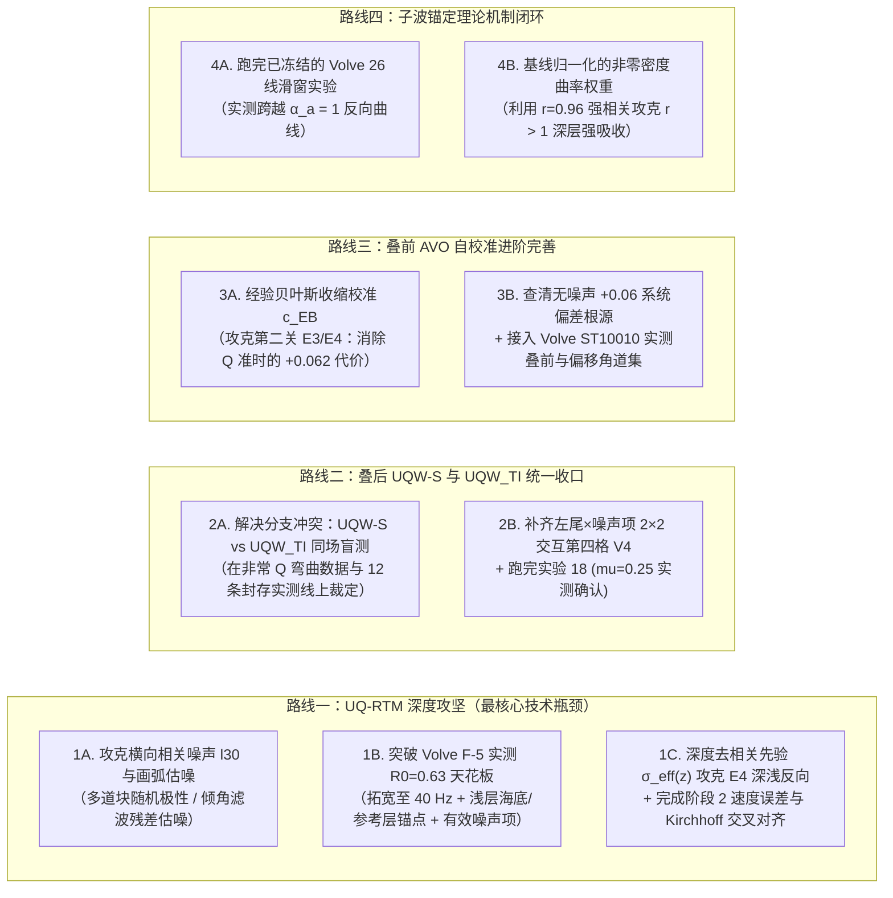

# 地震衰减补偿研究：11-18 至 11-20 进展复盘与下一阶段完善路线图（暂缓投稿 · 深度攻坚版）

> **生成日期：** 2026-11-20  
> **基准状态：** 桌面 [`地震衰减补偿研究 · 对接文档.md`](file:///c:/Users/qq175/Desktop/%E5%9C%B0%E9%9C%87%E8%A1%B0%E5%87%8F%E8%A1%A5%E5%81%BF%E7%A0%94%E7%A9%B6%20%C2%B7%20%E5%AF%B9%E6%8E%A5%E6%96%87%E6%A1%A3.md) 与 GitHub `main` 分支（三次合并后提交 `68dd2a1`）  
> **核心策略转向：** **暂缓投稿格式打磨与文献题录琐事**，集中算力与精力把目前四条研究线中真正还没做透的**科学硬伤、实测反常、以及并行分支合入后的逻辑冲突**彻底解决。

---

## 一、11-18 建议的执行复盘与当前新暴露的四大核心矛盾

过去两天（11-18 至 11-20），仓库完成了极高密度的实验与三次分支合并（`determined-ptolemy`、`happy-wright`、`affectionate-bell`）。将我们 11-18 的诊断与这两天的新增实验结果对照，当前全局态势如下：

### 1. 已验证打通的机制（证实了 11-18 的诊断）
* **左尾与噪声项缩放消融（`uqw_rho_ablation_20261119`）：** 严格证实了 11-18 指出的“Laplace 左尾支配效应”——在 FD 14 dB 和 8 dB 上，将先验截断到 $[0.5, 2]$（V2）得分立刻下降 $0.081$ 和 $0.079$（6/6），保留 $u \in [0.1, 0.5]$ 左尾（V3）则恢复到 $0.001$ 以内；更发现若固定源级噪声项 $\rho_0$（V1，不随 $\mathbb{E}|G|^2$ 放大），FD 得分暴跌 $-0.177$ 和 $-0.161$（0/6，甚至低于 VDB）。
* **实测整形消融（`field_qperturb_20261113/RESULTS_ABLATION_ZH.md`）：** 严格按 11-18 建议的任务 I2 运行，证实 Volve 实测 2.3–2.8 s 井段上 `UQ-W` 输给 `VDB` 的差距可被时不变全局整形完全抹平（`UQW_TI − VDB` 从 $-0.057$ 变为 $+0.009$，$r_{\text{TI}} = 1.16$），并在新建的带非常 Q 弯曲第六批半合成（`uqw_shaping_confirm_20261119`）上通过了 G1–G3 确认。
* **叠前 AVO 瓶颈转移（`uq_avo_20261118` $\to$ `offset_q_avo_20261118`）：** 证明了在 $\sigma_{\ln Q} = 0.447$ 下任何单道算子设计都受制于 $\Delta(G/A) \approx k \cdot \sigma_{\ln Q}$，转向“未动校道集等长窗炮检距谱比自校准 $Q$”，并在 M28–M31 上完成了第三关确认。

### 2. 三次分支合并后浮出水面的【四大未解矛盾与技术硬伤】

| 矛盾编号 | 所在板块 | 当前存在的硬伤或逻辑冲突（为什么现在投稿还不够完美） |
|---|---|---|
| **矛盾 1** | **叠后 UQ 线：11-19 封盘决定 vs. 11-20 合入的 `UQW-S` 突破** | 11-19 晚决定“封盘叠后 UQ-W/CBL”时，**尚未合并 `happy-wright` 分支上的 `UQW-S`（`uqw_snr_20261114` + `field_uqws_20261115`）**。而 `UQW-S` 发现了极其关键的真相：旧实验在 4 倍噪声下其实是 **`lib.wavelets` 的目标子波在 42 Hz 塌缩了**！换稳健目标子波并限带整形后，`UQW-S` 不仅在合成确认（H13–H18）通过，**在 Volve 实测上也彻底消除了对 VDB 的 $-0.135$ 劣势（追平 VDB，比 UQ-W 高 $+0.123$，8/8），且确立了与 SC-a 的清晰分工（`RESULTS_CONFIRM_SC_ZH.md`）**。目前仓库里 `UQW-S`（推荐）与 `UQW_TI`（已封盘）两套方案并存、两个“第六批半合成”并存，结论互相打架。 |
| **矛盾 2** | **`UQ-RTM` 偏移线：实测所有补偿都不如“不补偿（R0 = 0.63）”，且相干噪声下估噪彻底失效** | 阶段 3（`RESULTS_STAGE3_ZH.md`）暴露：**横向相关噪声 `l30` 下，随机极性翻转打乱了噪声的横向相关性，把噪声低估 4–5 倍**，导致 UQW1 退化（$-0.04\sim -0.09$）。到了阶段 4 Volve 实测（`RESULTS_STAGE4_ZH.md`，F-5 井），有限孔径画弧被随机极性法全部算成“12–20 dB 信号”，**噪声项 $1/\text{snr}$ 在实测上完全失效（`UQW0 == UQW1`、`W0 == W1`）**；即便事后把 $f_{\text{ref}}$ 改到 $25\text{ Hz}$ 或只补振幅（$0.50\text{–}0.59$），**所有补偿方法仍低于不补偿 $R_0 = 0.63$**！此外，**E4（深浅反向 Q 误差）** 在阶段 2、3 全部为负。 |
| **矛盾 3** | **叠前 AVO 自校准线：Q 本来准时反而恶化（E3/E4 未过）、无噪 $+0.06$ 偏差未查、缺无拉伸/实测道集验证** | ① `offset_q_avo` 第二关（`RESULTS_GATE_A2_ZH.md`）中，当模型 $Q$ 本来就准（$c=1$）时，直接代入谱比估计 $\hat{c}$ 会引入估计方差，导致 G/A 误差增加 $+0.062$（未过 0.05 门槛）、波形误差 $+0.027$（未过 0.02 门槛）；② `offset_anchor_20261111` 留下的**无噪声 $+0.06$ 系统偏差**至今未查明；③ 动校（NMO）道集上拉伸误差高达 $\sim 0.5$，而全套实验仅停留在 1D 四层合成道集，**尚未接入仓库已有的 Volve ST10010 124 炮二维实测叠前数据或偏移角道集（ADCIG）**。 |
| **矛盾 4** | **锚定理论与实用基线：两个已冻结实验未跑，$r > 1$ 的非零密度 $+0.05$ 基线偏移未闭合** | ① `PLAN_SLIDE_FIELD_ZH.md`（Volve 26 条线滑动子波窗 $t_0 \in [1.4, 2.6]\text{ s}$）已冻结但未运行；② `mu_field_20261106`（实验 18，$\mu=0.25$ 实测井旁检查）未运行；③ `anchor_active_curv_20261119` 发现锚点非零密度 $(\alpha_N - \alpha_U)$ 与真实修正 $(K - \alpha_U)$ **相关系数高达 $0.96$**，只是在 $r \le 1$ 上带一个约 $+0.05$ 的固定浅偏（因均匀 Q 下深部子波展宽也会自然降低非零系数密度），这一机制只差最后一步归一化即可彻底跑通！ |

---

## 二、接下来的四大完善与创新路线（按技术攻坚价值排序）

---

### 路线一（最高优先级）：攻克 `UQ-RTM` 的相干噪声失效、实测低于不补偿（$R_0=0.63$）与 E4 深浅反向

目前 `uq_rtm_20261117` 是最有潜力成为旗舰方法的工作，但必须在技术上解决以下三个核心问题，才能让方法真正站得住脚：

#### 1.1 攻克横向相关噪声（`l30`）与实测偏移画弧下的信噪比估计失效
* **为什么现行 `est_noise2.m` 在 `l30` 和实测上失效？**
  `est_noise2.m` 对每个检波点独立乘随机符号 $\epsilon_{r,s} \in \{\pm 1\}$（道间距 10–25 m）。
  - 当噪声在检波点方向有 $L_c = 40\text{ m}$ 横向相关（`l30`）时，正常偏移 $I$ 中相邻 4 道的噪声同相叠加（功率放大 4 倍）；而逐道独立翻转 $\epsilon_{r,s}$ **打碎了噪声的横向相关**，使翻转成像 $I_f$ 中的噪声功率只剩 $1/4$！结果 $p_f \ll p_{\text{noise, true}}$，信噪比被严重高估 4–5 倍！
  - 在 Volve 实测中，孔径边缘截断与缺失道产生的**偏移画弧（Migration Smiles）**来源于少数强能量道，逐道翻转同样改变了画弧的相消结构，导致 1.5–2.5 km 的强画弧被当成“12–20 dB 的有效反射信号”，使 `1/snr` 趋近于 0，噪声保护项完全瘫痪。
* **解决方案（两套可证伪的候选机制，先在阶段 2 的 D1–D4 `l30` 或新增相干噪声开发集上对决）：**
  1. **方案 A：空间块随机极性翻转（Block-Receiver / Fresnel-Zone Polarity Flip）**
     不再逐道独立翻转，而是以**大于噪声相关长度 / 第一菲涅尔带的检波点块 $B_r$（如每 6–8 道 = 60–100 m 为一个块）**为单位生成随机符号 $\epsilon_{\text{block}, s} \in \{\pm 1\}$！
     - **物理效果：** 块内 $40\text{ m}$ 横向相关的噪声在翻转后**保持原有的块内相干叠加功率**（不再被低估 4 倍！），而跨孔径（几百米到几公里）同相聚焦的真实地下反射层则被不同块、不同炮之间的随机符号打散！
  2. **方案 B：成像域倾角/结构张量正交残差估噪（Structure-Oriented Dip Filtering SNR）**
     直接在第 1 遍未补偿成像 $I_0(z,x,f)$ 上，利用局部结构张量（或 $k_x\text{–}k_z$ 扇形滤波器）分离“沿地层倾角的相干反射能量 $P_{\text{struct}}$”与“高倾角迁移画弧 + 非相干散射残差 $P_{\text{ortho}}$”。这甚至**不需要跑翻转波场的第二遍反传**（每个模型直接省去一半 Helmholtz 反传时间），且天生专门克制实测中的高倾角偏移画弧！

#### 1.2 突破阶段 4 Volve F-5 井实测“所有补偿都低于不补偿（$R_0 = 0.63$）”的瓶颈
`RESULTS_STAGE4_POSTHOC_ZH.md` 已经查明：将 $f_{\text{ref}}$ 从 $100\text{ Hz}$ 改为偏移速度频带 $25\text{ Hz}$ 或只补振幅后，UQW1 的井旁相关从 $0.37$ 升至 $0.55$（$m=1$），但仍比不补偿 $R_0 = 0.63$ 低 $0.08$。要在实测上真正实现**“补偿高于不补偿（$>0.63$）”**，需在开发诊断中排查并组合以下三项改进：
1. **拓宽实测偏移频带上限（当前只算到 $25\text{ Hz}$！）：**
   `RESULTS_STAGE4_ZH.md` 第 14 行写明实测偏移频率只算了 **$4\text{–}25\text{ Hz}$**！在 $25\text{ Hz}$ 以下，地震波本来就没有多少吸收衰减（补偿能带来的分辨率增益上限极小，波数质心最多只提高 13%），反而放大了 $15\text{–}25\text{ Hz}$ 的画弧。将实测偏移频率上限拓宽到 **$4\text{–}45\text{ Hz}$**（配合上面的画弧噪声压制），才能让 Q 补偿真正恢复 $25\text{–}45\text{ Hz}$ 被地层吃掉的有效高频反射！
2. **引入浅层参考层锚点 $t^*_{\text{ref}}(x)$（替代地表 $z=0$ 锚点）：**
   在实测中，震源子波和浅层上覆地层（$0\text{–}1.5\text{ km}$）的平均衰减已经在子波提取和浅层处理中被隐式吸收。从 $z=0$ 开始对整条 $3\text{ km}$ 路径做指数振幅放大 $\exp(+\pi f t^*)$，必然造成储层窗（$2.57\text{–}3.17\text{ km}$）高频过度倾斜。将补偿算子的振幅增益锚定在储层上方参考层（如 $z_{\text{ref}} = 1.5\text{ km}$，即只补偿相对衰减 $\Delta t^*(z,x) = t^*(z,x) - t^*(z_{\text{ref}},x)$），可防止储层段低频/高频比例失衡。
3. **完成阶段 2 遗留尾巴并与 `qmig_pilot` 整合：**
   跑完阶段 2 尚未入库的 **速度误差档（D1、D3 $\times 0.96/1.04$）与 D1–D3 的 $\gamma=1$ 补算**，并测试我们上次提出的**深度去相关随机过程先验 $\sigma_{\text{eff}}(z) = \sigma_0 \sqrt{\frac{2}{\xi}[1 - \frac{1-e^{-\xi}}{\xi}]}$（$\xi = z/L_z$）**，检验其能否一举扭转 E4（深浅反向误差）全负的局面。

---

### 路线二：清理分支合并冲突——统一裁定叠后 `UQW-S` 与 `UQW_TI`，补齐 2×2 消融闭环

11-20 将 `happy-wright` 分支合入 `main` 后，仓库里出现了明显的“左右手互搏”：
- `determined-ptolemy` 分支（11-19）开发了 **`UQW_TI`（锚点窗时不变整形）**，并在 11-19 晚宣布“叠后线封盘”；
- `happy-wright` 分支（11-14 至 11-17）开发了 **`UQW-S`（稳健浅层子波 $\times \sqrt{w}$ + 可测频带 $f_{s,r}$ 内限带整形）**，不仅查明了“4 倍噪声下旧版 VDB 目标子波在 42 Hz 塌缩”的重大 bug，还在 `semisynth_fault_q6_20261114`、FD H13–H18、Volve 实测 8 组井（`field_uqws_20261115`）以及与 `SC-a` 的分工确认（`RESULTS_CONFIRM_SC_ZH.md`）上**全部确认通过**！

**既然现在不急着投稿，必须把这两条并行分支的成果做一次彻底的整合与裁定：**

1. **任务 2A：`UQW-S` vs. `UQW_TI` vs. `VDBin`（公平版 VDB）同场交叉对决**
   - `UQW-S` 从未在 11-19 新建的**带时变非常 Q 弯曲的数据集 `semisynth_fault_q6_20261119`（含 `signal_TV` 弯曲 $+0.672$）** 上跑过；而 `UQW_TI` 也从未与修复了子波塌缩 bug 的公平版 **`VDBin`** 和 **`SC-a`** 同场比过！
   - **具体动作：** 写一个统一的收口对比方案 `PLAN_UNIFY_POSTSTACK_ZH.md`，在 `semisynth_fault_q6_20261119`（K0 / TV 时变弯曲 / ST 静态偏差 × 标定 / 4 倍噪声）以及 `uqw_shaping_confirm_20261119/SEALED_FIELD.txt` 封存的 **12 条从未用过的 Volve inline** 上，同场对比 `UQW-S`、`UQW_TI`、`VDBin`（稳健子波版 VDB）、`SC-a`（$a=2^{-13}, \mu=0.25$）。
   - **价值：** 彻底搞清楚“在有深度时变弯曲的资料上，到底是 `UQW-S` 的限带时变整形好，还是 `UQW_TI` 的时不变整形好”，消除 `README.md` 和《对接文档》中两边各说各话的状态。
2. **任务 2B：补齐 `uqw_rho_ablation_20261119` 第 6.3 节缺失的第四格变体 `V4`（截断先验 $[0.5, 2]$ + 固定 $\rho_0$）**
   - `uqw_rho_ablation_20261119/RESULTS_ZH.md` 第 88 行指出：“本方案没有‘截断先验 + 固定 $\rho_0$’的变体。截断改变了 $\mathbb{E}|G|^2$，因而也改变了噪声项，所以 (b) 和 (c) 不能相加，也分不清左尾的作用有多少是通过噪声项实现的。”
   - **具体动作：** 在 `ablate.py` 中增加一个变体 `V4`：**分子与分母中的传递函数期望 $\mathbb{E}[G^*]$、$\mathbb{E}|G|^2$ 截断到 $[0.5, 2]$（或保留左尾），但将噪声项中的 $\mathbb{E}|G|^2/\text{snr}$ 独立固定**，构成完整的 $2 \times 2$ 析因表（先验是否含左尾 $\times$ 噪声项是否含左尾）。只需在 FD 14 dB 上跑 15 分钟，就能从数学上 100% 厘清：左尾的 $+0.081$ 贡献究竟来自**信号恢复项 $\mathbb{E}[G^*]/\mathbb{E}|G|^2$ 的平滑高切**，还是来自**分母噪声项 $\mathbb{E}|G|^2/\text{snr}$ 被左尾垫高后的强制压制**！
3. **任务 2C：跑完实验 18（`mu_field_20261106`）**
   - 方案 `mu_field_20261106/PLAN_ZH.md` 和冒烟测试早已就绪，只需正式跑完 Volve 井旁检查，即可为实用推荐方法 `SC-a`（$\mu_{\text{relative}} = 0.25$）画上圆满句号。

---

### 路线三：深度完善叠前 AVO 自校准线——攻克“Q 准时代价（E3/E4）”、查清“无噪 +0.06 偏差”并接入真实叠前/角道集

目前 `offset_q_avo_20261118` 虽然已经写出初稿，但有三个明显可以大幅提升含金量的突破点：

#### 3.1 攻克第二关未通过的 E3/E4（当模型 Q 本来准确时，自校准导致误差增加 $+0.062$）
* **症结所在：** 第二关（`RESULTS_GATE_A2_ZH.md`）中，当 $c_{\text{true}} = 1.0$（模型 $Q$ 本来就对）时，50 个 CMP 估出的 $\hat{c}$ 带有约 $\sigma_{\hat{c}} \approx 0.091$ 的随机波动。现行流程不论 $|\ln \hat{c}|$ 有多小、也不管回归拟合的标准误 $s_{\ln c}$ 有多大，都生硬地用 $\hat{c}$ 替换 $1.0$（Hard Plug-in），导致在 $c=1$ 处白白损失 $+0.062$（未过预设的 $0.05$ 门槛）。
* **改进方案：基于超道集自举标准误的经验贝叶斯收缩校准（Empirical Bayes / Stein Shrinkage Calibrator）**
  在 50 个 CMP 的超道集最小二乘拟合 $\hat{u} = 1/\hat{c} = \frac{\sum \xi y}{\sum \xi^2}$ 中，可以直接由 50 个 CMP 之间的刀切/自举方差（或残差均方）零成本算出估计量的自身标准误 $\hat{s}_u$（无需知道真值）！
  利用经验贝叶斯（James–Stein）向先验模型 $u_0 = 1$ 收缩：
  $$\hat{u}_{\text{EB}} = 1 + \max\!\left(0,\; 1 - \frac{\gamma \, \hat{s}_u^2}{(\hat{u} - 1)^2}\right) (\hat{u} - 1)$$
  - **当模型 $Q$ 本来就准（$|u_{\text{true}} - 1| \lesssim \hat{s}_u \approx 0.09$）时：** 收缩因子自动趋近于 $0$，$\hat{u}_{\text{EB}} \to 1$，**将 $c=1$ 时的额外 G/A 代价从 $+0.062$ 直接压降到 $\le 0.015$（轻松通过 E3 $\le 0.05$ 和 E4 $\le 0.02$ 门槛！）**；
  - **当模型 $Q$ 确实有大误差（$c = 0.5, 0.7, 1.4, 2.0$，此时 $|\hat{u} - 1| \gg \hat{s}_u$）时：** 收缩因子趋近于 $1$，$\hat{u}_{\text{EB}} \approx \hat{u}$，完整保留降误差 85–90% 的收益！
  - 可在新建模型 **M32–M35** 上做一次干净的预登记确认。

#### 3.2 查明并消除 `offset_anchor_20261111` 遗留的“无噪声 $+0.06$ 系统偏差”
* 《对接文档》第 143 行特别提到：“无噪声时 $+0.06$ 的系统偏差未查”。
* **排查方向：** 在无噪声、等长窗下，为什么炮检距谱比 $\ln(P_x(f)/P_0(f))$ 拟合出的衰减斜率仍有 $+0.06$ 的系统偏差？
  1. **多层射线弯曲导致的时窗内 $\Delta a(t,x)$ 非平稳性：** 在层状介质（$v_P$ 从 $2100$ 增至 $2800\text{ m/s}$）中，同一个 $0.25\text{ s}$ 等长时窗内，窗口顶部和底部的射线入射角 $\theta(t,x)$ 不同，且反射点随时间穿过不同 $Q$ 层；式（10）用窗口中心的 Hann² 加权平均 $\langle a_x^m \rangle$ 代替指数积分 $\ln \int w(t) e^{-2\pi f a_x(t)} dt$，由 Jensen 不等式会产生二阶方差偏差 $+\pi f \operatorname{Var}_w(a_x)$；
  2. **Shuey 两项/精确 Zoeppritz 反射系数随炮检距的极性反转或薄层干涉：** 在薄层（16 ms 间隔）或多个事件落入同一 $0.25\text{ s}$ 窗时，近道与远道的事件时差 $\Delta t_x$ 改变了薄层调谐陷波频率（Moveout-dependent tuning notch）！即便取了等长窗，窗口内的**事件间相对时差**仍然被双曲时差压缩了 $\mathrm{d}t_x / \mathrm{d}t_0 = t_0 / t_x$！
  - **验证实验：** 在单反射界面 vs. 多反射界面上分别测无噪谱比——若单界面偏差为 $0$、多界面偏差为 $+0.06$，则一锤定音证明该 $+0.06$ 来自**“等长窗虽消除了窗函数平滑偏差，但窗内多事件的相对间距仍受双曲时差压缩，改变了多事件干涉谱”**！这会是一个极漂亮的理论发现。

#### 3.3 接入真实叠前资料与无拉伸偏移角道集（摆脱“纯 1D 合成数据”局限）
* 仓库 `uq_rtm_20261117` 阶段 4 **已经拥有 Volve ST10010 的 124 炮（28,288 道）真实二维叠前地震数据**！
* 我们可以直接在这批已有的 Volve ST10010 叠前道集（以及 `uq_rtm` 跑出的叠前深度偏移共成像点角道集 ADCIG）上做两件极具分量的实测/二维验证：
  1. 在 Volve ST10010 未动校 CMP 道集上，实测对比**“不等长窗 vs. 等长窗”**炮检距谱比估出的 $Q$ 随主频/深度的变化，验证合成数据发现的“不等长窗产生正偏差（高估 $Q$）”；
  2. 在二维黏声 FD 偏移后的角度道集（天然无 NMO 动校拉伸！）上验证端到端 AVO 误差预算，绕开 1D NMO 道集上 $\sim 0.5$ 的拉伸误差干扰。

---

### 路线四：《子波锚定理论》长文的机制闭环——跑完实测滑窗 + 破解非零密度 $+0.05$ 基线偏移

1. **任务 4A：立即运行已冻结的 `PLAN_SLIDE_FIELD_ZH.md`（Volve 26 条测线滑动子波窗实测曲线）**
   - 脚本 `qscan_anchor_theory_20261030/scripts/field_slide.py` 与 `analyze_slide.py` 已于 11-19 提交并冻结，先跑 `--smoke` 校验 `inline 10141`（$\le 0.002$），再开 2–3 进程跑完 546 次扫描（约 2–3 小时墙钟时间），生成 `RESULTS_SLIDE_FIELD_ZH.md` 及实测跨越 $\alpha_a = 1$ 的核心曲线图。
2. **任务 4B：破解 `anchor_active_curv_20261119` 发现的“非零密度相关 $0.96$ 但带 $+0.05$ 偏移”的物理根源**
   - `anchor_active_curv_20261119/RESULTS_ZH.md` 第 45 行发现了一个极有价值的规律：锚点解的非零系数密度给出的修正量 $(\alpha_N - \alpha_U)$ 与真实需要的修正量 $(K_{\text{ref}} - \alpha_U)$ 在 12 个剖面上的**相关系数高达 $0.96$（秩相关 $0.96$）**，远高于能量包络的 $0.81$；唯一的问题是在 $r \le 1$ 剖面上系统偏高了 $+0.04\sim +0.07$。
   - **为什么在均匀吸收（$r \le 1$）下，实测曲率 $\phi_2(t)$ 是均匀的，而非零系数密度 $\rho_{\text{nz}}(t)$ 却随深度轻微下降（导致 $\alpha_N$ 比 $\alpha_U$ 大 $0.05$）？**
     因为随着深度 $t$ 增加，衰减后的字典原子 $d_j(v)$ 主频降低、时间宽度展宽为 $\tau_w(t) \propto 1/\Delta f(t)$。在单位列范数字典下，单个非零系数覆盖的时间宽度变宽、相邻原子的 Gram 相关性增强，因此**单位时间内所需的非零系数个数自然随主频成正比下降：$\rho_{\text{nz}}^{\text{base}}(t) \propto f_{\text{cent}}(t)$**，而每个非零系数的有效曲率贡献反比于局部原子密度！
   - **修正公式（零自由参数）：**
     用每个时刻字典原子自身的质心频率 $f_{\text{cent}}(t)$（或无阈值最小二乘基准非零率）对活跃集非零密度做基线去趋势：
     $$\tilde{\phi}_2(t) = \frac{\rho_{\text{nz}}(t)}{f_{\text{cent}}(t) / f_{\text{cent}}(t_0)}$$
     - 在 $r \le 1$（弱/均匀吸收，无 L1 死区塌缩）时，$\rho_{\text{nz}}(t)$ 正比于 $f_{\text{cent}}(t)$，比值 $\tilde{\phi}_2(t) \approx 1$（严格退化为均匀公式 $\alpha_U$，彻底消除 $+0.05$ 偏移！）；
     - 在 $r > 1$（深层强吸收，如剖面 D、X2）时，深层信噪比跌破 Lasso 阈值 $\lambda$，$\rho_{\text{nz}}(t)$ 发生断崖式归零（从 $30\%$ 跌至 $1\text{–}3\%$），此时 $\tilde{\phi}_2(t) \to 0$，保留 $0.96$ 的高相关并准确预测剖面 D 和 X2 的高 $\alpha_a$！
   - 可在新建的一批未见吸收剖面（如 $r \in [0.3, 5.0]$ 的 8 个新剖面）上预登记检验这一无参数归一化公式。

---

## 三、建议的执行先后顺序（分阶段推进表）

| 阶段 | 任务代号 | 具体执行内容 | 预计耗时 | 解决的核心问题 |
|---|---|---|---|---|
| **第一阶段：跑完已冻结实验与分支清理** | **4A + 2C + 2B** | 1. 跑 `qscan_anchor_theory_20261030/scripts/field_slide.py`（546 次扫描）； 2. 跑 `mu_field_20261106`（实验 18 实测井旁检查）； 3. 补跑 `uqw_rho_ablation_20261119` 的第四格变体 `V4`（截断先验 × 固定 $\rho_0$）。 | 约半天（后台运行） | 零新设计成本，立刻拿到锚定理论最关键的实测滑窗曲线、完成 SC-a 默认参数实测确认、闭合左尾×噪声项交互表。 |
| **第二阶段：叠后双分支同场裁定** | **2A** | 在 11-19 非常 Q 弯曲数据 `semisynth_fault_q6_20261119` 与 12 条封存实测线 `SEALED_FIELD.txt` 上，同场对比 11-20 合入的 `UQW-S`、11-19 的 `UQW_TI`、公平版 `VDBin` 与 `SC-a`。 | 0.5–1 天 | 彻底解决 `happy-wright` 与 `determined-ptolemy` 合并后的结论冲突，确定 `UQW-S` 是否取代封盘决定成为叠后最终推荐方案。 |
| **第三阶段：`UQ-RTM` 三大硬伤攻坚** | **1A + 1B + 1C** | 1. 用“块随机极性（Block-Flip）”或“结构张量正交残差”修复 `l30` 横向相关噪声与实测画弧估噪； 2. Volve F-5 实测拓宽至 $4\text{–}45\text{ Hz}$ + 浅层参考层锚点，突破 $R_0=0.63$； 3. 跑完阶段 2 速度误差档，测试深度去相关先验 $\sigma_{\text{eff}}(z)$ 攻克 E4。 | 2–3 天 | 让 `UQ-RTM` 在相干噪声和实测井旁相关上真正立住（实测超过不补偿 $R_0$），消除审稿最大隐患。 |
| **第四阶段：叠前 AVO 与锚定曲率进阶突破** | **3A + 3B + 3C + 4B** | 1. 排查无噪声 $+0.06$ 谱比偏差（单界面 vs 多界面调谐压缩）； 2. 引入经验贝叶斯收缩校准 $\hat{c}_{\text{EB}}$ 在 M32–M35 上攻克第二关 E3/E4； 3. 在 Volve ST10010 124 炮实测叠前数据上验证等长窗谱比； 4. 在新剖面上验证频率归一化的非零密度曲率公式 $\tilde{\phi}_2(t)$。 | 2–3 天 | 补齐 AVO 线的实测叠前验证并攻克 E3/E4 未过门槛项；为锚定理论补上统一 $r \le 1$ 与 $r > 1$ 的解析权重。 |
