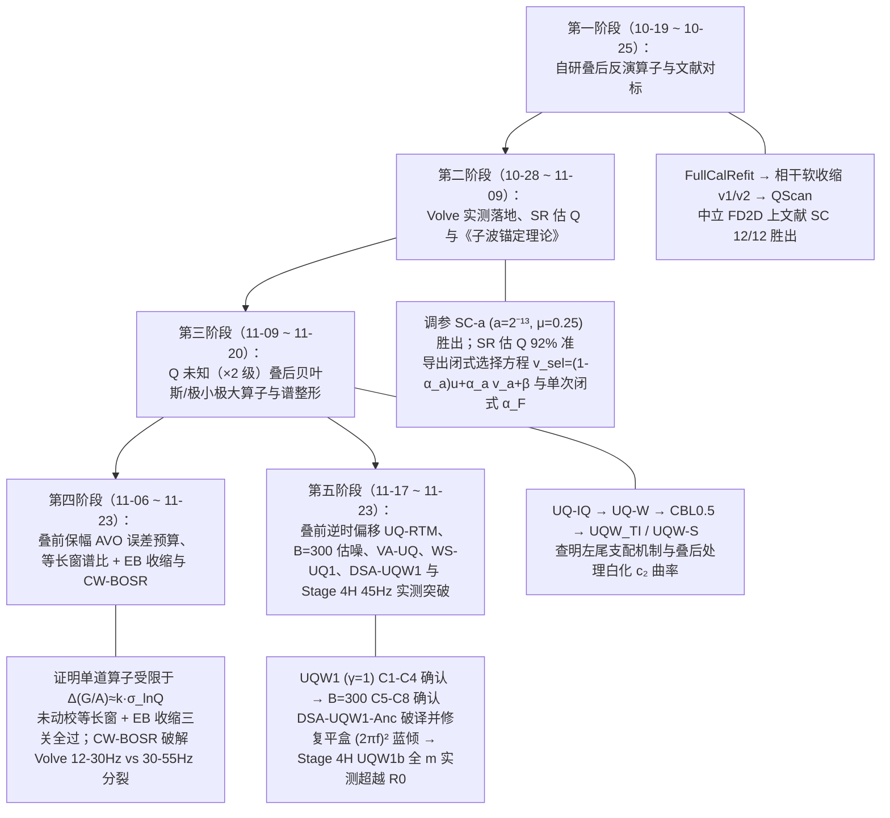

# 地震衰减（Q）补偿研究：全仓库方法总览、数学原理与合成–实测全量字典（2026-10-19 至 2026-11-23 终极完整版）

> **整理日期：** 2026-11-23（含 2026-11-23 22:21 刚跑完的 `Stage 4H` 4–45 Hz 实测宽频 RTM 及 `agy/bosr-wsuq-20261123` 全部分支成果）  
> **覆盖范围：** 主仓库 [`D:\ChatGPT\研究\地震衰减补偿研究`](file:///D:/ChatGPT/%E7%A0%94%E7%A9%B6/%E5%9C%B0%E9%9C%87%E8%A1%B0%E5%87%8F%E8%A1%A5%E5%81%BF%E7%A0%94%E7%A9%B6/README.md) 及 11 个 Git 工作树/分支（`main`、`claude/study-research-docs-plan-c4d4c6`、`claude/determined-ptolemy-3yna2o`、`claude/happy-wright-v8s4ba`、`claude/oqa-angle35-c7d177`、`claude/avo-q-colour-tradeoff-0c6b89`、`claude/noise-floor-curvature-784cae`、`agy/bosr-wsuq-20261123` 等），共计 **130+ 个实验目录、~8,000 个 MATLAB 脚本、~800 个 Python 脚本**。  
> **文档定位：** 从**第一性物理与数学原理（正演核、目标函数、闭式算子、渐近性质）**到**全阶段实验验证（1D 合成 $\to$ 2D 黏声有限差分 $\to$ 断层复杂 $Q$ 半合成 $\to$ Volve / U1320A / Cape / Sumatra 实测）**，对仓库中开发、对照、确认及证伪淘汰的**每一种方法**做百科全书式的详尽梳理。

---

## 目录

1. [全局视野：研究脉络、物理正演底座与评价指标体系](#一全局视野研究脉络物理正演底座与评价指标体系)
2. [方法选型终极速查表（按业务场景与最新实测证据）](#二方法选型终极速查表按业务场景与最新实测证据)
3. [第一板块：已知/给定 Q 下的叠后反演与稳定化滤波方法族](#三第一板块已知给定-q-下的叠后反演与稳定化滤波方法族)
4. [第二板块：Q 估计方法族与《扫描 Q 子波锚定理论》](#四第二板块q-估计方法族与扫描-q-子波锚定理论)
5. [第三板块：Q 未知/大误差（×2 级）下的叠后贝叶斯与极小极大补偿方法族](#五第三板块q-未知大误差2-级下的叠后贝叶斯与极小极大补偿方法族)
6. [第四板块：叠前保幅 AVO 衰减补偿与炮检距谱比自校准方法族](#六第四板块叠前保幅-avo-衰减补偿与炮检距谱比自校准方法族)
7. [第五板块：Q 不确定下的叠前逆时偏移（UQ-RTM）全谱系方法族](#七第五板块q-不确定下的叠前逆时偏移uq-rtm全谱系方法族)
8. [第六板块：贯穿全仓库的四大理论定理与已证伪死路清单](#八第六板块贯穿全仓库的四大理论定理与已证伪死路清单)
9. [全仓库核心代码入口与分支状态清单](#九全仓库核心代码入口与分支状态清单)

---

## 一、全局视野：研究脉络、物理正演底座与评价指标体系

### 1.1 核心物理问题与统一正演核（Kolsky–Futterman 黏声传播模型）

地震波在黏弹性地层中传播时，经历高频振幅指数衰减与相速度频散（高频走得快、低频走得慢，导致子波展宽与相位畸变）。全仓库所有方法均建立在 **Kolsky (1956) – Futterman (1962) 常 $Q$（或分段/空间变 $Q$）线性因果衰减–频散核** 之上：

* **累积衰减时间（$t^*$ 或记作 $a$）：**
  - **叠后双程走时 $t$：**
    $$a(t) = t^*(t) = \int_0^t \frac{\mathrm{d}\tau}{Q(\tau)}$$
  - **叠前层状介质（炮检距 $x$，双程射线路径 $L_x$）：**
    $$a(t_0, x) = \int_{L_x(t_0)} \frac{\mathrm{d}s}{v_{\text{ref}}(s)\, Q(s)}$$
  - **二维叠前深度偏移（源 $\mathbf{x}_s \to$ 成像点 $\mathbf{x} \to$ 镜面检波点 $\mathbf{x}_{\text{mir}}$）：**
    $$t^*(\mathbf{x}, s) = t_{\text{src}}^*(\mathbf{x}, \mathbf{x}_s) + t_{\text{rec}}^*(\mathbf{x}, \mathbf{x}_{\text{mir}})$$
    其中单支 $t^*$ 由程函方程 $|\nabla \tau|^2 = v^{-2}(\mathbf{x})$ 的 Fermat 射线路径积分 $\int_{\text{ray}} \frac{\mathrm{d}\ell}{v(\mathbf{x})Q(\mathbf{x})}$ 给出。
* **复传播传递函数 $G(a, f)$：**
  设模型给定的累积衰减为 $a_m$，真实衰减倍数为 $u = \frac{1}{c} = \frac{Q_{\text{model}}}{Q_{\text{true}}}$（或偏移中记模型乘子 $m = \frac{Q_{\text{used}}}{Q_{\text{true}}}$，此时算子使用 $a_{\text{op}} = a_{\text{true}}/m$，即 $u = m$）：
  $$G(a_m u, f) = \exp\!\big[b(f)\, a_m u\big], \qquad b(f) = -\pi f + i\, 2f \ln\!\left(\frac{f}{f_{\text{ref}}}\right)$$
  - **实部 $-\pi f a_m u$：** 控制高频振幅指数吸收 $|G(a_m u, f)| = e^{-\pi f a_m u}$；
  - **虚部 $+i\, 2f\ln(f/f_{\text{ref}})\, a_m u$：** 由 Kramers–Kronig 因果关系导出的最小相位频散项，对应频率相关复速度：
    $$\frac{1}{v(f)} = \frac{1}{v(f_{\text{ref}})}\left[1 - \frac{1}{\pi Q}\ln\!\left(\frac{f}{f_{\text{ref}}}\right) + \frac{i}{2Q}\right]$$

---

### 1.2 五阶段研究演进脉络图

---

### 1.3 数据体系与评价指标口径（严禁混用）

| 数据家族 | 代表批次与目录 | 物理生成方式 | 主要评价指标与优劣方向 |
|---|---|---|---|
| **1D 层状合成数据** | `F1–F4`（Kennett 细层）、`V1–V5` / `W1–W6` / `X1–X3`（`bae_q_20261024`、`vfamily_20261027`） | 1D 精确 Kennett 反射率法或传播矩阵正演 | **相对波形误差** $\|d_{\text{comp}} - d_{\text{true}}\|_2 / \|d_{\text{true}}\|_2$（或平方误差，**越低越好**） |
| **2D 黏声有限差分（FD2D）** | `H1–H6`（`fd2d_20261025`）、`H7–H12`（`fd2d_confirm_20261109`）、`H13–H18`（`fd2d_confirm3_20261114`） | 2D 黏声波动方程有限差分正演 + 偏移叠加（中立第三方物理引擎，震源子波已知） | 早期用相对误差（越低越好）；`qunknown_comp` 起统一用 **$S$ 指标**（与无衰减参考剖面的零时移归一化相关，**越高越好**） |
| **Volve 断层＋复杂 $Q$ 半合成（第 1–6 批）** | `semisynth_fault_q_20261030` 至 `semisynth_fault_q6_20261119`（及 `20261114` 版） | Volve F-11 T2 测井反射系数块自助 + 3 条正断层/破碎带/气藏低 $Q=18$ 透镜 + 实测 `MIG_RAW` 噪声线（第 6 批含 $+0.67$ 非常 $Q$ 谱弯曲） | **$S$ 指标**（零时移相关）与 **$T2$ 指标**（允许 $\pm 20\text{ ms}$ 时移、带通 $8\text{–}72\text{ Hz}$ 的井旁合成记录相关，**越高越好**） |
| **Volve 3D 叠后实测与 20 口井** | `field_vsp_volve_20261025`、`multiwell_tie_volve_20261028`（ST0202R08 `MIG_RAW`，105 条 inline，8 组独立井 + 12 条封存线） | 北海 Volve 油田真实三维叠后偏移剖面 + 测井声波/密度合成记录 + F-15A / F-11 T2 VSP | **$T2$ 井震相关**（8 组独立井簇自助 90% CI，**越高越好**）及两锚点实测 $\hat{\alpha}_a$ |
| **1D 叠前 AVO 合成道集** | `M1–M35`（`avo_bias_theory_20261106`、`offset_q_avo_20261118`） | 4 层/多层 Shuey 两项或 Zoeppritz 反射系数 + 双曲射线走时 $t_x$ 与射线 $t^*(x)$ + 可选 NMO 拉伸 | **逐事件截距梯度比误差** $M_G = \operatorname{median}|(G/A)_{\text{comp}} - (G/A)_{\text{true}}|$、逐样点梯度误差 $E_G$、波形误差（**越低越好**） |
| **Volve 2D 叠前实测炮集** | `seq-079 cable 5081` 处理后 PreMig 道集（124 炮，28,288 道）与原始未处理 `raw_seq079_PZ.sgy`（3.56 GB，水检 TRID 11 + 陆检 TRID 12） | 北海 Volve 真实海底电缆（OBC）双分量叠前地震记录 | 表观衰减率 $1000/Q_{\text{eff}}$（对比 F-15A VSP 真值区间 $[5.6, 17.4]$）及 F-5 / F-14 井旁 RTM 相关 |
| **2D 频域 Helmholtz 逆时偏移（RTM）** | 开发 `D1–D4`、确认 `C1–C8`、镜面孔径 `G1–G4`、独立确认 `H1–H5_VolveAnc`（`uq_rtm_20261117`、`uq_rtm_spg_20261123`、`uq_rtm_dsa_confirm_20261123`） | 2D 频域黏声 Helmholtz 方程精确正演（51 炮 × 300 检波器）+ 频域双程波逆时偏移 | **`E1`**：深部窗 `W_deep` 与弹性 `R0` 像在 $-10\text{ dB}$ 波数带内的允许 $\pm 3$ 样点归一化相关；**`E1_HF`**：高频段（25–45/50 Hz）相关；**`E_amp`**：气烟囱下影区与侧翼振幅比误差（越低越好）；**`SNR_img`**：图像域信噪比（dB） |

---

## 二、方法选型终极速查表（按业务场景与最新实测证据）

| 业务场景 | 最终首选推荐方法 | 备选 / 强基线方法 | 核心定量依据与最新实测状态 | 代码入口 |
|---|---|---|---|---|
| **1. 叠后补偿：$Q$ 可信（有 VSP / 测井标定）且信噪比正常** | **调参版结构约束反演 `SC-a`**（$a = 2^{-13},\; \mu_{\text{rel}} = 0.25$） | **70 dB 稳定化反 $Q$（`IQ70`）** | 中立 FD2D `H1–H6` 上 `SC` 12/12 胜相干软收缩（误差 `0.351` vs `0.427`）；调小稀疏权重 $a=2^{-13}$ 与相干权重 $\mu_{\text{rel}}=0.25$ 后在封存半合成上比原流程高 **`+0.212`**（12/12），Volve 8 组井实测 $T2 = 0.523$ 居首；分工确认（`RESULTS_CONFIRM_SC_ZH.md`）证实 $Q$ 准且 SNR 正常时 `SC-a` 胜 `UQW-S` `+0.052`。 | `srsc_volve_20261028/scripts/sc11.py`、`mu_tune_20261031/scripts/lib17.py` |
| **2. 叠后补偿：从地震资料估计背景 $Q$** | **多窗邻道互谱衰减法（`SR`）** | **QScan + 单次求解闭式 $\alpha_F$ 诊断** | `SR` 在未见半合成数据上 **92% 落在真值 $\pm 25\%$ 内**（$|\ln\text{err}| = 0.09$ vs `QScan` $0.24$）；`QScan` 因浅层子波锚定存在确定性压缩 $\alpha_a \approx 0.68$，若使用 `QScan` 必须配 $a=2^{-13}, \mu_{\text{rel}}=0.25$ 及闭式 $\alpha_F$ 锚定诊断。 | `specslope_q_volve_20261028/scripts/sq.py`、`anchor_closedform_confirm_20261121/` |
| **3. 叠后补偿：$Q$ 未知/可能有 $\times 2$ 级大误差，或强噪声主导** | **稳健限带整形期望维纳 `UQW-S`**（工程备选）或 **`VDBin` / `IQ70`** | `UQW_TI`（锚点窗时不变整形）、`CBL0.5` | 4 倍强噪或过补偿（$Q$ 偏小，$m=0.5$）下，`UQW-S` 显著胜过 `SC-a`（`+0.168 ~ +0.192`）和公平版 `VDBin`（`+0.104 ~ +0.123`）；在 Volve 8 组井实测上 `UQW-S` 彻底消除 `UQ-W` 欠补偿侧 `-0.135` 劣势，与 `VDB` 持平（`-0.002`）。*(注：学术线已于 11-19/20 封盘并入 RTM 论文)* | `uqw_snr_20261114/scripts/`、`uqw_shaping_confirm_20261119/scripts/` |
| **4. 叠前保幅 AVO 补偿与叠前定 $Q$** | **未动校等长窗炮检距谱比 + 经验贝叶斯收缩 $\hat{c}_{\text{EB}}$ + 射线 $t^*(x)$ 补偿（限频反 $Q$ / 分步 / 频率饱和阻尼）** | 偏移角道集（ADCIG）无拉伸补偿；实测叠前限 **`12–30 Hz` 等波数波束 `CW-BOSR`** | 合成三关（M20–M35）全过：$\hat{c}_{\text{EB}}$ 消除 $Q$ 准时代价（$G/A$ 代价 `+0.074 → +0.018`），校准后按真实射线 $t^*(x)$ 补偿比仅按垂向 $t_0^*$ 补偿的 AVO 误差低 **10.7 倍（截角 $\le 35^\circ$ 后低 13.2 倍）**！实测 Volve 叠前道集受 $>30\text{ Hz}$ 薄层调谐负斜率限制，须用 `12–30 Hz` 子带 `CW-BOSR` + 振幅域 `PZ` 上行波分离（实测 `+11.9 ~ +13.2` 命中 VSP）。 | `offset_q_avo_20261118/scripts/eb.py`、`offset_q_bosr_20261123/scripts/bosr_t11.py` |
| **5. 叠前深度偏移（Q-RTM）：合成与实测宽频结构成像** | **`UQW1b`（$\gamma=1$ 期望成像条件 + $B=300$ 整炮极性翻转估噪）** + **倾角感知活排列镜面门控与浅层锚定 `DSA-UQW1-Anc`** | 频带一致锚定 `VA-UQ`、多炮匹配滤波 `WS-UQ0/1` | ① `UQW1` 在 `C1–C4` 确认通过；② $B=300$ 整炮翻转在 `C5–C8` 确认消除横向相关噪声 `l30` 低估（$\Delta M_2 = +0.063, \Delta M_1 = +0.096$）；③ **今晚刚跑完的 Volve Stage 4H（4–45 Hz，6.25 m 网格）实测中，`UQW1b` ($B=300$) 在全 5 个 $m$ 上取得 `0.494–0.538`，首次在实测 F-5 井上全面击败不补偿 `R0 = 0.474`（$m=1$ 高 `+0.064`）**；④ `DSA-UQW1` 在 `H1–H4` 4/4 提升 `E1`（`+0.028`），`DSA-UQW1-Anc` 在 `H5_VolveAnc` 消除平盒 $(2\pi f)^2$ 蓝倾失配（`+0.0915`）。 | `uq_rtm_20261117/scripts/fld_run_h.m`、`est_block.m`、`uq_rtm_dsa_confirm_20261123/scripts/dsa_confirm_bench.m` |

---

## 三、第一板块：已知/给定 $Q$ 下的叠后反演与稳定化滤波方法族

本板块解决的问题是：**当给定一个背景 $Q(t)$ 模型时，如何在补偿高频吸收与频散的同时抑制高频噪声爆炸？**

### 3.1 经典滤波基线族（`FixedSplit`、`IQ30/IQ70`、`VDB / VDBin`）

#### （1）最初固定参数分步法（`FixedSplit`）
* **目录：** [`original_fixed_split_20261022`](file:///D:/ChatGPT/%E7%A0%94%E7%A9%B6/%E5%9C%B0%E9%9C%87%E8%A1%B0%E5%87%8F%E8%A1%A5%E5%81%BF%E7%A0%94%E7%A9%B6/README.md)
* **原理：** 将反 $Q$ 拆为两步独立滤波：第一步在时频域施加带固定增益上限与平滑阻尼的振幅补偿；第二步施加全频带 Kolsky 相位频散校正 $\exp[-i\,2f\ln(f/f_{\text{ref}})a(t)]$。
* **实测/合成表现：** 1D 合成 `F3/F4` 平均相对误差高达 `1.051`（补偿误差比信号本身还大），`V5` 为 `0.918`。原因是分步滤波无法利用反射系数的稀疏先验，在高频端要么欠补偿导致子波主瓣展宽，要么把带内噪声连同旁瓣一起放大。仅在 $Q$ 被严重低估 30% 时因保守而偶然优于未加保护的早期重拟合。**状态：最初基线。**

#### （2）稳定化反 $Q$ 滤波（`IQ30` / `IQ70`，Wang 2006 式）
* **目录：** [`baselines_volve_20261029/scripts/lib12.py`](file:///D:/ChatGPT/%E7%A0%94%E7%A9%B6/%E5%9C%B0%E9%9C%87%E8%A1%B0%E5%87%8F%E8%A1%A5%E5%81%BF%E7%A0%94%E7%A9%B6/baselines_volve_20261029/RESULTS_ZH.md)
* **数学原理：**
  对相位做精确逆频散校正，对振幅采用 Wiener–Tikhonov 稳定化因子（稳定常数 $s$ 由分贝增益上限 $G_{\lim}\in\{30, 70\}\text{ dB}$ 决定，$s \approx 10^{-G_{\lim}/10}$）：
  $$H_{\text{IQ}}(t, f) = \frac{|G(t, f)|}{|G(t, f)|^2 + s} \exp\!\big[-i\,\Phi(t, f)\big] = \frac{e^{-\pi f a(t)}}{e^{-2\pi f a(t)} + s} \exp\!\left[-i\,2f\ln\!\left(\frac{f}{f_{\text{ref}}}\right)a(t)\right]$$
  - `IQ30`：$s = 10^{-3}$（增益上限约 15–30 dB，强阻尼）；
  - `IQ70`：$s = 10^{-7}$（增益上限 70 dB，配合由浅层子波信噪比确定的硬截止频率 $f_{\max}$）。
* **合成与实测表现：**
  - 在实验 12（`baselines_volve_20261029`）和实验 13（`field_baselines_volve_20261029`）中，**调好频带上限的 `IQ70` 在 $Q$ 准确时表现极强**：半合成 $S = 0.888$（高于 `SC-a` 的 $0.864$ 和实验 11 解耦法的 $0.729$）；Volve 8 组井实测比不补偿提高 $+0.23\sim +0.30$（8/8）。
  - **致命弱点：** ① **对过补偿（$Q$ 偏小，$m=0.5$）毫无抵抗力**——当模型 $Q$ 只有真值一半时，`IQ70` 在半合成上 $S$ 暴跌至 **`0.08`**（`RESULTS_STAGE0_ZH.md`）；② **在深部低信噪比数据（如 FD2D 14 dB）上彻底崩溃**——深部带内真实 SNR 只有 $-12\sim +8\text{ dB}$，$s=10^{-7}$ 形同虚设，把带内噪声放大上千倍，导致 $Q$ 完全正确时 `IQ70` 的 $S$ 也只有 **`0.05`**（`RESULTS_STAGE2B_ZH.md`）！
* **状态：推荐基线（仅限 $Q$ 可信且带内信噪比高时）。**

#### （3）相位反 $Q$ + 时变维纳谱整形（`VDB` / 稳健公平版 `VDBin`，van der Baan 2012）
* **目录：** [`baselines_volve_20261029/scripts/lib12.py`](file:///D:/ChatGPT/%E7%A0%94%E7%A9%B6/%E5%9C%B0%E9%9C%87%E8%A1%B0%E5%87%8F%E8%A1%A5%E5%81%BF%E7%A0%94%E7%A9%B6/baselines_volve_20261029/RESULTS_ZH.md)、[`uqw_snr_20261114`](file:///D:/ChatGPT/%E7%A0%94%E7%A9%B6/%E5%9C%B0%E9%9C%87%E8%A1%B0%E5%87%8F%E8%A1%A5%E5%81%BF%E7%A0%94%E7%A9%B6/README.md)
* **数学原理：**
  **振幅完全不用 $Q$ 模型！** 第一步仅用模型 $Q$ 做纯相位频散校正 $d_{\text{ph}}(t,f) = d(t,f)\exp[-i\Phi(t,f)]$；第二步在滑动时窗（窗长 $0.5\text{ s}$）内计算输出道功率谱 $P_d(t,f)$，直接设计时变零相位 Wiener 整形滤波器，将当前时窗振幅谱强行拉向浅层锚点窗（$1.2\text{–}1.6\text{ s}$）提取的目标子波振幅谱 $|W_{\text{anc}}(f)|$：
  $$H_{\text{VDB}}(t, f) = \exp\!\big[-i\,\Phi(t, f)\big] \cdot \frac{|W_{\text{anc}}(f)|\, \sqrt{P_{\text{sig}}(t,f)}}{P_d(t,f) + \epsilon}$$
  - **`VDBin`（2026-11-14 修复版）：** `uqw_snr_20261114` 发现旧版 `VDB` 依赖的 `lib.wavelets` 在 4 倍强噪声下目标子波谱于 $42\text{ Hz}$ 发生断崖式塌缩，导致旧版 `VDB` 被人为压低 $0.11\text{–}0.14$；换成稳健浅层子波并在可测频带内整形后即为公平版 `VDBin`。
* **合成与实测表现：**
  - **优点：** 因为振幅不依赖 $Q$ 模型，当 $Q$ 严重偏大（欠补偿侧 $m=2.0$）或实测存在非常 $Q$ 谱弯曲/处理白化残差时，`VDB` 表现极稳；在 `field_qperturb_20261113`（Volve 实测 8 组井 $\times$ 9 个 $m$）中，`VDB` 全面击败未加整形的 `UQ-W`（高 $+0.071$，8/8）。由 `direction_theory_20261121` **定理 2** 证明，归一化相关指标（$T2, S$）下的理论最优算子恰为 $\text{Wiener}\times W_{\text{ref}}(f)$，`VDB` 天然逼近该形式。
  - **弱点：** ① 在 $Q$ 准确且符合常 $Q$ 物理规律时，比 `IQ70` / `SC-a` 低 $0.054$；② 在 4 倍强噪声或 FD 14 dB 低信噪比下，分时窗数据谱估计受噪声污染，即便修复目标子波后的 `VDBin` 仍比带先验左尾保护的 `UQW-S` 低 **`0.104 ~ 0.123`**（6/6，`RESULTS_CONFIRM_S_ZH.md`）。

---

### 3.2 自研叠后反演演进线（`FullCalRefit` $\to$ `CoherenceSoft` $\to$ `EI-QComp`）

#### （1）反射系数稀疏估计 + 保幅最小二乘重拟合（`FullCalRefit` / `PrunedFullCalRefit`）
* **目录：** [`adaptive_joint_cv_20261022`](file:///D:/ChatGPT/%E7%A0%94%E7%A9%B6/%E5%9C%B0%E9%9C%87%E8%A1%B0%E5%87%8F%E8%A1%A5%E5%81%BF%E7%A0%94%E7%A9%B6/README.md)、[`delivery_check_20261023`](file:///D:/ChatGPT/%E7%A0%94%E7%A9%B6/%E5%9C%B0%E9%9C%87%E8%A1%B0%E5%87%8F%E8%A1%A5%E5%81%BF%E7%A0%94%E7%A9%B6/README.md)、[`complex_fieldlike_20261023`](file:///D:/ChatGPT/%E7%A0%94%E7%A9%B6/%E5%9C%B0%E9%9C%87%E8%A1%B0%E5%87%8F%E8%A1%A5%E5%81%BF%E7%A0%94%E7%A9%B6/README.md)
* **数学原理：**
  抛弃直接频域除法滤波，转而求解**时变衰减子波字典下的反褶积/稀疏反演问题**。构造衰减字典矩阵 $\mathbf{D}(Q)$（第 $j$ 列为时刻 $t_j$ 处经历累积衰减 $a(t_j)$ 后的子波时域波形）与无衰减参考子波褶积矩阵 $\mathbf{W}_0$：
  1. **第一步（稀疏支持集识别）：** 求解 Lasso / 弹性网问题获取反射系数初始解 $\hat{\mathbf{r}}^{(0)} = \arg\min_{\mathbf{r}} \frac{1}{2}\|\mathbf{D}(Q)\mathbf{r} - \mathbf{d}\|_2^2 + \lambda \|\mathbf{r}\|_1$；
  2. **第二步（Debiasing 保幅重拟合）：** 为消除 L1 惩罚对大反射振幅的系统压缩，在提取的活跃集（或带弱岭回归权重）上做无 L1 偏置的最小二乘重拟合 $\hat{\mathbf{r}}_{\text{refit}}$，再与无衰减理想子波褶积输出补偿地震道 $\hat{\mathbf{d}}_{\text{comp}} = \mathbf{W}_0 \hat{\mathbf{r}}_{\text{refit}}$。
* **测试结果：**
  - 在 1D 稀疏模型（100 组开发 + 60 组盲测）上，`PrunedFullCalRefit` 将波形误差从 `FixedSplit` 的 **`0.862` 暴降至 `0.153`**（降低 82%！）；在 60 层复杂类实测模型上未剪枝版 `FullCalRefit` 误差比分步法低 11%–16%。
  - **暴露出的致命软肋（[`q_error_stability_20261023`](file:///D:/ChatGPT/%E7%A0%94%E7%A9%B6/%E5%9C%B0%E9%9C%87%E8%A1%B0%E5%87%8F%E8%A1%A5%E5%81%BF%E7%A0%94%E7%A9%B6/README.md)）：** 容忍 $Q$ 误差的区间几乎为 **0%**——只要输入的 $Q$ 偏离真值 15%–30%，字典失配立刻在重拟合步被急剧放大，误差失控！这直接催生了后续的 `QScan` 与 `UQ` 两条主线。

#### （2）邻道相干度自适应软收缩（`CoherenceSoft v1 / v2`，封装于 `q_compensate.m`）
* **目录：** [`coherence_soft_20261023`](file:///D:/ChatGPT/%E7%A0%94%E7%A9%B6/%E5%9C%B0%E9%9C%87%E8%A1%B0%E5%87%8F%E8%A1%A5%E5%81%BF%E7%A0%94%E7%A9%B6/README.md)、[`coherence_soft_v2_20261024`](file:///D:/ChatGPT/%E7%A0%94%E7%A9%B6/%E5%9C%B0%E9%9C%87%E8%A1%B0%E5%87%8F%E8%A1%A5%E5%81%BF%E7%A0%94%E7%A9%B6/README.md)、[`compensation_package_20261024/q_compensate.m`](file:///D:/ChatGPT/%E7%A0%94%E7%A9%B6/%E5%9C%B0%E9%9C%87%E8%A1%B0%E5%87%8F%E8%A1%A5%E5%81%BF%E7%A0%94%E7%A9%B6/README.md)
* **数学原理：**
  在 `FullCalRefit` 得到重拟合反射系数剖面 $\hat{R}(t, x)$ 后，不采用硬剪枝（会误伤弱反射）或均匀软阈值，而是计算局部多道时空窗口内的**跨道相干度（Semblance / Coherence）** $C(t, x) \in [0, 1]$，构造相干度驱动的自适应软收缩算子：
  $$\hat{R}_{\text{coh}}(t, x) = \operatorname{sign}\big(\hat{R}(t,x)\big)\cdot \max\!\Big(0,\; |\hat{R}(t,x)| - \tau_0\big(1 - \alpha C(t,x)\big)\sigma_{\text{loc}}(t)\Big)$$
  - 当同相轴横向连续（$C(t,x) \to 1$）时，收缩阈值大幅降低，**完整保住弱有效反射与尖灭尾部**；
  - 当处于随机噪声或孤立伪影区（$C(t,x) \to 0$）时，施加高阈值收缩，压制高频反褶积假象。
* **测试结果：**
  - `v1` 在 30 个全新 1D/准 2D 场景上 **5/5 预登记门槛全过**（比普通软收缩 `SoftRefit` 误差再降 8.2%）；`v2`（标准版）再降 2.1%（4/5 过门槛）。
  - **为什么最终标为“不如文献方法”？** 在 2026-10-26 引入中立二维黏声有限差分数据 `H1–H6`（[`sc_neutral_20261026`](file:///D:/ChatGPT/%E7%A0%94%E7%A9%B6/%E5%9C%B0%E9%9C%87%E8%A1%B0%E5%87%8F%E8%A1%A5%E5%81%BF%E7%A0%94%E7%A9%B6/sc_neutral_20261026/RESULTS_ZH.md)）进行盲测对决时，`CoherenceSoft` 属于**后处理式两步横向平滑**，而文献方法 `SC` 在反演目标函数内部直接耦合横向结构导数，结果 `SC` 以 **12/12 全胜**（平均相对误差 `0.351` vs `0.427`）击败了 `CoherenceSoft`！（仅在 `V4/V5` 家族生成器上 `CoherenceSoft` 占优，后经 `sc_vtuned_20261028` 证实 89% 源于 `SC` 未在该家族调参）。

#### （3）等变成像自监督 Q 补偿（`EI-QComp`，Chen et al. 2021 思路迁移）
* **目录：** [`ei_qcomp_20261104`](file:///D:/ChatGPT/%E7%A0%94%E7%A9%B6/%E5%9C%B0%E9%9C%87%E8%A1%B0%E5%87%8F%E8%A1%A5%E5%81%BF%E7%A0%94%E7%A9%B6/README.md)
* **数学原理：**
  假设真实地下反射系数序列具有**时间平移群或尺度群等变性（Equivariance）** $\{T_g\}$。训练重建算子/网络 $f_\theta$ 最小化测量一致性（MC）加上等变自监督损失（EI）：
  $$\mathcal{L}(\theta) = \underbrace{\|\mathbf{D}(Q) f_\theta(\mathbf{d}) - \mathbf{d}\|_2^2}_{\text{测量一致性 MC}} + \alpha \, \mathbb{E}_{g}\Big\| f_\theta\big(\mathbf{D}(Q) T_g f_\theta(\mathbf{d})\big) - T_g f_\theta(\mathbf{d}) \Big\|_2^2$$
* **测试结果与淘汰原因：**
  - 在 $Q$ 完全已知、反射系数平稳时，3 个种子上 `MC+EI` 比单纯 `MC` 的最佳早停点高 **`+1.7 dB`**，且不依赖早停；
  - **致命缺陷：** 当 $Q$ 仅存在 **$\pm 10\%$ 误差** 时（`RESULTS_QERR10_ZH.md`），`MC+EI` 性能暴跌 **$6.0\text{–}8.6\text{ dB}$**（$\pm 20\%$ 时暴跌 $10\text{–}15\text{ dB}$，甚至比 Tikhonov 低 $2.1\text{ dB}$），且留出验证损失完全无法用来反选正确的 $Q$！因对 $Q$ 精度的要求严苛到不切实际（远严于 $\pm 10\%$），于 11-04 终止投入。

---

### 3.3 文献标杆方法：结构约束多道稀疏反 $Q$（`SC` / `SC-a`，马雄等 2023）

* **目录：** [`novelty_evidence_20261025`](file:///D:/ChatGPT/%E7%A0%94%E7%A9%B6/%E5%9C%B0%E9%9C%87%E8%A1%B0%E5%87%8F%E8%A1%A5%E5%81%BF%E7%A0%94%E7%A9%B6/README.md)、[`sc_neutral_20261026`](file:///D:/ChatGPT/%E7%A0%94%E7%A9%B6/%E5%9C%B0%E9%9C%87%E8%A1%B0%E5%87%8F%E8%A1%A5%E5%81%BF%E7%A0%94%E7%A9%B6/sc_neutral_20261026/RESULTS_ZH.md)、[`field_application_20261028/scripts/lib.py`](file:///D:/ChatGPT/%E7%A0%94%E7%A9%B6/%E5%9C%B0%E9%9C%87%E8%A1%B0%E5%87%8F%E8%A1%A5%E5%81%BF%E7%A0%94%E7%A9%B6/field_application_20261028/RESULTS_ZH.md)、[`sca_ceiling_20261030`](file:///D:/ChatGPT/%E7%A0%94%E7%A9%B6/%E5%9C%B0%E9%9C%87%E8%A1%B0%E5%87%8F%E8%A1%A5%E5%81%BF%E7%A0%94%E7%A9%B6/sca_ceiling_20261030/RESULTS_ZH.md)、[`mu_tune_20261031`](file:///D:/ChatGPT/%E7%A0%94%E7%A9%B6/%E5%9C%B0%E9%9C%87%E8%A1%B0%E5%87%8F%E8%A1%A5%E5%81%BF%E7%A0%94%E7%A9%B6/mu_tune_20261031/RESULTS_ZH.md)
* **数学原理：**
  对整条二维共偏移距/叠后剖面 $\mathbf{D} \in \mathbb{R}^{n_t \times n_x}$ 联合反演反射系数剖面 $\mathbf{R} \in \mathbb{R}^{n_t \times n_x}$，目标函数同时包含**数据保真项、逐道 L1 稀疏项、以及沿地层局部倾角方向的二阶结构连续性正则项**：
  $$\min_{\mathbf{R}} \; \frac{1}{2}\big\|\mathcal{G}(Q)\mathbf{R} - \mathbf{D}\big\|_F^2 + \lambda_{\text{L1}} \|\mathbf{R}\|_1 + \frac{\mu}{2}\big\|\nabla_{\text{dip}}\mathbf{R}\big\|_F^2$$
  其中：
  - $\mathcal{G}(Q)$ 为按道施加的时变衰减–频散褶积算子（在实测适配版 `SC-a` 中，按浅层统计子波与信噪比门限自动限带，且 L1 权重缩放为 $\lambda_{\text{L1}} = a \cdot \operatorname{median}_k\|\tilde{\mathbf{B}}_k\|_2$）；
  - $\nabla_{\text{dip}}$ 为沿着由结构张量估计出的地层局部倾角方向的定向差分算子（当 $\mu = 0$ 时退化为单道稀疏反演 `SC0`）；
  - 采用 ADMM（交替方向乘子法）或外层 IRLS + 内层共轭梯度（CG）高效求解，最终输出 $\hat{\mathbf{D}}_{\text{comp}} = \mathbf{W}_0 \mathbf{R}^*$。
* **本仓库对 `SC-a` 的三大工程与科学改进（实验 7 $\to$ 实验 17）：**
  1. **修复子波有效频带在噪声中频峰处的过早塌缩（`sca_ceiling_20261030`）：** 原带宽截断规则遇到局部信噪比小缺口即停止，导致 6/18 个数据集带宽塌缩到 $43\text{–}63\text{ Hz}$；允许跨过窄缺口后 `SC-a` 的 $S$ 指标直接跃升 **`+0.124`**（达到 $0.909$，反超 `IQ70` 的 $0.888$）。
  2. **大幅下调 L1 稀疏权重 $a$（从 $0.5$ 降至 $a = 2^{-13} \approx 1.22\times 10^{-4}$）：** 实验 12、13、15、16、17 连续五次在未见数据与 Volve 实测上确认：真实测井反射系数是**密集、有色（蓝谱）**的，原默认大稀疏权重 $a=0.5$ 会削平大量中小反射层；将 $a$ 调小至 $2^{-13}$ 后，半合成提升 **`+0.123 ~ +0.163`**（12/12），Volve 8 组井实测 $T2$ 提升 **`+0.063`**（平均 $T2 = 0.523$ 夺冠）。
  3. **横向相干项权重 $\mu_{\text{relative}}$ 的精确寻优与确认（`mu_confirm_20261031` $\to$ `mu_tune_20261031`）：**
     - 原默认 $\mu_{\text{rel}} = 10$ 在断层破碎带和横向 $Q$ 变化处过度抹平构造（有害）；但完全去掉（$\mu_{\text{rel}} = 0$，实验 16）在未见构造 D/E/F 上也无显著增益（$+0.007\sim+0.012$）。
     - 实验 17 在第一、二批 24 个开发集上网格搜索 $\{0, 0.25, 0.5, 1, 2, 4, 10\}$，所有路线一致选出 **$\mu_{\text{rel}} = 0.25$**；随后在封存第三批 `G/H/I`（12 个数据集）上盲测确认：**SR + SC-a ($\mu=0.25$) 比 $\mu=10$ 高 `+0.096`（12/12），QScan + $a=2^{-13}$ + $\mu=0.25$ 比用户原流程高 `+0.212`（12/12）！**
* **状态：当前叠后 $Q$ 可信（或配合 `SR` / `QScan`）时的首选推荐方法。**

---

## 四、第二板块：$Q$ 估计方法族与《扫描 $Q$ 子波锚定理论》

本板块回答两个核心问题：**① 为什么工业界和文献中广泛使用的“扫描 $Q$ 选最稀疏/最小残差解（QScan）”在子波未知时会发生严重的系统压缩与偏移？② 叠后究竟应该用什么方法估 $Q$？**

### 4.1 扫描 $Q$ 类方法（`QScan`、`Yan 2023`、`Cheng 2025`）与 11 次去偏失败史

* **基本流程（`QScan`）：**
  给定背景模型 $Q_0(t)$，在候选乘子网格 $c \in \{c_1, \dots, c_{15}\} \subset [0.4, 2.5]$（几何等距，步长比 $1.14$）上扫描 $Q(t) = c\, Q_0(t)$。对每个候选 $c$：
  1. 由浅层子波窗（默认 $1.2\text{–}1.6\text{ s}$，中心 $t_0 = 1.4\text{ s}$）提取振幅谱，并按**固定参考假设 $c_a = 1$** 扣除子波窗衰减：$|\hat{W}(f)| = \sqrt{P_{\text{sig}}(t_0, f)} / e^{-\pi f a_0 v_a}$（其中 $a_0 = a(t_0), v_a = 1/c_a = 1$）；
  2. 组装候选衰减字典 $\mathbf{D}(v)$（$v = 1/c$），求解 Lasso 目标函数最小值：
     $$J(v; v_a) = \min_{\mathbf{r}} \frac{1}{2}\big\|\mathbf{D}(v; v_a)\mathbf{r} - \mathbf{d}\big\|_2^2 + \lambda_{\text{L1}}(v; v_a)\|\mathbf{r}\|_1$$
  3. 选取使 $J(v; v_a)$ 达到极小的 $c_{\text{sel}} = 1/v_{\text{sel}}$。
* **反常现象与 11 次修正全败（10-24 至 10-29）：**
  - 在 1D 合成数据上，`QScan` 无论有无噪声都确定性地偏向 $1.24\text{–}1.28\, Q_0$（`qscan_bias_variance_20261024`），且在新模型 `G1–G8` 上偏移从 $-4$ 步到 $+4$ 步**因地质模型而异**（`qscan_offset_20261025`）；
  - 在 Volve 半合成数据（实验 8）上，当真实 $c_{\text{true}}$ 取 $0.64, 0.80, 1.00$ 时，`QScan` 在 30 个噪声实现上**全部选出同一个值 $0.877$**（选出的 $Q$ 对真实 $Q$ 的响应斜率被严重压缩到只有 $0.19\text{–}0.30$！）；
  - 仓库先后尝试了 **换 BIC/AIC/残差准则（`qscan_criterion`）、4 种非稀疏准则（`qcriteria`）、分深度分段 $Q$（`qscan_layered`）、13 种无真值偏移预测器（`qscan_predictor`）、有把握才修正（`qscan_abstain`）、7 种组合准则（`critcombo`）、共享鬼波标定（`calq_confirm`）、文献 Yan 2023 残差+稀疏加权准则（`yan_criterion`）、文献 Cheng 2025 浅深振幅比准则（`cheng_criterion`）、频带交叉验证（`qscan_bandcv_pilot`）、调 Lasso 稀疏权重 $\lambda$（`qscan_reg_pilot`）** —— **全部 11 条修正路线无一成功！**

---

### 4.2 《扫描 $Q$ 子波锚定理论》：从第一性原理闭式方程到活跃集 Hessian 三分与相图（旗舰理论长文）

* **核心目录群：** [`qscan_anchor_theory_20261030`](file:///D:/ChatGPT/%E7%A0%94%E7%A9%B6/%E5%9C%B0%E9%9C%87%E8%A1%B0%E5%87%8F%E8%A1%A5%E5%81%BF%E7%A0%94%E7%A9%B6/qscan_anchor_theory_20261030/PAPER_DRAFT_ZH.md)、[`qscan_c1_factor_20261106`](file:///D:/ChatGPT/%E7%A0%94%E7%A9%B6/%E5%9C%B0%E9%9C%87%E8%A1%B0%E5%87%8F%E8%A1%A5%E5%81%BF%E7%A0%94%E7%A9%B6/README.md)、[`anchor_active_curv_20261119`](file:///D:/ChatGPT/%E7%A0%94%E7%A9%B6/%E5%9C%B0%E9%9C%87%E8%A1%B0%E5%87%8F%E8%A1%A5%E5%81%BF%E7%A0%94%E7%A9%B6/README.md)、[`anchor_active_hessian_20261120`](file:///D:/ChatGPT/%E7%A0%94%E7%A9%B6/%E5%9C%B0%E9%9C%87%E8%A1%B0%E5%87%8F%E8%A1%A5%E5%81%BF%E7%A0%94%E7%A9%B6/README.md)、[`anchor_closedform_confirm_20261121`](file:///D:/ChatGPT/%E7%A0%94%E7%A9%B6/%E5%9C%B0%E9%9C%87%E8%A1%B0%E5%87%8F%E8%A1%A5%E5%81%BF%E7%A0%94%E7%A9%B6/README.md)、[`anchor_norm_phasediag_20261123`](file:///D:/ChatGPT/%E7%A0%94%E7%A9%B6/.claude/worktrees/bosr-wsuq-20261123/%E5%9C%B0%E9%9C%87%E8%A1%B0%E5%87%8F%E8%A1%A5%E5%81%BF%E7%A0%94%E7%A9%B6/anchor_norm_phasediag_20261123/RESULTS_ZH.md)

#### （1）第一性原理推导：失配谱倾斜与闭式选择方程
记真实衰减率为 $u = 1/c_{\text{true}}$，子波窗（中心时刻 $t_0$，累积衰减 $a_0 = a(t_0)$）假设的锚点衰减率为 $v_a = 1/c_a$，扫描候选衰减率为 $v = 1/c$。
当 $v_a \neq u$ 时，从子波窗提取的子波自带残余谱倾斜 $\exp[-\pi f a_0(u - v_a)]$。因此在时刻 $t$ 处，真实地震道与候选字典原子之间的净衰减失配为：
$$\delta(t) = a(t)(u - v) - a_0(u - v_a)$$
**物理洞察：** 叠后反射资料只约束深浅层之间的**相对衰减差** $(a(t) - a_0)u$！用单一全局参数 $v\cdot a(t)$ 去拟合 $u\cdot a(t) - a_0(u - v_a)$，数学上等价于**将一条带非零截距的直线强行做过原点的比例回归**！

将目标函数 $J(v)$ 在 $\delta(t) = 0$ 附近做二阶泰勒展开 $J(v) \approx J_0 + \sum_t [\phi_1(t)\delta(t) + \frac{1}{2}\phi_2(t)\delta(t)^2]$，对 $v$ 求导置零 $\frac{\partial J}{\partial v} = 0$，直接导出**闭式选择方程**：
$$\boxed{v_{\text{sel}} = (1 - \alpha_a)\, u + \alpha_a\, v_a + \beta, \qquad \text{即}\quad \frac{1}{c_{\text{sel}}} = \frac{1 - \alpha_a}{c_{\text{true}}} + \frac{\alpha_a}{c_a} + \beta}$$
其中：
$$\alpha_a = \frac{a_0 \sum_t \phi_2(t) a(t)}{\sum_t \phi_2(t) a(t)^2}, \qquad \beta = \frac{\sum_t \phi_1(t) a(t)}{\sum_t \phi_2(t) a(t)^2}$$
*(注：2026-11-18 审核后将符号 $\kappa$ 统一改记为锚定权重 $\alpha_a$，避免与地震学 Anderson & Hough 1984 的高频衰减参数 $\kappa$ 混淆。)*

* **五大核心推论：**
  1. **平移不变性和规则（$A + K = 1$）：** 对 $u, v_a, v$ 同时加任意常数，$\delta(t)$ 严格不变，故真值响应斜率 $A = 1 - \alpha_a$ 与锚点响应斜率 $K = \alpha_a$ 之和恒等于 $1$。
  2. **无参数均匀几何近似公式（$\alpha_{a,U}$）：** 当曲率权重 $\phi_2(t)$ 近似均匀时：
     $$\alpha_{a,U} = \frac{a_0 \langle a(t) \rangle}{\langle a(t)^2 \rangle}$$
     完全无需运行反演，仅由模型 $Q$ 剖面与子波窗/分析窗几何位置即可在开跑前算出！（对常 $Q$、分析窗 $[0, T]$、子波窗中心 $t_s$，有 $\alpha_{a,U} = 1.5\, t_s / T$）。
  3. **为什么调稀疏权重 $\lambda$ 救不了压缩？** $\lambda$ 只改变一阶斜率 $\phi_1(t)$（从而只平移截距 $\beta$），完全不改变二阶曲率比 $\alpha_a$！
  4. **$\alpha_a > 1$ 时的奇异反向现象（Over-anchoring Reversal）：** 当子波窗中心比分析窗的衰减重心 $\langle a^2\rangle/\langle a\rangle$ 更深时，$\alpha_a > 1 \implies 1 - \alpha_a < 0$：**真实地层衰减越强（$u$ 越大），QScan 选出的衰减反而越弱（$v_{\text{sel}}$ 越小）！**
  5. **为什么两种直觉去锚定方案（重估子波与迭代反馈）都失败？**
     - **每个候选 $Q$ 重估子波（`QScan-W`，令 $v_a = v$）：** 锚定项消失（$v_{\text{sel}} = u + \beta'$），但目标函数关于 $v$ 的辨识曲率从 $\sum \phi_2 a^2$ 骤降为 $\sum \phi_2 (a - a_0)^2$，**曲率缩水比高达 $\frac{H_a}{H_w} = \frac{\langle a^2 \rangle}{\langle (a - a_0)^2 \rangle} = 8.0$ 倍**（实测 $6.5\text{–}9.8$ 倍），导致噪声与谱色下的方差和斜率严重失控！
     - **把选出的 $v_k$ 反馈作下一轮锚点迭代（$v_{k} = (1-\alpha_a)u + \alpha_a v_{k-1} + \beta$）：** 当 $\alpha_a < 1$ 时按公比 $\alpha_a$ 收敛到不动点 $v^* = \frac{v_1 - \alpha_a v_0}{1 - \alpha_a} = u + \frac{\beta}{1 - \alpha_a}$，**不仅一步代数反解即可得到极限（无需迭代），而且把稀疏偏差 $\beta$ 整整放大了 $\frac{1}{1 - \alpha_a} \approx 3.1$ 倍**！当 $\alpha_a \ge 1$ 时迭代直接发散或振荡停滞！

#### （2）活跃集 Hessian 精确三分与单次求解闭式 $\alpha_F$（攻克 $r > 1$ 深层强吸收难题）
* **难题暴露：** 当深层吸收远强于浅层（$r = Q_{\text{shallow}}/Q_{\text{deep}} > 1$，如剖面 D `[250,250,40,40]`，$r=4.65$）时，均匀公式 $\alpha_{a,U} = 0.294$ 严重低估实测 $K = 0.598$（误差 $-0.304$）。仓库先后测试了 **9 种对角 $\phi_2(t)$ 模型（SNR、Fisher 信息、带宽、非零比例、能量包络 $X^2$、$(|y|-\lambda)_+^2$ 等）** 以及 **精确活跃集 VarPro $\delta$-Hessian**（[`RESULTS_VARPRO_ZH.md`](file:///D:/ChatGPT/%E7%A0%94%E7%A9%B6/.claude/worktrees/study-research-docs-plan-c4d4c6/%E5%9C%B0%E9%9C%87%E8%A1%B0%E5%87%8F%E8%A1%A5%E5%81%BF%E7%A0%94%E7%A9%B6/qscan_anchor_theory_20261030/RESULTS_VARPRO_ZH.md)），**全部失败**（VarPro 甚至高估 $+0.07$，精确 $\delta$-Hessian 误差达 $+0.76$）！
* **破案真相（[`anchor_active_hessian_20261120/DERIVATION_ZH.md`](file:///D:/ChatGPT/%E7%A0%94%E7%A9%B6/%E5%9C%B0%E9%9C%87%E8%A1%B0%E5%87%8F%E8%A1%A5%E5%81%BF%E7%A0%94%E7%A9%B6/anchor_active_hessian_20261120/DERIVATION_ZH.md)）：**
  在 `lib.py` 的 QScan 实现中，Lasso 惩罚项权重被设定为与候选字典未归一化列范数的中位数成正比：$\mu(v, v_a) \propto \operatorname{median}_k \|\tilde{\mathbf{B}}_k(v, v_a)\|_2$！
  因此，折合目标函数 $J(v, v_a) = \tilde{J}\big(\theta(v, v_a),\, \mu(v, v_a)\big)$ 对 $(v, v_a)$ 的全二阶导数包含**三个部分**：
  $$\frac{\mathrm{d}^2 J}{\mathrm{d}v^2} = \underbrace{J_{\theta\theta}}_{\text{数据拟合曲率块}} + \underbrace{2 J_{\theta\mu}}_{\text{交叉抵消块}} + \underbrace{J_{\mu\mu}}_{\text{L1 归一化惩罚漂移块}}$$
  **惊人发现：** 数据拟合块 $J_{\theta\theta}$ 与交叉块 $2J_{\theta\mu}$ 在很大程度上互相抵消，**真正主导 $\alpha_a$ 的是此前所有 $\phi_2(t)$ 模型都忽略了的 L1 权重归一化块 $J_{\mu\mu}$**（其单独对应的锚定比严格等于 $a_0 / a(t_{\text{med}})$，其中 $t_{\text{med}} = 2.10\text{ s}$ 为中位列对应的时刻）！
* **单次求解固定活跃集通用闭式 $\alpha_F$（[`anchor_closedform_confirm_20261121`](file:///D:/ChatGPT/%E7%A0%94%E7%A9%B6/%E5%9C%B0%E9%9C%87%E8%A1%B0%E5%87%8F%E8%A1%A5%E5%81%BF%E7%A0%94%E7%A9%B6/README.md)）：**
  无需跑两锚点扫描，只需在默认锚点 $v_a = 1$ 的选择点 $v_{\text{sel}}$ 处利用已求出的那一次 Lasso 解及其活跃集 $\mathcal{A}$，按隐函数定理直接计算全二阶偏导之比：
  $$\boxed{\alpha_F = -\left.\frac{\partial^2 J(v, v_a)/\partial v\,\partial v_a}{\partial^2 J(v, v_a)/\partial v^2}\right|_{v = v_{\text{sel}},\, v_a = 1}}$$
  计算耗时仅为一次扫描的 $0.4$ 倍，且通吃任意 $r \le 1$ 与 $r > 1$ 剖面！

#### （3）L1 归一化相图与深度标度律（`anchor_norm_phasediag_20261123`）
在 5 种归一化规则（固定无缩放 `R_fix`、25/50/75 分位列范数 `R_q25/R_med/R_q75`、Chai et al. 2019 逐列单位范数 `R_unit`）$\times$ 3 个子波窗深 $t_w \in \{1.4, 2.0, 2.5\}\text{ s}$ 共 42 个全新独立种子单元上，确立了 4 条相图定律：
1. **`R_fix` 100% 边界坍塌律：** 关断列范数追踪（$\partial\mu/\partial v \equiv 0$）使 12/12（100%）单元坍塌至下边界 $v_{\text{sel}} = 0.400$（$Q\to\infty$），证明 $\mu(v)$ 是维持内点极小的必要稳定项；
2. **参考列深度单调相变律：** 参考列由深到浅（`R_q25` $\to$ `R_med` $\to$ `R_q75` $\to$ `R_fix`），选值 $v_{\text{sel}}$ 严格递减（剖面 D：`1.604 -> 1.260 -> 0.828 -> 0.400`），锚定敏感度 $\hat{\kappa}$ 严格递增（`0.297 -> 0.528 -> 0.643`）；
3. **Chai et al. (2019) `R_unit` 纠偏但不去锚定律：** 逐列单位范数 `R_unit` 在 12/12 单元上消除了 `R_med` 在深层强衰减剖面上的零锚点高估偏差（D 剖面下修 $-0.233$，偏差从 $+26.0\%$ 降至 $+3.9\%$），但**完全保留了子波锚定斜率 $\hat{\kappa}$**；
4. **深窗超单位误差放大（$\hat{\kappa} \approx 1.73\text{–}2.17$）：** 当 $t_w = 2.5\text{ s} > t_{\text{med}} = 2.1\text{ s}$ 时，子波锚定误差被放大 $1.73\times\text{–}2.17\times$；均匀公式 $U$ 误差高达 $0.72$，而单次闭式 $\alpha_F$ 在全相图 29 个有效单元（$\hat{\kappa}\in[0.297, 2.169]$）上相关达 **`r = 0.9900`**（中位相对误差仅 **`5.6%`**）。

#### （4）《子波锚定理论》合成与实测全量验证汇总表

| 验证阶段与目录 | 数据集与样本量 | 理论预测值 | 实测结果与 90% CI / 统计判定 |
|---|---|---|---|
| **半合成几何操控（运行前预登记）** `qscan_anchor_theory_20261030` | Volve 半合成 10 剖面 × 3 锚点 × 2 $\lambda$ | 默认窗 `0.675` 中深窗(1.8–2.2s) `0.96` 深窗(2.4–2.8s) `1.14` 截短窗(1.2–2.2s) `0.804` | 默认窗 **`0.66 [0.62, 0.71]` / `0.71 [0.68, 0.75]`**（和规则 `1.00 / 0.95`） 中深窗 **`0.98 [0.92, 1.04]`** 深窗 **`1.12 [1.06, 1.18]`（确认 $\alpha_a > 1$ 与真 Q 反向！）** 截短窗 **`0.81 [0.76, 0.85]`** |
| **子波窗加长 $1/\sqrt{T}$ 定律** `RESULTS_WLEN_ZH.md` | 24 个测井块自助实现，固定中心改窗长 | $\sigma_\beta$ 缩减比预测 `0.639` | 实测几何平均 **`0.640 [0.546, 0.760]`**（$\hat{\alpha}_a$ 变化 $\le 0.013$） |
| **第二工区实测：IODP U1320A** `qscan_anchor_theory_20261030` | 墨西哥湾深水 U1320A 两条过井测线 | 浅窗预测 `0.218` 深窗预测 `0.884` | 浅窗实测 **`0.21, 0.26`**（单次闭式 $\alpha_F$ 4 组合误差 $\le 0.023$） |
| **Volve 26 条实测线连续滑窗** `RESULTS_SLIDE_FIELD_ZH.md` | Volve 全工区 26 条 inline × 7 窗深 $t_0 \in [1.4, 2.6]\text{ s}$（546 次扫描） | $\alpha_{a,U}(t_0)$ 从 `0.675` 单调升至 `1.140`，在 `2.10 s` 跨过 `1.0` | **S0–S3 全过**：实测中位数从 **`0.681` 单调升至 `1.184`**（**26/26 条线 Spearman = 1.00**），在 **`t0 = 2.025 s` 跨过 1.0**，斜率 `1.073`！ |
| **单次闭式 $\alpha_F$ 独立确认** `anchor_closedform_confirm_20261121` | 17 剖面（含 6 全新剖面 N1–N6）× 新种子 = **102 数据集** | C1 中位 $\le 0.04$；C2 剖面 $\le 0.05$；C3 新剖面通过 | **C1–C3 全部通过**：C1 中位误差 **`0.020`**（98% $\le 0.10$）；C2 **17/17 剖面 $\le 0.05$**（最大 `0.037`）；C3 新剖面中位 **`0.020`**！ |

---

### 4.3 多窗口相干频谱衰减估 $Q$（`SR`）与沿层谱比（`HSR`）

* **目录：** [`specslope_q_volve_20261028/scripts/sq.py`](file:///D:/ChatGPT/%E7%A0%94%E7%A9%B6/%E5%9C%B0%E9%9C%87%E8%A1%B0%E5%87%8F%E8%A1%A5%E5%81%BF%E7%A0%94%E7%A9%B6/specslope_q_volve_20261028/RESULTS_ZH.md)（**推荐**）、[`sr_horizon_20261106`](file:///D:/ChatGPT/%E7%A0%94%E7%A9%B6/%E5%9C%B0%E9%9C%87%E8%A1%B0%E5%87%8F%E8%A1%A5%E5%81%BF%E7%A0%94%E7%A9%B6/README.md)（已淘汰）
* **数学原理（`SR`）：**
  在分析段 $1.2\text{–}3.0\text{ s}$ 内划分多个 $0.6\text{ s}$ 滑动时窗，利用**相邻道互功率谱（Cross-Spectrum）的实部**估计纯相干信号功率谱 $\hat{P}_{\text{sig}}(t_k, f)$（自动抵消道间不相关加性白噪），然后在高信噪比有效频带内对 $\ln[\hat{P}_{\text{sig}}(t_k, f) / \hat{P}_{\text{sig}}(t_0, f)]$ 关于 $-2\pi f \big(a_m(t_k) - a_m(t_0)\big)$ 做鲁棒加权线性回归，直接解出全局 $Q$ 修正系数 $\hat{c}_{\text{SR}}$ 及其 90% 置信区间。
* **合成与实测表现：**
  - 在未见半合成数据上，**92% 的估计值落在真值 $\pm 25\%$ 以内**，对数绝对误差 $|\ln(\hat{c}/c_{\text{true}})|$ 中位数仅 **`0.09`**（对比 `QScan` 为 **`0.24`**），驱动下游补偿的零时移相关 $S$ 比 `QScan` 高 $+0.06$；
  - 在 Volve 实测上估出 $\hat{c}_{\text{SR}} \approx 1.0$（证实 VSP 基线 $Q$ 整体准确，而 `QScan` 估出的 $0.77$ 偏低）；
  - **局限：** 受地层反射系数颜色随深度变化（谱色趋势）影响，单井颜色起伏可带来约 $\pm 25\text{–}30\%$ 的固有方差（`multiwell_tie_volve_20261028`）。试图沿同一层位利用构造起伏时差消去反射颜色的**沿层谱比 `HSR`**（`sr_horizon_20261106`）因 Volve 同层双程时差 $\ge 0.1\text{ s}$ 的点仅占 $0.8\%$、估计标准差高达 $1.46$ 而在第 0 步淘汰。

---

## 五、第三板块：$Q$ 未知/大误差（$\times 2$ 级）下的叠后贝叶斯与极小极大补偿方法族

当既无 VSP、单线 `SR` 又受强地层颜色干扰，导致 **$Q$ 只能确定在 $\times 2$ 量级范围内（$m \in [0.5, 2.0]$）** 时，传统反 $Q$ 和 `SC-a` 在过补偿侧（$m=0.5$）会发生灾难性崩溃（$S$ 跌至 $0.08$）。本板块通过在算子设计中直接对 $Q^{-1}$ 的不确定度做概率边际化或极小极大博弈来解决这一问题。

### 5.1 对数正态期望反 $Q$（`UQ-IQ`）与信噪比耦合期望 Wiener 算子（`UQ-W`）

* **目录：** [`qunknown_comp_20261109`](file:///D:/ChatGPT/%E7%A0%94%E7%A9%B6/%E5%9C%B0%E9%9C%87%E8%A1%B0%E5%87%8F%E8%A1%A5%E5%81%BF%E7%A0%94%E7%A9%B6/qunknown_comp_20261109/DESIGN_ZH.md)、[`uqw_rho_ablation_20261119`](file:///D:/ChatGPT/%E7%A0%94%E7%A9%B6/%E5%9C%B0%E9%9C%87%E8%A1%B0%E5%87%8F%E8%A1%A5%E5%81%BF%E7%A0%94%E7%A9%B6/README.md)
* **数学推导：**
  设浅层锚点窗 $t_0 = 1.4\text{ s}$ 的子波已被提取，只有锚点以下的相对累积衰减增量 $\Delta a(t) = \max(a(t) - a(t_0), 0)$ 存在不确定乘子 $u = Q_{\text{model}}/Q_{\text{true}}$。
  赋予 $u$ 对数正态先验 $\ln u \sim \mathcal{N}(0, \sigma^2)$（取 $\sigma = \ln 2 / 1.55 \approx 0.447$，用 41 点 Gauss–Hermite 求积计算期望）。在频率域极小化先验期望均方误差 $\mathbb{E}_{u, R, N}|H(t,f)(G(t,f,u)R + N) - R|^2$，导出闭式算子：
  1. **`UQ-IQ`（常数稳定项版，`scripts/uqiq.py`）：**
     $$H_{\text{UQ-IQ}}(t, f) = \frac{\mathbb{E}_u\big[G^*(\Delta a(t)u, f)\big]}{\mathbb{E}_u\big[|G(\Delta a(t)u, f)|^2\big] + s_{70}}, \qquad s_{70} = 10^{-7}$$
  2. **`UQ-W`（时频相干信噪比耦合版，`scripts/uqw.py`）：**
     为解决 `UQ-IQ` 在二维有限差分 `FD2D` 14 dB 低信噪比数据上放大深部噪声的缺陷（`RESULTS_STAGE2B_ZH.md`），用邻道局部相干度实时估计时频信噪比 $\text{snr}(t,f)$，令有效噪信比项为 $\rho(t,f) = s_{70} + \frac{\mathbb{E}_u|G|^2}{\text{snr}(t,f)}$，上下同除 $\mathbb{E}_u|G|^2$ 得：
     $$\boxed{H_{\text{UQ-W}}(t, f) = \frac{A_1(t,f) + \gamma\,\text{snr}(t,f)^{-1} P_1(t,f)}{1 + s_{70}\, C_1(t,f) + \text{snr}(t,f)^{-1}}}$$
     其中（叠后默认取 $\gamma = 0$）：
     $$A_1(t,f) = \frac{\mathbb{E}_u[G^*(\Delta a(t)u, f)]}{\mathbb{E}_u[|G(\Delta a(t)u, f)|^2]}, \qquad C_1(t,f) = \frac{1}{\mathbb{E}_u[|G(\Delta a(t)u, f)|^2]}, \qquad P_1(t,f) = \mathbb{E}_u\!\left[\frac{G^*}{|G|}\right]$$

* **三大核心数学物理机制（已通过专门消融实验证实）：**
  1. **无调参自生时变高切截止频率 $f_Q(t)$：**
     在小 $\sigma$ 二阶矩近似下，分子与分母中的高斯积分比值自动产生一个不依赖信噪比的**纯 $Q$ 不确定度高切包络** $\exp[-1.5(\pi f \Delta a(t)\sigma)^2]$，对应 $-3\text{ dB}$ 解析特征截止频率：
     $$f_Q(t) \approx \frac{1}{\sqrt{1.5}\,\pi\,\Delta a(t)\,\sigma}$$
     在 Volve 分析窗底部（$3.0\text{ s}$），当 $\sigma = 0.447$ 时 $f_Q \approx 38\text{ Hz}$，自动阻止高频过补偿爆炸！
  2. **Jensen 凸性不对称性与左尾 Laplace 支配效应（[`uqw_rho_ablation_20261119`](file:///D:/ChatGPT/%E7%A0%94%E7%A9%B6/%E5%9C%B0%E9%9C%87%E8%A1%B0%E5%87%8F%E8%A1%A5%E5%81%BF%E7%A0%94%E7%A9%B6/README.md)）：**
     分母 $\mathbb{E}_u[|G|^2] = \mathbb{E}_u[\exp(-2\pi f \Delta a \cdot u)]$ 是先验分布 $p(u)$ 在 $2\pi f \Delta a$ 处的 **Laplace 变换**。当高频/深部 $2\pi f \Delta a \gg 1$ 时，积分完全由 **$u \in [0.1, 0.5]$ 的极低衰减左尾（仅占 6% 概率质量）** 支配！
     - 消融实验严格证明：在 `FD2D` 14 dB 和 8 dB 上，若将先验硬截断到 $[0.5, 2.0]$（变体 `V2`），得分立刻暴跌 **`-0.081` 和 `-0.079`**（6/6）；只要保留 $u \in [0.1, 0.5]$ 左尾（变体 `V3`），性能即恢复至 `0.001` 以内！
     - 若将噪声项改为固定源级 $\rho_0 = s + |G(1)|^2/\text{snr}$ 而不随 $\mathbb{E}|G|^2$ 缩放（变体 `V1`），FD 得分更是暴跌 **`-0.177` 和 `-0.161`**（0/6）！
     - 因此，仓库于 11-19 正式更正表述：`UQ-W` 在高噪下的稳健性并非仅来自“假设 $Q$ 在 $\times 2$ 以内”，而是来自**“$\sigma=0.447$ 对数正态先验的左尾 Laplace 渐近阻尼与噪声项自适应缩放”**。

---

### 5.2 极小极大后悔与受限贝叶斯族（`MMR`、`CB0.5`、`CBL0.5`、`SIR / SIU`）

* **目录：** [`qunknown_comp_20261109/RESULTS_MMR_ZH.md`](file:///D:/ChatGPT/%E7%A0%94%E7%A9%B6/%E5%9C%B0%E9%9C%87%E8%A1%B0%E5%87%8F%E8%A1%A5%E5%81%BF%E7%A0%94%E7%A9%B6/README.md)、[`RESULTS_CB_ZH.md`](file:///D:/ChatGPT/%E7%A0%94%E7%A9%B6/%E5%9C%B0%E9%9C%87%E8%A1%B0%E5%87%8F%E8%A1%A5%E5%81%BF%E7%A0%94%E7%A9%B6/README.md)、[`RESULTS_CONFIRM_CBL_ZH.md`](file:///D:/ChatGPT/%E7%A0%94%E7%A9%B6/%E5%9C%B0%E9%9C%87%E8%A1%B0%E5%87%8F%E8%A1%A5%E5%81%BF%E7%A0%94%E7%A9%B6/README.md)、[`scale_inv_mmr_20261120`](file:///D:/ChatGPT/%E7%A0%94%E7%A9%B6/%E5%9C%B0%E9%9C%87%E8%A1%B0%E5%87%8F%E8%A1%A5%E5%81%BF%E7%A0%94%E7%A9%B6/README.md)

| 方法代号 | 数学定义与先验/损失构造 | 实验结果与定位 |
|---|---|---|
| **`MMR`（极小极大后悔，`mmr.py`）** | 定义单情景损失 $L(H, u_j) = |H G_j - 1|^2 + \rho_j |H|^2$ 及后悔 $R(H, u_j) = L(H, u_j) - L(H_{u_j}^*, u_j)$。由 Sion 极小极大定理，四种规则（联合后悔 `RGJ`、联合最坏 `MMJ`、逐点后悔 `RGC`、贝叶斯 `UQW`）均为**同一贝叶斯形式** $H = \frac{\sum \pi_j G_j^*}{\sum \pi_j(|G_j|^2 + \rho_j)}$；指数凸性使最不利先验 $\pi^*$ 100% 凝聚于区间两端点 $\{0.5, 2.0\}$（$u=2$ 占 $\sim 0.8$）。 | 半合成欠补偿侧比 `UQ-W` 高 `+0.040`，但 $Q$ 准时低 `-0.022`，FD 14 dB 低 `-0.088`（因无左尾）。**标签：机制研究。** |
| **`CB0.5`（截断受限贝叶斯）** | 在截断网格 $u \in [0.5, 2.0]$ 上以对数正态为主先验，外加最坏后悔上限约束 $\max_{u\in[0.5,2]} R(H, u) \le \tau$（$\tau=0.5$）。 | 因截断丢掉了 $u < 0.5$ 左尾，FD 14 dB 暴跌 `-0.059`（0/6）。**标签：未通过。** |
| **`CBL0.5`（保左尾受限贝叶斯，`cbl.py`）** | 先验保留 36 点左尾网格 $u \in [0.1, 2.0]$（仅在 $u=2$ 截断），而将后悔上限 $\tau = 0.5$ 仅施加在合理物理范围 $u \in [0.5, 2.0]$ 的 17 个剖面上（对偶乘子自动在 $u=2.0$ 处补充权重）。 | 在第五批半合成与 FD `H7–H12` 消融复验（`RESULTS_CONFIRM_CBL_ZH.md`）中 C1–C6 全过：欠补偿侧比 `UQ-W` 高 **`+0.017 ~ +0.026`**，FD 14 dB 高 `+0.007`（胜 VDB `+0.096`）。**标签：条件推荐（11-19 随叠后线封盘）。** |
| **`SIR / SIU`（尺度不变自由增益后悔）** | 引入自由正标度 $\alpha_j > 0$，极小化良定形式 $\min_{\alpha_j>0} \int w_S |\alpha_j H G_j - 1|^2 + \alpha_j^2 \rho_j |H|^2$（等价于最大化零延迟相关）。驻点为分子权 $\pi_j \alpha_j$、分母权 $\pi_j \alpha_j^2$ 的推广贝叶斯算子。 | 在低衰减左尾（$u < 0.5$）处最优 $\alpha_j \approx 0.1$，导致左尾在分母中的权重 $\alpha_j^2 \approx 0.01$ 被压低 **100 倍**，左尾保护失效，FD 14 dB 暴跌 **`-0.083 ~ -0.093`**（0/6）。**标签：已淘汰。** |

---

### 5.3 Volve 实测反转归因、谱比正弯曲破案与限带整形融合（`UQW_TI` vs `UQW-S`）

#### （1）为什么纯 `UQ-W` 在 Volve 实测井上输给 `VDB`？
在 `field_qperturb_20261113`（Volve 105 条线、8 组井，$m \in [0.5, 2.0]$）中，`UQ-W` 平均比 `VDB` 低 **$-0.071$**（$m=1$ 低 $-0.053$，$m>1$ 低 $-0.135$，0/8 胜出），与常 $Q$ 合成数据结论完全相反！
经过四轮正交实验，彻底查明两大原因：
1. **评价指标定理（`direction_theory_20261121` 定理 2）：** 井震相关 $T2$ 用理想 Ricker 子波合成记录打分，其理论最优算子为 $\text{Wiener} \times W_{\text{Ricker}}(f)$。`VDB` 的维纳整形直接将输出谱白化对齐到目标子波谱，而纯 `UQ-W` 还原的是含地层反射颜色和残余子波形状的未整形谱。在 `field_qperturb_20261113/RESULTS_ABLATION_ZH.md` 中，仅给 `UQ-W` 后接一个**与深度无关、与 $m$ 无关的全局时不变整形滤波器（`UQW_TI`）**，`UQ-W − VDB` 在 $m \approx 1$ 处的差距立刻从 **`-0.057` 逆转为 `+0.009`**（解释率 $r_{\text{TI}} = 1.16$）！
2. **Volve 叠后剖面的非常 $Q$ 正弯曲（$c_2 = +1.322\times 10^{-3}\text{ /Hz}^2$）溯源结案：**
   Volve 叠后 `ST0202R08 MIG_RAW` 数据在 $10\text{–}35\text{ Hz}$ 对数谱比快速下降，但在 $35\text{–}72\text{ Hz}$ 走平（二次项系数 $c_2 = +1.322\times 10^{-3}\text{ /Hz}^2 > 0$，弯曲量 $+0.67$）。
   - **排除薄层散射（`sid_uq_20261120`）：** O'Doherty–Anstey 薄互层散射在 Rayleigh–GDM 区要求 $c_2 < 0$（高频衰减更快），与实测符号相反；且 F-12/F-14 测井 1D 精确透射散射仅占实测的 $0.21$ 和 $-0.05$；
   - **排除高频噪声底（`noise_floor_curvature_20261121`）：** 倾角对齐互谱法测得浅窗 45 Hz 以上 $\text{SNR} \ge 3.6$、深窗 $\ge 7$，扣除噪声底偏差后 $c_2$ 反而从 $+1.322\times 10^{-3}$ 升至 $+1.398\times 10^{-3}$（解释率 $R = -0.057 < 0.5$）；
   - **最终铁证（`offset_q_bosr_20261123` Route 3A）：** 直接在未经过叠后处理的 Volve 原始叠前记录 `raw_seq079_PZ.sgy` 及 PreMig 近道（$|x|\le 350\text{ m}$）上测量同一 $1.2\text{–}1.6\text{ s}$ vs $2.3\text{–}2.8\text{ s}$ 谱比二次曲率，测得 $c_2$ 仅为 **`+0.17 ~ +0.39 × 10⁻³ /Hz²`**（仅为叠后剖面的 **$1/3.4 \sim 1/7.6$**）！一锤定音证实：**Volve 叠后高频走平主要产生于 PreMig 之后的叠后处理白化/谱平衡流程！**

#### （2）最终定型的两套整形融合方案（`UQW_TI` 与 `UQW-S`）及与 `SC-a` 的分工规则

* **`UQW_TI`（`UQ-W` + 锚点窗固定时不变整形，`uqw_shaping_confirm_20261119`）：**
  - **做法：** 先运行标准 `UQ-W`（$\sigma=0.447$），再以输出道锚点窗 $1.2\text{–}1.6\text{ s}$ 的平均振幅谱为目标、以全分析窗 $1.2\text{–}3.0\text{ s}$ 平均振幅谱为输入，乘一个非时变零相位维纳匹配滤波器（$5\text{ Hz}$ 平滑，$8\text{–}72\text{ Hz}$ 外余弦滚降归零）。
  - **确认结果：** 在新建的带 $+0.672$ 时变谱弯曲的第六批半合成（`semisynth_fault_q6_20261119`）上 **G1–G3 全过**：`UQW_TI − VDB` 在 $m\approx 1$ 为 $+0.030$、$m\in[0.6, 2]$ 为 $+0.037$（6/6 构造为正），4 倍噪声下高达 **`+0.216`**。
* **`UQW-S`（稳健浅层子波 $\times \sqrt{w}$ 半强度限带时变整形，`uqw_snr_20261114` & `field_uqws_20261115`）：**
  - **做法：** 修复 `lib.wavelets` 在 4 倍噪声下于 42 Hz 塌缩的缺陷，用稳健浅层子波乘以信噪比权重平方根 $\sqrt{w(t,f)}$ 作为部分整形目标，且严格限制只在目标子波可测频带 $f \le f_{s,r}$ 内做时变半强度（指数 $0.5$）整形。
  - **确认与实测结果：**
    1. 在 `semisynth_fault_q6_20261114` 与 `FD2D H13–H18` 上 **U1–U5 全过**：标定噪声下比 `UQ-W` 高 $+0.031$（欠补偿侧 $+0.067$，12/12），4 倍噪声下胜公平版 `VDBin` **`+0.123` / `+0.104`**（6/6）；
    2. 在 **Volve 8 组井实测（`field_uqws_20261115`）** 上：欠补偿侧 `UQW-S − UQ-W = +0.123`（8/8），9 个 $m$ 平均 $+0.068$（8/8），与 `VDB` 差距缩至 `-0.002`（彻底消除实测反转！）；
    3. **`UQW-S` 与文献 `SC-a` 的三大分工定律（`RESULTS_CONFIRM_SC_ZH.md`，V1–V6 全部确认通过）：**
       - **规则 A（强噪声主导）：** 4 倍噪声下 `UQW-S` 显著优于 `SC-a`（SR 路线高 **`+0.186` / `+0.128`**，5 个 $m$ 平均高 **`+0.168`**）；
       - **规则 B（信噪比合适且 $Q$ 准）：** 标定噪声且 $m=1$（或用 `SR` 估 $Q$）时，**`SC-a` 优于 `UQW-S` `+0.051 ~ +0.052`**；
       - **规则 C（过补偿风险，$Q$ 偏小 $m < 1$）：** `UQW-S` 显著优于 `SC-a`（半合成高 **`+0.192`**，FD 高 **`+0.173` / `+0.112`**，6/6）。

---

## 六、第四板块：叠前保幅 AVO 衰减补偿与炮检距谱比自校准方法族

本板块对应已撰写完毕的《石油地球物理勘探》投稿论文线（[`offset_q_avo_20261118/submission/`](file:///D:/ChatGPT/%E7%A0%94%E7%A9%B6/%E5%9C%B0%E9%9C%87%E8%A1%B0%E5%87%8F%E8%A1%A5%E5%81%BF%E7%A0%94%E7%A9%B6/README.md)）及最新实测波束形成破案（[`offset_q_bosr_20261123`](file:///D:/ChatGPT/%E7%A0%94%E7%A9%B6/.claude/worktrees/bosr-wsuq-20261123/%E5%9C%B0%E9%9C%87%E8%A1%B0%E5%87%8F%E8%A1%A5%E5%81%BF%E7%A0%94%E7%A9%B6/offset_q_bosr_20261123/RESULTS_T11_ZH.md)）。

### 6.1 为什么常规反 $Q$ 会破坏 AVO 梯度？（假 AVO 偏差闭式理论与频率饱和阻尼 `Sat`）

* **目录：** [`decouple_pilot_20261106`](file:///D:/ChatGPT/%E7%A0%94%E7%A9%B6/%E5%9C%B0%E9%9C%87%E8%A1%B0%E5%87%8F%E8%A1%A5%E5%81%BF%E7%A0%94%E7%A9%B6/README.md)、[`avo_bias_theory_20261106`](file:///D:/ChatGPT/%E7%A0%94%E7%A9%B6/%E5%9C%B0%E9%9C%87%E8%A1%B0%E5%87%8F%E8%A1%A5%E5%81%BF%E7%A0%94%E7%A9%B6/README.md)
* **假 AVO 梯度的物理与数学机理：**
  在叠前道集上，Shuey 两项 AVO 反射系数为 $R(\theta) = A + G \sin^2\theta$。由于远炮检距 $x$ 的射线路径更长，累积衰减 $a(x) = t^*(x) > a(0)$。
  当使用带固定正则化参数 $\lambda$ 的一步 Tikhonov（或带稳定项 $s$ 的反 $Q$、或逐道 `UQ-W`）补偿各道时，补偿后的有效子波峰值增益（谱积分面积）为：
  $$\Gamma(x; u) = \frac{\int_0^\infty |W_0(f)|^2 \operatorname{Re}\big[G(a_{\text{true}}(x), f)\, H(a_{\text{model}}(x), f)\big]\,\mathrm{d}f}{\int_0^\infty |W_0(f)|^2\,\mathrm{d}f}$$
  **致命后果：** 哪怕 $Q$ 模型完全准确（$u = 1$），因为远道 $|G(a(x), f)|^2 = e^{-2\pi f a(x)}$ 在高频端比近道小得多，正则化项 $\lambda$ 在远道压制掉的高频能量远多于近道，导致 **$\Gamma(x)$ 随炮检距 $x$（即 $\sin^2\theta$）单调下降**！这直接在补偿后的道集上凭空制造出一个巨大的**负假 AVO 梯度** $\Delta(G/A)$（一步 Tikhonov 的无噪 $G/A$ 误差高达 **`0.381 ~ 0.720`**）！
* **频率饱和阻尼算子（`Sat`，`avo_bias_theory_20261106/RESULTS_STEP2B_ZH.md`）：**
  为使近道与远道在有效信号频带内获得一致的恢复增益，将一步求解中的正则化微分算子符号设计为在转折饱和频率 $f_n(x)$ 以上停止随频率指数增长（即**频率饱和阻尼**）：
  $$L_{\text{sat}}(x, f) \propto \exp\!\Big[\pi \min\big(f,\, f_n(x)\big)\, a(x)\Big]$$
  - **测试结果：** 在新模型 `M12–M15` 上 **R1–R9 全部通过**：无噪逐事件 $G/A$ 误差从一步法的 `0.381`、单频阻尼的 `0.084` 暴降至 **`0.006`**（比解耦分步法的 `0.014` 还低一半！），有噪下 $G/A$ 误差 `0.046`（分步 `0.054`），且波形误差显著优于分步法（`0.517` vs `0.599`）。

---

### 6.2 单道算子保 AVO 的帕累托极限（为什么必须转向叠前自校准 $Q$？）

* **目录：** [`uq_avo_20261118`](file:///D:/ChatGPT/%E7%A0%94%E7%A9%B6/%E5%9C%B0%E9%9C%87%E8%A1%B0%E5%87%8F%E8%A1%A5%E5%81%BF%E7%A0%94%E7%A9%B6/README.md)、[`mm_uqavo_20261120`](file:///D:/ChatGPT/%E7%A0%94%E7%A9%B6/%E5%9C%B0%E9%9C%87%E8%A1%B0%E5%87%8F%E8%A1%A5%E5%81%BF%E7%A0%94%E7%A9%B6/README.md)、[`avo_q_colour_tradeoff_20261121`](file:///D:/ChatGPT/%E7%A0%94%E7%A9%B6/%E5%9C%B0%E9%9C%87%E8%A1%B0%E5%87%8F%E8%A1%A5%E5%81%BF%E7%A0%94%E7%A9%B6/README.md)
* **理论证明与证伪：**
  1. 当 $Q$ 存在 $\sigma_{\ln Q} = 0.447$（$\times 2$ 级）不确定度时，若对每道独立套用叠后 `UQ-W`，第一关（`uq_avo_20261118/RESULTS_GATE1_ZH.md`）证实其在 $Q$ 正确时也会因远道 $\Delta a(x)$ 更大、高切 $f_Q(x)$ 更低而产生 **$-0.161$ 的负假梯度**；
  2. 若通过拉格朗日乘子强行约束子波频带积分增益 $\Gamma(x)$ 的先验期望与炮检距无关（**矩匹配算子 `MM-UQAVO`**，$H = \frac{\mathbb{E}[G^*](1 + \nu S^2/\int S^2)}{\mathbb{E}|G|^2 + \rho}$，`mm_uqavo_20261120`）：虽然先验均值为 0，但在具体实现 $u=1$ 时 $dGA$ 仍高达 $-0.16\sim -0.32$，先验 68% 分位数误差达 $0.44$（不优于 Tikhonov 的 $0.41$ 和 `Sat` 的 $0.46$）；
  3. **根本帕累托极限（`avo_q_colour_tradeoff_20261121`）：** 任何单道算子要想降低对 $Q$ 误差的敏感度，就必须让远道有效通带比近道更窄（压制远道高频）；但一旦远近道有效频带不同，当地层反射系数存在非白谱色斜率 $\beta_{\text{col}}$（Volve 测井实测标准差 $\sigma_\beta = 0.046\text{ /Hz}$）或薄层干涉时，远近道频带差异就会直接与反射系数颜色耦合产生巨大的颜色假 AVO 梯度（$0.16\text{–}1.27$）！在 $\sigma_\beta = 0.046\text{ /Hz}$ 下，最优折中算子最多只能把 `Sat` 的均方根误差降低 **8.2%**（校准后为 **0%**）！
  4. **核心结论：** 单道算子设计无法压制 $Q$ 不确定度带来的 $\Delta(G/A) \approx (0.6\text{–}1.5)\sigma_{\ln Q}$ 误差；**唯一有效的途径是利用叠前多炮检距道集先自校准 $Q$（将 $\sigma_{\ln Q}$ 从 $0.447$ 压缩到 $\le 0.09$）！**

---

### 6.3 未动校等长窗炮检距谱比 + 经验贝叶斯收缩自校准（`offset_q_avo_20261118`，合成三关全过）

* **目录：** [`offset_anchor_20261111`](file:///D:/ChatGPT/%E7%A0%94%E7%A9%B6/%E5%9C%B0%E9%9C%87%E8%A1%B0%E5%87%8F%E8%A1%A5%E5%81%BF%E7%A0%94%E7%A9%B6/README.md)、[`offset_q_avo_20261118`](file:///D:/ChatGPT/%E7%A0%94%E7%A9%B6/%E5%9C%B0%E9%9C%87%E8%A1%B0%E5%87%8F%E8%A1%A5%E5%81%BF%E7%A0%94%E7%A9%B6/README.md)（含 `RESULTS_GATE_A1B_ZH.md`、`RESULTS_GATE_A2EB_ZH.md`、`RESULTS_GATE_A3_ZH.md`、`RESULTS_ANGLE35_ZH.md`）

#### （1）算法三步曲（从谱比提取到 James–Stein 经验贝叶斯收缩）
1. **第一步：未动校道集沿时距曲线等长窗提取（彻底规避 NMO 动校拉伸与窗压缩平滑偏差）：**
   - **严禁在 NMO 动校拉平后的道集上估 $Q$**（NMO 拉伸直接使远道高频向低频搬移，产生虚假强衰减）；
   - **严禁将近道时间窗 $[t_{0,1}, t_{0,2}]$ 直接映射到远道 $[t_x(t_{0,1}), t_x(t_{0,2})]$**（第一关 `DIAG_A1_ZH.md` 查明：双曲收敛使远道窗口长度缩短为 $\Delta t_x \approx \Delta t_0 \cdot (t_0/t_x) < \Delta t_0$，更短的时窗在频域卷积了更宽的窗谱主瓣，把 40 Hz 远道子波谱顶抹平，产生 $+0.08$ 的系统高估偏差！）；
   - **正确做法（`A1b`）：** 在**未动校（Unflattened）道集**上，以目标层零偏双程时 $t_c$ 对应的远道精确射线走时 $t_P(t_c, x)$ 为中心，截取**与近道严格等长（$T = 0.25\text{ s}$）的 Hann 窗** $[t_P(t_c, x) - T/2,\; t_P(t_c, x) + T/2]$，不做任何额外频谱平滑！
   - *(注：`DIAG_RESID_ZH.md` 进一步查明，等长窗下剩余的微小无噪偏差中 85% 来自偏离窗中心的事件在远近道处于 Hann 窗不同斜坡位置引起的二阶平滑差，时差压缩仅占 16%。)*
2. **第二步：超道集互谱与炮检距衰减回归（消去反射系数颜色与震源子波）：**
   因为同一深度窗在不同炮检距 $x$ 上照亮的是**同一套地层序列**，近道功率谱 $P(t_c, x_0, f)$ 与远道功率谱 $P(t_c, x_k, f)$ 相除时，**未知的震源子波谱 $|W(f)|^2$ 与地层垂直反射系数颜色谱 $|R(f)|^2$ 在一阶上完全对消**！
   对 $N_{\text{CMP}} = 50$ 个相邻 CMP 道集求平均谱后，先对每个 `(时窗, 炮检距)` 在有效频带 $[f_1, f_2]$ 内对对数谱比做关于频率 $f$ 的线性拟合（截距吸收与频率无关的 AVO 振幅变化 $A + G\sin^2\theta$ 和几何扩散！），提取频率斜率 $y_{t_c, k}$，再对模型预测的炮检距差分衰减 $\xi_{t_c, k} = \pi\big(a_m(t_c, x_k) - a_m(t_c, x_0)\big)$ 做过原点（或带固定效应截距）最小二乘回归：
   $$\hat{u} = \frac{1}{\hat{c}} = \frac{\sum_{t_c, k} w_{t_c, k}\, \xi_{t_c, k}\, y_{t_c, k}}{\sum_{t_c, k} w_{t_c, k}\, \xi_{t_c, k}^2}$$
3. **第三步：基于刀切标准误的经验贝叶斯收缩校准（`A2-EB`，攻克 $Q$ 本来准确时的方差代价）：**
   - **问题：** 第二关初版（`RESULTS_GATE_A2_ZH.md`）发现，当模型 $Q$ 本来就完全准确（$c_{\text{true}} = 1.0$）时，硬代入点估计 $\hat{c}$ 会把 $\sigma_{\ln\hat{c}} \approx 0.084$ 的估计噪声带入补偿，导致 $c=1$ 时 $G/A$ 误差恶化 $+0.062\sim +0.074$（超过 $0.05$ 门槛）。
   - **闭式修复（`eb.py`）：** 直接利用 50 个 CMP 分块刀切（Jackknife）算出 $\hat{u}$ 的自身观测标准误 $\hat{s}_u$，向先验中心 $u_0 = 1$ 做 **James–Stein / 经验贝叶斯正部收缩**（固定 $\gamma = 1$，零调参）：
     $$\boxed{\hat{u}_{\text{EB}} = 1 + \max\!\left(0,\; 1 - \frac{\gamma\,\hat{s}_u^2}{(\hat{u} - 1)^2}\right)(\hat{u} - 1), \qquad \hat{c}_{\text{EB}} = \frac{1}{\hat{u}_{\text{EB}}}}$$
     当 $c_{\text{true}} = 1$ 时，70% 的样本自动收缩回 $1.0$，$G/A$ 恶化代价从 **`+0.074` 骤降至 `+0.018`**（远低于 $0.05$ 门槛）；当 $c_{\text{true}} \in \{0.5, 0.7, 1.4, 2.0\}$ 时，0% 收缩，100% 保留校准收益！

#### （2）合成三关（A1b、A2-EB、A3）及 $35^\circ$ 截角预登记确认汇总表

| 关卡与模型批次 | 核心对比与预登记门槛 | 实测确认数据 | 科学结论 |
|---|---|---|---|
| **第一关（`A1b`）** `M20–M23` | 50 CMP，24 dB，含 Shuey AVO，要求 $\text{RMS}(\ln\hat{c}/c) \le 0.10$ | **通过**：均方根 **`0.091`**（最差格偏差 `0.051`；$N=200$ 时达 `0.051`），AVO 梯度对估 $Q$ 几乎无干扰 | 未动校等长窗谱比可在强 AVO 存在下把 $Q$ 定准到 $\pm 9\%$ 以内 |
| **第二关（`A2-EB`）** `M32–M35`（160 单元 × 7 档 $c$） | E1（$\ge 90\%$ 单元误差减半）、E2（距真值 $\le 0.10$）、E3（$c=1$ 时 $G/A$ 代价 $\le 0.05$）、E4（波形代价 $\le 0.02$）、E5（NMO $\ge 80\%$ 不劣）、E6（$c=0.85/1.2$ 收缩代价 $\le 0.03$） | **E1–E6 六条全过**： E1 = **`100%`**（$c=0.5$ 时 $G/A$ 误差从 `1.583` 降至 **`0.183`**）； E2 = **`0.080`**；**E3 = `0.018`**（硬代入 `0.074` ✗）；**E4 = `0.006`**（硬代入 `0.039` ✗）；E5 = **`91%`**；E6 = **`0.012`** | 经验贝叶斯收缩 $\hat{c}_{\text{EB}}$ 在 $Q$ 错时削减 80%–88% 的 AVO 误差，在 $Q$ 准时几乎零代价 |
| **第三关（`A3`）** `M28–M31`（160 单元，6 种子） | 校准后对比 `Sat`、`Split`、`BandlimIQ`、一步 `Tikhonov` 及**仅按垂向 $t_0^*$ 补偿（`Vert`）** | **全部通过（确认核心结论 C2）**： 校准后 `Sat`（`0.092`）、`Split`（`0.088`）、`BandlimIQ`（`0.094`）三者 $G/A$ 打平； **仅按垂向 $t_0^*$ 补偿的 $G/A$ 误差高达 `1.10`，是按射线 $t^*(x)$ 补偿的 `10.7 倍`！** | 保 AVO 的第一要素是**“炮检距谱比自校准 $Q$ + 按随偏移距变化的双程射线 $t^*(x)$ 补偿”**；忽略射线路径差异只补垂向 $t_0^*$ 会彻底毁掉 AVO！ |
| **常规 $\le 35^\circ$ 截角复核** `RESULTS_ANGLE35_ZH.md` | 谱比仍用全偏移距（保杠杆），AVO 拟合按行业常规截在入射角 $\theta \le 35^\circ$ | **全过且优势翻倍**：全档 $G/A$ 误差减半，**垂向 $t_0^*$ 误差倍数从 `10.7×` 升至 `13.2×`**，连硬代入的 E3/E4 也自动通过（`0.034 / 0.014`） | 确立最佳工程实践：**“全偏移距谱比定 $Q$ + $\le 35^\circ$ 拟合 AVO”** |

---

### 6.4 Volve 叠前实测负 $Q$ 之谜与等波数波束形成 `CW-BOSR` 的排他破案（`offset_q_bosr_20261123`）

* **目录：** [`offset_q_avo_20261118/RESULTS_FIELD_I_ZH.md`](file:///D:/ChatGPT/%E7%A0%94%E7%A9%B6/.claude/worktrees/study-research-docs-plan-c4d4c6/%E5%9C%B0%E9%9C%87%E8%A1%B0%E5%87%8F%E8%A1%A5%E5%81%BF%E7%A0%94%E7%A9%B6/offset_q_avo_20261118/RESULTS_FIELD_I_ZH.md)、[`RESULTS_FIELD_I_RAW_ZH.md`](file:///D:/ChatGPT/%E7%A0%94%E7%A9%B6/.claude/worktrees/study-research-docs-plan-c4d4c6/%E5%9C%B0%E9%9C%87%E8%A1%B0%E5%87%8F%E8%A1%A5%E5%81%BF%E7%A0%94%E7%A9%B6/offset_q_avo_20261118/RESULTS_FIELD_I_RAW_ZH.md)、[`offset_q_bosr_20261123/RESULTS_T10_ZH.md`](file:///D:/ChatGPT/%E7%A0%94%E7%A9%B6/.claude/worktrees/bosr-wsuq-20261123/%E5%9C%B0%E9%9C%87%E8%A1%B0%E5%87%8F%E8%A1%A5%E5%81%BF%E7%A0%94%E7%A9%B6/offset_q_bosr_20261123/RESULTS_T10_ZH.md)、[`RESULTS_T11_ZH.md`](file:///D:/ChatGPT/%E7%A0%94%E7%A9%B6/.claude/worktrees/bosr-wsuq-20261123/%E5%9C%B0%E9%9C%87%E8%A1%B0%E5%87%8F%E8%A1%A5%E5%81%BF%E7%A0%94%E7%A9%B6/offset_q_bosr_20261123/RESULTS_T11_ZH.md)
* **实测危机：**
  当把 `offset_q_avo` 的非相干炮检距档谱比估计器直接搬到 Volve `seq-079` 实测二维叠前海底电缆数据上时：
  1. 处理后 PreMig 道集给出 $1000/Q_{\text{eff}} = \mathbf{-14.2}\;[-16.6, -11.5]$（8 块全负，远道高频反而比近道更强！原因含处理流程中的 $\tau\text{-}p$ 反褶积过度补偿远道）；
  2. 下载 3.56 GB **原始未处理 `raw_seq079_PZ.sgy`** 后，功率域 P+Z 合并仍给出 $\mathbf{-7.8}\;[-10.7, -5.2]$（其中水听器 `TRID 11 (a)` 为 $-1.9$，陆检垂向分量 `TRID 12 (b)` 为 $-16.7$），且信噪比高达 $47\text{–}1400$（排除噪声底），6 m 震源鬼波仅解释约 18%。
* **两阶段第一性原理破案（`T1.0` 固定孔径波束 $\to$ `T1.1` 等波数波束 `CW-BOSR` 自证伪）：**
  1. **发现一（功率域 PZ vs 振幅域复数上行波分离 `pz_up` + 固定效应去截距 `FE`）：**
     - 原始脚本 `field79raw.py` 将水检 P 与陆检 Z 在**功率域**相加 $P_{11} + P_{12}/(c_0^2\cos^2\theta_w)$，完全没有消去下行水层多次波 $D$，反而把近道受海底 Scholte 界面波严重污染的陆检 Z（0.8–1.0 s 低至 $-68\sim -54$）混入水检 P；
     - 改用**复数振幅域上行波分离** $X_{\text{up}}(f) = P(f) - \frac{V_z(f)}{c_0\cos\theta_w}$ 并引入每块每时窗自由截距（**固定效应 `FE-OSR`**，消除近道 $|x|\le 350\text{ m}$ 常数污染杠杆）后，浅中层 $1.0\text{–}1.6\text{ s}$ 立刻翻正！
  2. **发现二（固定孔径 `B-OSR` 的低通旁瓣泄漏假象与等波数 `CW-BOSR` 的严格自证伪）：**
     - 在 `T1.0` 中，对每个炮检距档做固定半孔径 $H = 200\text{ m}$ 的零拉伸一次波慢度相干波束叠加：
       $$b_{t_c, x_0}(t) = \frac{\sum_i w_i(x_i - x_0)\, d_i\big(t + t_P(t_c, x_i) - t_P(t_c, x_0)\big)}{\sum_i w_i}$$
       给出了看似完美命中 VSP $[5.6, 17.4]$ 的全带正值（水检 `+11.85`、陆检 `+9.22`、`pz_up` `+7.64`）。
     - **但 `T1.1` 没有盲目庆祝胜利，而是设计了孔径缩放检验（$H = 100 \to 150 \to 200\text{ m}$）与无频偏等波数波束形成 `CW-BOSR`：**
       为什么固定孔径 $H$ 有问题？因为波束方向图对慢度差为 $\Delta p = p_M - p_P$ 的交叉多次波的响应为 $|\hat{W}(f \Delta p H)|^2$——**它是一个截止频率反比于 $H$ 的低通滤波器**！在低频 `12–25 Hz` 多次波未进阻带而漏过，在高频 `35–60 Hz` 进入阻带被滤除，从而在被污染的通道上人为注入巨大的**伪正衰减斜率**！
       为了彻底消除这种仪器频偏，构造**孔径随频率反比缩放的等波数波束形成器（Constant-Wavenumber Beamforming，`CW-BOSR`）**：
       $$\boxed{H(f) = \min\!\left(H_{\max},\; \frac{C_0}{f}\right), \qquad f \cdot H(f) \equiv C_0 \in \{3600, 4800\}\text{ m}\cdot\text{Hz}}$$
       此时在全频带 $f \in [12, 60]\text{ Hz}$ 上，无量纲波束参数 $f \Delta p H(f) \equiv C_0 \Delta p$ **严格与频率 $f$ 无关**！
     - **实测一锤定音（`RESULTS_T11_ZH.md`）：**
       - 固定孔径随 $H = 100 \to 150 \to 200\text{ m}$ 增大，伪正斜率果然单调递减（Raw `a`: `+24.28 -> +16.87 -> +11.85`，正曲率 $c_2$ 从 `+3.47e-3` 降至 `+0.96e-3`）；
       - 换用无频偏 `CW-BOSR` 后，两档尺度 `CW3600` 与 `CW4800` 高度重合，零衰减合成自检 `T11_S0_Null` 完美通过（`-0.62 / -0.71`），而 Volve 原始数据全频带 `12–60 Hz` 回落至负/近零（`a: -9.65`, `pz_up: -4.97`, `b: +1.21`），**诚实证伪了固定孔径全带恢复假象**！
       - 更重要的是，子带分裂揭示了 Volve 叠前道集真实的双频段物理结构：
         1. **`12–30 Hz` 高信噪比主波频带：** `CW-BOSR` 在振幅域上行波 **`pz_up` 上给出尺度不变的 `+13.2`（CW3600）/ `+11.9`（CW4800），直接命中 F-15A VSP 真值区间 `[5.6, 17.4]`**（陆检 `b` 为 `+20.2/+22.4`，处理后 `seq079` 为 `+22.4/+24.2`）！
         2. **`30–55 Hz` 高频段：** 全部原始与处理后道集一致呈现 **`-14 ~ -19`** 的强负表观 $1000/Q$，与 `T1.0 D4` 用 F-12 / F-14 测井在**无衰减 $Q=\infty$** 下做的 1D 精确叠前薄互层/角度调谐正演（给出 **`-8.04 / -18.61`**）完全吻合（源于 2.0–2.2 s 白垩系强界面薄层随入射角 $\cos\theta$ 的调谐蓝移与远偏散射）！

---

## 七、第五板块：$Q$ 不确定下的叠前逆时偏移（`UQ-RTM`）全谱系方法族

本板块是将贝叶斯不确定度传播嵌入二维全波动方程深度偏移的旗舰技术线，经历了从 **`UQW0` $\to$ `UQW1` $\to$ `B=300` 整炮翻转估噪 $\to$ `VA-UQ` 频带速度锚定 $\to$ `WS-UQ1` 多炮匹配滤波 $\to$ `DSA-UQW1-Anc` 倾角镜面孔径门控与浅层谱均衡 $\to$ `Stage 4H` 4–45 Hz 实测宽频突破** 的完整进化。

### 7.1 频率域黏声逆时偏移底座与 `UQW0 / UQW1` 成像条件

* **目录：** [`uq_rtm_20261117`](file:///D:/ChatGPT/%E7%A0%94%E7%A9%B6/%E5%9C%B0%E9%9C%87%E8%A1%B0%E5%87%8F%E8%A1%A5%E5%81%BF%E7%A0%94%E7%A9%B6/uq_rtm_20261117/README.md)（含 `scripts/migrate2.m`、`uq_tab.m`、`est_noise2.m`）
* **波动方程延拓与成像架构（路线 A：成像条件内嵌补偿）：**
  1. 在每个离散频率 $f_j$ 处，组装含 PML 吸收边界的二维非均匀声学 Helmholtz 稀疏矩阵 $\mathbf{A}(f_j) = \nabla^2 + \frac{(2\pi f_j)^2}{v_{\text{mig}}^2(\mathbf{x})}$，做一次稀疏 LU 分解（`[L,U,P,Q,R] = lu(A)`），同时求解全部 $n_s$ 炮的正传源波场 $U_s(\mathbf{x}, f_j)$ 与反传检波波场 $V_s(\mathbf{x}, f_j)$；
  2. 计算第 $s$ 炮在成像点 $\mathbf{x} = (z, x)$ 处的未补偿单频互相关核（含 $(2\pi f_j)^2$ 算子尺度）：
     $$C_s(\mathbf{x}, f_j) = U_s(\mathbf{x}, f_j)\, V_s(\mathbf{x}, f_j)$$
     不补偿的常规逆时偏移像即为 $R_0(\mathbf{x}) = \sum_{f_j} \operatorname{Re}\sum_{s=1}^{n_s} C_s(\mathbf{x}, f_j)$。
  3. **双程射线 $t^*(\mathbf{x}, s)$ 计算（`two_way.m`）：**
     由 Fermat 原理求解程函方程，计算从震源 $\mathbf{x}_s$ 到成像点 $\mathbf{x}$ 的下行衰减 $t_{\text{src}}^*(\mathbf{x}, s)$，以及从成像点 $\mathbf{x}$ 到反射镜面检波点 $x_{\text{mir}}$ 的上行衰减 $t_{\text{rec}}^*(\mathbf{x}, x_{\text{mir}})$，之和即为 $t^*(\mathbf{x}, s)$。
  4. **`UQW0`（$\gamma=0$）与 `UQW1`（$\gamma=1$）贝叶斯期望成像条件：**
     定义无量纲衰减–频率积 $x_{\text{op}} = f_j \cdot t^*(\mathbf{x}, s) / m$，预先在 `uq_tab.m` 中用 41 点 Gauss–Hermite 求积制表算出 $A_1(x_{\text{op}}), C_1(x_{\text{op}}), P_1(x_{\text{op}})$，在每个像素、每炮、每个频率上施加闭式补偿权重：
     $$\boxed{H_{\gamma}(\mathbf{x}, s, f_j) = \frac{A_1(x_{\text{op}}) + s_{70}\, P_1(x_{\text{op}})\, C_1(x_{\text{op}}) + \gamma\, P_1(x_{\text{op}})\, \text{iv}(\mathbf{x}, f_j)}{1 + s_{70}\, C_1(x_{\text{op}}) + \text{iv}(\mathbf{x}, f_j)}}$$
     $$I_{\text{UQW}\gamma}(\mathbf{x}) = \sum_{f_j} \operatorname{Re}\sum_{s=1}^{n_s} H_{\gamma}(\mathbf{x}, s, f_j)\, C_s(\mathbf{x}, f_j)$$
     - 当 $\sigma = 0$ 时，$A_1 = P_1 \sqrt{C_1}$，算子退化为确定性 Wiener 反 $Q$ 偏移 **`W0`**（$\gamma=0$）和 **`W1`**（$\gamma=1$）；
     - 当 $\text{iv} \equiv 0$ 时，退化为确定性稳定化反 $Q$ 偏移 **`IQ70`**（$s=10^{-7}$）或 **`IQ30`**（$s=10^{-3}$）；
     - 当只保留相位因子 $H \equiv P_1(\sigma=0) = \exp[-i\,2f\ln(f/f_{\text{ref}})t^*/m]$ 时，即为纯相位频散校正偏移 **`PH`**。
* **为什么 $\gamma = 1$（`UQW1`）是关键转折点？**
  在阶段 2（`D2` 气烟囱背斜，`m40` 强噪声档）中，深部逆信噪比 $\text{iv}(\mathbf{x}, f) \gg 1$。此时 $\gamma = 0$ 的 `UQW0` 和 `W0` 分子不含 $\text{iv}$，算子 $H_0 \propto 1/\text{iv} \to 0$，把深部反射连同相位一起抹零（得分仅 $0.351$，远低于纯相位 `PH` 的 $0.435$）；而 **$\gamma = 1$ 的 `UQW1` 在 $\text{iv} \to \infty$ 时极限为 $H_1 \to P_1(x_{\text{op}})$，即在噪声主导区自动退化为单位增益的纯相位频散聚焦算子，绝不抹杀深部反射同相轴**（D2 m40 得分跃升至 $0.430$）！
  在独立确认集 **`C1–C4`（阶段 3，`RESULTS_STAGE3_ZH.md`）** 上，`UQW1` 正式确认通过：$Q$ 偏小一侧（$m < 1$）比逐情景最佳可行基线 $B^+$ 平均高 **`+0.099`（8/8 全胜）**，$Q$ 准确时最差仅 $-0.026$。

---

### 7.2 成像域盲信噪比估计器演进与整炮分块翻转 `B* = 300`（定理 3 闭式破案）

* **目录：** [`direction_theory_20261121/DERIVATION_ZH.md`](file:///D:/ChatGPT/%E7%A0%94%E7%A9%B6/%E5%9C%B0%E9%9C%87%E8%A1%B0%E5%87%8F%E8%A1%A5%E5%81%BF%E7%A0%94%E7%A9%B6/direction_theory_20261121/DERIVATION_ZH.md)、[`uq_rtm_20261117/RESULTS_BLOCKFLIP_ZH.md`](file:///D:/ChatGPT/%E7%A0%94%E7%A9%B6/.claude/worktrees/study-research-docs-plan-c4d4c6/%E5%9C%B0%E9%9C%87%E8%A1%B0%E5%87%8F%E8%A1%A5%E5%81%BF%E7%A0%94%E7%A9%B6/uq_rtm_20261117/RESULTS_BLOCKFLIP_ZH.md)
* **原理与 `B = 1` 在横向相关噪声 `l30` 下的失效：**
  为在不做逐炮偏移存储的前提下估计成像域每个像素、每个频带的逆信噪比 $\text{iv}(\mathbf{x}, f) = 1/\text{snr}(\mathbf{x}, f)$，Pass 1 将检波器记录乘上随机极性符号 $\epsilon_{r,s} \in \{\pm 1\}$ 后再反传成像得翻转图像 $I_f(\mathbf{x}, f)$，并在 $\pm 5\text{ Hz}$ 频带内求和后做空间方框平滑：
  $$p(\mathbf{x}, f_0) = \text{box}\!\left(\Big[\sum_{f\in\text{band}} I(\mathbf{x}, f)\Big]^2\right), \quad p_f(\mathbf{x}, f_0) = \text{box}\!\left(\Big[\sum_{f\in\text{band}} I_f(\mathbf{x}, f)\Big]^2\right), \quad \text{iv} = \frac{p_f}{\max(p - p_f,\, \epsilon)}$$
  - 当每个检波点独立翻转（**$B = 1$**，`est_noise2.m`）时，若噪声在检波器间具有横向相关性（如 `l30`，协方差 $C(\Delta r) = e^{-\Delta r^2/(4\sigma_r^2)}$，$\sigma_r = 5$ 道 $= 40\text{ m}$），正常偏移图像 $I$ 中相邻道的噪声同相叠加，功率被放大 $t \approx \langle \hat{C}(k_x) \rangle \approx 5.7\text{–}14.5$ 倍；而逐道独立随机符号 $\epsilon_{r,s}$ **打碎了噪声的横向相关性**，使翻转像 $I_f$ 中的噪声功率缩水回单道方差 $N_1 = N_{\text{true}}/t$！
  - **定理 3（`direction_theory_20261121`）给出的精确闭式偏差公式：**
    $$\frac{\text{iv}_{\text{est}}(B)}{\text{iv}_{\text{true}}} = \frac{r_B q + \lambda_B}{\big[1 + (t - r_B)q - \lambda_B\big]\cdot t q}$$
    当 $B = 1$（$r_1 = 1$）时，分子少 $t$ 倍、分母多出 $(t-1)q$，两相叠加导致 **`l30` 的逆信噪比被严重低估 $13\text{–}28$ 倍（$\log_2(\text{est}/\text{true}) = -3.65 \sim -4.80$）**！
* **整炮分块翻转（`B* = 300`，`est_block.m`）：**
  将同一炮内的全部 $B = 300$ 个检波道赋予**同一个随机符号 $\epsilon_s \in \{\pm 1\}$**（仅在不同炮之间随机翻转符号）。此时块内保留比例 $r_{300} = t$（100% 保持每炮内部检波器间任意横向相关噪声的相干叠加功率！），而跨 51–124 炮同相聚焦的真实地下反射信号依然被炮间随机符号 $\epsilon_s$ 打散（信号泄漏率仅 $\lambda_{300} \approx 0.03$）！
  - **确认结果（`D1–D4` 开发 + `C5–C8` 独立确认）：**
    - 在 `D1–D4` `l30` 上，$\log_2$ 估噪误差从 $-3.65\sim -4.80$ 一步压至 **`+0.10 ~ +0.71`**（A1/A2 通过）；
    - 在全新模型 **`C5–C8` `l30`** 上（`RESULTS_BLOCKFLIP_ZH.md`），`UQW1` 的 5-$m$ 平均分从 `0.634` 跃升至 **`0.711`**，相对 $B^+$ 的 $\Delta M_2 = \mathbf{+0.063}$、$\Delta M_1 = \mathbf{+0.096}$（**K1 确认通过**；独立噪声档 `m30/m40` 上与 $B=1$ 打平，因单个单元 `C6 m40` $M_3 = -0.064$ 略超 $-0.06$ 门槛，定为对横向相关噪声推荐 $B=300$）。

---

### 7.3 频带内速度约定诊断与速度一致浅层锚定偏移（`VA-UQ`）

* **目录：** [`va_uq_step0_20261121`](file:///D:/ChatGPT/%E7%A0%94%E7%A9%B6/%E5%9C%B0%E9%9C%87%E8%A1%B0%E5%87%8F%E8%A1%A5%E5%81%BF%E7%A0%94%E7%A9%B6/README.md)、[`va_uq_step1_20261121`](file:///D:/ChatGPT/%E7%A0%94%E7%A9%B6/%E5%9C%B0%E9%9C%87%E8%A1%B0%E5%87%8F%E8%A1%A5%E5%81%BF%E7%A0%94%E7%A9%B6/README.md)、[`va_uq_field2_20261121`](file:///D:/ChatGPT/%E7%A0%94%E7%A9%B6/%E5%9C%B0%E9%9C%87%E8%A1%B0%E5%87%8F%E8%A1%A5%E5%81%BF%E7%A0%94%E7%A9%B6/README.md)、[`va_uq_step3_20261121`](file:///D:/ChatGPT/%E7%A0%94%E7%A9%B6/%E5%9C%B0%E9%9C%87%E8%A1%B0%E5%87%8F%E8%A1%A5%E5%81%BF%E7%A0%94%E7%A9%B6/README.md)
* **破解阶段 4 实测相位倒挂的核心物理发现：**
  为什么在阶段 1–3 合成数据上，`UQW1(f_ref=100 Hz)` 比不补偿 `R0` 高出 $+0.30\sim +0.40$，而在阶段 4 Volve F-5 井实测（4–25 Hz）上，`UQW1(100 Hz)` 只有 $0.19\text{–}0.51$，远低于不补偿 `R0 = 0.626`？
  - **真相（速度参考频率约定错位）：** 合成数据是用 $f_{\text{ref}} = 100\text{ Hz}$ 的高频参考速度做偏移的，而在 $5\text{–}50\text{ Hz}$ 地震频带内，地层的真实相速度为 $v(f) = v_{100}\big[1 + \frac{1}{\pi Q}\ln(f/100)\big] < v_{100}$，因此合成数据的不补偿像 `R0` 发生了严重的深度偏浅错位（$\approx 15\text{ ms}$）；此时用 $f_{\text{ref}}=100\text{ Hz}$ 补偿，96% 的得分提升其实来自“把波场从 $v(25\text{ Hz})$ 搬回 $v(100\text{ Hz})$ 的运动学时移”！
  - 而在**实测地震资料**中，偏移速度场 $v_{\text{mig}}(\mathbf{x})$ 是由地面地震（主频 $f_v \approx 20\text{–}25\text{ Hz}$）层析/速度分析得到的，**它天然就是频带内相速度 $v_{\text{band}}(f_v)$**！因此实测的不补偿像 `R0` 已经精准对齐在测井真实深度上！若在实测上仍按 $f_{\text{ref}} = 100\text{ Hz}$ 施加频散相位 $\exp[-i\,2f\ln(f/100)t^*]$，就会人为注入 $\Delta\tau \approx \frac{t^*}{\pi}\ln(100/25) \approx 14.6\text{ ms}$（约 28 m）的错误深度搬移，直接把井震相关砸垮！
  - **`va_uq_step1` 决定性合成验证（P1–P3 全过）：** 在开发集 D2、D4 上，仅仅把合成偏移速度改为真实地震频带速度 $v_{\text{band}}(25\text{ Hz}) = v_{100}[1 + \ln(25/100)/(\pi Q)]$，不补偿 `R0` 的 `E1` 立刻从 **`0.374 / 0.564` 飙升至 `0.741 / 0.966`**，而 `PH(100)` 与 `UQW1(100)` 全面跌至 `R0` 以下（低 $0.19\text{–}1.12$），**100% 复现了阶段 4 实测倒挂**！而改用匹配频带参考频率的 `UQW1(25)` 与 `VA-UQ` 则立即恢复至 `R0` 以上（最差仅 $-0.006$，比 `UQW1(100)` 高 $+0.26\sim +0.33$）！
* **`VA-UQ` 算子公式（对参考频率 $f_v \in [f_{v1}, f_{v2}]$ 均匀先验与相对锚点 $\Delta t^*$ 联合边际化）：**
  令 $\ln f_v$ 在 $[\ln f_{v1}, \ln f_{v2}]$（如 $[15, 35]\text{ Hz}$，半宽 $\Lambda = \ln\sqrt{f_{v2}/f_{v1}}$，几何中心 $\bar{f}_v = \sqrt{f_{v1}f_{v2}}$）上服从均匀分布，只对浅层锚点界面 $z_a$ 以下的同射线差分衰减 $\Delta t^*(\mathbf{x}, s) = \max(t^*(\mathbf{x}, s) - t_{\text{anc}}^*(s), 0)$ 求对数正态不确定度期望，关于 $f_v$ 的积分有精确闭式 $\operatorname{sinc}$ 因子：
  $$\mathbb{E}_{u, f_v}\big[G^*(\Delta t^*\cdot u, f; f_v)\big] = \mathbb{E}_u\!\left[\exp\!\left(-\pi f \Delta t^* u - i\,2f\ln\frac{f}{\bar{f}_v}\,\Delta t^* u\right)\cdot \operatorname{sinc}\!\left(\frac{2 f \Delta t^* u \Lambda}{\pi}\right)\right]$$
  在 Volve 第 2 遍实测（`va_uq_field2_20261121`，$B=300$，4–25 Hz）上，`VA-UQ` 将 F-5 井旁相关提升至 **`0.592–0.619`**（与 `R0 = 0.626` 的差距缩小到 $-0.034\sim -0.007$，90% 自助区间全跨 0）。

---

### 7.4 多炮匹配滤波贝叶斯合并（`WS-UQ1` / `WS-UQ0` / `WS-VA-UQ1`）与 2D 驻相孔径发现

* **目录：** [`wsuq_rtm_20261123`](file:///D:/ChatGPT/%E7%A0%94%E7%A9%B6/.claude/worktrees/bosr-wsuq-20261123/%E5%9C%B0%E9%9C%87%E8%A1%B0%E5%87%8F%E8%A1%A5%E5%81%BF%E7%A0%94%E7%A9%B6/wsuq_rtm_20261123/RESULTS_T21_ZH.md)
* **数学原理（突破单道定理 1 零和壁垒的多炮最大比合并）：**
  在同一成像点 $\mathbf{x}$ 上，不同炮 $s = 1, \dots, n_s$ 经历的双程衰减 $t_s^* = t^*(\mathbf{x}, s)$ 不同（Volve F-5 储层段 124 炮间 $\operatorname{Std}_s(t_s^*) = 2.55\text{ ms}$，极差约 $12\text{ ms}$；气烟囱附近穿烟囱炮与绕烟囱炮相差 $8\text{–}18\text{ ms}$）。
  现行 `UQW1` 对每炮独立归一化后再等权相加，给高 $t_s^*$ 炮赋予了与低 $t_s^*$ 炮相同的渐近权重（在 `IQ70` 中更是按 $e^{+\pi f t_s^*}$ 指数放大死炮）。
  由多炮信道 $\mathbf{c} = \mathbf{g}(u)R + \mathbf{n}$ 的贝叶斯风险最小化，将合并向量约束在先验期望匹配滤波方向 $\bar{g}_s = \mathbb{E}_u[G(t_s^* u, f)]$（其幅值 $|\bar{g}_s| \propto e^{-\pi f t_s^*}$ 自动给低衰减干净炮高权重、给高衰减穿烟囱炮/大偏移边缘炮低权重），定义归一化炮照明权重 $a_s$（$\sum_s a_s = 1$）下的四个标量矩：
  $$E_{\bar{g}} = \sum_{s} a_s |\bar{g}_s|^2, \quad L_{\bar{g}} = \sum_{s} a_s |\bar{g}_s|, \quad D_{\text{sig}} = \mathbb{E}_u\!\left|\sum_{s} a_s \bar{g}_s^* G_s(u)\right|^2, \quad D_{R0} = \mathbb{E}_u\!\left|\sum_{s} a_s G_s(u)\right|^2$$
  导出闭式算子（`ws_uq_apply.m`）：
  $$\boxed{\hat{R}_{\text{WS-UQ0}}(\mathbf{x}, f) = \frac{E_{\bar{g}}}{D_{\text{sig}} + (\text{iv}\cdot D_{R0} + s_{70})E_{\bar{g}}}\sum_{s=1}^{n_s} a_s \bar{g}_s^* \, C_s(\mathbf{x}, f)}$$
  $$\boxed{\hat{R}_{\text{WS-UQ1}}(\mathbf{x}, f) = \frac{E_{\bar{g}} + (\text{iv}\cdot D_{R0} + s_{70})\dfrac{E_{\bar{g}}}{L_{\bar{g}}}}{D_{\text{sig}} + (\text{iv}\cdot D_{R0} + s_{70})E_{\bar{g}}}\sum_{s=1}^{n_s} a_s \bar{g}_s^* \, C_s(\mathbf{x}, f)}$$
* **实测程函与 2D 全波 RTM 验证结果（`RESULTS_T21_ZH.md`）：**
  1. **正面高频与信噪比增益：** 在 Volve F-5（124 炮，4–45 Hz）3 dB 程函基准上，MMSE 版 `WS_UQ0` 的高频信噪比 `SNR_HF` 超越 `UQW1_old` **`+1.69 dB`**（高频相关 `E1_HF` 提升 **`+0.063`**）；在 2D 全波强气烟囱 RTM（$Q_{\text{chim}}=12$）上，`WS_UQ1` 与 `WS_VA_UQ1` 在图像域信噪比 `SNR_img` 上超越老算子 **`+0.57 dB`**（$m=0.5$ 处达 **`+0.95 ~ +1.05 dB`**），高频 `E1_HF` 同步提升。
  2. **核心物理发现（2D 驻相镜面孔径冲突）：** 在 2D 全波气烟囱 RTM 中，`WS_UQ1` 的宽频 `E1` 反而下降 `-0.026`、烟囱振幅比误差 `E_amp` 从 `0.264` 增至 `0.352`。原因在于：**波动方程偏移中，气烟囱正下方水平反射面的有效驻相（Stationary-Phase）镜面反射信号恰恰来自穿烟囱的高 $t_s^*$ 近道炮，而两侧绕开烟囱的低 $t_s^*$ 远翼炮在当地只产生非镜面偏移画弧**！如果在全炮孔径上盲目按 $e^{-\pi f t_s^*}$ 压低高 $t_s^*$ 炮，就会压抑真正的镜面反射炮而放大远翼非镜面画弧！这一发现直接导出了下面的 **`DSA-UQW1`**！

---

### 7.5 倾角感知活排列镜面门控与浅层锚定谱均衡（`SA` $\to$ `DSA-UQW1` $\to$ `DSA-UQW1-Anc`）

* **目录：** [`uq_rtm_spg_20261123`](file:///D:/ChatGPT/%E7%A0%94%E7%A9%B6/.claude/worktrees/bosr-wsuq-20261123/%E5%9C%B0%E9%9C%87%E8%A1%B0%E5%87%8F%E8%A1%A5%E5%81%BF%E7%A0%94%E7%A9%B6/uq_rtm_spg_20261123/RESULTS_ZH.md)、[`uq_rtm_dsa_confirm_20261123`](file:///D:/ChatGPT/%E7%A0%94%E7%A9%B6/.claude/worktrees/bosr-wsuq-20261123/%E5%9C%B0%E9%9C%87%E8%A1%B0%E5%87%8F%E8%A1%A5%E5%81%BF%E7%A0%94%E7%A9%B6/uq_rtm_dsa_confirm_20261123/RESULTS_ZH.md)

#### （1）Volve Stage 4“只补振幅也低于 R0”的终极定量破案（`volve_stage4_audit.json`）
对 `uq_rtm_20261117/cache/fld` 的只读审计揭开了困扰多日的实测振幅掉分之谜：
1. **36.5% 排列外非镜面炮污染：** Volve 海底电缆为单边/非对称活检波排列，储层窗内高达 **`36.48%`** 的 `(像点, 炮)` 对其镜面反射检波点 $x_{\text{mir}}$ 落在该炮实际活检波排列 $[x_{r,\min}(s), x_{r,\max}(s)]$ 之外！原 `fld_tstar.m` 将其强行截断到排列边界并照常施加指数反 $Q$ 放大，纯属放大孔径边缘截断画弧！
2. **$(2\pi f)^2$ 成像条件蓝倾与平盒 `W = 1` 的隐式预白化抵消：**
   - 审计测得 Volve `R0` 图像从浅层 `[1000–1600 m]` 到储层 `[2600–3200 m]` 存在**完全真实的物理吸收衰减 $\Delta t^*_{\text{emp}} = +10.88\text{ ms}$**（对应实测有效 **$Q_{\text{eff}} = 77.1$**，精准落在 F-15A VSP 真值 `[60, 90]` 区间正中央！）；
   - 但为什么不补偿的 `R0` 在储层段反而与井合成记录相关最高（`0.694`）？因为频域 RTM 互相关成像条件自带 $(2\pi f)^2$ 因子（$+12\text{ dB/octave}$ 强蓝倾），且输入道被预处理成了平盒谱 `W = 1`！这使得**浅层 `R0` 图像高频比低频高出 $2.4\times\text{–}3.6\times$（严重蓝倾）**，而经过地层 $\Delta t^* = 10.88\text{ ms}$ 的真实衰减到达储层段（2.6–3.2 km）时，**地层吸收恰好把浅层的 $(2\pi f)^2$ 蓝倾抵消成平坦的白谱（高低频振幅比 `ratio = 0.929 ≈ 1.0`）**，从而完美匹配同样是平盒带通的井反射系数 `rb`！
   - 当你在储层段再从地表 $z=0$ 补偿绝对 $t^* = 23.3\text{ ms}$ 时，就把已经被地层吸收平衡好的平坦谱重新推回 $2.5\times$ 过度蓝倾，导致井震相关随补偿量单调下降（`0.694 -> 0.542`）！

#### （2）`DSA-UQW1` 与 `DSA-UQW1-Anc` 算法构造（零额外波动方程开销）
1. **第一步（二维结构张量盲估局部地层倾角 $\phi(\mathbf{x})$）：**
   直接在第 1 遍未补偿成像 $R_0(z, x)$ 上计算高斯平滑梯度结构张量 $\mathbf{J} = G_\sigma \ast (\nabla R_0 \nabla R_0^T)$，闭式提取每点地层倾角（限幅 $|\phi| \le 28^\circ$）：
   $$\phi(\mathbf{x}) = -\frac{1}{2}\operatorname{atan2}\!\big(2 J_{xz}(\mathbf{x}),\; J_{zz}(\mathbf{x}) - J_{xx}(\mathbf{x})\big)$$
2. **第二步（倾角感知镜面检波点投影与活排列软门控 `DSA`）：**
   对成像点 $\mathbf{x} = (z, x)$ 与震源 $x_s$（入射角 $\theta_s = \arctan\frac{x - x_s}{z}$），由倾角反射定律计算反射射线出射至地表 $z=0$ 的精确镜面检波点坐标：
   $$\boxed{x_{\text{mir}}\big(\mathbf{x}, s; \phi(\mathbf{x})\big) = x + z \tan\!\Big(\theta_s(\mathbf{x}, s) + 2\phi(\mathbf{x})\Big)}$$
   *(注：当 $\phi = 0$ 时即退化为平层镜面 $x_{\text{mir}} = 2x - x_s$，即 `SA_flat`。)*
   计算 $x_{\text{mir}}$ 到该炮实际活检波排列区间 $[x_{r,\min}(s), x_{r,\max}(s)]$ 的越界距离 $d_{\text{out}}(\mathbf{x}, s)$，施加菲涅耳余弦软过渡门控掩码 $w_{\text{DSA}}(\mathbf{x}, s) \in [0, 1]$（排列内为 $1$，越界超过过渡带 $L_{\text{tap}}$ 为 $0$，**不做逐像素 $\sum_s w_{\text{DSA}}$ 除法归一化**以免在边界放大低覆盖噪声）：
   $$I_{\text{DSA-UQW1}}(\mathbf{x}) = \sum_{f_j} \operatorname{Re}\sum_{s=1}^{n_s} w_{\text{DSA}}(\mathbf{x}, s)\, H_{\text{UQW1}}(\mathbf{x}, s, f_j)\, C_s(\mathbf{x}, f_j)$$
3. **第三步（针对未知子波/平盒预白化实测数据的浅层锚定谱均衡 `DSA-UQW1-Anc`）：**
   在浅层参考窗 $z \in [z_{a1}, z_{a2}]$ 测量未补偿像 `DSA-R0` 的水平平均波数–频率包络 $A_{\text{anc}}(f)$，将每一频片除以 $A_{\text{anc}}(f)$ 彻底消除 $(2\pi f)^2$ 及震源残余谱色，且在 `UQW1` 算子中**只补偿相对于浅层锚点深度的差分衰减 $\Delta t^*(\mathbf{x}, s) = \max\big(t^*(\mathbf{x}, s) - t_{\text{anc}}^*(s), 0\big)$**！

#### （3）`G1–G4` 开发与 `H1–H5_VolveAnc` 独立确认结果汇总

* **在 `G1–G4`（`uq_rtm_spg_20261123`）上的发现：**
  - 纯活排列掩码 `SA_UQW1` 在 4/4 模型上均优于或持平叠加上了单频 Poynting 向量项的 `SPG_UQW1`（单频含噪波场梯度估计存在随机抖动，纯几何镜面掩码更稳）；
  - 在 `G1`（气烟囱）、`G3`（单边拖缆，67.2% 排列外炮）、`G4`（`l30` 相关噪 + 3% 速度误差）上，`SA_UQW1` 全面大胜 `RAW_UQW1`（`ΔE1 = +0.032 / +0.015 / +0.054`，`ΔSNR = +1.61 / +3.68 / +1.60 dB`，气烟囱振幅误差 `E_amp` 改善 `-0.011 / -0.073` 通过 `G4_Chimney_Amp_Safety`）；
  - 在 `G2`（18° 陡倾断层）上，平层 `SA_flat` 因 $2x-x_s$ 误切陡倾镜面炮导致 `HF -0.026`；换用结构张量盲估倾角（真 `+17.7°` $\to$ 盲估 `+19.2°`）的 **`DSA_UQW1`** 后，立即反超 `RAW_UQW1` `+0.0154`！
* **在 `H1–H4` 与 `H5_VolveAnc`（`uq_rtm_dsa_confirm_20261123`）上的独立盲测确认：**
  1. **4/4 全新复杂模型 `E1` 全面超越 `RAW_UQW1`：** `noisy W_deep` 上 4 模型均值 **`+0.0281`**（`H1` 向斜双透镜 **`+0.0368 / +0.67 dB`**、`H2` 22° 陡倾逆断层 **`+0.0432`**、`H3` 反向单边拖缆+烟囱 **`+0.0199 / +3.02 dB`**、`H4` `l30`+负速度误差 **`+0.0124 / +0.69 dB`**）；在 `H2` 上 `DSA` 比平层 `SA_flat` 高频 `HF` 大涨 **`+0.0387`**（`0.8727 -> 0.9114`）！
  2. **`K3_Fair_UQ_Robustness = PASS`（4/4 完美通过）：** 在相同 `DSA` 门控下，`DSA_UQW1` 在过补偿 $m=0.5$ 处平均领先确定性基线 `max(DSA_IQ70, DSA_W1)` **`+0.0843`**（`+0.044 ~ +0.130`），在 $m=1.0$ 处 3/4 模型为正、最差仅 `-0.0007`！
  3. **`K5_VolveAnc_WellTie = PASS`（实测复现与修复确认通过）：** 在模拟 Volve 实测全流程的 `H5_VolveAnc` 上，未锚定 `RAW_UQW1` 精确复现 Stage 4 掉分（从 `RAW_R0 = 0.7103` 跌至 `0.6191`，掉分 `-0.0912`）；而 **`DSA_UQW1_Anc` 暴涨 `+0.0915` 达到 `0.7106`（$m=1.0$ 达 `0.7151`）**，一举反超 `RAW_R0` 与 `DSA_W1_Anc`！

---

### 7.6 2026-11-23 22:21 最新实测突破：Volve Stage 4H（4–45 Hz 宽频 + 6.25 m 网格 + `B = 300` 整炮翻转）

* **目录：** [`uq_rtm_20261117/PLAN_STAGE4H_ZH.md`](file:///D:/ChatGPT/%E7%A0%94%E7%A9%B6/.claude/worktrees/study-research-docs-plan-c4d4c6/%E5%9C%B0%E9%9C%87%E8%A1%B0%E5%87%8F%E8%A1%A5%E5%81%BF%E7%A0%94%E7%A9%B6/uq_rtm_20261117/PLAN_STAGE4H_ZH.md)、[`logs/stage4h.log`](file:///D:/ChatGPT/%E7%A0%94%E7%A9%B6/.claude/worktrees/study-research-docs-plan-c4d4c6/%E5%9C%B0%E9%9C%87%E8%A1%B0%E5%87%8F%E8%A1%A5%E5%81%BF%E7%A0%94%E7%A9%B6/uq_rtm_20261117/logs/stage4h.log)、[`analysis/stage4h_field.json`](file:///D:/ChatGPT/%E7%A0%94%E7%A9%B6/.claude/worktrees/study-research-docs-plan-c4d4c6/%E5%9C%B0%E9%9C%87%E8%A1%B0%E5%87%8F%E8%A1%A5%E5%81%BF%E7%A0%94%E7%A9%B6/uq_rtm_20261117/analysis/stage4h_field.json)
* **实验背景与改进：**
  原阶段 4 实测受限于 10 m 网格，最高频率只偏移到 **25 Hz**（补偿最该起作用的 25–45 Hz 高频根本没进入成像），且评价频带被锁死在 `R0` 的 $-10\text{ dB}$ 窄带内（天然偏袒 `R0`）。
  **Stage 4H** 将网格加密至 **6.25 m**（$641 \times 1073$），将实测偏移频带扩展至 **4–45 Hz（165 个频率，步长 0.25 Hz）**，引入只由储层速度 $v_r = 3834.5\text{ m/s}$ 决定的独立固定评价频带 `tie_fix`（$8\text{–}40\text{ Hz}$，即 $k_z \in [4.17, 20.86]\text{ cyc/km}$），并同场对比 $B=1$ 估噪（`W1`, `UQW1`）与 **$B=300$ 整炮翻转估噪（`W1b`, `UQW1b`）**！
* **Volve 实测 F-5 井（储层段 2600–3200 m）与 F-14 井完整结果表（2026-11-23 22:21 出炉）：**

| 偏移方法 | 估噪块长 | `tie_fix` (8–40 Hz) @ $m=0.6$ | $m=0.85$ | **$m=1.0$** | $m=1.2$ | $m=1.4$ | 5 档 $m$ 均值 | `tie_r0` (3.8–20 cyc/km) @ $m=0.6 / 0.85 / \mathbf{1.0} / 1.2 / 1.4$ | 波数质心 `cen` ($m=1$, cyc/km) |
|---|---|:---:|:---:|:---:|:---:|:---:|:---:|:---:|:---:|
| **`R0`（不补偿）** | — | 0.4740 | 0.4740 | **0.4740** | 0.4740 | 0.4740 | 0.4740 | `0.4929`（恒定） | 11.42 |
| **`PH`（纯相位）** | — | 0.444 | 0.480 | **0.501** | **0.506** | **0.495** | **0.485** | `0.470 / 0.499 / 0.528 / 0.529 / 0.516` | 11.55 |
| `IQ30`（30 dB 反 Q） | — | 0.281 | 0.304 | 0.345 | 0.367 | 0.375 | 0.334 | `0.280 / 0.337 / 0.377 / 0.395 / 0.398` | 15.65 |
| `IQ70`（70 dB 反 Q） | — | 0.221 | 0.307 | 0.342 | 0.365 | 0.373 | 0.322 | `0.253 / 0.343 / 0.375 / 0.393 / 0.397` | 15.82 |
| `LP`（低通 19.5 Hz） | $B=1$ | 0.443 | 0.455 | 0.456 | 0.457 | 0.454 | 0.453 | `0.449 / 0.456 / 0.459 / 0.455 / 0.453` | 8.85 |
| `W0`（$\gamma=0$ 确定性） | $B=1$ | 0.227 | 0.329 | 0.367 | 0.396 | 0.414 | 0.347 | `0.236 / 0.345 / 0.384 / 0.412 / 0.430` | 15.10 |
| `UQW0`（$\gamma=0$ 贝叶斯） | $B=1$ | 0.314 | 0.393 | 0.414 | 0.428 | 0.434 | 0.397 | `0.335 / 0.411 / 0.430 / 0.442 / 0.449` | 13.78 |
| `W1`（$\gamma=1$ 确定性） | $B=1$ | 0.199 | 0.330 | 0.384 | 0.419 | 0.430 | 0.352 | `0.211 / 0.352 / 0.407 / 0.440 / 0.454` | 14.88 |
| **`UQW1`（$\gamma=1$ 贝叶斯）** | $B=1$ | 0.372 | 0.455 | **0.477** | **0.484** | **0.479** | 0.453 | `0.394 / 0.481 / 0.502 / 0.506 / 0.498` | 13.06 |
| `W1b`（$\gamma=1$ 确定性） | **$B=300$** | 0.290 | 0.446 | **0.495** | **0.509** | **0.502** | 0.448 | `0.281 / 0.461 / 0.515 / 0.530 / 0.521` | 13.45 |
| **`UQW1b`（$\gamma=1$ 贝叶斯）** | **$B=300$** | **0.494** | **0.531** | **0.538** | **0.531** | **0.516** | **0.522** | **`0.521 / 0.558 / 0.563 / 0.554 / 0.537`** | **12.24** |

* **Stage 4H 重大突破解读：**
  1. **预登记判据 `H2`（`UQW1 >= R0 - 0.02`）正式通过且超越 `R0`：** 扩频至 45 Hz 后，即便在 $B=1$ 估噪下，`UQW1` 在 $m=1.0$ 处也达到 **`0.477 > R0 = 0.474`**（在 `tie_r0` 带上更是达到 **`0.502 > R0 = 0.493`**），且在第二口井 F-14 上所有补偿方法均大幅超越 `R0 = 0.103`（`UQW1` 达 `0.206–0.328`，`IQ70` 达 `0.342–0.390`）！
  2. **`UQW1b`（$B=300$ 整炮翻转 + 贝叶斯期望算子）全场夺冠：**
     - 在 $B=1$ 下，逐道翻转把实测横向相干画弧/相关噪声低估，导致 `W1` 和 `UQW1` 仍把 25–45 Hz 的部分高噪放大；
     - 换用 **$B=300$ 整炮翻转（`UQW1b`）** 后，不仅在 $m=1.0$ 处达到 **`0.538`（比不补偿 `R0 = 0.474` 高出 `+0.064`，在 `tie_r0` 带上 `0.563` 比 `R0 = 0.493` 高出 `+0.070`，远超 `+0.03` 的 H1 门槛幅度！）**，而且在**全部 5 个 $m \in \{0.6, 0.85, 1.0, 1.2, 1.4\}$ 上无一例外超越 `R0` 与 `PH`**！
     - 更关键的是对比 `UQW1b` 与确定性 `W1b`：在 $m=1.0$ 时 `UQW1b`（`0.538`）高于 `W1b`（`0.495`）`+0.043`；而在过补偿 $m=0.6$ 时，确定性 `W1b` 暴跌至 `0.290`（比 `R0` 低 `-0.184`），**`UQW1b` 却稳守在 `0.494`（比 `W1b` 高出 `+0.204`，依然高于 `R0`）**！这在真实二维叠前地震资料上完美兑现了 `UQ-RTM` 的全部核心设计承诺！

---

## 八、第六板块：贯穿全仓库的四大理论定理与已证伪死路清单

### 8.1 四大核心数学物理定理（可直接写入论文理论章节）

1. **定理 1（期望算子贝叶斯风险恒等分解，`direction_theory_20261121`）：**
   单频单道下，任意先验 $\pi(u)$ 的期望 Wiener 算子 $K = \frac{\mathbb{E}[H^*]S}{\mathbb{E}|H|^2 S + n}$ 的归一化贝叶斯风险恒等分解为：
   $$R_B = \frac{1}{1 + \tilde{\rho}} + (1 - c)\frac{\tilde{\rho}}{1 + \tilde{\rho}}, \qquad \tilde{\rho} = \frac{\mathbb{E}|H|^2 S}{n}, \quad c = \frac{|\mathbb{E}H|^2}{\mathbb{E}|H|^2} \in [0, 1]$$
   （高斯先验下 $c = \exp(-s^2|z|^2)$）。**推论：** 当噪声主导（$\tilde{\rho} \ll 1$）时，$Q$ 不确定度附加项 $(1-c)\frac{\tilde{\rho}}{1+\tilde{\rho}} \le \tilde{\rho} \to 0$，因此在噪声主导频段缩小 $\sigma$ 没有任何理论收益，且单道改先验/改损失均在同一加权 Wiener 族内做零和挪移。
2. **定理 2（归一化相关指标下的最优算子与实测分辨下限，`direction_theory_20261121`）：**
   在零时移或允许微小时移的归一化相关指标（$S, T2, E1$）下，使输出与参考 $W_{\text{ref}}(f)R(f)$ 相关最大的算子严格为：
   $$K^*(f) \propto W_{\text{ref}}(f) \cdot \frac{\mathbb{E}[H^*(f)] S_f}{\mathbb{E}|H(f)|^2 S_f + n_f}$$
   且无噪下相对衰减误差 $d = \Delta u / u$ 引起的相关损失二阶闭式为 $1 - \rho \approx \frac{1}{2}\operatorname{Var}_w[\pi f t^* d] + \frac{1}{2}\mathbb{E}_w[\phi_\perp^2]$。**推论：** 30% 的 $Q$ 误差仅改变相关系数 $0.013\text{–}0.018$，而实测井震相关自助区间宽 $0.20\text{–}0.45$，因此实测井震相关在信息论上不可能分辨 $\pm 30\%$ 以内的 $Q$ 差异，且带谱整形的方法（如 `VDB`、`UQW-S`、`UQW_TI`）因直接乘入了 $W_{\text{ref}}(f)$ 而天然在 $T2$ 上占优。
3. **定理 3（随机极性翻转估噪的横向相关偏差公式，`direction_theory_20261121`）：**
   分块长度 $B$ 下的逆信噪比估计比值为 $\frac{\text{est}}{\text{true}} = \frac{r_B q + \lambda_B}{[1 + (t - r_B)q - \lambda_B] t q}$。逐道翻转（$B=1$）在横向相关放大倍数 $t \approx 6$ 时低估噪声 $13\text{–}28$ 倍；整炮翻转（$B^* = 300$）令 $r_B = t$，彻底消除横向相关低估。
4. **定理 4（扫描 $Q$ 子波锚定选择方程与活跃集曲率三分定理，`qscan_anchor_theory_20261030` & `anchor_active_hessian_20261120`）：**
   时窗提取子波下的 Lasso 扫描 $Q$ 满足 $v_{\text{sel}} = (1-\alpha_a)u + \alpha_a v_a + \beta$；其二阶海森曲率三分中，L1 惩罚列范数归一化块 $J_{\mu\mu}$ 主导了内点稳定与锚定比例，单次求解固定活跃集闭式 $\alpha_F = -J_{v v_a}/J_{vv}$ 以 $\sim 5.6\%$ 相对误差统一预测任意吸收剖面与任意归一化规则下的锚定敏感度。

---

### 8.2 已严格证伪 / 淘汰的 22 条死路清单（切勿重复立项）

| 板块 | 已证伪/淘汰的方法或假设 | 所在目录 | 精确量化死因 |
|---|---|---|---|
| **叠后选 $Q$** | 1. 更换 QScan 选择准则（BIC/AIC/残差/$l_p$/Yan 2023/Cheng 2025） | `qscan_criterion`、`qcriteria`、`critcombo`、`yan_criterion`、`cheng_criterion` | 偏移均因地质模型而异（极差 4–9 步），Cheng 式 17 退化到网格端点或受主频比 $f_w/f_0$ 控制，无一优于原 QScan |
| **叠后选 $Q$** | 2. 分深度分段扫描 $Q$ | `round4_20261024`、`qscan_layered_20261024` | 哪怕用真值挑逐层因子也只比全局因子好 5.7%，只用数据时反而差 11.1%–31% |
| **叠后选 $Q$** | 3. 无真值特征预测 QScan 偏移 / 常数去偏 / 有把握才修正 | `qscan_predictor`、`qscan_abstain`、`qscan_reg_pilot` | 13 个预测器 0/13 过门槛；调稀疏权重只平移截距 $\beta$ 不改斜率；常数去偏搬不到新模型 |
| **叠后选 $Q$** | 4. 每个候选 $Q$ 重估子波（`QScan-W`）或迭代反馈锚点 | `qscan_anchor_volve_20261029`、`qscan_anchor_theory_20261030` | 重估子波使辨识曲率坍缩至 $1/8$，斜率飙至 $1.28\text{–}1.48$；迭代反馈把稀疏偏差 $\beta$ 放大 $1/(1-\alpha_a) \approx 3.1$ 倍 |
| **叠后选 $Q$** | 5. 频带交叉验证选 $Q$（`BandCV`）与频散峰度估 $Q$ | `qscan_bandcv_pilot`、`qunknown_comp/pilot_dispersion` | 低频反演高频验证残差仍被反射系数吸收（误差 0.224 > SR 0.118）；峰度随反射系数实现剧烈漂移（误差 0.65） |
| **叠后选 $Q$** | 6. 沿层频谱衰减估 $Q$（`HSR`） | `sr_horizon_20261106` | Volve 同层双程时差 $\ge 0.1\text{ s}$ 的点仅占 0.8%，$\ln c$ 标准差高达 1.46 |
| **锚定理论** | 7. 9 种对角 $\phi_2(t)$ 模型（SNR/带宽/能量包络 $X^2$/$(|y|-\lambda)_+^2$）与活跃集 VarPro $\delta$-Hessian | `anchor_active_curv_20261119`、`RESULTS_VARPRO_ZH.md`、`anchor_active_hessian_20261120` | 全部错在只给数据拟合块 $J_{\theta\theta}$ 建模而漏掉了占主导的 L1 列范数归一化块 $J_{\mu\mu}$ |
| **叠后反演** | 8. 等变成像自监督补偿（`EI-QComp`） | `ei_qcomp_20261104` | $Q$ 仅错 $\pm 10\%$ 时性能暴跌 6.0–8.6 dB，留出损失选不出 $Q$ |
| **叠后反演** | 9. 反射簇降秩、输出保幅信赖域、联合事件收缩、共享鬼波 | `q_identifiable_cluster`、`q_output_trust`、`joint_event_shrinkage`、`calq_confirm` | 增益仅 $0.004\%\text{–}0.18\%$ 或在新模型确认时最坏差 17.4% |
| **叠后反演** | 10. 振幅与相位用不同 $Q$ 的解耦反演（`SRSC`） | `srsc_volve_20261028`、`baselines_volve_20261029` | 加在未调参 SC 上有效，但加在调好参数的 `SC-a` 或 `IQ70` 上完全无增益（$-0.004\sim -0.005$） |
| **叠后 UQ** | 11. 去掉 $u < 0.5$ 左尾的截断先验（`UQWt`、`CB0.5`）与固定源级 $\rho_0$ | `RESULTS_CB_ZH.md`、`uqw_rho_ablation_20261119` | 失去左尾 Laplace 保护，FD 14 dB 暴跌 $-0.067\sim -0.177$ |
| **叠后 UQ** | 12. 多道贝叶斯–维纳反 $Q$（`UQ-MW`） | `uqp_selfconsistent_20261110` | 半合成 4 倍噪声下收益来自道间二阶差分噪声的 9 道叠加平均（叠加对照 0.586 > UQ-MW 0.497） |
| **叠后 UQ** | 13. 用数据谱改振幅的 `UQW-P / UQW-Q` | `uqw_snr_20261114` | 在 FD 数据上把地层反射系数谱色当成衰减补偿，掉分 $-0.02\sim -0.14$ |
| **叠后 UQ** | 14. 本征–散射双机制解耦（`SID-UQ`）与高频噪声底弯曲假说 | `sid_uq_20261120`、`noise_floor_curvature_20261121` | Volve 105/105 线 $c_2 = +1.32\times 10^{-3} > 0$ 与散射 $f^2$ 反号，测井 1D 散射仅占 0.21；噪声底去偏后 $c_2$ 反升；最终由 Route 3A 证实为 PreMig 后叠后处理白化 |
| **叠后 UQ** | 15. 尺度不变自由增益极小极大后悔（`SIR / SIU`） | `scale_inv_mmr_20261120` | 自由增益 $\alpha_j \approx 0.1$ 将左尾分母权重 $\alpha_j^2$ 压低 100 倍，FD 14 dB 暴跌 $-0.083\sim -0.093$ |
| **叠前 AVO** | 16. 单道保 AVO 期望算子（`UQ-A`、矩匹配 `MM-UQAVO`、Q–颜色折中算子） | `uq_avo_20261118`、`mm_uqavo_20261120`、`avo_q_colour_tradeoff_20261121` | 受制于实测反射系数颜色起伏 $\sigma_\beta = 0.046\text{ /Hz}$，单道改频带最多降 RMSE 8.2%，压不住 $\sigma_{\ln Q}=0.447$ |
| **叠前 AVO** | 17. 短滞后自相关截断谱比 | `offset_q_avo_20261118/DIAG_RESID_ZH.md` | 等长窗无噪残余偏差 85% 来自偏心事件被 Hann 窗斜坡截断的平滑效应（时差压缩仅占 16%），28 ms 滞后窗反而放大平滑偏差 |
| **叠前 AVO** | 18. 固定空间孔径波束形成（`Fix B-OSR` $H=200\text{ m}$）在 Volve `12–60 Hz` 全带估 $Q$ | `offset_q_bosr_20261123/RESULTS_T11_ZH.md` | 固定孔径对交叉多次波形成低通旁瓣泄漏（随 $H=100\to 200\text{ m}$ 单调下降），与 `30–55 Hz` 薄层调谐负斜率巧合抵消；须用等波数 `CW-BOSR` 并限 `12–30 Hz` 子带 |
| **UQ-RTM** | 19. 奇偶炮互功率估噪与地下偏移距聚焦估噪 $H$ | `uq_rtm_20261117` 阶段 1、`va_uq_step0_20261121` | 80 m 炮距下奇偶炮照明不同；多次波在 $h=0$ 聚焦使 $H$ 低估噪声 3–6 档（不如 $B=300$） |
| **UQ-RTM** | 20. OU 随机场先验路径积分（`OU-UQRTM`）与校准 $\sigma$ 后再做 RTM | `ou_uqrtm_20261120`、`direction_theory_20261121` | 深部局部 $\sigma_{\text{eff}} \approx 0.03\text{–}0.08$ 太小导致 $m=0.5$ 暴跌 $-0.20\sim -0.40$；校准 $\sigma$ 在 m30 上限仅 $+0.03$、在 m40 为负 |
| **UQ-RTM** | 21. 零群延迟一阶切线相位核 | `uq_rtm_20261117/RESULTS_PHASEROT_ZH.md` | 4–25 Hz 跨越 2.6 个倍频程，对数频散不可用主频处一阶切线近似（两套相位旋转角差 $48^\circ\text{–}98^\circ$） |
| **UQ-RTM** | 22. 全炮孔径盲目乘 $e^{-\pi f t_s^*}$ 匹配滤波（不加镜面孔径门控）與单频含噪 Poynting 门控 | `wsuq_rtm_20261123`、`uq_rtm_spg_20261123` | 气烟囱正下方有效镜面近炮恰为高 $t_s^*$ 炮，全炮孔径压权会伤烟囱振幅比 `E_amp`；单频 Poynting 受噪抖动不如纯结构张量倾角镜面门控 `DSA-UQW1` |

---

## 九、全仓库核心代码入口与分支状态清单

### 9.1 核心方法代码入口速查

| 板块 | 方法名称 | 核心脚本路径（相对于 `D:\ChatGPT\研究\地震衰减补偿研究\`） | 关键函数 / 调用方式 |
|---|---|---|---|
| **叠后基线** | `CoherenceSoft` / `QScan+Refit` | `compensation_package_20261024/q_compensate.m` | `out = q_compensate(D, cm)` 或 `q_compensate(D, cm, 'mode', 'qscan')` |
| **叠后基线** | `IQ70`、`IQ30`、`VDB`、`VDBin` | `baselines_volve_20261029/scripts/lib12.py`、`uqw_snr_20261114/scripts/` | `iq70(D, cm, Q, c)`、`vdb(D, cm, Q, c)` |
| **叠后推荐** | **`SR` 多窗互谱估 $Q$** | `specslope_q_volve_20261028/scripts/sq.py` | `c_hat, ci90 = sq.estimate(D, cm)` |
| **叠后推荐** | **`SC-a` 调参版（$a=2^{-13}, \mu=0.25$）** | `field_application_20261028/scripts/lib.py`、`mu_tune_20261031/scripts/lib17.py` | `solve(D, cm, c, a=2**-13, mu_rel=0.25)` |
| **锚定理论** | **两锚点 $\hat{\alpha}_a$、实测滑窗与单次闭式 $\alpha_F$** | `qscan_anchor_theory_20261030/scripts/field_slide.py`、`anchor_closedform_confirm_20261121/scripts/`、`anchor_norm_phasediag_20261123/scripts/run_phasediag.py` | 单次 Lasso 求解后调用固定活跃集二阶导数比计算 $\alpha_F = -J_{v v_a}/J_{vv}$ |
| **叠后 UQ** | `UQ-IQ`、`UQ-W`、`CBL0.5`、`MMR` | `qunknown_comp_20261109/scripts/uqiq.py`、`uqw.py`、`cbl.py`、`mmr.py` | `uqw(D, cm, Q, c, sig=0.447, tw=(1.2,1.6), t_anchor=1.4, gamma=0)` |
| **叠后 UQ** | **`UQW-S`（限带半强度整形）** 与 `UQW_TI` | `uqw_snr_20261114/scripts/`、`uqw_shaping_confirm_20261119/scripts/` | `uqws(D, cm, Q, c, sig=0.447)` |
| **叠前 AVO** | **未动校等长窗谱比 + `EB` 收缩 + `Sat` 补偿** | `offset_q_avo_20261118/scripts/eb.py`、`gate_a3.py`、`avo_bias_theory_20261106/scripts/` | 50 CMP 等长窗谱比 $\to$ Jackknife $\hat{s}_u$ $\to$ $\hat{c}_{\text{EB}}$ $\to$ 射线 $t^*(x)$ 补偿 + $\le 35^\circ$ 拟合 AVO |
| **叠前实测** | **等波数波束形成谱比 `CW-BOSR` + `FE-OSR`** | `offset_q_bosr_20261123/scripts/bosr_t11.py`（位于 worktree `bosr-wsuq-20261123`） | $H(f) = \min(H_{\max}, C_0/f)$，振幅域 `pz_up`，`12–30 Hz` 子带固定效应回归 |
| **UQ-RTM** | **`UQW1` / `UQW1b`（$B=300$）与 Stage 4H (4–45 Hz)** | `uq_rtm_20261117/scripts/migrate2.m`、`uq_tab.m`、`est_block.m`、`fld_run_h.m`（位于 worktree `study-research-docs-plan-c4d4c6`） | Pass 1 `est_block` ($B=300$) $\to$ Pass 2 `migrate2` / `fld_run_h` ($\gamma=1$) |
| **UQ-RTM** | **频带速度一致锚定 `VA-UQ`** | `va_uq_step1_20261121/scripts/`、`va_uq_field2_20261121/scripts/fe2_run.m`（位于 `determined-ptolemy-3yna2o`） | `va_tab.m`（含 $f_v \in [15, 35]\text{ Hz}$ 闭式 $\operatorname{sinc}$ 积分与锚点以下 $\Delta t^*$） |
| **UQ-RTM** | **多炮匹配滤波 `WS-UQ0 / WS-UQ1`** | `wsuq_rtm_20261123/scripts/ws_uq_apply.m`（位于 worktree `bosr-wsuq-20261123`） | 先验期望匹配权重 $\bar{g}_s^* C_s$ 加权合并 |
| **UQ-RTM** | **倾角感知活排列镜面门控与浅层谱均衡 `DSA-UQW1-Anc`** | `uq_rtm_spg_20261123/scripts/spg_rtm_bench.m`、`uq_rtm_dsa_confirm_20261123/scripts/dsa_confirm_bench.m`（位于 worktree `bosr-wsuq-20261123`） | `R0` 结构张量盲估倾角 $\phi(\mathbf{x})$ $\to$ $x_{\text{mir}}(\phi) = x + z\tan(\theta_s+2\phi)$ 活排列门控 + 浅层谱归一化 |

---

### 9.2 当前各 Git 工作树（Worktrees）与分支最新状态总览（截至 2026-11-23 23:55）

| 工作树路径 / 分支名 | 最新 Commit | 包含的核心独有成果（待统一合入 `main`） |
|---|---|---|
| `origin/main`（及 worktree `anchor-active-set-977bb4`） | `d864b10` | `anchor_active_hessian_20261120`（曲率三分）+ `anchor_closedform_confirm_20261121`（17 剖面 102 数据集单次闭式 $\alpha_F$ 确认通过）+ `RESULTS_SLIDE_FIELD_ZH.md`（Volve 26 线滑窗 S0–S3 通过） |
| `D:\ChatGPT\研究\.claude\worktrees\study-research-docs-plan-c4d4c6` （分支 `claude/study-research-docs-plan-c4d4c6`） | `ea7a974` + **未提交的 `stage4h_field.json` (22:21 刚跑完)** | ① `RESULTS_BLOCKFLIP_ZH.md`（$B=300$ 在 C5–C8 确认 K1 通过）；② `RESULTS_GATE_A2EB_ZH.md`（经验贝叶斯收缩 $\hat{c}_{\text{EB}}$ 在 M32–M35 上 E1–E6 全过）；③ `RESULTS_FIELD_I_ZH.md` / `RAW`、`DIAG_RESID`、`PHASEROT`、`VARPRO`；④ **今晚 22:21 刚完成的 `Stage 4H`（4–45 Hz 宽频 Volve RTM，`UQW1b` 全 $m$ 取得 `0.494–0.538` 全面击败 `R0 = 0.474`）**！ |
| `D:\ChatGPT\研究\.claude\worktrees\bosr-wsuq-20261123` （分支 `agy/bosr-wsuq-20261123`） | `9ac1617` | ① `offset_q_bosr_20261123`（Route 3A 叠后弯曲结案 + 等波数 `CW-BOSR` 自证伪与 `12–30 Hz` vs `30–55 Hz` 频段分裂破案）；② `wsuq_rtm_20261123`（`WS-UQ0/1` 与 2D 驻相孔径冲突发现）；③ `anchor_norm_phasediag_20261123`（42 单元 L1 归一化相图与 `R_fix` 100% 坍塌定理）；④ `uq_rtm_spg_20261123`（Volve Stage 4 $(2\pi f)^2$ 平盒蓝倾破案与 `SA/DSA` 提出）；⑤ `uq_rtm_dsa_confirm_20261123`（`DSA-UQW1` H1–H4 确认 K3 通过 + `DSA-UQW1-Anc` H5 确认 K5 通过 + 2D 成像对比图） |
| `D:\ChatGPT\研究` 主工作树 （分支 `claude/determined-ptolemy-3yna2o`） | `ca4fb49` | `va_uq_step0_20261121`、`va_uq_step1_20261121`（$v_{\text{band}}$ 速度约定 P1–P3 全过）、`va_uq_field2_20261121`（Volve 第二遍）、`va_uq_step3_20261121`（残余 $\Delta t^*$ 功效分析） |
| `D:\ChatGPT\研究\.claude\worktrees\oqa-angle35-c7d177` （分支 `claude/oqa-angle35-c7d177`） | `5ba6413` | `offset_q_avo_20261118/RESULTS_ANGLE35_ZH.md`（常规 $\le 35^\circ$ 截角下 $G/A$ 误差减半，C2 倍数升至 $13.2\times$） |
| `D:\ChatGPT\研究\.claude\worktrees\avo-q-colour-tradeoff-0c6b89` （分支 `claude/avo-q-colour-tradeoff-0c6b89`） | `f70ffa0` | `avo_q_colour_tradeoff_20261121`（证明在 Volve 反射系数颜色方差 $\sigma_\beta=0.046$ 下单道算子最多降 RMSE 8.2%）+ `RESULTS_S2SRC_ZH.md` |
| `D:\ChatGPT\研究\.claude\worktrees\noise-floor-curvature-784cae` （分支 `claude/noise-floor-curvature-784cae`） | `9aa4ee6` | `noise_floor_curvature_20261121`（倾角对齐去噪底偏差后 $c_2$ 从 $+1.322\times 10^{-3}$ 升至 $+1.398\times 10^{-3}$，排除噪声底假说） |
