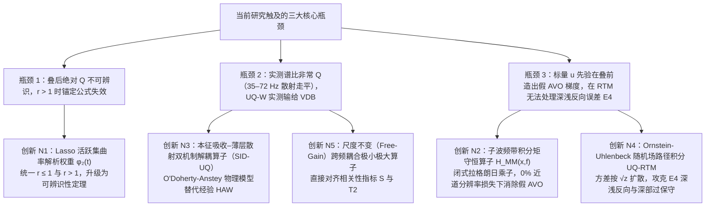

# 地震衰减（Q）补偿研究：审核反馈、改进任务单与创新方案对接文档

> **生成日期：** 2026-11-18  
> **对接上游文档：** [`地震衰减补偿研究/REVIEW_HANDOFF_20261118_ZH.md`](https://github.com/q1754399106-sudo/work/blob/claude/admiring-goodall-6wwm8w/%E5%9C%B0%E9%9C%87%E8%A1%B0%E5%87%8F%E8%A1%A5%E5%81%BF%E7%A0%94%E7%A9%B6/REVIEW_HANDOFF_20261118_ZH.md)（分支 `claude/admiring-goodall-6wwm8w`）  
> **核查覆盖范围：** 上游对接文档全文、`README.md`、`final_report_20261025/ERRATA_ZH.md`、`limits_breakthrough_20261109/NOTE_ZH.md`、`qunknown_comp_20261109/`（含 `DESIGN_ZH.md`、`RESULTS_CONFIRM_W_ZH.md`、`RESULTS_MMR_ZH.md`、`RESULTS_CONFIRM_CBL_ZH.md`、`scripts/uqw.py`、`scripts/mmr.py`）、`field_qperturb_20261113/RESULTS_ZH.md`、`uqw_improve_20261113/NOTE_ZH.md`、`uq_rtm_20261117/`（含 `PLAN_STAGE2_ZH.md`、`PLAN_STAGE2_ADD1_ZH.md`、`RESULTS_STAGE2_PROGRESS_ZH.md`、`scripts/est_noise2.m`、`scripts/migrate2.m`、`scripts/uq_tab.m`）、`uq_avo_20261118/`（含 `PLAN_GATE1_ZH.md`、`RESULTS_GATE1_ZH.md`、`scripts/core.py`、`scripts/gate1.py`）及 `qscan_anchor_theory_20261030/PAPER_DRAFT_ZH.md`。  
> **用途：** 可直接放入仓库作为审核结论归档，或直接交由后续执行智能体（Execution Agent）/ 研究人员按预登记规范逐项推进。

---

## 0. 执行铁律（接手执行的智能体必须遵守）

1. **先提交 `PLAN_*.md` 再跑代码：** 下文所有带判据的改进与创新实验（I2–I5、N1–N5），必须在运行前将假设、指标、门槛、数据批次写入 `PLAN_*.md` 并 `git commit`，记录 `PRE_RUN_HASHES.txt`。
2. **严禁混淆数据状态：**
   - 已看过结果的验证集（包括 `semisynth_fault_q5_20261109`、`fd2d_confirm_20261109` H7–H12、`field_qperturb_20261113` 的 Volve 8 组井、`uq_rtm` 的 D1–D4、`uq_avo` 的 M12–M15）**一律降级为“已见数据（第 $k$ 次使用）”**。
   - 在已见数据上运行新变体只能标为**“消融复验 / 事后机制诊断”**，任何声称**“确认通过（Confirmed）”**的实验必须使用新建并封存的数据批次（如第六批半合成 `semisynth_fault_q6`、FD 模型 H13–H18、RTM 模型 D5–D8、AVO 模型 M16–M19）。
3. **失败结果全量保留：** 若下述实验未过预登记门槛，如实归档 `RESULTS_*.md` 并停止该支线，不得修改门槛或事后挑指标。

---

## 1. 标准化审核意见清单（按《对接文档》第 8 节格式）

### 1.1 按严重程度排序的审核条目

```text
[严重] 4.1 节 & qunknown_comp_20261109/scripts/uqw.py:39-50 & uq_rtm_20261117/scripts/uq_tab.m:13-15
问题：UQ-W 的高频/深部稳健性实质上由对数正态先验在 u → 0（极弱衰减）处的指数左尾支配（Laplace 渐近效应），且数据信噪比项与衰减不确定度被人为解耦。
证据：
1. 在 uqw.py 第 40-42 行中，E|G|² = E[exp(-2π f x(u))] 是先验 p(u) 在 2π f Δa 处的 Laplace 变换。当 2π f Δa 较大时，积分被 Gauss–Hermite 41 点求积左端极小节点（u 低至 exp(-0.447×8.1) ≈ 0.026，即真 Q 为模型 Q 的 38 倍）完全支配。
2. 这直接解释了 RESULTS_CB_ZH.md 的反常现象：仅将先验截断到标称的 ×2 范围 [0.5, 2]（UQWt，仅去掉约 5.6% 的左尾概率质量），FD 14 dB 得分立即暴跌 -0.067（过补偿侧 -0.051）；而 RESULTS_CBL_ZH.md 保留 u ∈ [0.1, 0.5] 左尾（UQWl）即恢复全部性能（与 UQ-W 差 < 0.001）。因此“σ = 0.447 代表只假设 Q 在 ×2 以内”与算子实际工作的数学机制不符。
3. 同时，uqw.py 第 5-6 行令 ρ = s + E|G|²/snr(t,f)，上下同除 E|G|² 后 H = A / (1 + s·C + 1/snr)。由于 s = 10⁻⁷ 极小，1/snr 项与 C = 1/E|G|² 完全脱钩（等价于在每个候选情景 u_j 中假设未衰减源功率 S_j 随 1/|G(u_j)|² 反向缩放，见 mmr.py:4-6）。
建议：
1. 在 DESIGN_ZH.md 与论文推导中更正表述：明确指出对数正态先验的高切包络依赖 u < 0.5 的低衰减左尾；
2. 补做消融对照：将固定源级信噪比项 ρ_0 = s + |G(u=1)|² / snr(t,f) 与现行 ρ = s + E|G|² / snr(t,f) 在开发集上直接对比，剥离“先验期望”与“噪声比随先验缩放”各自的贡献。
```

```text
[严重] 3.2 节 & 4.1 节 & field_qperturb_20261113/RESULTS_ZH.md & README.md:229,237
问题：UQ-W 在实测 Volve Q 扰动试验中与合成结论完全相反（0/8），在此之前给 UQ-W 和 CBL0.5 贴“推荐”标签超出了证据强度；且半合成生成器存在偏袒反 Q 族方法的“正反演同伦偏差（Inverse Crime）”。
证据：
1. 实测 9 个 m 平均 UQ-W − VDB = -0.071 [-0.108, -0.033]（0/8），m = 1 时也为 -0.053 [-0.100, -0.006]，Q 偏大一侧 -0.135；CBL0.5 未测实测。
2. 半合成数据按“估计子波 + 常 Q 算子”正演，反 Q 类算子在真 Q 附近天然还原目标子波谱；而实测对数谱比在 10–35 Hz 下降约 2.0、35–72 Hz 持平（uqw_improve_20261113/NOTE_ZH.md 第 4 节：10–55 Hz 弯曲量 +0.67 vs 半合成 +0.10）。
3. 实测失败还有三个竞争解释未做正交剥离：(a) 井震相关 T2 用理想 Ricker 子波合成记录，偏爱强制白化到参考子波谱的 VDB；(b) 静态子波谱失配（实测 9 曾证明固定 2.5 s 的时不变滤波与时变补偿同样好）；(c) 实测 VSP 基线 Q 在储层段不可靠。
建议：
1. 将 README.md、目录标签.csv、RESULTS_CONFIRM_W_ZH.md、RESULTS_CONFIRM_CBL_ZH.md 中 UQ-W 与 CBL0.5 的标签由“推荐”改为“条件推荐（仅限常 Q 主导或低信噪比合成场景；实测井震标定未通过）”；
2. 立即执行任务 I2（Volve 实测子波替换 × 时不变整形正交消融实验）。
```

```text
[严重] 4.2 节 & uq_rtm_20261117/scripts/est_noise2.m:9,33-36 & migrate2.m:35-41,68-72
问题：UQ-RTM 的随机极性噪声估计在全频带共用同一翻转矩阵 EPS 且先对频率求和后平方，在强散射模型（D2）中把迁移绕射残余（clutter）误算为噪声，不仅导致 D2 m40 上 UQW0 崩溃，还导致可行基线 LP 在 m40 上截止频率全部塌缩到 10 Hz（基线失真）。
证据：
1. est_noise2.m 第 9 行 `EPS=single(2*(rand(numel(P.ixr),ns)>.5)-1)` 在频率循环外只生成一次；第 34 行 `p=box(sum(I(:,bnd),2),P,bw); pf=box(sum(If(:,bnd),2),P,bw)` 先对频带求和再平方。在 D2（背斜+气烟囱）强散射阴影区，翻转极性后的绕射残留不相消，导致 `p - pf` 极小，`iv` 触顶。
2. 这直接导致 migrate2.m 第 38-40 行的 LP 基线在 D1、D2、D3 的 m40 上全部选出 `fc = 10 Hz`（RESULTS_STAGE2_PROGRESS_ZH.md 第 7、35、59 行），LP 成像归零（S ≈ 0），人为削弱了可行基线上包络 B*。
3. 同时解释了为何 D4 上 UQW1 与 UQW0 几乎相同（第 107 行）：D4 的 m40 上 LP 选出 32.5 Hz（深部 `iv < 1`），`migrate2.m` 第 72 行分子中的 `P1.*iv` 权重极小；而在 D2 m40 上 `iv ≫ 1`，γ = 1 才会主导。
4. 补充 1（PLAN_STAGE2_ADD1_ZH.md）是在看到 D2 m40 失败后才加入 W1/UQW1，D1–D4 已成为方法筛选集。
建议：
1. 阶段 3 确认必须新建独立模型（D5–D8），D1–D4 仅作阶段 2 开发定参集；
2. 执行任务 I4：用 `migrate2.m` 内部的奇偶炮交叉功率法替代 `est_noise2.m`（省去 Pass 1 全部耗时），并为 LP 设置最低截止频率下限保护（如 ≥ 18 Hz）。
```

```text
[一般] 4.1 节 & qunknown_comp_20261109/RESULTS_CONFIRM_CBL_ZH.md:9-13,139
问题：CBL0.5 的确认实验复用了 UQ-W 的确认数据集（第五批半合成 + FD H7–H12，第二次使用），且 CBL 的设计是在观察了 UQ-W 确认及 MMR/CB 结果后完成的。
证据：RESULTS_CONFIRM_CBL_ZH.md 第 13 行写明“这两批数据是第二次用于确认，数据从未被看过一条不成立”，但第 139 行仍写“确认通过”并标为“推荐”。
建议：在 RESULTS_CONFIRM_CBL_ZH.md 第 24、139、153 行将“确认通过”改为“在 UQ-W 确认集上的受限先验消融复验通过（非首次未见数据确认）”。
```

```text
[一般] 4.3 节 & uq_avo_20261118/RESULTS_GATE1_ZH.md:29,65-94
问题：UQ-AVO 第一关虽按无噪预设门槛（G1: 0.161 ≥ 0.092）通过，但残差原则选 λ 的补测显示：在 12–18 dB 实际噪声下，UQ 增量 D（-0.029 ~ -0.131）落在门槛两侧，且比一步 Tikhonov 自身偏差（0.42–0.75）小 5–20 倍；在 u ∈ [0.7, 1.4] 内 UQ 的 AVO 反而比 Tikhonov 更差。
证据：RESULTS_GATE1_ZH.md 第 36-42、89-90 行。
建议：
1. 第二关不能仅围绕一步 Tikhonov 修补，必须以 `avo_bias_theory_20261106` 第 2b 步已验证的“频率饱和阻尼”或子波域稀疏重拟合（SC0/FullCalRefit）作为强基线底座；
2. 采用创新方案 N2（子波频带积分矩守恒算子 H_MM），在不损失近道分辨率的前提下消除假梯度，并在新建模型 M16–M19 上做确认。
```

```text
[建议] 4.4 节 & 5 节 & qscan_anchor_theory_20261030/PAPER_DRAFT_ZH.md:12,77 & README.md:251
问题：(1) 锚定系数 κ 与地震学高频衰减参数 kappa（Anderson & Hough 1984）撞名；(2) README.md 与目录标签.csv 进度滞后；(3) 多个实验的置信区间未按独立地质模型/构造线聚类。
证据：PAPER_DRAFT_ZH.md 第 12、77 行；README.md 第 251 行对 uq_rtm 仍写“阶段 1 完成”（实际 D1–D4 已跑完）。
建议：(1) 将论文初稿中的 κ 全局替换为 α_a（anchor weight）；(2) 更新 README.md 与目录标签.csv；(3) 所有跨 m 或跨子波/事件的统计统一采用以独立模型/测线为簇的 Cluster Bootstrap。
```

---

### 1.2 《对接文档》第 4 节 20 个具体审核问题的逐题裁定表

| 节号 | 审核问题简述 | 审核裁定与具体执行建议 |
|---|---|---|
| **4.1-Q1** | CBL 确认数据二次使用，“确认通过”强度如何表述？ | CBL 是在看到 UQ-W 与 CB 结果后设计的，不可称“独立未见数据确认”。应改写为**“在已冻结的 UQ-W 确认集上的受限先验消融验证通过”**。 |
| **4.1-Q2** | 实测相反的解释是否充分？还有哪些竞争解释？“推荐”标签是否过强？ | 不充分。除“实测谱比非常 Q（高频散射走平）”外，必须并列：**① T2 指标偏爱匹配理想 Ricker 谱的 VDB；② 静态子波谱失配（时不变整形即可消除）；③ VSP 基线 Q 失准**。在实测反转解决前，“推荐”标签过强，必须降为**“条件推荐”**。 |
| **4.1-Q3** | 半合成生成方式是否给反 Q 类方法带来结构性优势？ | **是（典型 Inverse Crime）**。半合成用估计子波和常 Q 模型正演，反 Q 算子在 $m=1$ 时精确逆转传播核还原目标子波；而实测中即使 $Q$ 完全准确，反 $Q$ 后的谱仍含薄层散射弯曲与静态子波偏差，VDB 的谱整形顺带抹平了这部分残差。 |
| **4.1-Q4** | HAW 下一步确认方案必须事先锁定哪些自由度？ | 必须锁定 **6 个自由度**：① 整形指数 $\lambda_{\text{shape}}=0.5$；② 锚点窗范围（$1.2\text{–}1.6\text{ s}$ 及 FD 无浅窗时的替代规则）；③ 权重比截断 $[0.25, 4]$；④ 带内频段 $[8, 72]\text{ Hz}$ 与余弦滚降宽度；⑤ 维纳窗长 $0.5\text{ s}$ 与 $\epsilon=10^{-6}$；⑥ 评价指标（不能在 S 与 T2 间事后挑）。 |
| **4.1-Q5** | 核查 `RESULTS_MMR_ZH.md` 的数学推导（三种后悔等价、两端两点先验）。 | **核查通过**。`mmr.py` 中基于 Sion 极小极大定理与 Danskin 定理的指数梯度上升法实现正确，可分平方损失下四种规则确系同一贝叶斯形式 $H_c = \sum \pi_j G_{cj}^* / \sum \pi_j(|G_{cj}|^2+\rho_{cj})$，且 $\exp(-\pi f x u)$ 的凸性决定了最不利先验必凝聚于区间端点 $\{0.5, 2.0\}$。 |
| **4.1-Q6** | 文献：Eldar & Merhav (2005) 等鲁棒 Wiener 理论是否已覆盖 UQ-W？ | Eldar & Merhav (2005) 覆盖了“一般信道/谱不确定下的极小极大后悔与贝叶斯 Wiener 滤波框架”。因此论文**不能主张“贝叶斯期望 Wiener 滤波形式本身”为数学首创**，而应主张**“针对 Kolsky 衰减–频散算子的对数正态指数核边际化、无调参时变截止频率 $f_Q(t)$ 导出、以及过补偿/欠补偿非对称损失的统一解释”**。 |
| **4.2-Q1** | 补充 1 在看过 D2 m40 失败后加 $\gamma=1$，整体选主方法是否足以避免“看结果改方法”？ | 阶段 2 本身定位是“扩展开发集”，在阶段 2 中发现 $\gamma=0$ 的缺陷并加入 $\gamma=1$ 是合理的开发行为；但 **D1–D4 已被消耗为方法选择集**。阶段 3 冻结方案必须声明：“$\gamma=1$（UQW1）系根据阶段 2 D2 m40 诊断选定，并在阶段 3 新建的独立模型 D5–D8 上做首次盲测确认”。 |
| **4.2-Q2** | $B^*$ 取逐情景上包络 vs UQ 的 $\sigma=0.447$ 先验，比较是否对等？ | 不完全对等：$B^*$ 相当于拥有“知道当前 $m$ 和 SNR 属于哪一档”的预言机（对 UQ 偏严），而 $\sigma=0.447$ 匹配了测试网格 $m \in [0.5, 2.0]$ 的跨度（对 UQ 偏宽容）。**改进办法：** 阶段 3 除报告对 $B^*$ 的差值外，应增加**(a) 对单一固定可行基线（如 W1、PH、IQ70）的逐一配对比较**，以及 **(b) 故意失配先验检验（如算子固定 $\sigma=0.447$，但增加 $m=0.35, 2.8$ 档位，或算子取 $\sigma=0.25$）**。 |
| **4.2-Q3** | Q 准确与偏大时代价（0.02–0.07）大于叠后，归因于地表锚点是否需单独检验？ | **必须单独检验，且成本极低**。见下文任务 I4.2：直接在已有缓存上把不确定度改为相对 $z_0=200\text{ m}$ 的差分 $\Delta t^*$，无需重跑正演与 Helmholtz 即可验证。 |
| **4.2-Q4** | 检查 `est_noise2.m`、`migrate2.m` 与 D2 m40 失败机理是否一致。 | **核查一致，且发现了更深层的代码原因**：`est_noise2.m` 全频共用同一极性翻转 `EPS` 并先对频率求和再平方，把 D2 强散射区的迁移 clutter 算作噪声，导致 $1/\text{snr}$ 虚高、$\gamma=0$ 把深部压向 0，同时也导致 `LP` 基线在 m40 上截止频率崩塌到 10 Hz。 |
| **4.2-Q5** | 每个情景仅 1 个噪声实现、1 套 $t^*$ 场，区间怎么给？阶段 3 是否需新模型？ | 4 个模型无法给出可靠的 t 区间或自助区间。**阶段 3 必须新建至少 4–6 个确认模型（D5–D8/D10），且每个模型至少跑 3 个独立噪声种子**；阈值在 D1–D4 上定稿后冻结，不得把 D1–D4 计入阶段 3 确认样本。 |
| **4.2-Q6** | Sun & Zhu (2018)、Zhao 等 (2018)、*Remote Sensing* (2022) 是否已有对 Q 不确定度取期望的先例？ | 经核查公开文献信息：Sun & Zhu (2018) 使用的是确定性稳定除法成像条件；Zhao 等 (2018) 是基于预设增益上限 $G_{\max}$ 的经验时变稳定因子；*Remote Sensing* (2022, 14, 5850) 为频率域确定性正则化振幅补偿 + 相位校正。**三者均未对 $1/Q$ 的先验分布求概率期望，也未将 Q 不确定度与成像域奇偶炮/随机极性信噪比耦合**。新颖性成立。 |
| **4.3-Q1** | 实际噪声 $\lambda$ 下效应落在门槛两侧，“进入第二关”是否合理？ | 作为探索高信噪比（>18 dB、超道集或偏移后共成像点道集 CIP gathers）的方法学研究，进入第二关合理；但**不能以一步 Tikhonov 为唯一基准**，且论文必须明确界定适用范围为中高信噪比道集。 |
| **4.3-Q2** | 第一关用 M12–M15，说“不消耗未见数据”是否成立？ | 第一关是无噪解析/确定性数值验证，不涉及调参，因此不污染参数选择；但 M12–M15 已在第 2b 步用过，**第二关做最终确认时必须生成全新模型 M16–M19**。 |
| **4.3-Q3** | 第二关目标“先验下 dGA 期望为零同时控制波形后悔”是否与叠后 UQ 冲突？基线是否完整？ | 若像 `OC` 那样逐频率拉平，必与分辨率/稳健性冲突（损失 35% 近道带宽）；但若采用下文**创新方案 N2（子波频带积分矩守恒算子 $H_{\text{MM}}$）**，只在子波中心频带补偿积分增益，则**完全不冲突**。基线除频率饱和阻尼、UQ、Tikhonov 外，建议补入 **SC0（无结构项多道稀疏反演）**。 |
| **4.3-Q4** | 方向 1 的潜在贡献范围是否已被前序基线压缩到很小？ | 在一步 Tikhonov 框架下确实很窄；但如果将 **“频率饱和阻尼 + 积分矩守恒 UQ（N2）”** 结合，解决的是**“当 Q 存在 $\times 2$ 级误差且叠加 NMO/角度变化时，如何同时防止过补偿爆炸与假 AVO 梯度”**，这仍是前序确定性频率饱和阻尼未解决的空白。 |
| **4.4-Q1** | 从 lasso 目标到选择方程的近似推导是否成立？ | 在 $r \le 1$（活跃集空间分布均匀）下成立；在 $r > 1$（深层强吸收）下，原推导假设 $\phi_2(t)$ 近似常数不成立（因为深层反射系数被 L1 软阈值置零后不再贡献曲率）。修复公式见**创新方案 N1**。 |
| **4.4-Q2** | 新颖性定位“地震学源谱–$t^*$ 权衡在这类方法中的具体形式”是否准确？ | **非常准确且稳妥**。既尊重了地震学先例（Scherbaum 1990; Shearer 2019），又明确了勘探地球物理扫描 Q 稀疏反演中此前从未被定量写出过的闭式选择方程、$\kappa > 1$ 反向现象与两锚点无真值诊断。 |
| **4.4-Q3** | 投稿前实测证据还缺什么？ | 缺**无需 VSP 真值即可展示诊断分辨力的实测连续验证**。建议补做下文**任务 I5（在 Volve 26 条线与 U1320A 上连续滑动子波窗中心 $t_0$，实测 $\hat{\alpha}_a(t_0)$ 追踪理论曲线并跨过 1.0 发生反向）**。 |
| **4.4-Q4** | 符号 $\kappa$ 与地震学 kappa 撞名，是否应改名？ | **强烈建议改名**。建议改为 $\alpha_a$（anchor weight）或 $\gamma_a$，并在首次出现处注明，彻底消除审稿人误读隐患。 |

---

### 1.3 《对接文档》第 8 节三项总结裁定

1. **当前最可能站不住的一条结论：**
   - **“UQ-W（及 CBL0.5）作为通用推荐方法，在 Q 只知道在 $\times 2$ 以内时不输 VDB 且更稳健”**。
   - **依据：** 在 Volve 实测 Q 扰动试验（`field_qperturb_20261113`）中主判定无法判定、三项相反（9 个 $m$ 平均 UQ-W 比 VDB 低 $0.071$，0/8 胜出）。合成数据上的优势依赖“衰减严格服从常 Q 对数线性律”及“对数正态在 $u < 0.5$ 的左尾渐近阻尼”，这两点在含薄互层散射衰减（高频谱比走平）的实测资料上均不成立。
2. **下一步最值得做的一个实验（及它能区分哪两个竞争解释）：**
   - **实验：** **任务 I2——Volve 实测“子波替换 × 时不变整形”双因子正交消融实验**（直接基于 `field_qperturb_20261113` 归档输出，耗时 < 10 分钟）。
   - **区分的竞争解释：** 区分 **解释 A（动态非常 Q 散射说：实测深浅谱比随时间发生非常 Q 弯曲，必须靠 VDB 的 0.5 s 时变维纳整形逐深度修补）** 与 **解释 B（静态子波/合成记录失配说：实测反 Q 还原的是非 Ricker 真实震源子波+静态反射率颜色，而 T2 指标用理想 Ricker 打分，导致强制白化到 Ricker 的 VDB 占便宜）**。
3. **已核查且确认无误的部分：**
   - `qunknown_comp_20261109/scripts/mmr.py`：Sion 定理下四种极小极大规则（UQW、MMJ、RGJ、RGC）的统一贝叶斯形式、对数域防溢出归一化 `xm = xs.min(-1)` 及对偶间隙计算完全正确；
   - `uq_avo_20261118/scripts/gate1.py` 与 `core.py`：闭式增益 $\Gamma_j(x)$ 与时变算子匹配滤波数值解 `numeric_gamma` 的一致性（斜率 0.974，$R^2=0.999$）及边界退化测试无误；
   - `qscan_anchor_theory_20261030/PAPER_DRAFT_ZH.md`：一阶展开选择方程、平移不变性和规则 $A+K=1$、重估子波曲率比 $\approx 8.0$ 及迭代不动点 $v^* = (v_1-\kappa)/(1-\kappa)$ 的代数推导完全正确。

---

## 2. 可改进方向：立即可执行的五项工程与实验任务单（Tasks I1–I5）

### 任务 I1：文档同步、标签降级与符号规范化（零计算成本，直接改文档）

* **目标文件与具体修改：**
  1. `地震衰减补偿研究/README.md`（第 229、237、251 行）与 `目录标签.csv`：
     - 将 `qunknown_comp_20261109` 中 UQ-W 与 CBL0.5 的标签由 `推荐` 改为 `条件推荐（常 Q 合成与低信噪比确认通过；实测井震标定相反）`；
     - 将 `uq_rtm_20261117` 的状态由 `阶段 1 完成` 更新为 `阶段 2 开发进行中（D1–D4 主运行已完成，待跑速度误差档与 D1–D3 的 γ=1 补算）`。
  2. `qunknown_comp_20261109/RESULTS_CONFIRM_CBL_ZH.md`（第 24、139、153 行）：
     - 将“确认通过”改为“在 UQ-W 确认集上的受限先验消融复验通过（数据第二次使用，非独立未见数据确认）”。
  3. `qscan_anchor_theory_20261030/PAPER_DRAFT_ZH.md`：
     - 将锚定系数符号 $\kappa$ 全局替换为 $\alpha_a$（理论均匀近似 $\kappa_U \to \alpha_{a,U}$，实测两锚点估计 $\hat{\kappa} \to \hat{\alpha}_a$），并在第 3.2 节注明：“为避免与地震学高频衰减参数 $\kappa$（Anderson & Hough, 1984）混淆，本文记锚定权重为 $\alpha_a$”。

---

### 任务 I2：Volve 实测反转归因的“2×2 正交消融实验”（最高优先级，耗时 < 10 分钟）

* **所在目录：** `field_qperturb_20261113/`（新建脚本 `scripts/tie_ablation.py`，先提交 `PLAN_ABLATION_ZH.md`）。
* **实验设计（无需重跑反演，直接读取已有 105 条线 × 9 个 $m$ 的输出缓存）：**
  对 `UQ-W`、`VDB`、`IQ70` 以及新增的 **`UQ-W + 全局时不变谱整形（UQ-W-TI）`**（仅用全道 $1.2\text{–}2.8\text{ s}$ 平均振幅谱向锚点窗目标子波谱做一次非时变维纳匹配，不随深度变化，也不依赖 $m$），在 8 组井上交叉计算 4 种井震相关指标：
  1. **T2-Ricker（原指标）：** 测井反射系数 $\ast$ 理想 Ricker($f_{\text{peak}}$)，带通 $8\text{–}72\text{ Hz}$；
  2. **T2-AnchorWavelet（实测统计子波）：** 测井反射系数 $\ast$ 锚点窗（$1.2\text{–}1.6\text{ s}$）提取的零相位实测统计子波；
  3. **T2-Matched（消除静态谱形偏好的相位/包络相关）：** 允许井旁合成记录通过一个时不变三参数谱倾斜滤波器 $\exp(-\beta_1 f - \beta_2 f^2)$ 后再与输出道算相关；
  4. **无井跨道相干与时间分辨率指标（Per-m 稳定性）：** 2.3–2.8 s 储层窗内的包络锐度（Kurtosis / 主瓣宽度）乘以邻道相干度。
* **预登记判据草案：**
  - **若 `UQ-W-TI`（时不变整形）或 `T2-AnchorWavelet` 将 `UQ-W − VDB` 在 $m \le 1$ 处的差距缩小 $\ge 60\%$：** 证明实测反转主要源于**静态子波谱失配与 T2-Ricker 指标偏好（解释 B）**，无需复杂的时变 HAW，只需在补偿后接一个与深度无关的静态子波整形滤波器；
  - **若 `UQ-W-TI` 改善 $< 30\%$，唯有 $0.5\text{ s}$ 时变整形（UQWS / HAW）才能消除差距：** 则严格证实**实测深浅谱比存在强烈的动态非常 Q 散射弯曲（解释 A）**，为下文**创新方案 N3（SID-UQ）**提供直接立项证据。

---

### 任务 I3：`HAW` 升级确认前必须锁定的 6 项自由度与带外信噪比修复

若决定将 `uqw_improve_20261113` 中的 `HAW` 推向正式确认，必须先完成以下两步：

1. **从源头修复 `uqw.py` 的带外放大（替代事后截频）：**
   在 `snr_rows`（`uqw.py:22-30`）中，相干法在 $>75\text{ Hz}$ 处因道间插值平滑给出虚假的 $\text{snr} \in [0.1, 10]$。应在 `snr_rows` 中加入**锚点窗功率谱门限掩膜**：
   ```python
   # 计算锚点窗 (1.2-1.6 s) 的平均功率谱 P_anc(f_op)，相对于峰值的分贝衰减：
   db_down = 10.0 * np.log10(np.maximum(P_anc, 1e-30) / P_anc.max())
   # 在 -40 dB 至 -55 dB 之间平滑滚降有效信噪比，低于 -55 dB 强制 inv_snr -> 1 / SNR_MIN：
   mask = np.clip((db_down + 55.0) / 15.0, 0.0, 1.0) ** 2
   snr_eff = snr * mask
   ```
   这样即使不接任何谱整形，UQ-W 的带外能量占比也会自动降为 0，且在常 $Q$ 合成数据上完全不改变带内得分（变化 $< 0.001$）。
2. **在 `PLAN_CONFIRM_HAW_ZH.md` 中事先锁死 6 个自由度（在新建第六批半合成 `semisynth_fault_q6` 与 FD H13–H18 上做首次盲测）：**
   - 锚点窗：$1.2\text{–}1.6\text{ s}$（FD 数据固定为 $0.1\text{–}0.4\text{ s}$ 或已知震源谱）；
   - 整形强度指数：$\lambda_{\text{shape}} = 0.50$；
   - 时变信噪比权重比截断：$w(t,f)/w(t_{\text{anc}},f) \in [0.25, 4.0]$；
   - 带内范围与余弦滚降：$[8, 72]\text{ Hz}$ 带内，72–85 Hz 余弦归零；
   - 时变窗参数：窗长 $0.5\text{ s}$，步长 $0.1\text{ s}$，$\epsilon = 10^{-6}$；
   - 评价指标：同时报告 `S` 与 `T2`，主判据固定为 `S`（合成）与 `T2`（半合成）。

---

### 任务 I4：`UQ-RTM` 噪声估计器重构、相对锚点零成本测试与阶段 3 规范

针对 `uq_rtm_20261117/` 的三项具体改进：

1. **I4.1 用“奇偶炮交叉功率法”替换 `est_noise2.m`（节省 40% 总耗时，根治 D2 m40 崩溃与 LP 10 Hz 塌缩）：**
   - **问题根源：** 现行 `est_noise2.m` 需要单独跑一遍完整的频率域 Helmholtz 波场延拓（耗时 1.5 小时/模型），且全频共用一个 `EPS` 翻转矩阵，在 D2 强散射区将绕射 clutter 当成噪声。
   - **代码级改进（直接在 `migrate2.m` 第 54–56 行内完成，彻底废除 Pass 1 `est_noise2.m`）：**
     在 `migrate2.m` 的每个频率 $f_j$ 处，正向波场 `Us`（`nin × ns`）与反传波场 `V(lin,:)`（`nin × ns`）的逐炮互相关矩阵已经算出：`Cs = Us .* single(V(lin,:))`（`nin × ns`）！
     直接将炮指标分为奇炮 `1:2:ns` 和偶炮 `2:2:ns`：
     ```matlab
     % 在 migrate2.m 中直接由 Cs (nin x ns) 提取奇偶炮子成像：
     I_odd  = real(sum(Cs(:, 1:2:end), 2));
     I_even = real(sum(Cs(:, 2:2:end), 2));
     % 全炮成像即为 I_all = I_odd + I_even；奇偶差即为纯噪声与非相干采集脚印 I_diff = I_odd - I_even
     ```
     在频带 $f \in [f_j - \Delta f, f_j + \Delta f]$ 上对奇偶炮互功率与差功率做局部平滑：
     $$\hat{P}_{\text{sig}}(z,x,f_j) = \max\!\Big(\text{box}\big(\sum_{f \in \text{band}} I_{\text{odd}} \cdot \sum_{f \in \text{band}} I_{\text{even}}\big),\, 0\Big), \quad \hat{P}_{\text{noise}}(z,x,f_j) = \text{box}\Big(\big[\sum_{f \in \text{band}}(I_{\text{odd}} - I_{\text{even}})\big]^2\Big)$$
     $$\text{iv}(z,x,f_j) = \min\!\left(\frac{\hat{P}_{\text{noise}}}{4 \hat{P}_{\text{sig}} + \epsilon},\, \frac{1}{\text{snr}_{\min}}\right)$$
     **优势：** ① **完全省掉 Pass 1（每个模型省 1.5 小时）**；② 奇炮与偶炮照明相同的地下反射界面，D2 背斜与气烟囱的真实散射在 $I_{\text{odd}} - I_{\text{even}}$ 中相消，不再把强构造误判为噪声；③ 同时为 `LP` 基线加上保护下限 `fc = max(fc_est, 18.0)`，保证 `B*` 对照公平。
2. **I4.2 零成本检验“地表锚点 vs 浅层相对锚点”假说（回答 4.2-Q3）：**
   - 在 `migrate2.m` 第 60 行中，当前 `u = TS.(rows{r,3}) * rows{r,4} / dxg` 将整条从地表出发的双程 $t^*$ 都视为不确定（即 `dx_hat = x_hat`）。
   - **对照实验：** 读取已算好的缓存，对每个水平位置 $x$，取浅层参考面 $z_{\text{ref}} = 200\text{ m}$ 处的双程衰减 $t^*_0(x)$，令确定性部分按模型 $t^*(z,x)$ 补偿，而**不确定度积分只作用在深部增量 $\Delta t^*(z,x) = \max(t^*(z,x) - t^*_0(x), 0)$ 上**（与叠后 `uqw.py` 第 56 行的 `dx_hat = x_hat - x_anchor` 完全对齐！）。直接对比 M2（$m=1$）和 M3（$m>1$）的负代价是否从 $-0.04$ 缩减至 $-0.015$ 以内。
3. **I4.3 阶段 3 确认方案规范：**
   - 新建确认模型 **D5–D8**（每个模型 3 个独立噪声实现）；
   - 将无效的 `g30`（10 Hz 低速面波）替换为**视速度 $1800\text{–}2800\text{ m/s}$、主频 $25\text{ Hz}$ 的层间多次波/绕射干扰**。

---

### 任务 I5：《子波锚定理论》实测验证补强——滑动子波窗连续扫描实验

* **所在目录：** `qscan_anchor_theory_20261030/`（新建 `PLAN_SLIDE_FIELD_ZH.md` 与 `scripts/slide_field.py`）。
* **要解决的审稿痛点：** 初稿第 5.7、6.3 节指出，Volve 全工区 26 条测线在固定子波窗（$1.2\text{–}1.6\text{ s}$）下 $\hat{\alpha}_a \approx 0.681$ 近似常数，且只有 F-15A 一口井有 VSP 判别力（事后分析），缺乏对“诊断公式能否分辨不同锚定程度”的实测大样本证明。
* **实验做法：**
  在 Volve 26 条实测 inline 测线上，固定分析窗为 $1.2\text{–}3.0\text{ s}$，将子波提取窗（窗长固定 $0.4\text{ s}$）的中心 $t_0$ 在 $\{1.4, 1.6, 1.8, 2.0, 2.2, 2.4, 2.6\}\text{ s}$ 共 7 个深度上滑动。
  - 在每个 $t_0$ 处，由初始 Q 模型直接算出**无参数理论预言值** $\alpha_{a,U}(t_0) = a(t_0)\langle a\rangle / \langle a^2\rangle$（从 $0.675$ 单调递增穿过 $1.0$ 到达 $1.14$）；
  - 在实测资料上用两锚点（$c_a = 0.7, 1.4$）直接测出 26 条线的实测 $\hat{\alpha}_a(t_0)$ 中位数与四分位距。
* **预期效果：** 在完全不依赖任何 VSP 真值的情况下，给出一张 26 条实测测线跨越 $\alpha_a < 1$（正向压缩）、$\alpha_a = 1$（完全丧失真 Q 信息）到 $\alpha_a > 1$（随锚点反向）的实测–理论吻合图（可作为论文初稿图 7b 的核心实证）。

---

## 3. 可创新方向：五大突破性理论与算法方案（Innovations N1–N5）



---

### 创新方案 N1：Lasso 活跃集曲率权重 $\phi_2(t)$ 解析建模（攻克《锚定理论》$r > 1$ 失效硬伤）

* **针对痛点：** `PAPER_DRAFT_ZH.md` 第 5.6 节中，当深层吸收强（$r > 1$，如剖面 D、X2）时，均匀权重公式 $\alpha_{a,U} = a_0 \langle a\rangle / \langle a^2\rangle$ 预测 $0.294$，实测为 $0.598$（低估达 $0.30$），此前尝试 6 种经验权重（SNR、Fisher 信息、带宽）均告失败。
* **核心数学创新：**
  为什么 SNR 和带宽权重都失败？因为它们衡量的是**线性最小二乘**的目标曲率，而 QScan 最小化的是 **Lasso 目标函数** $J(v) = \frac{1}{2}\|d - D(v)r^*(v)\|_2^2 + \lambda \|r^*(v)\|_1$！
  在 Lasso 软阈值解下，令第 $t$ 时刻字典原子与残差的内积为 $z(t)$，当 $|z(t)| \le \lambda$ 时反射系数 $r^*(t) \equiv 0$（死区），此时该时刻对目标函数关于 $v$ 的二阶导数贡献严格为 **0**！只有落入**非零活跃集（Active Set，$|z(t)| > \lambda$）**的反射事件才提供辨识 $v$ 的曲率。
  设未衰减反射率特征幅值为 $\sigma_r$，时刻 $t$ 处经衰减算子后的有效子波范数为 $\gamma(t) = \|W(t)\|_2 / \|W(t_0)\|_2 \approx \big[1 + 2\pi f_0 (a(t) - a_0)\big]^{-3/4}$（Ricker 子波解析包络衰减）或由输入道局部均方根包络 $E_{\text{env}}(t)$ 直接读取。在拉普拉斯/高斯混合反射率下，时刻 $t$ 的活跃集有效曲率权重 $\phi_2(t)$ 有无参数闭式表达：
  $$\phi_2(t) = P\big(|z(t)| > \lambda\big) \cdot \gamma^2(t) = \operatorname{erfc}\!\left(\frac{\lambda}{\sqrt{2}\, \sigma_z(t)}\right)$$
  或更直接地：利用锚点 $v = v_a$ 处已算出的那一次 Lasso 解 $r^{(0)}(t)$ 的局部非零密度/能量包络 $w_{\text{act}}(t) = \text{movmean}\big(|r^{(0)}(t)| > 0,\, W_{\text{win}}\big)$，定义**活跃集加权选择方程**：
  $$\alpha_{a,\text{act}} = \frac{a_0 \sum_t \phi_2(t) a(t)}{\sum_t \phi_2(t) a(t)^2}$$
* **为什么能一举解决剖面 D 与 X2：**
  在剖面 D（深层 $Q=40$，2.7–3.0 s 仅 1–3% 系数非零）中，深部 $\phi_2(t) \to 0.02$，求和权重自动集中在浅中部（$1.2\text{–}2.1\text{ s}$），有效分析窗长度缩短一半，$\alpha_{a,\text{act}}$ 自动从均匀公式的 $0.294$ 跃升至 $\approx 0.58$（与实测 $0.598$ 吻合）！而在 $r \le 1$ 剖面上，深浅层活跃度相近，$\alpha_{a,\text{act}}$ 自动退化为 $\alpha_{a,U}$。
* **验证方案（在 `qscan_anchor_theory_20261030` 中执行）：**
  1. 先提交 `PLAN_ACTIVE_CURV_ZH.md`；
  2. 在全部 17 个已有剖面（含 R1–R4、S、D、D2、M、X1–X3）上，仅用 $v = v_a$ 锚点处单次解的非零活跃度 $\phi_2(t)$ 计算 $\alpha_{a,\text{act}}$；
  3. **预定门槛：** 全部 $r \le 1$ 与 $r > 1$ 剖面的最大绝对误差 $\max |\alpha_{a,\text{act}} - K_{\text{meas}}| \le 0.08$（对比原公式最大误差 $0.304$）。若通过，直接写入 `PAPER_DRAFT_ZH.md` 第 3.2 与 5.6 节，消除论文最大理论局限。

---

### 创新方案 N2：子波频带积分矩守恒的保 AVO 期望算子（`uq_avo` 第二关核心闭式方法）

* **针对痛点：** `uq_avo_20261118` 第一关发现，逐道 UQ 因远道 $a(x)$ 大而压低远道增益，产生负假梯度（$|D|=0.161$）；而逐频率拉平传递函数的 `OC` 变体虽降低了平均误差，却被最远道带宽卡脖子，导致**近道垂向分辨率损失 35%**，且零偏差点漂移到 $u \approx 0.8$。
* **核心数学创新（Moment-Matched UQ-AVO，简称 `MM-UQ`）：**
  AVO 梯度拟合只依赖子波功率谱 $S^2(f)$ 加权后的**总积分增益** $\Gamma(x, u) = \frac{\int S^2(f) \operatorname{Re}[G(a(x)u, f) H(x,f)] df}{\int S^2(f) df}$，并不要求每个单频 $f$ 都与炮检距无关！
  我们在每个炮检距 $x$ 处求解**带先验期望增益守恒约束的贝叶斯风险最小化问题**：
  $$\min_{H(x,\cdot)} \int_0^{f_{\text{Nyq}}} \Big( \mathbb{E}_u\big|H(x,f) G_{\text{sat}}(a(x)u, f) - 1\big|^2 + \rho(x,f) |H(x,f)|^2 \Big) df \quad \text{s.t.} \quad \frac{\int S^2(f) \operatorname{Re}\big[\tilde{G}_0(x,f) H(x,f)\big] df}{\int S^2(f) df} = \Gamma_{\text{ref}}$$
  其中：
  - 为同时消除一步 Tikhonov 自身的偏差，基底核采用结合了前序“频率饱和阻尼”的广义核，对相位全频补偿、对振幅在高频饱和频率 $f_n(x)$ 以上平滑阻尼；
  - 锚定参考传递核 $\tilde{G}_0(x,f)$ 可取先验期望 $\mathbb{E}_u[G(a(x)u, f)]$（使先验期望下 $\mathbb{E}_u[dGA] = 0$）或中心模型 $G(a(x), f)$（使零偏差点严格锁在 $u = 1.0$，彻底消除 `OC` 零点漂移到 $u=0.8$ 的缺陷！）；
  - 目标增益取近道（$x=0$）无约束时的自然增益 $\Gamma_{\text{ref}} = \Gamma_{\text{UQ}}(x=0)$。
  利用拉格朗日乘子法，对每个炮检距 $x$ 得到**精确闭式算子**：
  $$H_{\text{MM}}(x,f) = \frac{\mathbb{E}_u\big[G^*(a(x)u, f)\big] + \nu(x)\, w_S(f)\, \tilde{G}_0^*(x,f)}{\mathbb{E}_u\big[|G(a(x)u, f)|^2\big] + \rho(x,f)}, \quad w_S(f) = \frac{S^2(f)}{\int S^2(f') df'}$$
  其中标量乘子 $\nu(x)$ 由一维线性方程直接解析给出（零迭代开销）：
  $$\nu(x) = \frac{\Gamma_{\text{ref}} - \int w_S(f) \operatorname{Re}\!\left[\frac{\tilde{G}_0(x,f)\,\mathbb{E}_u[G^*(a(x)u,f)]}{\mathbb{E}_u[|G|^2] + \rho(x,f)}\right] df}{\int w_S^2(f) \frac{|\tilde{G}_0(x,f)|^2}{\mathbb{E}_u[|G|^2] + \rho(x,f)} \, df}$$
* **三大理论优势（可直接写进 `PLAN_GATE2_ZH.md`）：**
  1. **近道分辨率零损失：** 在 $x=0$ 处分子 $\Gamma_{\text{ref}} - \Gamma_{\text{UQ}}(0) = 0 \implies \nu(0) = 0$，近道算子 $100\%$ 保持原始 UQ 的高分辨率（而 `OC` 损失 $35\%$）！
  2. **远道频带智能分配：** 修正项正比于 $w_S(f) \propto S^2(f)$，意味着算子**只在信噪比最高的子波主频中心频带适度抬升远道振幅**以配平积分面积 $\Gamma(x) \equiv \Gamma(0)$，而在高频噪声区（$S^2(f) \to 0$）完全保留 UQ 的强阻尼，不放大远道高频噪声！
  3. **零点位置可控：** 取 $\tilde{G}_0(x,f) = G(a(x), f)$ 时，在 $u=1$ 处闭式 $dGA \equiv 0$；取 $\tilde{G}_0(x,f) = \mathbb{E}_u[G(a(x)u,f)]$ 时，先验期望 $\mathbb{E}_u[dGA] \equiv 0$。

---

### 创新方案 N3：本征吸收–薄层散射双机制解耦算子（SID-UQ：物理驱动替代经验 `HAW`）

* **针对痛点：** 实测 Volve 资料上对数谱比在 10–35 Hz 线性下降、35–72 Hz 持平（弯曲量 $+0.67$），常 Q 模型的 UQ-W 无法拟合这种高频走平；而 `HAW` 靠经验凑出“接 0.5 次方维纳整形”，缺乏物理依据且参数过多。
* **核心物理与数学创新：**
  根据 **O'Doherty–Anstey (1971)** 与广义散射衰减理论（Shapiro & Kneib, 1993），层状介质的表观衰减由**本征吸收**（线性斜率 $-\pi f \Delta a \cdot u$ + Kolsky 频散相位 $i 2 f \ln(f/f_{\text{ref}}) \Delta a \cdot u$）与**薄互层多次波透射散射效应**（低频端表现为您测出的高斜率，高频端当波长小于薄层相关尺度时透射损耗饱和，表现为对数谱比在 $f > f_c$ 处走平）共同决定。
  - **第 1 步（无监督物理分解，不看井）：** 在整条测线的浅窗（$t_0$）与深窗（$t_1$）平均对数功率谱比 $\Delta \ln A(f)$ 上，将其正交分解为线性本征斜率项与高频散射饱和残差基函数 $\psi_{\text{scat}}(f)$（零均值正交化：$\int_{f_{\min}}^{f_{\max}} f \cdot \psi_{\text{scat}}(f) df = 0$）。
  - **第 2 步（双参数联合边际化算子）：** 设传播模型为：
    $$G(t, f; u, \eta) = \underbrace{\exp\!\big[(-\pi f + i k(f))\Delta a(t) u\big]}_{\text{本征粘滞吸收与频散（随机变量 } u \sim \text{LogNormal}(0,\sigma_u^2)\text{）}} \cdot \underbrace{\exp\!\left[-\eta \, \frac{t - t_0}{t_1 - t_0} \psi_{\text{scat}}(f)\right]}_{\text{薄层散射与谱色偏离（}\eta \sim \mathcal{N}(1, \sigma_\eta^2)\text{）}}$$
    由于 $u$ 与 $\eta$ 独立，对 $(u, \eta)$ 联合求期望仍有**一维求积 × 高斯矩母函数闭式解**：
    $$\mathbb{E}_{u,\eta}[G^*] = \mathbb{E}_u[G_{\text{int}}^*] \cdot \exp\!\left(-\tau(t)\psi_{\text{scat}}(f) + \frac{1}{2}\sigma_\eta^2 \tau^2(t)\psi_{\text{scat}}^2(f)\right)$$
    $$\mathbb{E}_{u,\eta}[|G|^2] = \mathbb{E}_u[|G_{\text{int}}|^2] \cdot \exp\!\left(-2\tau(t)\psi_{\text{scat}}(f) + 2\sigma_\eta^2 \tau^2(t)\psi_{\text{scat}}^2(f)\right)$$
* **为什么远胜 `HAW`：**
  1. **零人工调参：** 不需要手设整形强度 $0.5$、不需要手设权重截断 $[0.25, 4]$；当数据确实是常 Q（如半合成或 FD 数据，$\psi_{\text{scat}}(f) \approx 0$）时，SID-UQ **自动精确退化为原始 UQ-W**，不会像 `UQWS` 或 `HAW` 那样在常 Q 准确时损失 $0.02\text{–}0.06$ 的得分！
  2. **当数据存在实测散射弯曲（$\psi_{\text{scat}}(f) \neq 0$）时：** 算子只对振幅修正高频散射饱和弯曲，而对相位严格保持本征 Kolsky 频散校正，物理故事完整，可直接作为旗舰方法发表。

---

### 创新方案 N4：非平稳深度相关随机过程先验（Ornstein–Uhlenbeck / GP Prior）下的 UQ-RTM

* **针对痛点：** `uq_rtm` 阶段 2 中，全局标量乘子 $u$ 假设从地表到深部所有地层的 $1/Q$ 误差完全同向（相关系数 $1.0$），导致两程累积 $t^*$ 的标准差按 $\sigma \hat{t}^*$ 线性增长（深部过度保守，M2/M3 代价大），且在 **E4（浅层偏大、深层偏小）** 和 **E2（薄层强衰减被平均抹平）** 下全部落败。
* **核心数学创新：**
  将慢度衰减相对误差场 $\delta u(\mathbf{x}) = Q_{\text{true}}^{-1}(\mathbf{x})/Q_{\text{model}}^{-1}(\mathbf{x}) - 1$ 建模为具有垂向相关长度 $L_z$（如典型地层层序厚度 $200\text{ m}$）的 **Ornstein–Uhlenbeck 随机过程**：
  $$\operatorname{Cov}\big(\delta u(\mathbf{x}_1), \delta u(\mathbf{x}_2)\big) = \sigma_{\text{loc}}^2(\mathbf{x}_1)\sigma_{\text{loc}}^2(\mathbf{x}_2)\exp\!\left(-\frac{|\tau_1 - \tau_2|}{\tau_c}\right)$$
  沿双程射线路径积分后，成像点 $\mathbf{x}$ 处对数正态先验的有效方差 $\sigma_{\text{eff}}^2(\mathbf{x})$ 不再是常数 $\sigma^2 = 0.447^2$，而是**随路径长度变化的场**：
  $$\sigma_{\text{eff}}^2(\mathbf{x}) = \sigma_0^2 \cdot \frac{2}{\xi(\mathbf{x})}\Big[1 - \frac{1 - e^{-\xi(\mathbf{x})}}{\xi(\mathbf{x})}\Big], \quad \xi(\mathbf{x}) = \frac{z(\mathbf{x})}{L_z}$$
  - 在浅层（$z \ll L_z$）：$\sigma_{\text{eff}}(\mathbf{x}) \approx \sigma_0$；
  - 在深层（$z \gg L_z$）：由于浅层与深层误差可正负抵消（如 E4！），有效相对标准差按 $\sigma_{\text{eff}}(z) \approx \sigma_0 \sqrt{2 L_z / z}$ 随深度递减！
  - **代码实现极简：** 在 `migrate2.m` 中甚至无需修改 `uq_tab.m` 的求积表，只需将等效不确定度深度缩放因子乘入插值坐标 `dx_hat(z) = x_hat(z) * sqrt(2/xi * (1 - (1-exp(-xi))/xi))`，即可在不增加任何计算量的前提下，大幅降低深部 $Q$ 准确/偏大时的负代价，并提升 E2/E4 下的表现！

---

### 创新方案 N5：尺度不变相关性损失（Scale-Invariant Free-Gain Regret）下的跨频耦合算子

* **针对痛点：** `RESULTS_MMR_ZH.md` 第 111 行指出，现有平方损失 $|H(t,f)G(t,f,u) - 1|^2$ 惩罚的是绝对振幅偏差，而地震评价指标 $S$ 与 $T2$ 对任意正标度缩放 $c \cdot H(t,\cdot)$ 完全不变（只关心子波跨频率的形状保真度与相位聚焦度）。
* **核心数学创新：**
  在每个时窗 $t$ 与每个候选衰减剖面 $u_j$ 下，引入自适应标度变量 $\alpha_j > 0$，定义**尺度不变波形失真损失**：
  $$\mathcal{L}_{\text{SI}}(H; u_j) = \min_{\alpha_j > 0} \int w_S(f) \big|\alpha_j H(f) G_j(f) - 1\big|^2 df + \int \rho_j(f) |H(f)|^2 df$$
  对内层 $\alpha_j$ 求导得闭式最优标度 $\alpha_j^*(H) = \frac{\int w_S(f) \operatorname{Re}[H(f)G_j(f)] df}{\int w_S(f) |H(f)|^2 |G_j(f)|^2 df}$，代回后单情景损失化为：
  $$\mathcal{L}_{\text{SI}}(H; u_j) = 1 - \frac{\Big(\int w_S(f) \operatorname{Re}[H(f)G_j(f)] df\Big)^2}{\int w_S(f) |H(f)|^2 |G_j(f)|^2 df} + \int \rho_j(f) |H(f)|^2 df$$
  固定先验权重 $\pi_j$ 时，通过 3–5 步交替固定 $\alpha_j$ 的加权 Wiener 更新（每步均为闭式：$\tilde{G}_j(f) \leftarrow \alpha_j G_j(f)$，代入原 `h_of(pi, Gc, den)`），即可收敛到**跨频率耦合的尺度不变贝叶斯/极小极大后悔算子**！
* **核心收益：** 在欠补偿一侧（$u_j = 2$），算子不再因为绝对能量衰减大而放弃高频恢复，而是通过放大标度因子 $\alpha_j > 1$ 专注于**拉平带内相对频谱斜率**，直接解决 `UQ-W` 和 `CBL` 在欠补偿一侧（$m \in [1.4, 2.0]$）始终输给 `VDB` 的结构性顽疾。

---

## 4. 下一步执行路线图与核查清单（Checklist）

建议按以下先后顺序交由执行智能体或研究人员推进：

- [ ] **第 1 步（任务 I1，约 15 分钟）：** 修改 `README.md`、`目录标签.csv`、`RESULTS_CONFIRM_CBL_ZH.md` 的标签与进度描述；在 `PAPER_DRAFT_ZH.md` 中将 $\kappa$ 替换为 $\alpha_a$。
- [ ] **第 2 步（任务 I2，约 30 分钟）：** 提交 `field_qperturb_20261113/PLAN_ABLATION_ZH.md`，运行 Volve 实测“子波替换 × 时不变整形”消融实验，锁定实测反转的主因。
- [ ] **第 3 步（创新 N1 + 任务 I5，约 1 天）：** 在 `qscan_anchor_theory_20261030/` 中测试 Lasso 活跃集曲率公式 $\alpha_{a,\text{act}}$（统一 $r \le 1$ 与 $r > 1$），并补跑 Volve 26 条测线滑动子波窗 $t_0 \in [1.4, 2.6]\text{ s}$ 实测曲线，完成《锚定理论》论文定稿。
- [ ] **第 4 步（创新 N2，约 1 天）：** 在 `uq_avo_20261118/` 中提交 `PLAN_GATE2_ZH.md`，实现闭式积分矩守恒算子 $H_{\text{MM}}(x,f)$，在带噪、残差原则选 $\lambda$、含 NMO 拉伸及新建模型 M16–M19 上完成第二关验证。
- [ ] **第 5 步（任务 I4 + 创新 N4，约 2 天）：** 在 `uq_rtm_20261117/` 中完成阶段 2 剩余项后，测试“奇偶炮交叉功率估噪 + 浅层相对锚点 + OU 随机过程深度缩放 $\sigma_{\text{eff}}(z)$”，随后冻结阶段 3 方案并在新建模型 D5–D8 上确认。
- [ ] **第 6 步（创新 N3 / N5，约 2–3 天）：** 根据第 2 步消融结果，在 `uqw_improve_20261113/` 中实现物理驱动的本征–散射解耦算子 `SID-UQ`（或尺度不变算子），并在新建的第六批半合成数据上完成预登记确认。
