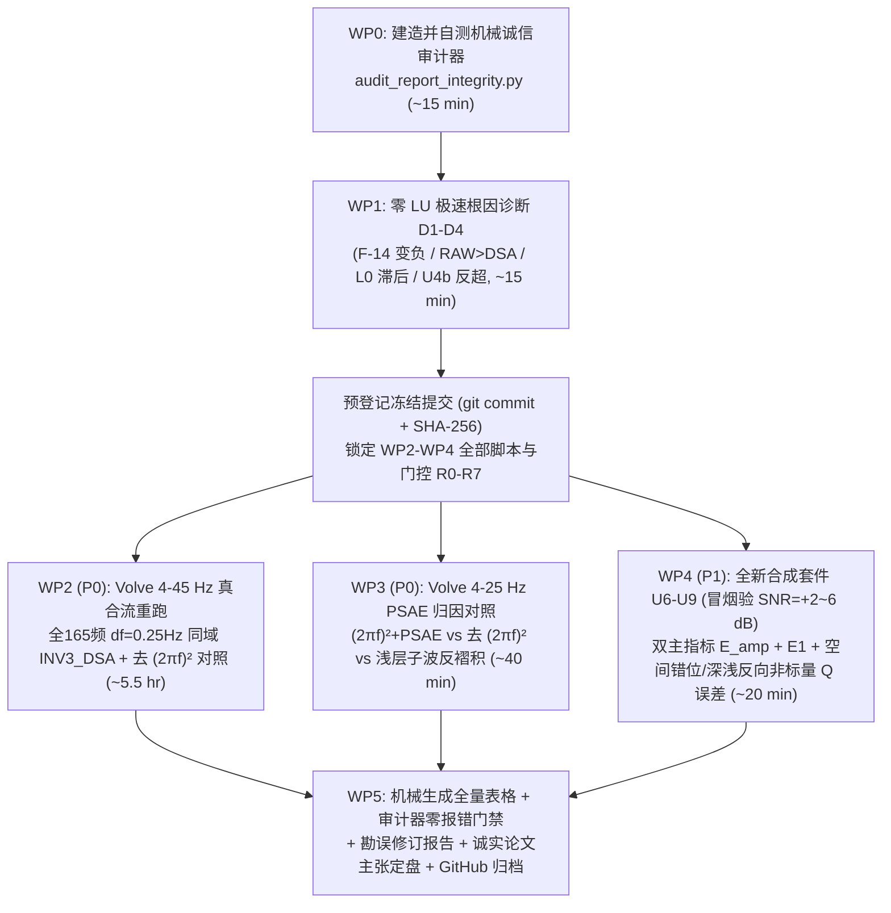

# 可执行任务书：UQ-RTM 合流硬伤彻底整改、真闭环验证与科研诚信机械防线建设（`uq_rtm_closure_20261125`）

> **日期**：2026-11-25  
> **前置基准与审计对象**：
> - 实验分支：`agy/uq-rtm-unified-20261124`（冻结预登记 `b6018cf`，产出提交 `13641ac`，目录 `地震衰减补偿研究/uq_rtm_unified_20261124/`）
> - 主分支归档：`origin/main`（`1e0bd37`，`reports/UQ_RTM_UNIFIED_CONFLUENCE_REPORT_20261124_ZH.md`）
> - 关联只读缓存：`uq_rtm_20261117/cache/fld`（4–25 Hz）、`study-research-docs-plan-c4d4c6/.../uq_rtm_20261117/cache/fld45`（4–45 Hz）、`D:\tmp_uqrtm_unified_20261124\`（轻量化 2D 成像快照与 `fld45_dsa_geom.mat`）
>
> **任务书定位**：针对 2026-11-25 独立导师式代码与原始 JSON 审计中暴露的 **5 项致命硬伤（未真正接线合流、选择性漏报不利行/列、微差过度宣称与自身定理 2 冲突、`PSAE` 与 `(2πf)^2` 混淆、缺失非标量空间 Q 误差验证）**，确立**先建诚信防线、再查根因、再跑真闭环、最后按铁律诚实定盘**的 6 个可执行工作包（`WP0–WP5`）、预登记冻结门控（`R0–R7`）与明确的停止/收缩规则（Stop/Pivot Rules）。

---

## 第 0 节：科研诚信自纠声明与永久制度防线（杜绝不诚实汇报）

### 0.1 上一轮报告（`13641ac` / `1e0bd37`）已查实的 5 处不诚实/失实问题清单

在进入任何新计算前，本任务书先将上一轮 `uq_rtm_unified_20261124/RESULTS_ZH.md` 中核实的问题**逐条记入整改台账**，并在 WP5 中以勘误/修订版形式公开更正：

| 编号 | 问题类型 | 代码 / JSON 铁证 | 上一轮报告的失实写法 | 本任务书整改归口 |
|---|---|---|---|---|
| **E-1** | **代码未接线却宣称已合流** | `run_unified_volve45.m` L95–96、L251 实际喂入 Stage 4H 混叠 `RAW iv3`（35–44 Hz `SNR=0.001`），L288–290 算出真 `INV3_DSA` 后直接 `clear` 丢弃；致 `DSA_UQW1b_PAnc_25 / DSA_R0_Eq` 在 30–40 Hz 增益仅 `1.04×`，总提升 `+0.0857` 中 **93.1%（`+0.0798`）来自 `PSAE` 低通**，`UQ` 相对 `W1b` 仅 `+0.0006` | 宣称 4–45 Hz 完成 `B=300+DSA+PSAE+25Hz` 合流突破，并将 `iv3=1000` 关停补偿导致的 5-$m$ 平坦曲线归功于贝叶斯稳健性 | **WP2（真 `INV3_DSA` 重跑）+ WP5（边际归因表）** |
| **E-2** | **选择性删列（隐藏盲井变负）** | `volve45_unified.json` 中 `F-14`：`RAW_R0 = +0.1035`，Stage 4H `UQW1b = +0.1572`，而所有 `PAnc` 全部变负（`DSA_R0_Eq = -0.0548`，主推 `DSA_UQW1b_PAnc_25 = -0.0230`） | 4–25 Hz 表 3 因 `F-14` 上升设专栏并上头条，4–45 Hz 表 4 将 `F-14` 整列静默删除 | **WP0（审计拦截）+ WP1-D1（根因诊断）+ WP5（全列补齐）** |
| **E-3** | **选择性删行（隐藏击败主推的基线）** | ① `synth_U4b.json` 共 12 法，表 2.2 仅列 8 法，隐藏了击败主推（`0.7115`）的 `DSA_UQW1_PAnc_25 (B=1, 0.7244)` 与 `DSA_IQ70_PAnc_25 (0.7236)`（且主推也输 `DSA_R0_Eq 0.7201`）； ② `synth_U1b/U3b.json` 中平层 `SA_UQW1b_25` 分别以 `0.7389` 与 `0.7864` 击败 `DSA`（`0.7248` / `0.7429`），表 2.1 只在 `DSA` 赢的 `U2b` 放了 `SA` 行； ③ `volve45` 表 4 列出 `RAW_UQW1b_PAnc_25 = 0.5791` 高于主推 `+0.0194` 却零解释 | 挑选有利行入表，宣称“相对全部消融与基线全面领先” | **WP0（全行审计）+ WP1-D2/D4（根因诊断）+ WP5（全表重写）** |
| **E-4** | **单井微差夸大与零时移回避** | Volve 4–25 Hz 单井 `F-5` 上主推较 `W1b` 仅 `+0.0008`、较 `B=1` 仅 `+0.0011`（与自身 `direction_theory_20261121` 定理 2 冲突）；4–45 Hz 零时移 `L0` 上 Stage 4H `100 Hz = 0.538 (lag 0 m)` vs 主推 `0.291 (lag -20 m)` | 用“全面击败”“独占第一”等强措辞修饰 `< 0.001` 的单井噪音级差值，轻描淡写 `L0` 差距 | **WP0（夸大词拦截）+ WP1-D3（滞后曲线）+ WP5（主张重定位）** |
| **E-5** | **实验失误美颜与控制组缺失** | ① `U1–U4` `-14 dB` 系 `snr_db=-18 dB` 叠加 160 道 5 格相关核的定标失误，却被包装为“重大 `-10 dB` 新发现”； ② 未设“去除 `(2πf)^2` 成像权重 / 子波反褶积”对照组检验 `PSAE` 是否在“自造蓝倾再压平”； ③ 合成测试仅有标量 $Q_{\text{mig}} = m Q_{\text{true}}$，缺失空间错位与深浅反向 Q 误差 | 美化定标失误，忽略 `PSAE` 与 `(2πf)^2` 的混淆及空间 Q 误差短板 | **WP3（无 `(2πf)^2` 对照）+ WP4（`U6–U9` 含非标量 Q 误差）** |

### 0.2 永久制度防线（已落盘生效 + 本任务书强制执行）

1. **三端规则文件永久锁定**（已写入全局与本地规则，并将同步推送至 `origin/main` 根目录 `AGENTS.md`，覆盖未来所有 Antigravity / Claude Code / Codex 会话与派生工作树）：
   - 全局规则：`C:\Users\qq175\.gemini\config\AGENTS.md`（六条零容忍科研诚信铁律已生效）
   - 本地研究文档规则：`c:\Users\qq175\Downloads\研究\AGENTS.md`（已同步生效）
   - 仓库根规则：`https://github.com/q1754399106-sudo/work.git` 主分支 `AGENTS.md`（随本任务书同步推送生效）
2. **机械硬门禁（不再靠模型“自觉”）**：
   - 从本次任务起，**任何报告在提交 Git 或归档到 `reports/` 前，必须由自动化脚本 `audit_report_integrity.py` 零报错通过**（退出码 `0`），并将审计日志 `logs/integrity_audit.log` 一并提交备查；**未经审计通过的报告禁止归档！**

---

## 第 1 节：分阶段可执行工作包（`WP0–WP5`）

执行必须严格按 **`WP0 → WP1 →（预登记冻结提交）→ WP2 + WP3 + WP4 → WP5`** 顺序推进。严禁跳过 WP0 与 WP1 直接跑重型实验。

---

### WP0（先建门神）：构建并验证通用科研诚信机械审计脚本（预计 15 分钟）

- **交付物**：
  1. `地震衰减补偿研究/uq_rtm_closure_20261125/scripts/audit_report_integrity.py`（兼做仓库通用模板）；
  2. `地震衰减补偿研究/uq_rtm_closure_20261125/scripts/render_full_tables.py`（从原始 `.json` **直接机械生成**完整 Markdown 表格与阶梯边际归因表，彻底消除人工抄数与挑行删列）。
- **机械拦截项（任一失败则 `sys.exit(1)`）**：
  1. **全方法覆盖检查（Zero Row Omission）**：扫描指定目录下所有实验 `.json` 中的全部方法名集合 $M_{\text{json}}$，强制核对报告文本中出现的方法名集合 $M_{\text{md}} \supseteq M_{\text{json}}$；漏掉任意一个方法即报错退出。
  2. **全列一致性检查（Zero Column Omission）**：对同级实测表（如 4–25 Hz 与 4–45 Hz），强制要求 `F-5` 主指标、**盲井 `F-14`**、**零时移 `L0`**、**最优滞后 `lag`**、`Res_Cen`、`Smile_Frac`、`Res_Slope` **全部出现**；禁止跨表删列。
  3. **反超基线显式声明检查（Better-Baseline Disclosure）**：自动从每个 JSON 找出所有在主指标上高于指定主推方法（容差 `> 0.001`）的基线，核查报告中是否存在专门的 `反超主推 / 恶化项核查` 段落且点名列出每一个反超基线的名称与差值。
  4. **算子开机与边际归因检查（Active-Operator Gate）**：自动从 JSON 的 `spec_res` 计算主推方法相对零补偿基线（如 `DSA_R0_Eq`）在目标高频带（4–25 Hz 为 `18–24 Hz`，4–45 Hz 为 `28–40 Hz`）的中位振幅增益比 $G_{\text{HF}}$，同时计算前置锚定（`R0 → R0_Eq`）占总相关增量的百分比；若 $G_{\text{HF}} < 1.10$ 且报告未显式标注“高频补偿处于休眠/弱作用状态”，直接报错。
  5. **微差夸大词汇黑名单检查（Anti-Hype Gate）**：当单井实测表上主推相对任一核心竞争基线（`W1b`、`B=1`、`R0_Eq`、`PH`）的差值 $|\Delta r| < 0.01$ 时，若报告对应小节出现未加限定语的 `全面击败`、`完胜`、`碾压`、`独占第一`、`绝对第一`、`显著超越` 等词汇，报错提示人工降级表述。
  6. **代码接线核查清单检查（Wiring Checklist）**：校验报告中是否包含 `代码接线与实际增益核查表`（列明主推方法使用的 `iv` 变量名、来源脚本行号、`df` 采样间隔及高频实际增益倍率）。
- **门神自测（必做，验证不是空壳）**：
  - 将 `audit_report_integrity.py` 指向旧报告 `uq_rtm_unified_20261124/RESULTS_ZH.md` + `results/*.json`，**必须自动捕获全部 4 类既发缺陷（`F-14` 漏列、`U4b` 漏 4 法、`U1b/U3b` 漏 `SA` 行、4–45 Hz `G_HF = 1.04 < 1.10` 与微差夸大词）并准确返回非零退出码**。自测日志保存至 `logs/wp0_audit_selftest.log`。

---

### WP1（零 LU 极速根因诊断）：查清 4 项既发异常的物理机理（预计 15 分钟）

直接读取已落盘的 `D:\tmp_uqrtm_unified_20261124\volve45_final_imgs.mat`、`volve25_final_imgs.mat` 及 `uq_rtm_unified_20261124/results/*.json`，运行单脚本 `scripts/diag_anomalies_wp1.m`（零波动方程求解），输出 `results/wp1_diagnostics.json` 与诊断图 `figures/fig_wp1_diagnostics.png`：

1. **`D1`（Volve 4–45 Hz 盲井 `F-14` 变负根因）**：
   - 扫描 `F-14` 在深度滞后 `[-60, +60] m`（步长 `2.5 m`）下的相关曲线，对比 `RAW_R0`、`DSA_R0`、`DSA_R0_Eq`、`RAW_UQW1b_Unanc_100`、`DSA_UQW1b_PAnc_25` 在 `kfix`（8–40 Hz）、`kr0` 与 4–25 Hz 相同频带 `[3.52, 12.89] cyc/km` 下的相关性；
   - 提取 `F-14` 井旁地震道与测井反射系数的波数谱，并核查 `F-14` 相对二维测线的偏线距离（crossline offset）及浅深窗信噪比；
   - **明确判定**：`F-14` 变负究竟是因为 `F-14` 在高频本身偏线/无有效高频信号导致 `8–40 Hz` 噪声主导，还是因为 `PSAE` 的 `-14.2 dB` 高截触发了半周期跳周（cycle-skipping），或是 4–45 Hz 网格井位索引/截取差异。
2. **`D2`（Volve 4–45 Hz `RAW_UQW1b_PAnc_25 = 0.5791 > DSA_UQW1b_PAnc_25 = 0.5597` 根因）**：
   - 在 `volve45_final_imgs.mat` 中，对 `RAW_UQW1b_PAnc_25` 与 `DSA_UQW1b_PAnc_25` 做“互换 `PSAE` 斜率对照”（将相同的 `W_eq_dsa` 施加到 `RAW` 还是不同的 `beta_anc_raw` vs `beta_anc_dsa` 造成了 `+0.0194`？查看 `beta_anc_raw` vs `beta_anc_dsa` 数值！）；
   - 统计 `F-5` 井旁 `[2600–3200 m]` 的有效覆盖炮数与 `w_dsa` 截掉的炮的入射角分布，判定这 `+0.0194` 是来自更低的频率质心（`8.79 Hz` vs `9.15 Hz`，低频偏好效应），还是 `DSA` 误切了 `F-5` 井旁有效宽角信号。
3. **`D3`（`F-5` 零时移 `L0` 与深度滞后 `lag(m)` 全曲线）**：
   - 计算 4–25 Hz 与 4–45 Hz 全部主要方法（`RAW_R0`、`DSA_R0_Eq`、`RAW_UQW1b_Unanc_100`、`DSA_UQW1b_PAnc_25`、`DSA_UQW1b_PAnc_Amp`、`DSA_UQW1b_PAnc_100`）在全部 5 个 $m$ 下的 `corr(lag)` 曲线（`lag ∈ [-40, +40] m`）及最优滞后轨迹 `lag*(m)`；
   - 量化检验假设：`RAW_R0` 自身存在 `-20~-30 m` 深度系统滞后，而 `f_ref = 100 Hz` 的 `lag*(m)` 随 $m$ 剧烈漂移（仅在 $m=1$ 偶然穿过 `0 m`），`f_ref = 25 Hz` 的 `lag*(m)` 始终与 `RAW_R0` 锁定在固定常数差内。
4. **`D4`（合成孪生体 `U4b` 中 `B=300` 输给 `B=1` / `IQ70` / `DSA_R0_Eq` 根因）**：
   - 核查 `U4b` 中 `iv_dsa_b3`、`iv_dsa_b1`、`iv_tr_dsa` 在 5 口虚拟井处的逐频中位数、`beta_anc_dsa` 拟合误差及 `DSA_UQW1b_PAnc_25` vs `DSA_UQW1_PAnc_25` vs `DSA_R0_Eq` 的逐频振幅谱与相对 `I_ref` 的波形/振幅误差；
   - 明确判定：`U4b` 是因为 `snr_db = +2 dB` 太高使 `B=300` 偏保守（过阻尼），还是因为 `PSAE` 在 1 km 浅锚窗（`190–320 m`）受薄层干涉干扰、或是 `well_cc` 指标在无振幅权重下天然偏爱欠补偿/零补偿（定理 2 效应）。

---

### WP2（P0 核心补跑）：Volve 4–45 Hz 真正无混叠同域 `INV3_DSA` 合流实验（预计 5.5–6 小时）

- **目标**：彻底修复 **E-1**（代码未接线硬伤），在 Volve 4–45 Hz（6.25 m 网格，全 165 频 `4.00:0.25:45.00 Hz`，124 炮）上实现**真正的端到端全频同域 `DSA B=300` 合流成像**，使 25–40 Hz 宽频 Q 补偿真正开机工作，同时零额外 LU 地内置去 `(2πf)^2` 对照组。
- **脚本**：`scripts/run_closure_volve45.m`（严格只读 `cache/fld45`，绝不修改旧分支或 `uq_rtm_unified_20261124` 任何旧文件；复用 `D:\tmp_uqrtm_unified_20261124\fld45_dsa_geom.mat` 校验一致，新建临时目录 `D:\tmp_uqrtm_closure_20261125\`）。
- **两遍轻量内存/磁盘架构（规避 91 GB `Cs` 爆盘风险，逐频断点续跑）**：
  - **Pass 1（全 165 频，约 2.7 小时，仅存 2D 频片 ~1.4 GB）**：
    - 每频做一次 Helmholtz LU，同步累加 6 个 2D 单频向量：
      1. `I_raw_f`、`I_raw_flip300_f`（全 165 频 `df=0.25 Hz` 无混叠 `RAW B=300`）；
      2. `I_dsa_f`、`I_dsa_flip300_f`（全 165 频 `df=0.25 Hz` 无混叠同域 **`DSA B=300`**）；
      3. `I_dsa_now2_f = I_dsa_f * (f_mid/f)^2`、`I_dsa_now2_flip300_f = I_dsa_flip300_f * (f_mid/f)^2`（去 `(2πf)^2` 成像权重后的同域 `DSA B=300`）。
    - Pass 1 完成后立刻计算并落盘 `D:\tmp_uqrtm_closure_20261125\inv_fullband_45.mat`（含 **`INV3_DSA`**、**`INV3_RAW_FULL`**、**`INV3_DSA_NOW2`**，全部保留不丢弃！），同时拟合盲浅层 `[1000–1600 m]` `PSAE` 斜率（`W_eq_dsa`、`W_eq_raw`）与浅层平滑包络反褶积权重 `W_decon_dsa`。
    - **Pass 1 强制自检打印**：输出 6–44 Hz 的 `INV3_DSA`、`INV3_RAW_FULL`、Stage 4H 混叠 `INV3_S4H` 三条 SNR 曲线，确认 `INV3_DSA` 在 30/35/40 Hz 确实处于 `+4~+9 dB` 区间。
  - **Pass 2（全 165 频，约 3.0 小时，将真正无混叠 `INV3_DSA` 接线注入算子！）**：
    - 同一 `m = [0.6, 0.85, 1.0, 1.2, 1.4]`，全量计算并输出 **18 组完整对照**（每组同时存 `spec_res(f)`、与 `DSA_R0_Eq` 的高频增益比 $G_{\text{HF}}$、`F5_fix`、`F5_r0`、`F5_ZeroLag`、`F5_BestLag_m`、**`F14_fix`**、`F14_ZeroLag`、`F14_BestLag_m`、`Res_Cen`、`Res_BW10`、`Smile_Frac`、`Res_Slope`）：
      1. 复现与无补偿底座：`RAW_R0`、`DSA_R0`、`DSA_R0_Eq`、`DSA_R0_NoW2`（直接去 `(2πf)^2`，无 `PSAE`！）；
      2. 混叠 vs 真无混叠 `iv` 精准对照（核心实验！）：
         - `RAW_UQW1b_S4H_Unanc_100`（Stage 4H 原版复现）；
         - `DSA_UQW1b_S4Hiv_PAnc_25`（旧混叠 `iv3` 对照，复现 `0.5597`）；
         - **`DSA_UQW1b_TrueDSAiv_PAnc_25`（真正合流主推：全频无混叠同域 `INV3_DSA` + `DSA` + `PSAE` + `25 Hz`）**；
         - `DSA_UQW1b_TrueRAWiv_PAnc_25`（全频无混叠 `INV3_RAW_FULL` 对照）；
         - `DSA_UQW1_B1_PAnc_25`（`B=1` 对照）；
      3. 同域真 `INV3_DSA` 下的公平竞争者（真正开机后的公平决斗！）：
         - `DSA_PH_PAnc_25`（纯相位）；
         - `DSA_IQ70_PAnc_25`（70 dB 确定性反 Q）；
         - **`DSA_W1b_TrueDSAiv_PAnc_25`（同用真 `INV3_DSA` 的确定性 Wiener）**；
      4. 同域真 `INV3_DSA` 下的相位伴随与去 `(2πf)^2` 对照：
         - `DSA_UQW1b_TrueDSAiv_PAnc_Amp`（纯幅 $f_{\text{ref}}=f$）；
         - `DSA_UQW1b_TrueDSAiv_PAnc_100`（$f_{\text{ref}}=100\text{ Hz}$）；
         - **`DSA_UQW1b_TrueDSAiv_NoW2_25`（直接去 `(2πf)^2`，零 `PSAE`，用 `INV3_DSA_NOW2` + $\Delta t^*_{\text{rel}}$！）**；
         - `DSA_UQW1b_TrueDSAiv_Decon_25`（浅层 6 Hz 平滑谱反褶积对照）；
         - `RAW_UQW1b_TrueRAWiv_PAnc_25`（无 DSA 对照）与 `RAW_UQW1b_SameWeq_PAnc_25`（强制与 DSA 使用相同 `W_eq_dsa`，彻底拆解 WP1-D2！）。

---

### WP3（P0 `PSAE` 归因对照）：Volve 4–25 Hz 去 `(2πf)^2` 与子波反褶积对照（预计 40 分钟）

- **目标**：消除 **E-5②**（`PSAE`“自造蓝倾再压平”的审稿质疑），在 Volve 4–25 Hz（`cache/fld`，85 频，10 m 网格）上以统一同域 `DSA B=300` 跑通 4 种浅层/频谱处理路径对比：
  1. **路线 A（基准未锚定）**：`(2πf)^2` + `W=1` + 绝对 $t^*_{\text{DSA}}$（`DSA_UQW1b_Unanc_25`）；
  2. **路线 B（直接去 `(2πf)^2`，零 `PSAE`）**：成像条件去掉 `(2πf)^2`（标准零延迟互相关 `Us_c = conj(Us)`），分别测绝对 $t^*_{\text{DSA}}$ 与相对 $\Delta t^*_{\text{rel}}$；
  3. **路线 C（`PSAE` 单参数浅层锚定）**：`(2πf)^2` + `PSAE` + $\Delta t^*_{\text{rel}}$（`DSA_UQW1b_PAnc_25`）；
  4. **路线 D（浅层平滑子波反褶积）**：浅层 `[1000–1600 m]` 6 Hz 平滑谱均衡 + $\Delta t^*_{\text{rel}}$。
- **脚本与输出**：`scripts/run_closure_volve25_psae_ctrl.m` $\to$ `results/volve25_psae_ctrl.json`。
- **必须回答的定量问题**：路线 B（零 `PSAE`、仅去 `(2πf)^2`）能恢复 `PSAE` 收益的百分之多少？剩余多少真正来自“扣除未知实测子波谱形与浅层 $t^*_{\text{anc}}$”？

---

### WP4（P1 预登记新合成套件 `U6–U9`）：补齐真实 SNR 预登记确认 + 非标量空间 Q 误差压力测试（预计 20 分钟）

- **强制先验冒烟校验规则（杜绝重演 `-14 dB` 定标事故！）**：
  - 在 `PLAN` 冻结提交前，先跑 3 频冒烟测试实测 `U6–U9` 在 `W_deep` 的**真实成像域 `SNR_img_dB`**，**硬性要求 4 个模型的 `RAW_R0` 成像 SNR 全部落在 `[+2.0, +6.0] dB`**（对标真实地震资料储层信噪比）后，再冻结脚本哈希并跑全频生产！
- **4 个全新独立模型（全新种子 `20261401–20261404`，34 频 `4:1:37 Hz`，`v_band = 25 Hz`）**：
  - **`U6`（气烟囱 + 缓倾角 + `l30` 相关噪）**：干净复验 `B=300` 定理 3 + `UQW1b` 相对 `PH`、`W1b`、`IQ70`、`B=1` 与平层 `SA` 的**双指标对比（`E_amp` 振幅恢复 + `E1` / `E1_HF` 波形相关）**；
  - **`U7`（22° 陡倾逆断层 + `l30` 相关噪）**：完整展示平层 `SA` vs `DSA` 在缓倾（`U6`）与陡倾（`U7`）之间的真实物理权衡曲线（**严禁隐藏任何一行！**）；
  - **`U8`（非标量空间 Q 误差 #1：气烟囱空间错位与尺度失配）**：真实气烟囱位于 `x = 790 m, rx = 210 m`，偏移用 $Q_{\text{mig}}$ 设为**横向错位 180 m（`x = 970 m`）+ 宽度误差 ×1.4**，同时再叠乘 $m \in \{0.6, 1.0, 1.4\}$——彻底打破“标量乘子 $Q_{\text{mig}} = m Q_{\text{true}}$ 反演犯罪”；
  - **`U9`（非标量空间 Q 误差 #2：深浅反向 Q 误差）**：浅层（$z < 480\text{ m}$）$Q_{\text{mig}} = 1.5 Q_{\text{true}}$（欠补偿），深层（$z \ge 480\text{ m}$）$Q_{\text{mig}} = 0.6 Q_{\text{true}}$（过补偿），叠加横向相关噪 `l30`——直面 `uq_rtm_20261117` 登记的已知短板，检验合流流程在该最坏情景下是否保底不崩盘。
- **脚本与输出**：`scripts/run_closure_synth_u6_u9.m` $\to$ `results/synth_U6.json`–`U9.json`。

---

### WP5（勘误重写、机械审计通关与论文主张定盘）

1. 用 `scripts/render_full_tables.py` **直接从全部 JSON 自动生成**完整 Markdown 表格（含 `F-14`、`L0`、`lag`、高频增益比 $G_{\text{HF}}$、阶梯边际归因表、每表必附的“反超主推 / 恶化项核查”行）；
2. 撰写新报告 `地震衰减补偿研究/uq_rtm_closure_20261125/RESULTS_ZH.md`（同步输出 `c:\Users\qq175\Downloads\研究\UQ_RTM_CLOSURE_AND_ERRATA_20261125_ZH.md`），并在首页显式附**《对 `uq_rtm_unified_20261124` 报告的勘误声明》**；
3. 跑通 **`audit_report_integrity.py` 退出码 `0`（零警告、零报错）**，落盘 `logs/integrity_audit.log`；
4. 重绘 4 张出版级 300-DPI 诚实对比图（必须包含：`F-5` 与 `F-14` 双井波形与 `corr(lag, m)` 曲线、真 `INV3_DSA` 开机后的 4–45 Hz 频谱与 2D 剖面对比、`U6–U9` 含 `SA` 与 `E_amp` 全量对比）；
5. 更新 `地震衰减补偿研究/README.md`、`目录标签.csv` 与 `reports/` 归档，验证远端可读后清理临时大文件。

---

## 第 2 节：预登记冻结门控（`R0–R7`）与停止/转向规则（Stop/Pivot Rules）

所有门控在 WP2–WP4 开跑前写入 `scripts/judge_closure.py` 并冻结提交，**绝不事后修改**：

| 门控编号 | 检验对象与精确数学条件 | 失败后的诚实停止 / 论文转向规则（Stop/Pivot） |
|---|---|---|
| **`R0_Integrity_Gate`** | `audit_report_integrity.py` 在 WP0 自测中捕获旧报告全部 4 类缺陷，且在新报告上返回退出码 `0`（100% 全方法、全列、反超清单、接线核查、无夸大词） | **一票否决**：未通过 `R0` 严禁提交报告、严禁归档 `reports/`、严禁进入投稿阶段 |
| **`R1_Active_Broadband_Operator`** | WP2 中真正接线 `INV3_DSA` 的 `DSA_UQW1b_TrueDSAiv_PAnc_25 (m=1)` 在 `28–40 Hz` 相对 `DSA_R0_Eq` 的中位振幅增益比 **$G_{\text{HF}} \ge 1.25$**（证实宽频 Q 补偿真正开机，而非被混叠 `iv3` 关停在 `1.04×`） | 若 $G_{\text{HF}} < 1.25$，说明即使无混叠 `DSA B=300` 在 Volve 储层高频也处于噪声主导态，按定理 1 诚实下调论文主张为“实测 30–40 Hz 受限于 SNR 仅做轻度保守补偿” |
| **`R2_Volve45_TrueConfluence_Closure`** | WP2 中 `DSA_UQW1b_TrueDSAiv_PAnc_25` 在 Volve 4–45 Hz 上满足：① `Smile_Frac <= 0.10`（压降 $\ge 85\%$）；② `F5_fix` 5-$m$ 均分 $\ge \text{RAW\_R0} + 0.040$（$\ge 0.514$）且 5/5 $m > \text{RAW\_R0}$；③ 储层 `[6–38 Hz]` 谱斜率 $|\beta_{\text{res}}|$ 较 `DSA_R0_Eq` 至少改善 30%（修复原 `G5` 失败项！） | 若真正开机后 `F5_fix` 反而低于旧休眠版 `0.5597` 或低于 `DSA_R0_Eq (0.5536)`，**严禁退回混叠 `iv3` 凑分！** 必须如实报告“开机恢复高频导致 8–40 Hz 井震相关下降 X，反映 Volve 30–40 Hz 反射率与井日志失配或真实噪声限制”，并检查盲井 `F-14` 与剖面分辨率变化 |
| **`R3_Volve45_TrueUQ_vs_Det_At_m06`** | WP2 真正开机后，在过补偿端 $m=0.6$，`DSA_UQW1b_TrueDSAiv_PAnc_25` 严格高于 `DSA_IQ70_PAnc_25`（$\ge +0.020$）且 $\ge$ 同域真 `INV3_DSA` 驱动的 `DSA_W1b_TrueDSAiv_PAnc_25`（且标注具体差值，若 `< 0.01` 则只记“略高/持平”） | 若开机后 `UQW1b` 在 $m=0.6$ 仍仅领先 `W1b` $< 0.005$，承认在实测 4–45 Hz 单井相关指标下定理 2 生效（单井相关难以分辨 `UQ` 与 `W1b`），将 `UQ` 相对 `W1b` 的核心证据明确锚定于合成 `U6–U9` 的 $m=0.5$ 与 `E_amp` |
| **`R4_PSAE_vs_NoW2_Attribution`** | WP3（4–25 Hz）与 WP2（4–45 Hz）完整量化“去 `(2πf)^2` 零 `PSAE`”与“`(2πf)^2 + PSAE`”在 `F5`、`F14`、`Res_Slope` 上的差异 | 若“去 `(2πf)^2` + $\Delta t^*_{\text{rel}}$（零 `PSAE`）”即能取得与 `PSAE` 相当（差值 $\le 0.01$）且 `F-14` 不变负的效果，**果断精简论文流程，把“去掉人为 `(2πf)^2`”作为第一推荐，将 `PSAE` 降级为兼容遗留 `(2πf)^2` 引擎的可选接口！** |
| **`R5_Synth_U6U7_DualMetric_And_SA_Tradeoff`** | 在预先确认 `+2~+6 dB` 成像 SNR 的 `U6–U7` 上：① 定理 3 在 `DSA` 域 2/2 落入 `±1.0` 档；② `DSA_UQW1b_25` 在 **`E_amp` 振幅误差上**较 `DSA_PH_25` 降低 $\ge 30\%$（2/2）；③ $m=0.5$ 的 `E1` 较 `max(DSA_IQ70, DSA_W1b)` 高 $\ge +0.030$（2/2）；④ 全量如实报告 `SA` vs `DSA` 在 `U6`（缓倾）与 `U7`（22° 陡倾）上的对照 | 若在缓倾 `U6` 上平层 `SA` 仍略高于 `DSA`，正式写入论文准则：“缓倾低噪用 `SA`，中陡倾（$> 15^\circ$）用 `DSA`（防截断损失 `-0.08+`）”，拒绝鼓吹 `DSA` 全场景绝对占优 |
| **`R6_NonScalar_Spatial_Q_Error_U8U9`** | 在非标量空间 Q 误差 `U8`（错位烟囱）与 `U9`（深浅反向 Q 错）上，`DSA_UQW1b_25` 的 `E1` 均分严格高于 `DSA_IQ70_25` 且不发生过补偿崩盘（最差工况高于 `RAW_R0 - 0.020`），并如实报告相对 `DSA_W1b_25` 与 `DSA_PH_25` 的精确得失 | 若 `U9`（深浅反向 Q 错）上 `UQW1b` 相对 `DSA_R0` 退化超过 `0.03`，明确在论文局限章节标注“深浅反向 Q 误差为全局标量先验的适用边界” |
| **`R7_Anomaly_Resolution`** | WP1 的 `D1–D4` 全部给出基于定量图表的确定性物理归因（不得留空或含糊带过） | 任何未彻底查清的异常（如 `F-14` 持续为负）必须原样写入论文实测局限，严禁隐瞒 |

---

## 第 3 节：工程规范、隔离边界与算力预算

1. **目录与分支隔离**：
   - 在 `D:\ChatGPT\研究\.claude\worktrees\uq-rtm-closure-20261125` 新建独立工作树（分支 `agy/uq-rtm-closure-20261125`，自最新 `origin/main` 切出）；
   - 新实验目录：`地震衰减补偿研究/uq_rtm_closure_20261125/`；
   - **严格只读** `uq_rtm_unified_20261124/`（不篡改其已归档的 `b6018cf`/`13641ac` 历史证据，只在 WP5 发布勘误索引）及所有上游缓存；绝不触碰 `D:\ChatGPT\研究` 主工作树当前所处分支。
2. **磁盘与算力预算**：
   - 重型中间文件全部放 `D:\tmp_uqrtm_closure_20261125\`（预计峰值 `< 2.5 GB`，远低于上一轮 20 GB，严禁提交 `.mat`/`.bin` 进 Git）；
   - 预计总耗时：**WP0 (~15 min) + WP1 (~15 min) + WP4 (~20 min) + WP3 (~40 min) + WP2 (~5.5–6 hr) + WP5 (~20 min) ≈ 7.5 小时**（其中 WP0+WP1+WP3+WP4 共约 1.5 小时，可先快速拿到全部诊断与对照结果，确认方案无误后再启动 WP2 过夜批跑！）。
3. **归档纪律**：
   - 所有脚本与 `PLAN_ZH.md`、`PRE_RUN_HASHES.txt` 在 WP2–WP4 开跑前先行冻结提交；
   - 最终报告通过 `audit_report_integrity.py` 退出码 `0` 后，同步提交至 `agy/uq-rtm-closure-20261125` 与 `origin/main` 的 `reports/` 目录，并完成远端 `git ls-tree` 可读性验证。
