# 地震衰减补偿研究 · MATLAB 模型图册

手机直接在本页向下查看图片，点图片可放大。无需下载 MATLAB，也无需打开 HTML 文件。

**26 张图，覆盖 29 个主要模型配置。** 展示速度、Q、反射系数及配套地震道集。

[模型来源与复现说明](README_ZH.md) · [MATLAB 源码](plot_research_models.m)

## 1. 研究模型总览 · 00_research_models_overview

四个物理模型家族的代表。V1/V2/V4 为独立时间域反射模型，另有专图。

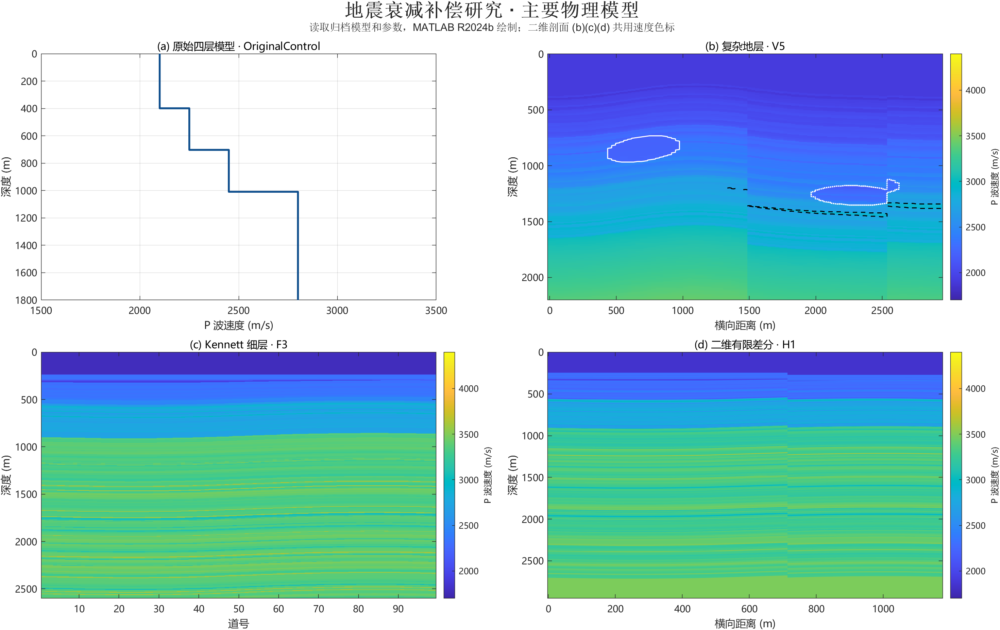

[查看原图](figures/00_research_models_overview.png) · [PDF](figures/00_research_models_overview.pdf) · [MATLAB FIG](figures/00_research_models_overview.fig)

## 2. 四层模型 · 01_layered_vp

10 个配置；P 波速度 (m/s)；共同坐标范围；水平线为层界面。

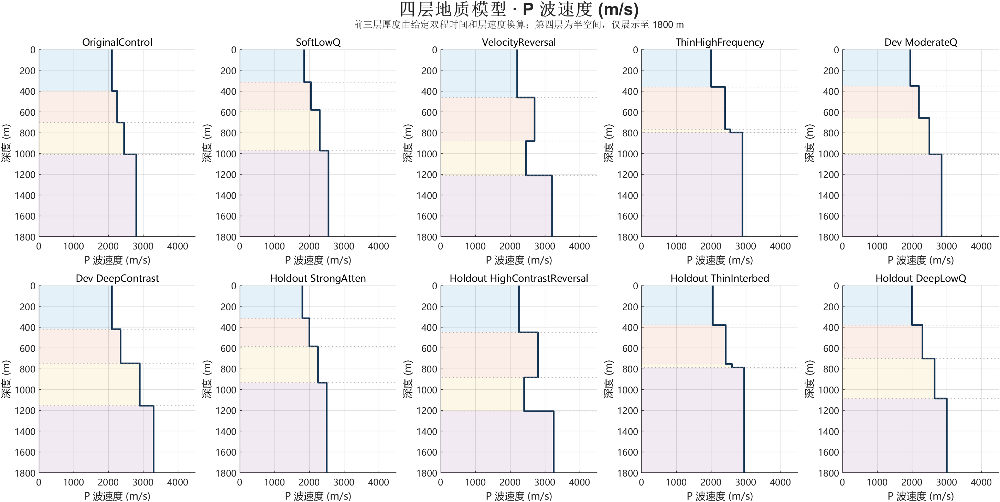

[查看原图](figures/01_layered_vp.png) · [PDF](figures/01_layered_vp.pdf) · [MATLAB FIG](figures/01_layered_vp.fig)

## 3. 四层模型 · 01_layered_Q

10 个配置；品质因子 Q（无量纲）；共同坐标范围；水平线为层界面。

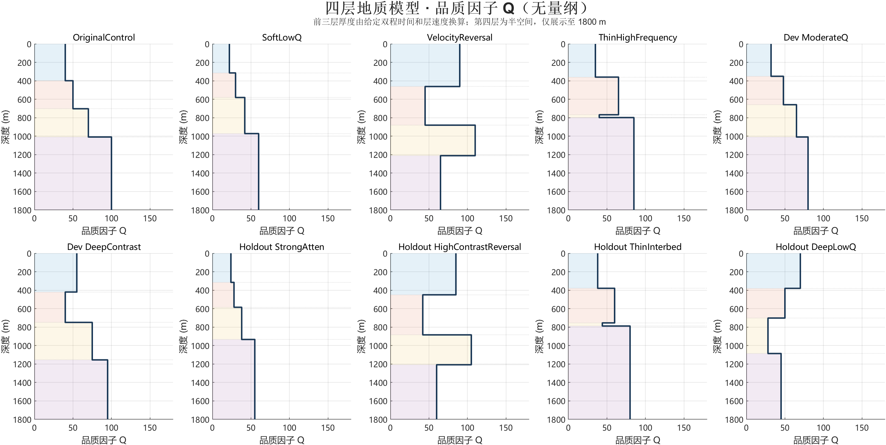

[查看原图](figures/01_layered_Q.png) · [PDF](figures/01_layered_Q.pdf) · [MATLAB FIG](figures/01_layered_Q.fig)

## 4. 稀疏反射模型 · 02_V1_reflectivity

时间域反射系数及配套道集；保留原始极性和幅度。

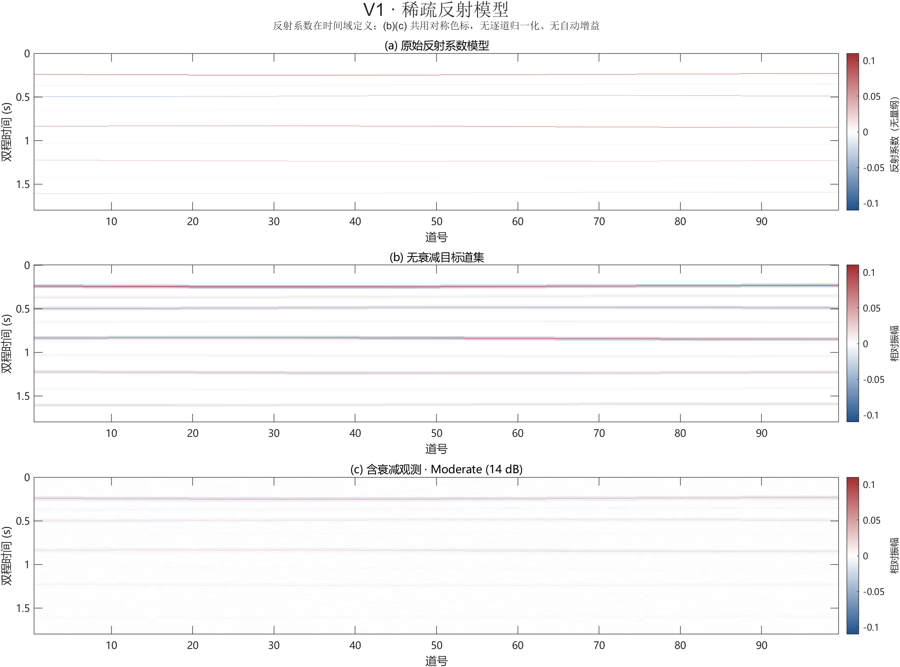

[查看原图](figures/02_V1_reflectivity.png) · [PDF](figures/02_V1_reflectivity.pdf) · [MATLAB FIG](figures/02_V1_reflectivity.fig)

## 5. 稀疏反射模型 · 02_V2_reflectivity

时间域反射系数及配套道集；保留原始极性和幅度。

[查看原图](figures/02_V2_reflectivity.png) · [PDF](figures/02_V2_reflectivity.pdf) · [MATLAB FIG](figures/02_V2_reflectivity.fig)

## 6. 稀疏反射模型 · 02_V4_reflectivity

时间域反射系数及配套道集；保留原始极性和幅度。

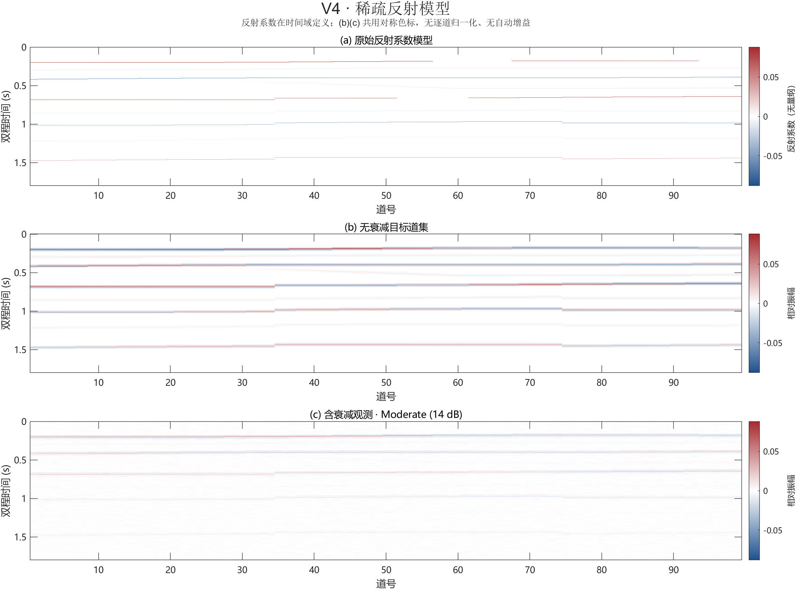

[查看原图](figures/02_V4_reflectivity.png) · [PDF](figures/02_V4_reflectivity.pdf) · [MATLAB FIG](figures/02_V4_reflectivity.fig)

## 7. 复杂地质模型 · 03_V3_complex

速度和 Q 剖面；河道、楔状体、含气异常轮廓；目标和观测共用幅度色标。

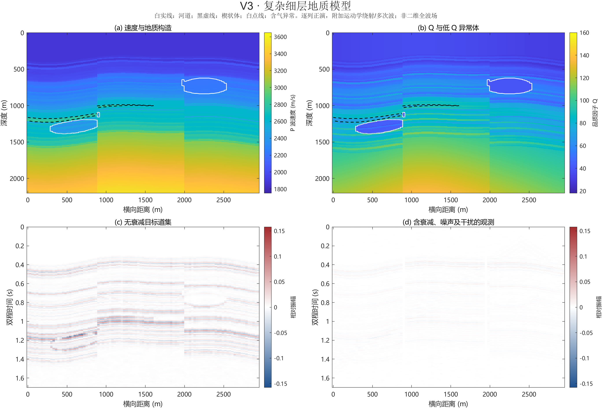

[查看原图](figures/03_V3_complex.png) · [PDF](figures/03_V3_complex.pdf) · [MATLAB FIG](figures/03_V3_complex.fig)

## 8. 复杂地质模型 · 03_V5_complex

速度和 Q 剖面；河道、楔状体、含气异常轮廓；目标和观测共用幅度色标。

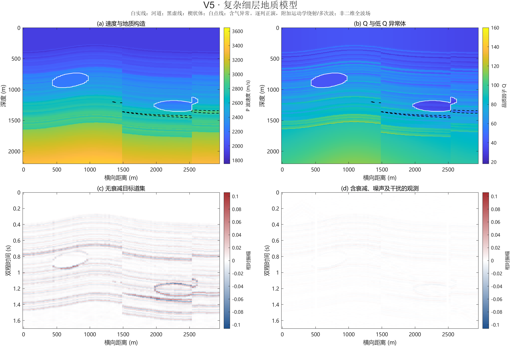

[查看原图](figures/03_V5_complex.png) · [PDF](figures/03_V5_complex.pdf) · [MATLAB FIG](figures/03_V5_complex.fig)

## 9. Kennett 细层模型 · 04_F1_Kennett

由归档 base 日志按原 lateral 规则重建；2 m 显示采样；第 50 道测井。

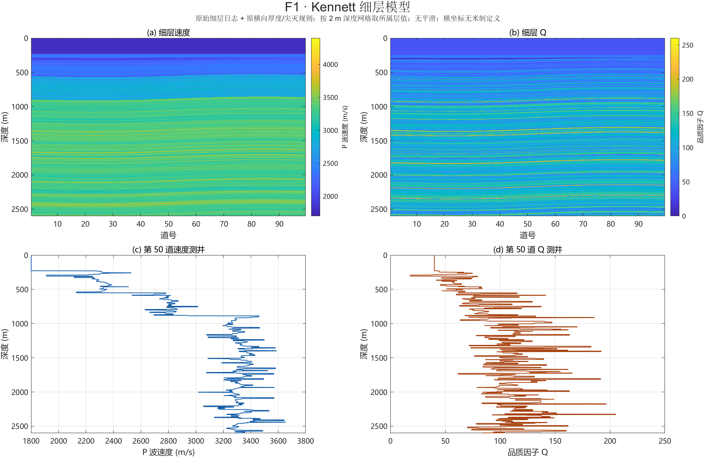

[查看原图](figures/04_F1_Kennett.png) · [PDF](figures/04_F1_Kennett.pdf) · [MATLAB FIG](figures/04_F1_Kennett.fig)

## 10. Kennett 细层模型 · 04_F2_Kennett

由归档 base 日志按原 lateral 规则重建；2 m 显示采样；第 50 道测井。

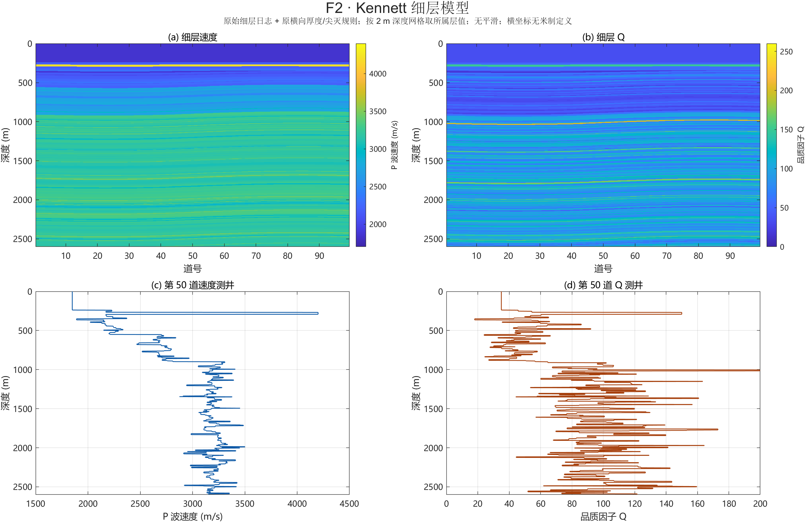

[查看原图](figures/04_F2_Kennett.png) · [PDF](figures/04_F2_Kennett.pdf) · [MATLAB FIG](figures/04_F2_Kennett.fig)

## 11. Kennett 细层模型 · 04_F3_Kennett

由归档 base 日志按原 lateral 规则重建；2 m 显示采样；第 50 道测井。

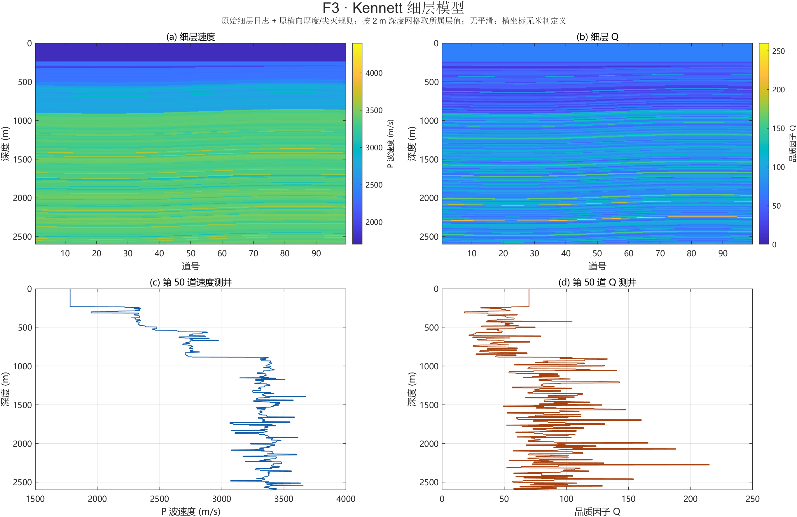

[查看原图](figures/04_F3_Kennett.png) · [PDF](figures/04_F3_Kennett.pdf) · [MATLAB FIG](figures/04_F3_Kennett.fig)

## 12. Kennett 细层模型 · 04_F4_Kennett

由归档 base 日志按原 lateral 规则重建；2 m 显示采样；第 50 道测井。

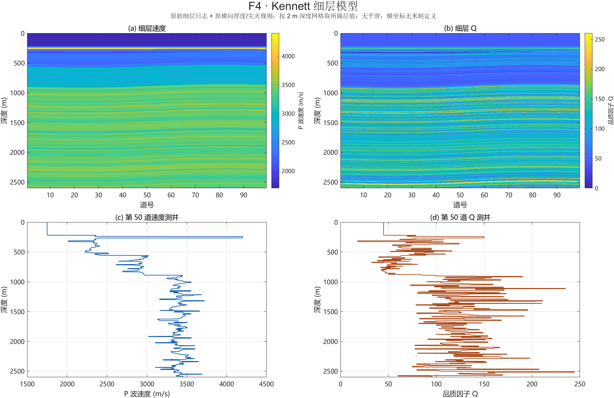

[查看原图](figures/04_F4_Kennett.png) · [PDF](figures/04_F4_Kennett.pdf) · [MATLAB FIG](figures/04_F4_Kennett.fig)

## 13. Kennett 细层模型 · 04_U1_Kennett

由归档 base 日志按原 lateral 规则重建；2 m 显示采样；第 50 道测井。

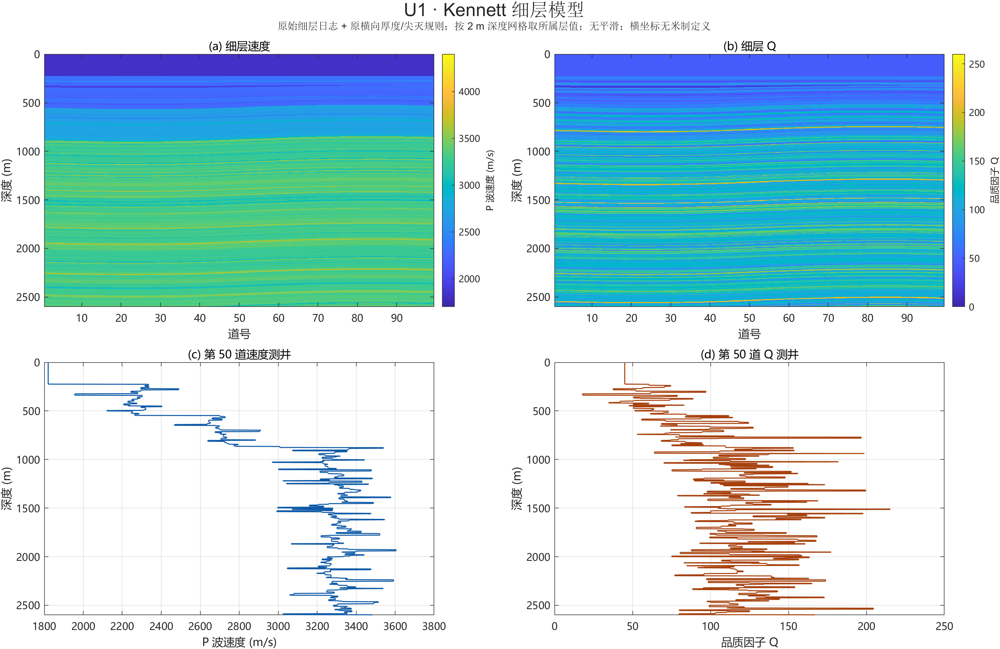

[查看原图](figures/04_U1_Kennett.png) · [PDF](figures/04_U1_Kennett.pdf) · [MATLAB FIG](figures/04_U1_Kennett.fig)

## 14. Kennett 细层模型 · 04_U2_Kennett

由归档 base 日志按原 lateral 规则重建；2 m 显示采样；第 50 道测井。

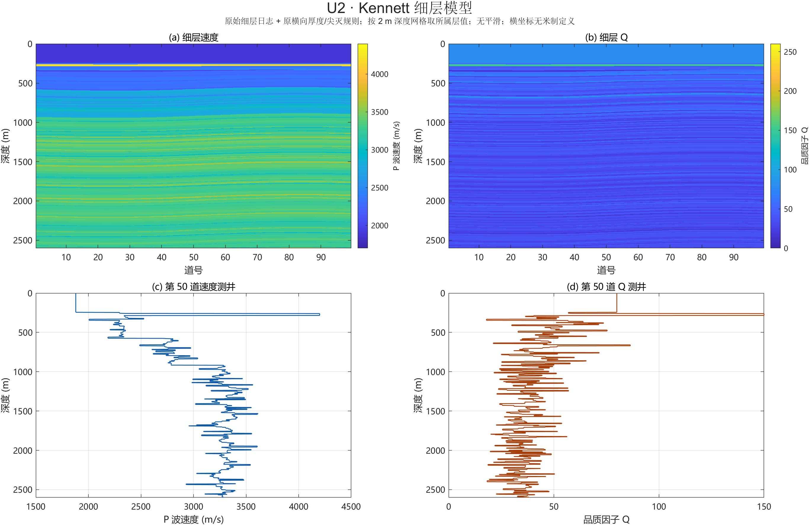

[查看原图](figures/04_U2_Kennett.png) · [PDF](figures/04_U2_Kennett.pdf) · [MATLAB FIG](figures/04_U2_Kennett.fig)

## 15. Kennett 细层模型 · 04_U3_Kennett

由归档 base 日志按原 lateral 规则重建；2 m 显示采样；第 50 道测井。

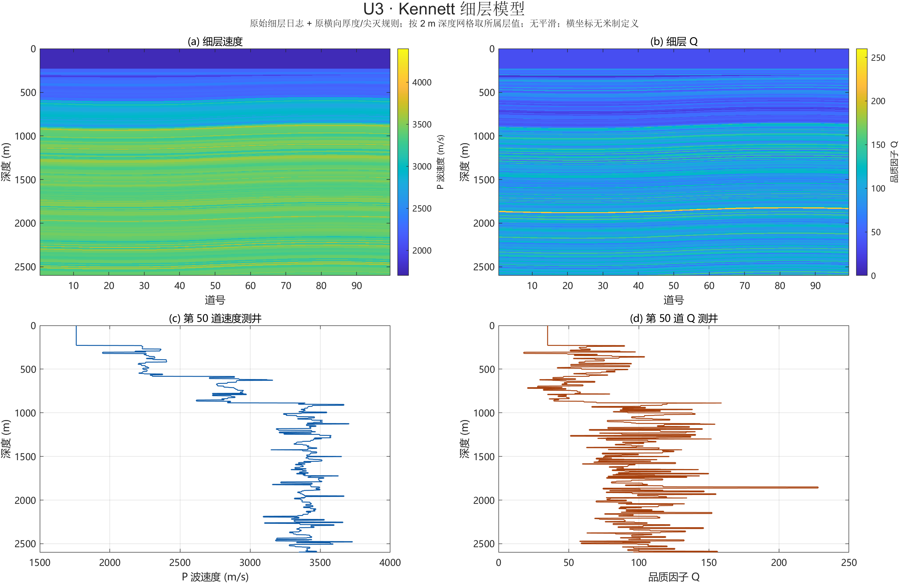

[查看原图](figures/04_U3_Kennett.png) · [PDF](figures/04_U3_Kennett.pdf) · [MATLAB FIG](figures/04_U3_Kennett.fig)

## 16. Kennett 细层模型 · 04_U4_Kennett

由归档 base 日志按原 lateral 规则重建；2 m 显示采样；第 50 道测井。

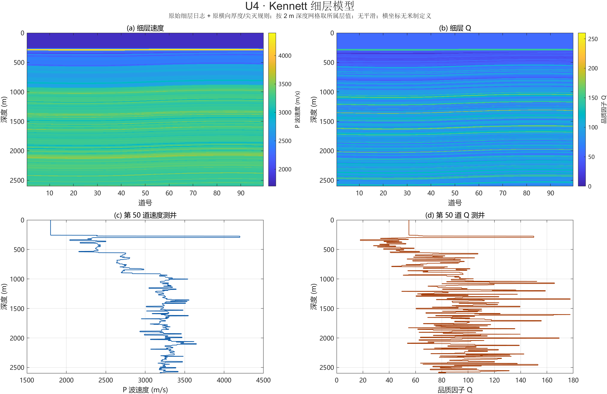

[查看原图](figures/04_U4_Kennett.png) · [PDF](figures/04_U4_Kennett.pdf) · [MATLAB FIG](figures/04_U4_Kennett.fig)

## 17. 模型总览 · 05_Kennett_atlas_vp

八个 Kennett 模型，同变量统一色标。

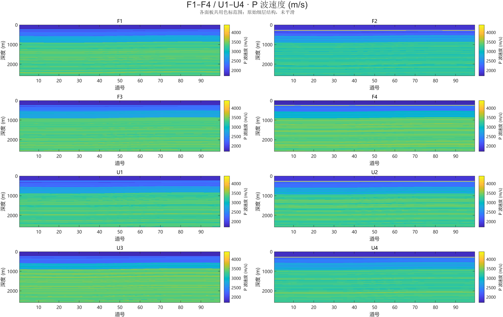

[查看原图](figures/05_Kennett_atlas_vp.png) · [PDF](figures/05_Kennett_atlas_vp.pdf) · [MATLAB FIG](figures/05_Kennett_atlas_vp.fig)

## 18. 模型总览 · 05_Kennett_atlas_Q

八个 Kennett 模型，同变量统一色标。

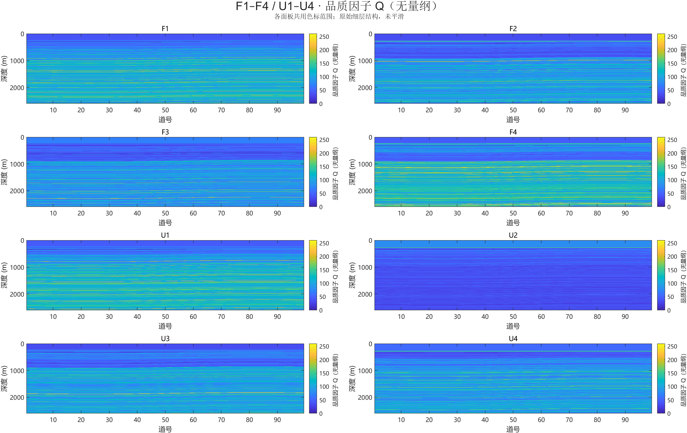

[查看原图](figures/05_Kennett_atlas_Q.png) · [PDF](figures/05_Kennett_atlas_Q.pdf) · [MATLAB FIG](figures/05_Kennett_atlas_Q.fig)

## 19. 二维有限差分模型 · 06_H1_FD2D

原始 fd_geology 与固定随机种子重建，base 与归档真值逐字段一致；剔除吸收边界。

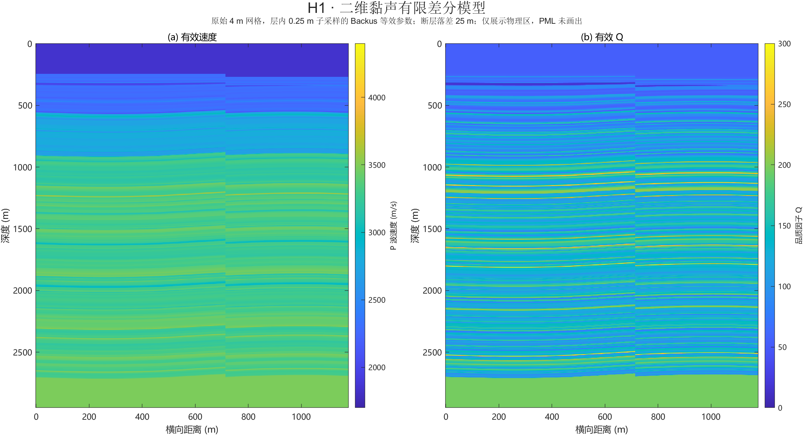

[查看原图](figures/06_H1_FD2D.png) · [PDF](figures/06_H1_FD2D.pdf) · [MATLAB FIG](figures/06_H1_FD2D.fig)

## 20. 二维有限差分模型 · 06_H2_FD2D

原始 fd_geology 与固定随机种子重建，base 与归档真值逐字段一致；剔除吸收边界。

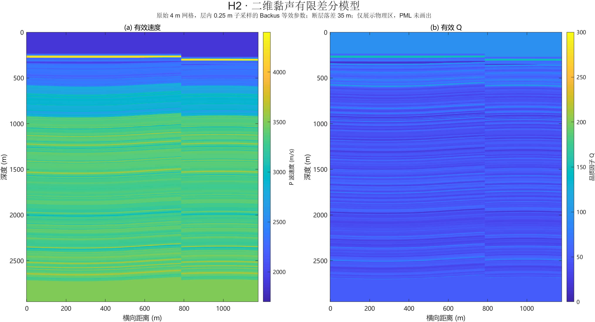

[查看原图](figures/06_H2_FD2D.png) · [PDF](figures/06_H2_FD2D.pdf) · [MATLAB FIG](figures/06_H2_FD2D.fig)

## 21. 二维有限差分模型 · 06_H3_FD2D

原始 fd_geology 与固定随机种子重建，base 与归档真值逐字段一致；剔除吸收边界。

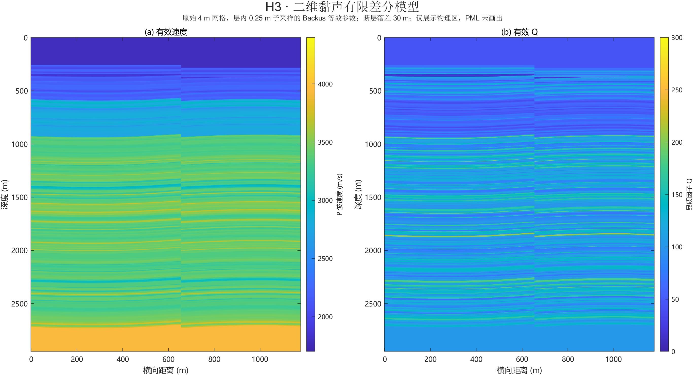

[查看原图](figures/06_H3_FD2D.png) · [PDF](figures/06_H3_FD2D.pdf) · [MATLAB FIG](figures/06_H3_FD2D.fig)

## 22. 二维有限差分模型 · 06_H4_FD2D

原始 fd_geology 与固定随机种子重建，base 与归档真值逐字段一致；剔除吸收边界。

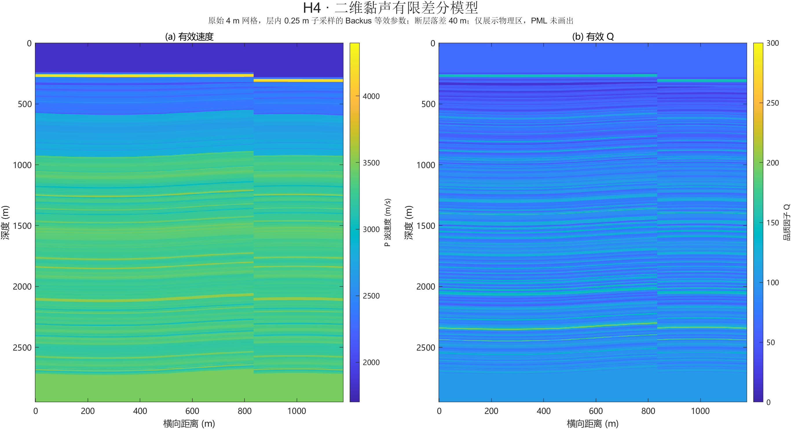

[查看原图](figures/06_H4_FD2D.png) · [PDF](figures/06_H4_FD2D.pdf) · [MATLAB FIG](figures/06_H4_FD2D.fig)

## 23. 二维有限差分模型 · 06_H5_FD2D

原始 fd_geology 与固定随机种子重建，base 与归档真值逐字段一致；剔除吸收边界。

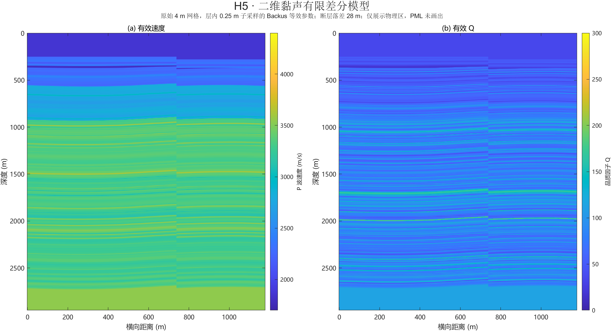

[查看原图](figures/06_H5_FD2D.png) · [PDF](figures/06_H5_FD2D.pdf) · [MATLAB FIG](figures/06_H5_FD2D.fig)

## 24. 二维有限差分模型 · 06_H6_FD2D

原始 fd_geology 与固定随机种子重建，base 与归档真值逐字段一致；剔除吸收边界。

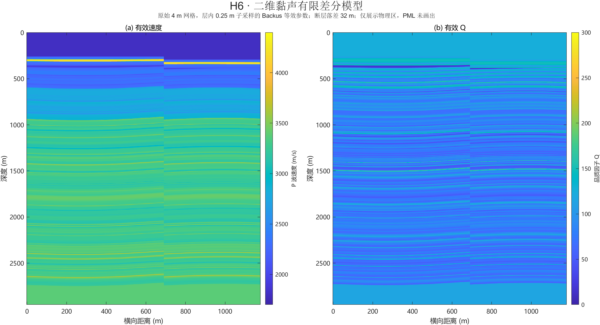

[查看原图](figures/06_H6_FD2D.png) · [PDF](figures/06_H6_FD2D.pdf) · [MATLAB FIG](figures/06_H6_FD2D.fig)

## 25. 模型总览 · 07_FD2D_atlas_vp

六个独立二维模型，同变量统一色标。

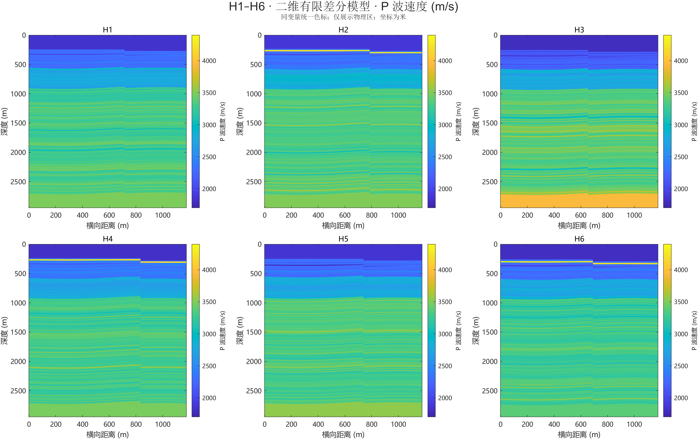

[查看原图](figures/07_FD2D_atlas_vp.png) · [PDF](figures/07_FD2D_atlas_vp.pdf) · [MATLAB FIG](figures/07_FD2D_atlas_vp.fig)

## 26. 模型总览 · 07_FD2D_atlas_Q

六个独立二维模型，同变量统一色标。

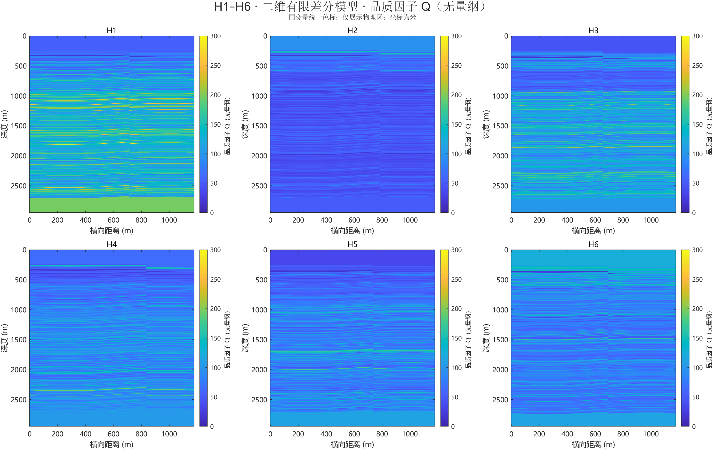

[查看原图](figures/07_FD2D_atlas_Q.png) · [PDF](figures/07_FD2D_atlas_Q.pdf) · [MATLAB FIG](figures/07_FD2D_atlas_Q.fig)
