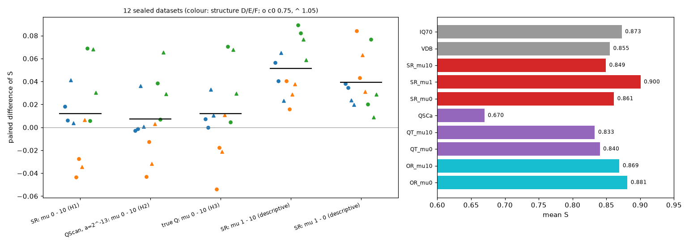

# 实验 16 结果：SC-a 去掉横向相干项的确认检验

方案 [PLAN_ZH.md](PLAN_ZH.md)，运行前提交于 e22f2d8。检验数据为第二批断层＋复杂 Q 半合成数据的 12 个封存数据集（构造 D、E、F；c₀ = 0.75、1.05）。4 个进程运行，每个数据集 729–949 s。判定由 `scripts/analyze16.py` 给出，详见 `analysis/summary.json`。

## 结论

- **mu_relative 从 10 改成 0 没有得到确认**。H1–H3 都是"无法判定"：
  - 平均只提高 +0.007 到 +0.012；
  - 构造 E 上三条路线都变差（−0.021 到 −0.025）；
  - 上限核查在第一批数据上看到的 +0.069（c₀ = 0.75 时 +0.100），在新数据上没有重现。
- **对用户流程的总建议仍然成立**（H4 支持），但收益几乎全部来自调小 a：
  - QScan＋a = 2⁻¹³＋mu 0 比原流程高 +0.171，12/12；
  - 只调小 a、保留 mu 10 就已经高 +0.163，12/12。这是对实验 15 H1 的又一次重现。
- **事后发现**：中间值 mu_relative = 1 明显好于 0 和 10。
  - SR 路线上比 mu 10 高 +0.051（12/12），比 mu 0 高 +0.039（12/12），三个构造方向一致；
  - 平均 S 为 0.900，高于 70 dB 反 Q 的 0.873（11/12），也高于用真值 Q 的 SC-a。
  - mu 1 只是方案里的描述项，没有为它设判定，也只试了这一个中间值。所以这是新的探索性线索，需要另做确认。
- **H5 无法判定**：mu 0 的 SC-a 与 70 dB 反 Q 差 −0.012，区间 [−0.024, +0.001]，略偏向反 Q。

## 判定

12 个数据集，配对差的 90% t 区间（自由度 11）；"支持"还要求 D、E、F 三个构造的平均差都 > 0。

| 判定 | 比较 | 平均差 [90% 区间] | 为正 | D / E / F | 结果 |
|---|---|---|---|---|---|
| H1 SR 路线 | SR_mu0 − SR_mu10 | +0.012 [−0.007, +0.031] | 9/12 | +0.017 / −0.025 / +0.043 | 无法判定 |
| H2 用户流程（调小 a） | QT_mu0 − QT_mu10 | +0.007 [−0.009, +0.023] | 7/12 | +0.008 / −0.021 / +0.035 | 无法判定 |
| H3 真值 Q | OR_mu0 − OR_mu10 | +0.012 [−0.007, +0.030] | 8/12 | +0.013 / −0.021 / +0.043 | 无法判定 |
| H4 对用户的总收益 | QT_mu0 − QSCa | +0.171 [+0.146, +0.195] | 12/12 | +0.201 / +0.152 / +0.160 | **支持** |
| H5 与反 Q 比较 | SR_mu0 − IQ70 | −0.012 [−0.024, +0.001] | 6/12 | −0.003 / −0.030 / −0.001 | 无法判定 |

**与预期的比较**：
- H1–H3 预期"支持"，H3 预期幅度 +0.05 到 +0.10，实际 +0.012。
- H4 预期"支持"，结果支持。
- 按 c₀ 分开，mu 0 − mu 10 在 c₀ = 0.75 上几乎为零（SR +0.005，QScan −0.002，真值 +0.002），在 c₀ = 1.05 上为 +0.017 到 +0.022。上限核查中"c₀ = 0.75 收益最大"的规律也没有重现。

## 平均 S（12 个数据集）

| 方法 | S | 方法 | S |
|---|---|---|---|
| Input | 0.036 | QSCa（用户原流程） | 0.670 |
| IQ70 | 0.873 | QSCa_mu0 | 0.648 |
| VDB | 0.855 | QT_mu10 | 0.833 |
| SR_mu10 | 0.849 | QT_mu0 | 0.840 |
| **SR_mu1** | **0.900** | OR_mu10（真值 Q） | 0.869 |
| SR_mu0 | 0.861 | OR_mu0（真值 Q） | 0.881 |

## 描述性结果（不作判定）

| 比较 | 平均差 [90% 区间] | 为正 |
|---|---|---|
| SR_mu1 − SR_mu10 | +0.051 [+0.039, +0.064] | 12/12 |
| SR_mu1 − SR_mu0 | +0.039 [+0.027, +0.052] | 12/12 |
| SR_mu1 − IQ70（事后） | +0.028 [+0.014, +0.041] | 11/12 |
| SR_mu1 − VDB（事后） | +0.045 [+0.036, +0.054] | 12/12 |
| SR_mu1 − OR_mu0（事后） | +0.019 [+0.008, +0.030] | 11/12 |
| QT_mu10 − QSCa（只调小 a） | +0.163 [+0.131, +0.195] | 12/12 |
| QSCa_mu0 − QSCa（a = 0.125 时去掉相干项） | −0.022 [−0.029, −0.014] | 0/12 |
| QT_mu0 − IQ70 | −0.032 [−0.060, −0.005] | 3/12 |
| OR_mu0 − IQ70 | +0.008 [−0.007, +0.023] | 10/12 |
| VDB − IQ70 | −0.018 [−0.034, −0.001] | 2/12 |

- **mu 1 呈"中间最好"的形状**：
  - SR 路线上，mu 1 在 12 个数据集上都高于 mu 0 和 mu 10；
  - 冒烟测试的开发数据集 `ZA_c0.75_r0` 上也是如此（0.840，对 0.780 / 0.770）。
  - 相干项的作用不是单纯有害，权重 10 太大，0 又丢掉了它的好处。
  - 上限核查只比较了 0 和 10，第一批数据上 0 恰好更好，就得出了"去掉更好"的结论；在新数据上，0 和 10 差不多，都不如 1。
- **原流程（a = 0.125）去掉相干项反而更差**（12/12）。a 大时，相干项的作用与 a 小时不同。
- **带宽**：12 个数据集的浅层带宽 fs 都在 98–125 Hz，没有一个低于目标带宽 fd（59–83 Hz）。上限核查的机制 1 在这批数据上没有出现，与实测一致。
- **局部窗口**（2.0–3.0 s，见 `analysis/summary.json`）：
  - mu 0 在断面附近好于 mu 10（SR 0.802 对 0.730）；
  - 在气藏下方，mu 0 差于 mu 10（0.821 对 0.852）；
  - mu 1 在两处都最好（0.804、0.904）。
- **选 Q**：SR 的 |ln(c/c_eff)| 平均 0.077，QScan 为 0.123；QScan 没有选在网格边上。QT 路线整体低于 SR 路线（0.840 对 0.861），差距主要来自 Q 误差。

## 解释

- **上限核查的结论需要修正**。"横向相干项 mu 10 有害、应去掉"在未见数据上不成立：0 与 10 无法区分，且随构造变号（E 上 0 更差）。原报告把这一条列为机制 2，应改为"mu 10 偏大，最优在中间"。
- **对用户流程的建议不变**：保持实验 12、15 的建议，把 a 从 0.125 调到 2⁻¹³（第三次在未见数据上确认，这次 +0.163，12/12）；mu 不要改成 0。
- **新线索**：mu_relative ≈ 1 可能让 SC-a 超过 70 dB 反 Q，这会改变"SR 路线优先用反 Q"的推荐。但这是在已用来检验的 12 个数据集上看到的，而且只试了一个值。正确的做法是：
  1. 在开发数据（第一、二批，都已用过）上按网格选 mu；
  2. 冻结后，在新的未见构造上确认，同时覆盖 QScan 路线；
  3. 再到实验 13 的实测测线上做井旁检查。

## 文件

- `results/test/*.json`：每个数据集的估计、带宽、分数、局部窗口和用时；`results/smoke/`：冒烟测试。
- `analysis/summary.json`：判定、描述性比较、逐数据集表。
- `figures/mu_effects.png`、`scripts/figures16.py`。
- 输出剖面在 `cache/out/`，不上传。
