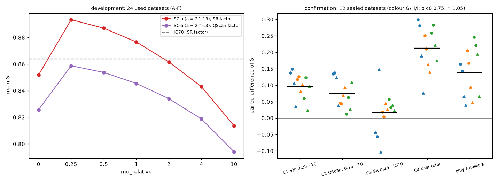

# 实验 17 结果：开发选择 SC-a 的相干项权重并在封存数据上确认

- **方案**：[PLAN_ZH.md](PLAN_ZH.md)。选择规则和判定在任何开发结果出现之前提交（1eab557）；选出的值和封存数据的哈希在检验运行之前提交（e9b5640）。
- **运行**：4 个进程。开发阶段每个数据集约 30 分钟，检验阶段 11–14 分钟。

## 结论

- **默认权重改为 0.25 有依据**：SC-a 的横向相干项权重 mu_relative 从 10 改为 0.25，在两条路线的 12 个未见数据集上都更好，12/12。
  - SR 估 Q：+0.096（C1 支持）；
  - 用户的 QScan 流程（a 调小）：+0.075（C2 支持）。
- **给用户的总建议**：QScan＋a = 2⁻¹³＋mu 0.25，比原流程（a = 0.125、mu 10）高 +0.212，12/12（C4 支持）。
  - 其中调小 a 贡献 +0.138，这是第四次在未见数据上确认；
  - 再把 mu 改为 0.25，又多 +0.075。
- **SC-a 是否胜过 70 dB 反 Q 仍无法判定**（C3）：平均 +0.016，区间 [−0.017, +0.049]，9/12 为正，但构造 G 的平均为负。
  - SR 路线的推荐暂不改：SC-a（mu 0.25）与 70 dB 反 Q 并列。
  - 两者都比原来的 SC-a（mu 10）好很多：原 SC-a 比反 Q 低 0.080。
- **还没做实测检查**：这仍是半合成数据上的结论。改动默认值之前，还要在实验 13 的实测测线上做井旁检查（方案第 6 节）。

## 开发阶段（24 个已用数据集：第一批 A、B、C 和第二批 D、E、F，c₀ = 0.75、1.05）

| mu_relative | 0 | **0.25** | 0.5 | 1 | 2 | 4 | 10 |
|---|---|---|---|---|---|---|---|
| SR 路线平均 S | 0.852 | **0.893** | 0.887 | 0.877 | 0.862 | 0.843 | 0.814 |
| QScan 路线平均 S | 0.826 | **0.859** | 0.854 | 0.845 | 0.834 | 0.819 | 0.794 |
| SR 路线胜过 mu 10 的个数 | 21 | 24 | 24 | 24 | 24 | 24 | — |
| QScan 路线胜过 mu 10 的个数 | 18 | 24 | 24 | 24 | 24 | 24 | — |

- IQ70 平均为 0.864。
- **两条路线都选 0.25**。按批次、按 6 个构造、按 c₀ 分开选，结果也全是 0.25（`analysis/dev_summary.json`）。
- **曲线形状**：中间高、两端低，0.25 之后单调下降。
- **网格局限**：0.25 是网格中最小的非零值，真正的最优值可能在 0 到 0.25 之间，本实验没有检验。
- **重现性**：开发数据中与实验 16 重叠的方法（mu 0、1、10 和 IQ70）与实验 16 结果完全相同（差 0）。

## 确认阶段（12 个封存数据集：第三批 G、H、I）

配对差的 90% t 区间，自由度 11。"支持"还要求 G、H、I 三个构造的平均差都 > 0。

| 判定 | 比较 | 平均差 [90% 区间] | 为正 | G / H / I | 结果 |
|---|---|---|---|---|---|
| C1 | SR_sel − SR_mu10 | +0.096 [+0.076, +0.117] | 12/12 | +0.107 / +0.107 / +0.075 | **支持** |
| C2 | QT_sel − QT_mu10 | +0.075 [+0.052, +0.097] | 12/12 | +0.108 / +0.063 / +0.053 | **支持** |
| C3 | SR_sel − IQ70 | +0.016 [−0.017, +0.049] | 9/12 | −0.014 / +0.024 / +0.038 | 无法判定 |
| C4 | QT_sel − QSCa | +0.212 [+0.178, +0.247] | 12/12 | +0.211 / +0.191 / +0.234 | **支持** |

**平均 S**

| 方法 | S |
|---|---|
| Input | 0.051 |
| IQ70 | 0.881 |
| VDB | 0.867 |
| SR_mu10 | 0.801 |
| **SR_sel（mu 0.25）** | **0.897** |
| QSCa（用户原流程） | 0.654 |
| QT_mu10 | 0.792 |
| **QT_sel（mu 0.25）** | **0.867** |

**描述性比较**

| 比较 | 平均差 [90% 区间] | 为正 |
|---|---|---|
| QT_mu10 − QSCa（只调小 a） | +0.138 [+0.100, +0.175] | 12/12 |
| QT_sel − IQ70 | −0.014 [−0.070, +0.041] | 6/12 |
| SR_sel − VDB | +0.030 [+0.016, +0.045] | 10/12 |
| SR_mu10 − IQ70 | −0.080 [−0.120, −0.041] | 2/12 |

- **按 c₀ 分开**：C1 在 c₀ = 0.75 为 +0.119，在 1.05 为 +0.074；C4 分别为 +0.264、+0.161。
- **C3 的分歧集中在构造 G**：
  - G 的气藏阴影最强（振幅比 0.52–0.59），3 个负值都在 G：r0、r1（c₀ = 0.75）和 c₀ = 1.05 的 r1，最大为 −0.102；
  - G 上唯一的大正值 +0.149（`ZG_c1.05_r0`）来自 SR 把 c 估成 1.37（真值 1.08）：IQ70 掉到 0.734，SC-a 掉得少（0.883）。
  - 在这批数据上，SC-a 对 Q 偏差更稳健，但气藏强时不如反 Q。这一点只是事后观察。
- **QScan**：12 个中 8 个选 1.00、4 个选 0.88；c₀ = 0.75 时（真值约 0.76）偏高，符合锚定理论的压缩。没有选在网格边上。
- **带宽塌缩**：1/12。

## 解释（按方案第 6 节）

- **C1、C2 支持**：SC-a 的默认 mu_relative 可以改为 0.25，SR 路线和用户的 QScan 路线都适用。前提是还要在实验 13 的实测测线上做井旁检查，没有真值时确认改动不变差。
- **C3 无法判定**：SR 路线维持原推荐，70 dB 反 Q 与 SC-a（mu 0.25）都可用。
- **C4**：给用户的建议更新为 QScan＋a = 2⁻¹³＋mu_relative = 0.25，在未见数据上比原流程高约 0.21。
- **与实验 16 的关系**：实验 16 事后看到的 "mu 1 最好" 方向正确，但最优值更小。上限核查的 "去掉相干项更好" 仍然不成立：mu 0 在开发数据上比 0.25 低 0.03–0.04。

## 文件

- `CHOICE.json`：冻结的选择。`PRE_RUN_HASHES.txt`：封存数据、脚本和方案的哈希。
- `results/dev/*.json`：开发阶段每个数据集的 14 个 SC-a 分数和 IQ70。`analysis/dev_summary.json`：选择及其稳定性。
- `results/test/*.json`、`analysis/summary.json`：确认阶段的结果与判定。
- `figures/mu_tune.png`、`scripts/figures17.py`。
- 输出剖面在 `cache/out/`，不上传。
