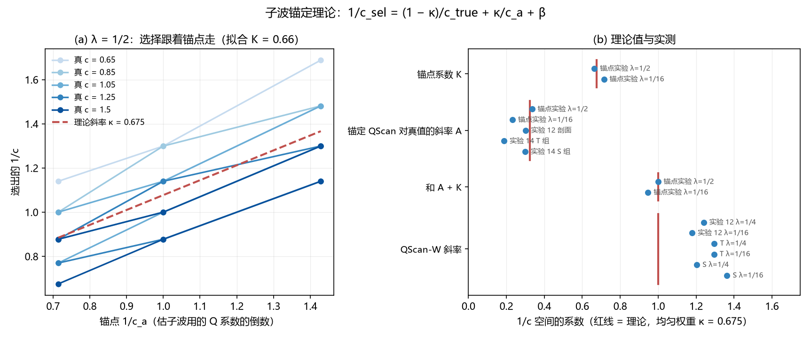
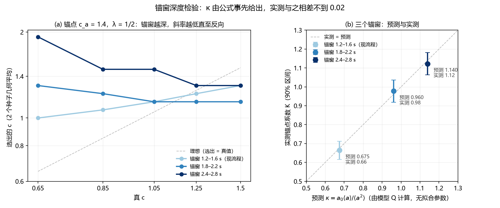
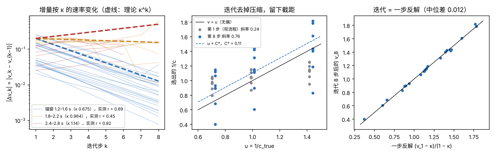
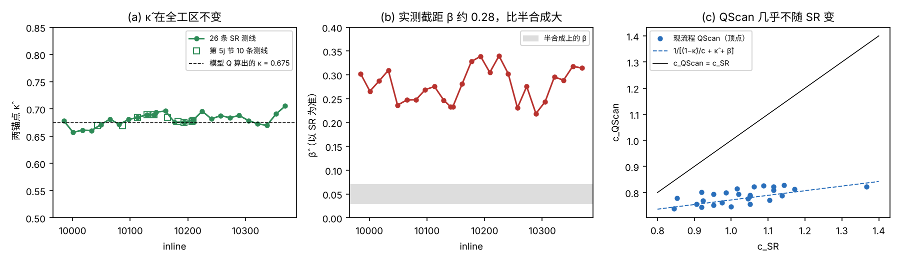

# 子波锚定理论：QScan 选 Q 为什么被压缩

2026-10-30。推导解释实验 12–14 中 QScan 选 Q 的压缩与偏差；锚点实验检验推导的定量预测（预测见 `PLAN_ZH.md`，开跑前已提交，1ac6e24）。

## 1. 记号

- 模型 Q 剖面 Q(z)，真 Q = c_true·Q，扫描 Q = c·Q。记 **u = 1/c_true，v = 1/c**。
- a(t)：模型 Q（c = 1）下到双程时间 t 的累积 t*（`lib.absorption`）。Q 乘 c，t* 变为 a(t)/c，故**一切衰减与色散都对 1/c 线性**：`lib.dictionary` 中第 k 列的传播算子为 exp[b(f)·a(t_k)·v]，b(f) = −πf + 2i f ln(f/f_ref)。
- a₀ = a(1.4 s)：`lib.wavelets` 估子波的浅层窗（1.2–1.6 s）中点。
- 锚点 v_a = 1/c_a：估计输入子波时假设的 Q 系数。现流程 QScan 的 v_a = 1。

## 2. 推导

**子波估计。** `lib.wavelets` 取浅层窗振幅谱，除以假设 Q 下 1.4 s 处的吸收：

  |Ŵ(f)| = √P_s(f) / e^{−πf a₀ v_a} ≈ |W(f)| ρ(f) · e^{−πf a₀ (u − v_a)}，

其中 ρ(f) 是浅层反射系数的谱色。只要 v_a ≠ u，估出的子波就带着一个谱倾斜 e^{−πf a₀(u − v_a)}。

**字典与数据之差。** 局部平稳近似下，t 时刻数据的振幅谱为 W e^{−πf a(t) u}，字典为 Ŵ e^{−πf a(t) v}。反演得到的反射系数要把两者之比吸收进去，相当于对真反射系数做了一个随时间变化的谱倾斜 e^{−πf δ(t)}，其中

  **δ(t) = a(t)(u − v) − a₀(u − v_a)**。

**选择。** QScan 的目标值（lasso）对 v 的依赖只经过 δ(t)。把它在 δ = 0 附近展成二次：

  J(v) ≈ J₀ + Σ_t [φ₁(t) δ(t) + ½ φ₂(t) δ(t)²]，

φ₂ ≥ 0 是 t 时刻对谱倾斜的敏感度，φ₁ 是稀疏项对倾斜的偏好（λ 越大，L1 项越重，φ₁ 越大）。对 v 求极小：

  **v_sel = (1 − κ) u + κ v_a + β**，  **κ = a₀ Σφ₂a / Σφ₂a²**，  β = Σφ₁a / Σφ₂a²。

三种情形：

| 子波 | 选出的 1/c | 1/c 空间斜率 |
|---|---|---|
| 现流程：锚在 v_a = 1 | (1 − κ) u + κ + β | 1 − κ < 1，被拉向锚点 1 |
| 锚在任意 v_a | (1 − κ) u + κ v_a + β | 对真值 1 − κ，对锚点 κ，两者之和为 1 |
| 每个 c 重估（QScan-W，v_a = v） | u + β′，β′ = Σφ₁(a − a₀)/Σφ₂(a − a₀)² | 1；λ 只平移截距 |

和规则 A + K = 1 来自平移不变性：u、v_a、v 同加一个常数，δ(t) 不变。

**κ 的含义与数值。** κ 是 a₀ 与 a(t) 在 φ₂ 加权下的"回归系数"，取值 0–1。信息越集中在浅层（a ≈ a₀），κ 越接近 1，压缩越强。φ₂ 在分析窗 1.2–3.0 s 内均匀时，由模型 Q 直接算得：

  **κ = 0.675，预测斜率 1 − κ = 0.33**（无拟合参数）。

**换到 log c。** 实验都在 log c 上算斜率和偏差。由 v_sel = A u + C，log 斜率 = A u / v_sel。对 QScan-W（A ≈ 1）：β > 0 时选择偏低且 log 斜率 < 1，β < 0 时偏高且 log 斜率 > 1。所以实验 14 H2 里"偏差和斜率随 λ 一起单调变化"其实是同一个参数 β(λ) 的两个表现。

## 3. 检验

### 3.1 已有结果（事后拟合，`analysis/fit_existing.json`）

在 1/c 空间拟合 v_sel = A u + C：

| 方法 | 实验 12 剖面 | 实验 14 T | 实验 14 S | 理论 |
|---|---|---|---|---|
| 现流程 QScan，A | 0.30 | 0.19 | 0.30 | 1 − κ = 0.33 |
| QScan-W(1/4)，A / C | 1.24 / +0.23 | 1.30 / +0.01 | 1.20 / +0.26 | 1 / β |
| QScan-W(1/16)，A / C | 1.18 / +0.06 | 1.29 / −0.29 | 1.36 / −0.22 | 1 / β |
| QScan-W(1/64)，A / C | 1.39 / −0.29 | 1.36 / −0.46 | 1.32 / −0.45 | 1 / β |

由 A 和 C 推出的 log 斜率与直接算的 log 斜率一致（例如 T 组 QScan 0.21 对 0.21，QScan-W(1/16) 1.31 对 1.28）。

### 3.2 锚点实验（`scripts/anchor.py`，`analysis/anchor.json`）

实验 12 的 10 个剖面（c = 0.65–1.5，种子 9701、9702）× 锚点 c_a = 0.7、1.0、1.4，λ = 1/2、1/16，共 30 次扫描。对每个 λ 拟合 v_sel = A u + K v_a + C，区间为按剖面自助重抽样 2000 次的 90% 百分位区间：

| | A（对真值） | K（对锚点） | A + K | 单调（每个剖面） | 收敛 |
|---|---|---|---|---|---|
| λ = 1/2 | 0.34 | **0.66** [0.62, 0.71] | **1.00** [0.81, 1.19] | 10/10 严格单调 | 100% |
| λ = 1/16 | 0.23 | **0.71** [0.68, 0.75] | **0.95** [0.79, 1.14] | 10/10 严格单调 | 99.8% |
| 理论（均匀 φ₂） | 0.33 | 0.675 | 1 | — | — |

锚点取 1、λ = 1/2 时，10 个剖面的选择与实验 12 的 `lib.qscan` 完全相同。

对照开跑前的预测：

1. K 在 0.5–0.9 之间：**满足**（0.66、0.71），与无拟合参数的 κ = 0.675 相差不到 0.04。
2. A + K 接近同一 λ 下 QScan-W 的斜率，差 ±0.2 以内：λ = 1/2 **满足**（1.00 对 0.97）；λ = 1/16 **差 0.23，略超出**（0.95 对 1.18）。A + K 本身符合理论值 1，超出的是 QScan-W 的斜率（见第 4 节）。
3. 每个剖面单调：**满足**（20/20 严格单调）。

## 4. 结论与局限

1. **压缩的定量来源**：现流程 QScan 选出的 1/c 是真值与锚点 1 的加权平均，真值的权重只有 1 − κ ≈ 0.3。κ 由模型 Q 剖面和分析窗几何直接给出（0.675），锚点实验测得 0.66–0.71。
2. **为什么调权重救不了现流程**：λ 只进入 β（平移），不进入 κ。预实验 `qscan_reg_pilot_20261029` 把权重从 2 扫到 2⁻⁷，log 斜率始终只有 0.16–0.37，正是这个原因。锚点实验中两个 λ 的 A 也都在 0.2–0.35。
3. **重估子波为何有效、又为何需要校正**：重估后 κ 项消失，Q 的信息只来自深浅之差 a(t) − a₀，原理上与谱比法相同；但截距 β 由稀疏项决定，随 λ 和数据（构造、反射系数、噪声）变化，所以开发集上定的偏差搬不到新数据（实验 14 H3）。第 5d 节显示，λ 只移动这个截距，1/c 斜率约 1.3 不随 λ 变。
4. **QScan-W 斜率高于 1（第 5 节补充检验）**：QScan-W 在 1/c 空间的斜率为 1.18–1.39，而一阶理论给 1，固定锚点的扫描满足 A + K ≈ 1。原先猜测的子波归一化在代码上不成立（整体幅度在 B 和罚项中精确抵消）。曲率检验支持另一解释：QScan-W 的目标函数对 1/c 的曲率只有固定锚点的约 1/8，β 对数据衰减的微小依赖被同倍放大。第 5c 节的噪声检验排除了噪声作为低噪声下这一超出的来源（噪声 ×0.25、×0.5 时斜率都是 1.28），噪声只在 ×1、×2 时使斜率进一步变大。第 5d、5e 节进一步排除了乘性偏差和深层来源；超出的大小随数据批次变化（0.07–0.39），截短分析窗、降低曲率时变大，更像是数据相关的小扰动被低曲率放大。
5. φ₂ 均匀只是近似；κ = 0.675 与实测吻合，说明在这些数据上 Q 的敏感度在分析窗内大致均匀分布。不同的窗口、Q 剖面、信噪比会给出不同的 κ，公式 κ = a₀⟨a⟩/⟨a²⟩ 可直接用于预测。
6. **适用范围（2026-11-01 补充，第 5g、5k 节）**：换成上覆层强吸收的剖面，κ 仍按公式走（预测 0.880，实测 0.856）；换成深层强吸收的剖面，公式低估了压缩（预测 0.294，实测 0.598）。深层强吸收时深层对选择的贡献小于均匀权重（第 5h 节），κ 需要按实际的 φ₂ 计算，目前还没有能同时拟合三个剖面的 φ₂ 模型。实用上可以绕开：用两个锚点在数据上直接测 κ̂（第 5j、5k 节），不需要真值，也不依赖 φ₂ 均匀。
7. **迭代反馈（第 5f 节）**：按速率 κ 收敛（实测 0.689），极限等于一步反解 (v_1 − κ)/(1 − κ)，把稀疏偏差放大约 3 倍，精度不比第一步好。

## 5. 补充检验：目标函数的曲率比

方案 `PLAN_CURV_ZH.md`，计算前提交（50470f2），程序 `scripts/curvature.py`，结果 `analysis/curvature.json`。

**排除归一化。** `lib.dictionary` 把字典每列除以其范数 scale，罚项为 λ·median(scale)/scale_k。子波乘以任何常数 α，scale 变为 α·scale，B 与罚项都不变，目标值也不变。所以子波幅度归一化不能影响选择。

**曲率。** 由第 2 节的二次展开，目标值对 v 的曲率：

- 固定锚点：H_a = Σφ₂ a²；
- 子波随 c 重估：H_w = Σφ₂ (a − a₀)²。

QScan-W 只靠深浅差辨 Q，曲率小。φ₂ 均匀、忽略色散相位项时，**H_a/H_w = ⟨a²⟩/⟨(a − a₀)²⟩ = 8.0**（由模型 Q 算得）。

**实测**（实验 12 的 10 个剖面；H_a 用锚点实验 c_a = 1 的目标值，H_w 用实验 14 开发集 QScan-W 的目标值；在最小点和两侧各两个网格点上拟合二次式）：

| λ | 有效剖面 | 比值中位数 | 90% 区间 | 预测（4–11，区间下限 > 2） |
|---|---|---|---|---|
| 1/2 | 6（4 个 QScan-W 的最小点贴网格边，不算） | 9.8 | [7.9, 22.7] | 满足 |
| 1/16 | 10 | 6.5 | [5.8, 7.8] | 满足 |

**对斜率的含义。** 若稀疏偏好随数据衰减变化（∂φ₁/∂u ≠ 0），斜率偏离 1 的量为 Σ(∂φ₁/∂u)·w / H，其中 w 在固定锚点时为 a，在 QScan-W 时为 a − a₀。若 ∂φ₁/∂u 在时间上均匀，两者之比为 (1 − a₀/⟨a⟩)·H_a/H_w ≈ 0.28 × 8 ≈ 2.3。QScan-W 的超出量 0.18–0.39 对应固定锚点应有 0.08–0.17 的超出；锚点实验测得 +0.00 [−0.19, +0.19]（λ = 1/2）和 −0.05 [−0.21, +0.14]（λ = 1/16），区间容得下，但点估计没有显示出这一量，所以这只是"不矛盾"，不是证实。

结论：QScan-W 的辨 Q 能力（曲率）只有现流程的约 1/8，这一点得到证实，它与 QScan-W 斜率不稳、偏差随数据漂移（实验 14 H3）是同一件事；斜率超出 1 的具体来源仍未单独证实。

## 5b. 补充检验：锚窗深度改变 κ

方案 `PLAN_WINDOW_ZH.md`，开跑前提交（91dee11）；程序 `scripts/anchor2.py`、`scripts/analyze_window.py`，结果 `results2/`、`analysis/window.json`。

只改输入子波的估计窗：从 1.2–1.6 s（除以 1.4 s 处的吸收）移到 1.8–2.2 s（2.0 s）或 2.4–2.8 s（2.6 s），a₀ 随之变大。其余（目标、σ、K、网格、求解器）不变；默认窗口下改写的子波函数与 `lib.wavelets` 逐点相同。数据为锚点实验的 10 个剖面，锚点 c_a = 0.7、1.4，λ = 1/2，共 40 次扫描；求解收敛比例 100%（1.8–2.2 s）和 97%（2.4–2.8 s），没有选在网格边上。

| 锚窗 | 预测 κ | 实测 K（90% 区间） | 预测 A = 1 − κ | 实测 A（90% 区间） | A + K |
|---|---|---|---|---|---|
| 1.2–1.6 s（锚点实验） | 0.675 | 0.66 [0.62, 0.71] | +0.33 | +0.34 | 1.00 |
| 1.8–2.2 s | **0.96** | **0.98** [0.92, 1.04] | +0.04 | −0.14 [−0.22, −0.07] | 0.84 |
| 2.4–2.8 s | **1.14** | **1.12** [1.06, 1.18] | −0.14 | **−0.23** [−0.31, −0.14] | 0.89 |

四条判据（K 在预测 ±0.15 内；K 随锚窗加深增大；2.4–2.8 s 时 A < 0；A + K 在 1 ± 0.2 内）**全部满足**。

- K 与无拟合参数的预测相差 0.02、0.02，三个锚窗都落在"实测 = 预测"线上。
- 最冒险的一条成立：锚窗在 2.4–2.8 s 时，选出的 c 与真 c **反向相关**（锚点 1.4 时，真 c 从 0.65 到 1.5，选出的 c 从 1.92 降到 1.30）。
- 不吻合之处：锚窗加深后 A 比 1 − κ 低 0.18、0.09，A + K 为 0.84、0.89，低于 1（仍在判据内）。深窗的子波估计带宽和信噪比与浅窗不同，β 可能随 u 变化；选择只有网格分辨率（相邻 c 差约 14%），A 的估计也较粗。第 5c 节的噪声检验表明这一不足主要来自噪声：噪声 ×0.25、×0.5 时深锚窗 A + K = 0.96、0.98。

## 5c. 补充检验：噪声与两处偏差

方案 `PLAN_NOISE_ZH.md`，开跑前提交（26d3ee7）；程序 `scripts/noise.py`、`scripts/analyze_noise.py`，结果 `results3/`、`analysis/noise.json`。

假设：噪声不衰减，破坏平移不变性，使 β 随 u 变化，A + K = 1 + ∂β/∂u。数据为实验 14 的配方（构造线 10227），新种子 9931、9932，c = 0.7、1.0、1.4，噪声乘 0.25、0.5、1、2，共 24 个数据集、120 次扫描。

| 噪声 | QScan-W 斜率 A_W | 默认锚窗 K | 默认锚窗 A + K | 深锚窗 K | 深锚窗 A + K |
|---|---|---|---|---|---|
| ×0.25 | 1.28 [1.08, 1.49] | 0.69 | 0.89 [0.75, 1.01] | 1.20 | 0.96 [0.79, 1.06] |
| ×0.5 | 1.28 [1.08, 1.49] | 0.69 | 0.89 | 1.16 | 0.98 [0.90, 1.07] |
| ×1 | 1.45 [1.25, 1.79] | 0.69 | 0.89 | 1.25 | 0.94 [0.68, 1.02] |
| ×2 | 2.17 [1.39, 2.47] | 0.65 | 1.14 [0.98, 1.42] | 1.17 | 0.82 [0.67, 0.98] |

| 预测 | 结果 |
|---|---|
| 1. QScan-W 斜率随噪声单调上升，×0.25 时在 0.8–1.2 | **不满足**：×0.25 与 ×0.5 的选择逐个相同（斜率都是 1.28），×0.25 时不在 0.8–1.2 |
| 2. 深锚窗 ×0.25 时 \|A + K − 1\| ≤ 0.12，且小于 ×2 时 | 满足：0.04 对 0.18 |
| 3. K 与噪声无关（深 1.14 ± 0.15，默认 0.675 ± 0.15） | 满足：深 1.16–1.25，默认 0.65–0.69 |
| 4. 默认锚窗 A + K 在 1 ± 0.2 内 | 满足：0.89–1.14 |

结论：

- **κ 是几何量**：四档噪声下 K 基本不变，再次确认 κ = a₀⟨a⟩/⟨a²⟩。
- **深锚窗的 A + K 偏低主要来自噪声**：噪声低时 0.96–0.98，×2 时 0.82。第 5b 节的 0.84、0.89 是在 ×1 噪声的数据上测的。
- **QScan-W 斜率高于 1 不是噪声造成的**：噪声 ×0.5 以下选择完全不随噪声变，斜率仍是 1.28；只有噪声 ×1、×2 时斜率才继续变大（1.45、2.17）。噪声假设只解释了大噪声下的额外部分。
- 事后观察（未事先预测）：低噪声下 QScan-W 的选择接近常数比例偏差，v_sel/u = 1.23–1.60，即 c_sel ≈ 0.7 c_true；在 log 空间斜率为 0.94。所以 1/c 空间斜率大于 1，可能只是因为偏差是乘性的（β ∝ u），而不是加性的。第 5d 节在已有数据上检验，这一猜想不成立。另外，c = 0.7 的两个选择落在 0.52，是第一个收敛的网格点（更小的两个点在 20000 次迭代内未收敛）；去掉 c = 0.7，1/c 斜率为 1.33，结论不变。

## 5d. 事后检验：QScan-W 的偏差是不是乘性的

程序 `scripts/fit_ratio.py`，结果 `analysis/fit_ratio.json`。这是事后分析，没有事先提交预测。

**猜想（来自第 5c 节）**：c_sel = r·c_true，即 v = B u、没有截距。这样 log 空间斜率应为 1，而 1/c 空间的斜率大于 1 只是乘性偏差的表现。

**数据**：已有的 QScan-W 选择，包括实验 12 的 10 个剖面（开发集）、实验 14 的 T 组和 L+N 组，各取 λ = 1/4、1/16、1/64，以及噪声检验 ×0.25 的 6 个数据集（λ = 1/16）。按数据集自助 2000 次，给出 90% 区间。

| 组 | λ | 1/c 斜率 A | 截距 C | log 斜率 |
|---|---|---|---|---|
| 开发集（20） | 1/4 | 1.24 [1.07, 1.40] | +0.23 [0.04, 0.42] | 0.86 [0.73, 0.98] |
| | 1/16 | 1.18 [1.04, 1.32] | +0.06 [−0.09, 0.21] | 0.96 [0.82, 1.10] |
| | 1/64 | 1.39 [1.23, 1.50] | −0.29 [−0.41, −0.14] | 1.27 [1.11, 1.41] |
| T（20） | 1/4 | 1.30 [1.15, 1.46] | +0.01 [−0.15, 0.16] | 1.02 [0.90, 1.16] |
| | 1/16 | 1.29 [1.15, 1.44] | −0.29 [−0.47, −0.14] | 1.28 [1.10, 1.52] |
| | 1/64 | 1.36 [1.20, 1.54] | −0.46 [−0.67, −0.29] | 1.48 [1.27, 1.74] |
| L+N（12） | 1/4 | 1.20 [0.72, 1.67] | +0.26 [−0.24, 0.75] | 0.84 [0.49, 1.18] |
| | 1/16 | 1.36 [0.92, 1.78] | −0.22 [−0.67, 0.24] | 1.21 [0.80, 1.62] |
| | 1/64 | 1.32 [0.79, 1.82] | −0.45 [−0.99, 0.13] | 1.58 [0.90, 2.24] |
| 噪声 ×0.25（6） | 1/16 | 1.28 [1.08, 1.49] | +0.10 [−0.17, 0.38] | 0.94 [0.74, 1.16] |

**跨 λ 的对比**。每组把三个 λ 放在一起，比较两种模型：

- 加性：v = A u + C_λ，斜率共用，λ 只平移；
- 乘性：v = B_λ u，λ 只改比例。

加性模型多一个参数（4 个对 3 个）。每组有 36–60 个点，多一个参数平均只能把残差平方和降低约 RSS/n ≈ 0.02–0.07，实测差距为 0.18–0.54，大得多。三组都是加性模型的残差更小，残差平方和分别为：

| 组 | 加性 | 乘性 | 自助中加性更好的比例 |
|---|---|---|---|
| 开发集 | 1.03 | 1.21 | 100% |
| T | 1.68 | 2.22 | 100% |
| L+N | 2.18 | 2.36 | 99% |

**结论**：

- **乘性猜想不成立**。log 斜率随 λ 从 0.84 变到 1.58，只在截距 C 恰好过零时才接近 1：开发集和噪声检验在 λ = 1/16 时，T 组在 λ = 1/4 时。第 5c 节的“c_sel ≈ 0.7 c_true”是这种巧合。
- **稳定的是 1/c 斜率**。A ≈ 1.2–1.4 在三个 λ、四组数据上都差不多，λ 只移动截距：λ 从 1/4 降到 1/64，C 下降约 0.5。这与理论的形式 v = A u + β(λ) 一致，只是 A 约为 1.3 而不是 1。
- **含义**：斜率的超出不来自稀疏权重的取舍（否则会随 λ 变），而在失配项本身。但它不是一个在时间上均匀分布、正比于 u 的失配项（例如估子波窗口的有效衰减 ā ≠ a₀）。这种项在固定锚点的扫描中会产生约 0.13 的 A + K 超出（为 QScan-W 超出量的 1/2.4），而默认锚窗实测为 −0.11 到 0.00。如果这种项集中在深层，QScan-W 与固定锚点的超出之比可以到 3.7 以上，与观测不矛盾。具体来源仍未确定。

## 5e. 补充检验：截短分析窗

方案 `PLAN_TRUNC_ZH.md`，开跑前提交（1433d09）；程序 `scripts/trunc.py`、`scripts/analyze_trunc.py`，结果 `results4/`、`analysis/trunc.json`。

**假设**：QScan-W 斜率的超出来自分析窗深部（2.2–3.0 s）的失配。

**设计**：实验 14 配方，新种子 9941–9944，c = 0.7、1.0、1.4，噪声 ×0.5，共 12 个数据集。输入子波不变，只把反演与目标函数的分析窗截为 1.2–T1 s。可信度条件满足：每个 T1 只有 1/12 的选择贴网格边或附近未收敛，收敛比例 0.91–0.92。

| 分析窗 | QScan-W 斜率 A_W | 按种子分截距时的 90% 区间（事后） | 曲率（相对完整窗） |
|---|---|---|---|
| 1.2–3.0 s（对照） | 1.07 [0.74, 1.38] | [0.93, 1.20] | 1 |
| 1.2–2.6 s | 1.20 [0.79, 1.54] | [0.99, 1.31] | 0.49 |
| 1.2–2.2 s | 1.28 [0.84, 1.66] | [1.12, 1.41] | 0.18 |

A_W(3.0) − A_W(2.2) = −0.21 [−0.41, −0.03]（配对自助）。

固定锚点（分析窗 1.2–2.2 s，c_a = 0.7、1.4，24 次扫描）：K = **0.81** [0.76, 0.85]，预测 κ = 0.804；A = +0.12，A + K = 0.93 [0.78, 1.06]。

| 预测 | 结果 |
|---|---|
| 1. 对照复现：A_W(3.0) 在 1.1–1.5 | **不满足**：1.07。这 12 个新数据集上，完整窗的斜率与 1 相容 |
| 2. 深层假设：截短后斜率降到 1.12 以下 | **否定**：截短后斜率反而升到 1.28 |
| 3. 新几何下 K 在 0.804 ± 0.10 内，A + K 在 1 ± 0.2 内 | 满足：K 0.81，A + K 0.93 |

结论：

- **深层来源被否定**。去掉深部数据后，斜率不降反升。
- **κ 公式第五次事先预测通过**（新的分析窗几何，误差 0.01）。
- **超出不是稳定的常数**。对照在这批新种子上只有 0.07，在种子 9931/9932 上为 0.28（第 5c 节），在实验 12/14 上为 0.18–0.39（第 5d 节）。

事后观察（未事先预测）：

- 截短后多数选择不变：12 个数据集中有 8 个在三个窗口下选点完全相同。斜率的变化来自少数数据集（c = 1.4 的种子 9943、9944，截到 2.2 s 后选点升到 1.688）。
- 超出随曲率降低而变大：完整窗为 0.07，1.2–2.6 s 为 0.20，1.2–2.2 s 为 0.28。若超出 ∝ 1/曲率，由 0.07 推得的值为 0.14 和 0.39，量级相符。

综合第 5、5c–5e 节，目前最一致的解释是：QScan-W 的选择受一个与数据有关的小扰动（反射系数实现等）影响，再被它很小的曲率放大。这个扰动在不同数据批次之间大小不同，与 λ 无关，不集中在深部。它不是可以预先算出的几何量；κ 是。

## 5f. 补充检验：把选出的 Q 反馈为锚点迭代（2026-11-01）

方案 `PLAN_ITER_ZH.md`，开跑前提交（a7fb41e），三条运行中的补充说明另有提交（f6001fe、54cc434、cc3d0c3）；程序 `scripts/iterate.py`、`scripts/analyze_iter.py`、`scripts/fig_iter.py`，结果 `results5/`、`analysis/iter.json`、`figures/iter.png`。

**理论推论**：v_k = (1 − κ)u + κv_{k−1} + β。增量按 κ 缩小，不动点 v* = u + β/(1 − κ)，并且 v* = (v_1 − κ)/(1 − κ)，即迭代的极限等于一步代数反解。

**数据**：实验 14 配方，c = 0.7、1.0、1.4，噪声 ×0.5，种子 9941–9944（与第 5e 节相同）和新种子 9951–9954，共 24 个；λ = 1/2；锚点连续取值，选择取抛物线顶点。

### main 组（默认锚窗，κ = 0.675，24 个数据集 × 8 步，全部完成）

| 预测 | 结果 |
|---|---|
| P1 增量比 r ∈ [0.55, 0.80]，至少 20/24 单调收敛 | **满足**：r = **0.689** [0.676, 0.699]，24/24 单调收敛 |
| P3 第 8 步对 u 的斜率 A* ∈ [0.8, 1.2] | **不满足**：A* = 0.76 [0.43, 1.07]（第 1 步 0.24） |
| P4 v_8 与一步反解的中位差 ≤ 0.08，斜率 0.8–1.2 | **满足**：中位差 **0.012**，斜率 0.99 |
| P5 截距 C* > 0 且区间不含 0，0.05 ≤ C* ≤ 0.5 | **满足**：C* = 0.107 [0.008, 0.201] |

可信度条件满足：没有不可靠步；只有 1 个数据集（c1.4_s9954）最后落到网格边（c = 2.5）。

- **收敛速度就是 κ**：实测 0.689 对理论 0.675，24 个数据集全部单调收敛。这是 κ 公式的第六次事先预测，也是第一次用"迭代速度"而不是"锚点系数"测 κ。
- **迭代 = 一步反解**：8 步后与 (v_1 − 0.675)/0.325 的中位差只有 0.012（网格相邻 1/c 之差约 0.13）。所以迭代不必真的跑，第一步的选择加上 κ 就已经决定了它收敛到哪里。
- **P3 不满足的原因**：一步反解把第一步的斜率放大 1/(1 − κ) 倍。第一步斜率 A_1 = 0.24，比 1 − κ = 0.325 低 0.08（即 ∂β/∂u ≈ −0.08，与第 5c 节默认锚窗 A + K = 0.89 一致），于是不动点斜率为 0.24/0.325 = 0.75，与实测 0.76 相符。预测时把 ∂β/∂u 当成 0，没有考虑这一放大。
- **迭代不能去偏**：C* = 0.107，即选出的 c 平均偏低约 10%；按 c 分开，c = 0.7、1.0、1.4 的平均 v_8 − u 为 +0.01、+0.13、+0.18。第一步的 β 平均 0.034，放大约 3 倍后为 0.106，与 C* 一致。各数据集的 v_8 随反射系数种子大幅变化（例如 u = 1 时 0.61–1.44），这正是 β 被放大 3 倍的结果。
- **精度没有提高**：中位 |log c 误差| 第 1 步 0.198，第 8 步 0.225，一步反解 0.217。种子 9941–9944 的 12 个数据集上，QScan-W（λ = 1/16，第 5e 节）为 0.186，第 1 步 0.160，第 8 步 0.256。

### mid、deep 组（κ = 0.964、1.14）

6 个数据集（种子 9941、9942）全部跑完 8 步（mid）和 4–6 步（deep，1 个到达网格边）。

| 预测 | 结果 |
|---|---|
| P2 r_mid ∈ [0.84, 1.08]，r_deep ∈ [1.02, 1.26]，r_main < r_mid < r_deep，deep 至少 5/6 单调远离 | **未通过**：mid 组不可靠步占 27%（> 1/4），按可信度条件记为无法判定；deep 组按预登记的合并增量比 r = 0.82 [0.51, 1.16]，不在区间内；deep 单调远离 5/6 满足 |

原因在轨迹上很清楚（`analysis/iter.json`）：

- **线性区内速率与 κ 一致**。mid 组每个数据集的前 4 步都几乎匀速爬升，18 个相邻增量比平均 **0.99**（0.81–1.04），理论 κ = 0.964；deep 组前几步加速远离，事后只用两步都收敛的相邻增量，合并比为 **1.17** [1.08, 1.25]，理论 κ = 1.14（`scripts/posthoc_iter.py`，`analysis/iter_posthoc.json`；事后分析，不作判据）。
- **离开线性区后迭代停滞或振荡**。v 升到约 1.7–2.0 之后，一部分选点在 20000 次迭代内不收敛，另一部分虽然收敛，但选择在两个值之间来回跳（增量比约 −1.1，例如 c0.7_s9942 在 1.73 与 1.77 之间）。这说明锚点很强时 v_sel(v_a) 不再是直线，线性化在这里失效；预登记的合并比把这些步也算进去，所以偏低。
- 结论：κ 决定迭代速度这一点，在线性区内对 κ = 0.675、0.964、1.14 三种几何都成立（事后看）；κ ≥ 1 时迭代不会收敛，会一路漂到线性区之外。按预登记的判据，P2 没有通过。

### 结论

交替"估子波—扫描 Q"的迭代确实去掉了锚点的影响，但只是把压缩换成了放大约 3 倍的稀疏偏差：收敛点由第一步的选择和 κ 完全决定，精度不比第一步好。这为"联合估计子波与 Q"类方法给出一个可检验的上限：只要每一步仍在单一全局 Q 上扫描、子波仍在浅层估计，迭代的极限就是 (v_1 − κ)/(1 − κ)。

## 5g. 补充检验：κ 是否跟着吸收剖面的形状走（2026-11-01）

方案 `PLAN_PROFILE_ZH.md`，开跑前提交（1951185），运行中的补充说明另有提交（54cc434）；程序 `scripts/qprofile.py`、`scripts/analyze_profile.py`，结果 `results7/`、`analysis/profile.json`。

两个新剖面（生成和扫描都用新剖面），到 3.0 s 的总衰减与基准相近，只改衰减在时间上的分布：S = 30/200/200/200（上覆层强吸收，κ = 0.880），D = 250/250/40/40（2.04 s 以下强吸收，κ = 0.294）。新种子 9971–9974，c = 0.7、1.0、1.4，锚点 0.7、1.0、1.4，λ = 1/2，每个剖面 36 次扫描，全部完成；没有选在网格边上，没有未收敛的选点。

| 剖面 | 预测 κ | 实测 K [90% 区间] | A | A + K | 现流程（c_a = 1）斜率 | 预测斜率 |
|---|---|---|---|---|---|---|
| S | 0.880 | **0.856** [0.848, 0.863] | 0.12 | 0.98 | 0.14 [0.01, 0.26] | 0.12 |
| D | 0.294 | **0.598** [0.585, 0.612] | 0.38 | 0.98 | 0.38 [−0.11, 0.87] | 0.71 |

| 预测 | 结果 |
|---|---|
| Q1 K_S 在 0.880 ± 0.12，K_D 在 0.294 ± 0.12 | **不满足**：S 满足（差 0.024），**D 差 0.30** |
| Q2 K_D < 0.675 < K_S，区间都不含 0.675 | 满足 |
| Q3 A + K 在 1 ± 0.2 | 满足（0.98、0.98） |
| Q4 现流程斜率 D ∈ [0.5, 0.9]，S ∈ [−0.05, 0.30] | **不满足**：S 满足，D 只有 0.38 |
| Q5 曲率比 | 已按补充说明取消 |

- **S 剖面完全按公式走**：K 0.856 对 0.880，A 0.12 对 0.12。衰减集中在上覆层时，现流程 QScan 几乎找不回 Q（斜率 0.14）。
- **D 剖面不按公式走**：方向对了（K 比基准小），和规则也成立，但 K 只降到 0.60，而均匀权重给 0.29。每个数据集的 K 在 0.56–0.64 之间，很稳定，说明这是一个确定的量，只是均匀权重算错了。
- **含义**：κ = a₀⟨a⟩/⟨a²⟩ 依赖"Q 的信息在分析窗内均匀分布"（φ₂ 均匀）。基准、S 剖面和窗口几何的五次检验里这一点成立；衰减集中在深层时，深层对选择的贡献明显小于均匀权重，κ 被低估，压缩比公式预测的更强。所以 κ 作为诊断量偏乐观的情形是：深层强吸收。

## 5h. 探索：D 剖面上深层的贡献（事后，无冻结方案）

程序 `scripts/dtrunc.py`，结果 `results8/`、`analysis/dtrunc.json`。D 剖面、种子 9971–9972、固定锚点 0.7/1.4，把分析窗截到 1.2–T1 s（同第 5e 节的做法）：

| 分析窗 | 均匀权重 κ | 实测 K | 各数据集 K |
|---|---|---|---|
| 1.2–2.2 s | 0.749 | 0.80 | 0.75–0.86 |
| 1.2–2.6 s | 0.448 | 0.74 | 0.70–0.77 |
| 1.2–3.0 s | 0.294 | 0.61 | 0.59–0.64 |

截到 2.2 s 时 K 与均匀权重接近（差 0.05）；再往深加窗，K 下降得远比均匀权重慢。也就是说，2.2 s 以下（Q = 40 的层）对选择的贡献很小。事后试过几种权重（按信号 f² 功率、按频带宽度、按 10–60 Hz 信噪比，见运行日志），没有一种能同时拟合基准、S、D 三个剖面：按 f² 功率在 D 上给 0.55–0.73（接近），但在基准上给 0.77–0.87（实测 0.66–0.71）；其余两种在 D 上仍为 0.30–0.38。一个尚未检验的解释：D 剖面的选择离真值远（截距 C = 0.20，种子 9971 上 c_a = 1 时偏高 0.4–0.8，即 β 大），深层的 δ(t) = a(t)(u − v) 在 2.6–3.0 s 约为 0.01–0.03，超出二阶展开的范围，深层目标值趋于饱和，曲率变小。但 `analysis/profile.json` 的逐个数据集结果不支持这一解释：选择离真值很近的数据集（c_a = 1 时偏差 −0.07、+0.04、+0.09）K 也只有 0.56、0.65、0.61，|偏差| 与 K 的相关系数仅 0.23。所以 D 上 K 偏大不是因为离真值远，原因仍未找到。另一个事后检查（`scripts/probe_active.py`，`logs/probe_active.log`，开发种子 9940）：按每个时刻 lasso 非零系数的比例加权，基准、S、D 分别给 0.73–0.76、0.90–0.91、0.46–0.55（实测 0.66–0.71、0.86、0.60）。D 剖面 2.7–3.0 s 只有 1–3% 的系数非零（基准约 8–14%），方向上说明深层反射被 lasso 压成零后不再提供 Q 的信息，但数值仍差 0.05–0.10，还不是可用的预测公式。φ₂ 的建模是理论下一步要补的部分。

## 5i. 探索：两层参数化时深层 Q 不可辨（事后，无冻结方案，开发种子 9940）

把扫描模型改为 2.04 s 层界上下各一个 Q 系数，固定浅层 c₁ = c_true、锚点正确（c_a = 1），沿深层 v₂ 扫描。真 c 取 0.7、1.0、1.4 时，lasso 目标都随 v₂ 线性下降，直到 v₂ = 0（深层不衰减）出现折点，没有内部极小（λ = 1/2；λ = 1/16 在 c = 1 上相同）。理论上深层的曲率 ⟨g₂²⟩ 只有单一 Q 的 1.3%，均匀稀疏偏好下截距放大约 5.6 倍。所以按层扫描 Q 时，深层 Q 由稀疏偏好决定，总是选"不衰减"。这与 Chai 等 (2019) 报告的分解偏向小 Q⁻¹ 一致，也说明第 7.1 节"分层参数化能吸收锚点"的推论在 lasso 目标下用不上：深层先被 β 吞掉了。线性化给出的两层锚定系数（κ₁ = 0.80、κ₂ = −0.59，深层与锚点反向）因此无法检验。

## 5j. 实测检验：在 Volve 测线上直接测 κ（2026-11-01）

方案 `PLAN_FIELD_ZH.md`，开跑前提交（9cfb36f）；程序 `scripts/field_kappa.py`、`scripts/analyze_field.py`，结果 `results9/`、`analysis/field.json`、`logs/field_*`。

**做法**：同一条测线用两个锚点各扫描一次，差值消掉真值和截距，κ̂ = [v(0.7) − v(1.4)]/(1/0.7 − 1/1.4)，不需要真值。测线为实验 13 的 10 条 QScan 测线，幕帘模型 Q，λ = 1/2，共 50 次扫描，全部收敛，没有选在网格边上。

| 预测 | 结果 |
|---|---|
| F0 c_a = 1 的网格选择与实验 13 相同（≥ 9/10） | **满足**：10/10 |
| F1 默认锚窗 κ̂ 中位数在 0.675 ± 0.12，≥ 9/10 条随锚点严格单调 | **满足**：**0.678** [0.676, 0.684]，10 条全在 0.669–0.690；10/10 单调 |
| F2 深锚窗 κ̂ 中位数在 1.14 ± 0.12，≥ 9/10 条 κ̂_deep > κ̂ | **满足**：**1.19** [1.17, 1.21]；10/10 |

- **κ 在实测上就是几何量**：10 条实测测线的 κ̂ 与由模型 Q 算出的 0.675 只差 0.003，测线间的差别不到 0.02。这是 κ 公式第一次在没有真值的实测数据上得到检验。实测的行为像基准剖面，不像深层强吸收剖面 D。
- **深锚窗在实测上同样把 κ 推过 1**（1.12–1.22），即在实测上用深窗估子波，QScan 的选择会与真 Q 反向变化。
- **实测上 QScan 偏强的来源**（描述，不作判据）：现流程在实测上选 c ≈ 0.77（顶点 0.76–0.84），实验 10 的 SR 给 0.98–1.17。若以 SR 为真值，κ̂ 已知时可以反推截距 β = v_1 − (1 − κ̂)u − κ̂，10 条测线为 0.22–0.34（中位数 0.29）。半合成数据上 β 只有 0.03–0.07。也就是说，压缩部分（κ̂ = 0.68）在实测上已经准确知道，QScan 与 SR 之间约 0.25 的差距主要来自稀疏偏好 β，而 β 在实测反射系数上比半合成上大得多。相应地，一步反解 (v_1 − κ̂)/(1 − κ̂) 在实测上给 c = 0.50–0.64，把这一 β 放大约 3 倍，不可用。

## 5k. 补充检验：两锚点 κ̂ 当诊断量，公式只在深层强吸收时失效（2026-11-01）

方案 `PLAN_PROFILE2_ZH.md`，开跑前提交（d6deecf）；程序 `scripts/qprofile2.py`、`scripts/analyze_profile2.py`，结果 `results10/`、`analysis/profile2.json`、`logs/prof2_*`。两个新剖面，新种子 9981–9984，每个剖面 12 个数据集 × 锚点 0.7/1.0/1.4，共 72 次扫描，全部收敛，没有选在网格边上。

| 剖面 | 公式 κ | 两锚点 κ̂（中位数） | 1 − κ̂ | 现流程实测斜率 A_cur | A + K |
|---|---|---|---|---|---|
| D2 = 150/150/60/60（2.04 s 以下吸收较强） | 0.489 | **0.624** [0.611, 0.637] | 0.38 | 0.32 [0.25, 0.41] | 0.95 |
| M = 200/45/200/200（吸收集中在 0.72–2.04 s） | 0.595 | **0.614** [0.589, 0.679] | 0.39 | 0.27 [0.21, 0.33] | 0.91 |

| 预测 | 结果 |
|---|---|
| G1 两个剖面 A_cur 都在 (1 − κ̂) ± 0.15 内 | **满足**（差 −0.05、−0.12） |
| G2 D2 上 κ̂ 比公式至少高 0.08；M 上与公式相差 ≤ 0.10 | **满足**（+0.135；+0.019） |
| G3 A + K 在 1 ± 0.2 内 | **满足**（0.95、0.91） |

- **失效位置确认**：衰减集中在深层的两个剖面上公式都低估 κ（D +0.30、D2 +0.135，深层越强偏差越大）；衰减在浅层（S）、中部（M）或分布较均匀（基准、实测）时，公式误差都在 0.03 以内。
- **两锚点诊断可用**：两个新剖面上 1 − κ̂ 都预测了现流程的压缩斜率，包括公式算不准的 D2。实测斜率比 1 − κ̂ 系统地低 0.05–0.12，对应 A + K 略小于 1（∂β/∂u < 0，与第 5c、5f 节一致）。

## 5l. 实测检验：全工区 26 条测线上的 κ̂ 与 β（2026-11-01）

方案 `PLAN_FIELD2_ZH.md`，开跑前提交（ca44394）；程序 `scripts/field_kappa2.py`、`scripts/analyze_field2.py`、`scripts/fig_field.py`，结果 `results11/`、`analysis/field2.json`、`figures/field.png`、`logs/field2_*`。实验 10 直接测过 SR 的 26 条测线（inline 9985–10369，覆盖全工区），默认子波窗，锚点 0.7/1.0/1.4，共 78 次扫描，全部收敛，没有选在网格边上。

| 预测 | 结果 |
|---|---|
| K1 κ̂ 中位数在 0.675 ± 0.12，≥ 24/26 在 0.675 ± 0.06 | **满足**：**0.681** [0.677, 0.686]，26/26 在 0.657–0.705，标准差 0.012 |
| K2 ≥ 24/26 随锚点严格单调 | **满足**：26/26 |
| B1 ≥ 22/26 β̂ > 0，中位数区间下限 > 0.10 | **满足**：26/26 为正，中位数 **0.278** [0.257, 0.299]，范围 0.22–0.34 |

- **κ̂ 在全工区就是一个常数**：26 条测线的标准差只有 0.012，与模型 Q 算出的 0.675 相差 0.006。
- **β 在全工区也近似恒定**：0.22–0.34，标准差 0.036；与 c_SR 的相关系数 0.11，与 inline 号的相关系数 0.18。所以现流程 QScan 在实测上的选择近似是同一个变换：1/c_1 ≈ 0.32/c_true + 0.68 + 0.28。
- **后果**：c_SR 在 26 条测线上从 0.85 变到 1.37，现流程 QScan 只在 0.74–0.83 之间变（图 c）；c_1/c_SR 的中位数为 0.77。实测上 QScan 偏强约 23%，其中压缩和 β 两部分都已量化。
- 反过来用：β 的测线间离散度 0.036，经 1/(1 − κ̂) ≈ 3 倍放大后约 0.11（1/c 单位，约 11%）。也就是说，即使先在少数有 VSP 或 SR 的测线上标定 β，再对其余测线做一步反解，误差也与 SR 本身的刀切标准误相当，没有优势。这里的 β 以 SR 为准，SR 自身的误差也算在离散度里。

## 5m. 换选 Q 准则（2026-11-02，`PLAN_CRIT_ZH.md`、`RESULTS_CRIT_ZH.md`）

同一组 lasso 解换准则，两锚点测 κ̂：J（对照）半合成 0.687、实测 0.680；Cheng 2025 型浅深一致性半合成 0.89、实测 −0.78–0.31（不稳定）；Yan 2023 型（φ = 0.5）半合成 0.51、实测 0.25，和规则不成立；Ma 2018 型 lp 稀疏度退化（总选网格端点）。在有真值的数据上，三种准则都被锚定，所以压缩不是 lasso 目标特有的；"比值型准则中锚点项相消"的推论被否定（稀疏尖脉冲吸收不了倾斜）。κ 公式本身只对 lasso 目标验证过。

## 5n. 第二个工区 U1320A（2026-11-02，`PLAN_U1320A_ZH.md`、`RESULTS_U1320A_ZH.md`）

墨西哥湾 U1320A 井旁两条 1988 年叠加剖面，水层不吸收、海底以下 Q = 266，几何与 Volve 完全不同。浅子波窗预测 κ = 0.218，两条线测得 0.211、0.255（满足）；深子波窗预测 0.884，测得 0.816、0.607（一条不满足）；两条线上都是深窗 κ̂ 更大，选择 4/4 随锚点严格单调。κ 随几何变化的规律在第二个工区上成立，深窗的一条线偏低 0.28，原因未单独检验（吸收很弱，β 相对强）。

## 5o. VSP Q 的稳健重算（2026-11-02，事后，`RESULTS_VSP_ZH.md`）

Theil–Sen 斜率、按级块自助：独立井 F-15A 覆盖段（1.2–2.67 s）等效 c = 1.42 [1.02, 3.87]，排除 c ≈ 0.65，支持 SR；F-11 T2 两段合并无法判定（NI 段几乎无信息），只用 RS 段为 1.01 [0.81, 1.29]。第七步引用的区间偏窄。方案未能在运行前提交，只作事后分析。

## 5p. 从目标函数分解测 φ₂：不可用（2026-11-02，`PLAN_PHI2_ZH.md`、`RESULTS_PHI2_ZH.md`）

想法：二阶模型下每个时刻对 v 的曲率是 φ₂(t)a(t)²，于是 κ = a₀Σ(C_t/a_t)/ΣC_t 可以从一次扫描的逐时刻目标曲率算出，不需要第二个锚点。预先登记的三项判据全部不满足：U1320A 上 κ_curv 为 0.57–5.4（两锚点 0.21–0.82），4508-32 与 3677-32 的差别方向相反；Volve 五个剖面上系统偏高 0.06–0.18。逐时刻的曲率有 20–40% 是负的，窗顶第一段（a 最小）占 15–45%，说明 v 变化时系数在时刻间转移，逐时刻归属不唯一，也受窗顶边缘支配。φ₂ 仍没有可用的测量或模型；U1320A 4508-32 深窗偏低的原因仍未找到。两锚点 κ̂ 仍是唯一可靠的 κ 测量。

## 6. 对论文

可以写成一个带预测的机制结论：

- 对任何"先在浅层用参考 Q 估子波、再扫描 Q"的稀疏反演选 Q 方法，选出的 1/Q 被压向参考值，压缩系数 κ = a₀⟨a⟩/⟨a²⟩ 只取决于吸收剖面和窗口几何，可事先算出；
- 锚点实验在不改任何其他设置的情况下，按理论比例（0.66 对 0.675）移动了选择；
- 公式能对新的几何事先给出 κ：把估子波的窗口移深，预测 κ = 0.96、1.14，实测 0.98、1.12，最深的窗口下选择与真 Q 反向相关，与预测一致；
- 把分析窗截到 1.2–2.2 s，预测 κ = 0.804，实测 0.81（第 5e 节）；
- 每个 c 重估子波可以去掉锚定，但辨 Q 的曲率只剩约 1/8（理论 8.0，实测 6.5–9.8），所以它对稀疏项的偏好更敏感，偏差随数据漂移，这与实验 14 中校正量搬不过去一致。

- 交替迭代（选出的 Q 反馈为锚点）按速率 κ 收敛，实测 0.689 对理论 0.675（24/24 单调），极限与一步反解 (v_1 − κ)/(1 − κ) 的中位差 0.012：迭代不必真跑，也不能去偏（第 5f 节）；
- 换吸收剖面：上覆层强吸收时 κ 按公式升到 0.86（预测 0.88）；深层强吸收时公式低估压缩（预测 0.29，实测 0.60），这是目前已知的适用边界（第 5g、5h 节）。

- 两锚点诊断（第 5k 节）：两个新剖面上 1 − κ̂ 预测了现流程的压缩斜率（差 0.05–0.12），公式只在衰减集中于深层时失效（D +0.30、D2 +0.135；M、S、基准误差 ≤ 0.03）；
- 全工区（第 5l 节）：26 条 SR 测线上 κ̂ = 0.681（标准差 0.012），以 SR 为准时 β 近似恒定为 0.28（26/26 为正）；这一 β 依赖 SR 在实测上无偏。追查（`BETA_ZH.md`）表明，β 主要由反射系数的具体实现决定（半合成种子间标准差 0.09–0.14，范围 −0.15 到 0.36），部分来自子波窗与深处的谱色差（新种子上 r = 0.64），实测值落在半合成范围的上端，不需要实测特有的机制；归档的 VSP 直达波 Q（F-11 T2 RS 段、F-15A）换算为窗内等效 c 0.92–1.08、1.09–1.53，与 SR 一致，排除了 c ≈ 0.65，所以实测上偏强主要来自 β（VSP 估计未通过当时的登记门槛，证据有力但非决定性）；
- 实测（第 5j 节）：10 条 Volve 测线上用两个锚点直接测 κ̂ = 0.678（预测 0.675，测线间 0.669–0.690），深锚窗 1.19（预测 1.14）；不需要真值，且实测上 QScan 与 SR 的差距主要来自 β（约 0.29），不是压缩。

这比"经验上 QScan 斜率低"更强：它给出了原因、大小，以及不靠调参的修正方向（重估子波）；同时也标出了公式在哪里不够用。

## 7. 相关工作与对照推论

2026-10-30 补充。两篇文献与本理论的对应关系。本节的"推论"只是推导，没有做实验检验。

### 7.1 Chai et al. 2019：多 Q 字典联合分解

Chai X., Peng R., Tang G., Chen W., Li J., 2019. Some remarks on Q-compensated sparse deconvolution without knowing the quality factor Q. *Geophysical Prospecting* 67(8), 2003–2021. doi:10.1111/1365-2478.12838

**方法。** 沿用 Gholami (2015, *J. Appl. Geophys.* 117, 32–41) 的字典 D = W[F_Q1 … F_QM]：W 是已知子波，每一块用一个候选 Q⁻¹ 做吸收和色散（M = 50，Q 在 10–200 之间，按 Q⁻¹ 等距取）。在频域用基追踪分解出反射系数矩阵 R(t, Q)。第二阶段对每个时间点，用复数谱的实部和虚部（振幅和色散相位）线性拟合 log r_n 与 1/Q_eff(n)，再按其式 53 差分得到层间 Q。

**与本理论的对应：**

1. **原子结构相同。** 其传播算子 exp(−ωτ/2Q)·exp[i ln(ω/ω_r)·ωτ/(πQ)] 对 1/Q 线性，与 `lib.dictionary` 的 exp[b(f)a(t)v] 一致，所以第 2 节关于 δ(t) 的推导适用。
2. **β 项。** 他们指出分解偏向小 Q⁻¹（补偿不足），原因是小 Q⁻¹ 原子的能量大。用列范数加权 P（Gholami 用 2 范数，他们改用 ∞ 范数）和随时间增益的预条件 T，只能"部分缓解"。这对应第 2 节的 β，即稀疏项对谱倾斜的偏好；`lib.dictionary` 的列归一化和 median(scale)/scale_k 罚项相当于他们的 P。
3. **锚定。** 两个合成例子（其 Fig. 3、Fig. 12）用的都是真实震源子波，即 a₀ = 0、κ = 0，没有压缩。所以他们在合成数据上得到准确的 Q（Table 1：真 Q = 100，反演法 99.9–100.1，对数谱比 68–74，CFS/WCFS 在 26–102 之间，甚至为负），这与本理论不矛盾。实测例子（Alberta 的 Hampson–Russell 演示数据）的子波由软件在 0.3–0.6 s 统计提取，理由是需要"无衰减子波"，没有做吸收校正。用本文记号，这是 v_a = 0（假设 Q = ∞）、a₀ = a(0.45 s) 的锚定。实测没有 Q 真值，文中看不出偏差。

**对照推论（未检验）：**

- 如果在这种子波上扫描单一全局 Q（如 QScan），由第 2 节，v_sel = (1 − κ)u + β：选出的 1/Q 被压向 0，即 Q 偏大、补偿不足，压缩系数仍是 κ = a₀⟨a⟩/⟨a²⟩。
- 在他们的逐点参数化下，δ(t) = 0 要求 v(t)·a(t) = u·[a(t) − a₀]，即估得的累积 t* 整体少了 t*_true(t_a)。（这里把其 1/Q_eff(n) 理解为累积衰减，其式 39、53 正是按这个定义写的。）于是：
  - (a) 逐点 Q_eff 偏大；
  - (b) 锚点以上需要负的 t*，超出字典的 Q⁻¹ ∈ [1/200, 1/10]，会被压在 Q_max 一端；
  - (c) 锚点以下按式 53 差分得到的层间 Q，常数偏移相消，原则上不受锚定影响。

  也就是说，逐点或分层参数化能把锚点当成一个常数吸收掉，而全局单一 Q 吸收不了，于是表现为 κ 压缩。吸收的代价与 QScan-W 同类：只剩深浅之差可用（第 5 节，曲率约 1/8）。
- 他们的 Fig. 1 用稀疏尖脉冲反射系数论证"稀疏约束很重要"；实验 12 在测井反射系数上，SC-a 的最佳 a 降到 2⁻¹³，几乎没有稀疏项。结论随反射系数家族而变。

### 7.2 Wang, Morozov & Marfurt 2020：逐窗子波谱比

Wang Y., Morozov I., Marfurt K., 2020. Non-stationary source waveform and Q estimation by sparse-pulse decomposition of seismic images. *SEG Technical Program Expanded Abstracts*, 2789–2793. doi:10.1190/segam2020-3428440.1。子波估计方法见 Wang Y., Morozov I. B., 2020, *Geophysics* 85(3), V257–V268。

**方法。** 把单道分成若干时窗，每个窗里挑出彼此间隔不小于 T_s 的最强峰，截段对齐后叠加，得到该窗的子波。相邻窗子波振幅谱取对数比，线性拟合得到层间 Q⁻¹。前提是强反射在各窗的谱特征相同。

**与本理论的对应：**

1. 属于第 2 节表中"重估子波"这一类：公共子波在比值中相消，没有锚定项（κ = 0），Q 的信息只来自深浅之差 a(t) − a₀，与本仓库的 SR（实验 10）同类。
2. 这一类的截距项在谱比法里就是相邻窗反射系数谱色之差。他们用 Weyburn 测井反射系数自检，Q⁻¹ 误差为 +0.0042（250–600 ms）、−0.0024（600–850 ms）、−0.0005（850–1150 ms）；若 Q ≈ 100，第一窗约为 40%。这与实验 10（两窗版 SR 因颜色偏低 20–25%，因此改用多窗）和实验 9（只用测井的颜色检查：F-12 偏高 26–58%，F-14 偏低 21–32%）量级一致。摘要没有与真 Q 做定量比较。
3. 可能的互补（猜测，未检验）：`qscan_sparsity_mech_20261029` 中 SR 在尖脉冲反射系数上失效（|误差| 0.45），而峰值叠加法的前提恰好是稀疏的强反射。

### 7.3 对论文定位

- 这两篇以及 Gholami 2015 都把子波当成已知或无衰减。Chai 2019 明确要求从浅层取"无衰减子波"，但没有讨论这一假设不成立时 Q 会偏多少。本理论补的正是这一点：给出 κ 的闭式，并说明全局参数化和逐点/分层参数化对锚点的不同反应。
- Gholami 2015 原文未读，上面的内容依据 Chai 2019 的转述。
- 投稿时，Chai 2019 型两阶段分解可以作为"联合估计反射系数与 Q"的基线；7.1 的推论 (b)、(c) 可以直接在锚点实验的数据上检验。
