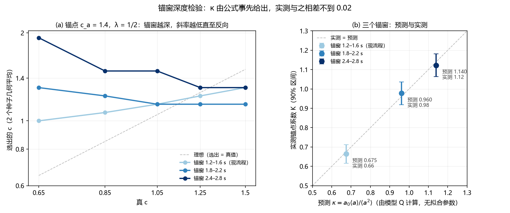

# 子波锚定理论：QScan 选 Q 为什么被压缩

2026-10-30。推导解释实验 12–14 中 QScan 选 Q 的压缩与偏差；锚点实验检验推导的定量预测（预测见 `PLAN_ZH.md`，开跑前已提交，1ac6e24）。

## 1. 记号

- 模型 Q 剖面 Q(z)，真 Q = c_true·Q，扫描 Q = c·Q。记 **u = 1/c_true，v = 1/c**。
- a(t)：模型 Q（c = 1）下到双程时间 t 的累积 t*（`lib.absorption`）。Q 乘 c，t* 变为 a(t)/c，故**一切衰减与色散都对 1/c 线性**：`lib.dictionary` 中第 k 列的传播算子为 exp[b(f)·a(t_k)·v]，b(f) = −πf + 2i f ln(f/f_ref)。
- a₀ = a(1.4 s)：`lib.wavelets` 估子波的浅层窗（1.2–1.6 s）中点。
- 锚点 v_a = 1/c_a：估计输入子波时假设的 Q 系数。现流程 QScan 的 v_a = 1。

## 2. 推导

**子波估计。** `lib.wavelets` 取浅层窗振幅谱，除以假设 Q 下 1.4 s 处的吸收：

  |Ŵ(f)| = √P_s(f) / e^{−πf a₀ v_a} ≈ |W(f)| ρ(f) · e^{−πf a₀ (u − v_a)}，

其中 ρ(f) 是浅层反射系数的谱色。只要 v_a ≠ u，估出的子波就带着一个谱倾斜 e^{−πf a₀(u − v_a)}。

**字典与数据之差。** 局部平稳近似下，t 时刻数据的振幅谱为 W e^{−πf a(t) u}，字典为 Ŵ e^{−πf a(t) v}。反演得到的反射系数要把两者之比吸收进去，相当于对真反射系数做了一个随时间变化的谱倾斜 e^{−πf δ(t)}，其中

  **δ(t) = a(t)(u − v) − a₀(u − v_a)**。

**选择。** QScan 的目标值（lasso）对 v 的依赖只经过 δ(t)。把它在 δ = 0 附近展成二次：

  J(v) ≈ J₀ + Σ_t [φ₁(t) δ(t) + ½ φ₂(t) δ(t)²]，

φ₂ ≥ 0 是 t 时刻对谱倾斜的敏感度，φ₁ 是稀疏项对倾斜的偏好（λ 越大，L1 项越重，φ₁ 越大）。对 v 求极小：

  **v_sel = (1 − κ) u + κ v_a + β**，  **κ = a₀ Σφ₂a / Σφ₂a²**，  β = Σφ₁a / Σφ₂a²。

三种情形：

| 子波 | 选出的 1/c | 1/c 空间斜率 |
|---|---|---|
| 现流程：锚在 v_a = 1 | (1 − κ) u + κ + β | 1 − κ < 1，被拉向锚点 1 |
| 锚在任意 v_a | (1 − κ) u + κ v_a + β | 对真值 1 − κ，对锚点 κ，两者之和为 1 |
| 每个 c 重估（QScan-W，v_a = v） | u + β′，β′ = Σφ₁(a − a₀)/Σφ₂(a − a₀)² | 1；λ 只平移截距 |

和规则 A + K = 1 来自平移不变性：u、v_a、v 同加一个常数，δ(t) 不变。

**κ 的含义与数值。** κ 是 a₀ 与 a(t) 在 φ₂ 加权下的"回归系数"，取值 0–1。信息越集中在浅层（a ≈ a₀），κ 越接近 1，压缩越强。φ₂ 在分析窗 1.2–3.0 s 内均匀时，由模型 Q 直接算得：

  **κ = 0.675，预测斜率 1 − κ = 0.33**（无拟合参数）。

**换到 log c。** 实验都在 log c 上算斜率和偏差。由 v_sel = A u + C，log 斜率 = A u / v_sel。对 QScan-W（A ≈ 1）：β > 0 时选择偏低且 log 斜率 < 1，β < 0 时偏高且 log 斜率 > 1。所以实验 14 H2 里"偏差和斜率随 λ 一起单调变化"其实是同一个参数 β(λ) 的两个表现。

## 3. 检验

### 3.1 已有结果（事后拟合，`analysis/fit_existing.json`）

在 1/c 空间拟合 v_sel = A u + C：

| 方法 | 实验 12 剖面 | 实验 14 T | 实验 14 S | 理论 |
|---|---|---|---|---|
| 现流程 QScan，A | 0.30 | 0.19 | 0.30 | 1 − κ = 0.33 |
| QScan-W(1/4)，A / C | 1.24 / +0.23 | 1.30 / +0.01 | 1.20 / +0.26 | 1 / β |
| QScan-W(1/16)，A / C | 1.18 / +0.06 | 1.29 / −0.29 | 1.36 / −0.22 | 1 / β |
| QScan-W(1/64)，A / C | 1.39 / −0.29 | 1.36 / −0.46 | 1.32 / −0.45 | 1 / β |

由 A 和 C 推出的 log 斜率与直接算的 log 斜率一致（例如 T 组 QScan 0.21 对 0.21，QScan-W(1/16) 1.31 对 1.28）。

### 3.2 锚点实验（`scripts/anchor.py`，`analysis/anchor.json`）

实验 12 的 10 个剖面（c = 0.65–1.5，种子 9701、9702）× 锚点 c_a = 0.7、1.0、1.4，λ = 1/2、1/16，共 30 次扫描。对每个 λ 拟合 v_sel = A u + K v_a + C，区间为按剖面自助重抽样 2000 次的 90% 百分位区间：

| | A（对真值） | K（对锚点） | A + K | 单调（每个剖面） | 收敛 |
|---|---|---|---|---|---|
| λ = 1/2 | 0.34 | **0.66** [0.62, 0.71] | **1.00** [0.81, 1.19] | 10/10 严格单调 | 100% |
| λ = 1/16 | 0.23 | **0.71** [0.68, 0.75] | **0.95** [0.79, 1.14] | 10/10 严格单调 | 99.8% |
| 理论（均匀 φ₂） | 0.33 | 0.675 | 1 | — | — |

锚点取 1、λ = 1/2 时，10 个剖面的选择与实验 12 的 `lib.qscan` 完全相同。

对照开跑前的预测：

1. K 在 0.5–0.9 之间：**满足**（0.66、0.71），与无拟合参数的 κ = 0.675 相差不到 0.04。
2. A + K 接近同一 λ 下 QScan-W 的斜率，差 ±0.2 以内：λ = 1/2 **满足**（1.00 对 0.97）；λ = 1/16 **差 0.23，略超出**（0.95 对 1.18）。A + K 本身符合理论值 1，超出的是 QScan-W 的斜率（见第 4 节）。
3. 每个剖面单调：**满足**（20/20 严格单调）。

## 4. 结论与局限

1. **压缩的定量来源**：现流程 QScan 选出的 1/c 是真值与锚点 1 的加权平均，真值的权重只有 1 − κ ≈ 0.3。κ 由模型 Q 剖面和分析窗几何直接给出（0.675），锚点实验测得 0.66–0.71。
2. **为什么调权重救不了现流程**：λ 只进入 β（平移），不进入 κ。预实验 `qscan_reg_pilot_20261029` 把权重从 2 扫到 2⁻⁷，log 斜率始终只有 0.16–0.37，正是这个原因。锚点实验中两个 λ 的 A 也都在 0.2–0.35。
3. **重估子波为何有效、又为何需要校正**：重估后 κ 项消失，Q 的信息只来自深浅之差 a(t) − a₀，原理上与谱比法相同；但截距 β 由稀疏项决定，随 λ 和数据（构造、反射系数、噪声）变化，所以开发集上定的偏差搬不到新数据（实验 14 H3）。第 5c 节显示，低噪声下这一偏差近似为常数比例（c_sel ≈ 0.7 c_true）。
4. **QScan-W 斜率高于 1（第 5 节补充检验）**：QScan-W 在 1/c 空间的斜率为 1.18–1.39，而一阶理论给 1，固定锚点的扫描满足 A + K ≈ 1。原先猜测的子波归一化在代码上不成立（整体幅度在 B 和罚项中精确抵消）。曲率检验支持另一解释：QScan-W 的目标函数对 1/c 的曲率只有固定锚点的约 1/8，β 对数据衰减的微小依赖被同倍放大。第 5c 节的噪声检验排除了噪声作为低噪声下这一超出的来源（噪声 ×0.25、×0.5 时斜率都是 1.28），噪声只在 ×1、×2 时使斜率进一步变大。
5. φ₂ 均匀只是近似；κ = 0.675 与实测吻合，说明在这些数据上 Q 的敏感度在分析窗内大致均匀分布。不同的窗口、Q 剖面、信噪比会给出不同的 κ，公式 κ = a₀⟨a⟩/⟨a²⟩ 可直接用于预测。

## 5. 补充检验：目标函数的曲率比

方案 `PLAN_CURV_ZH.md`，计算前提交（50470f2），程序 `scripts/curvature.py`，结果 `analysis/curvature.json`。

**排除归一化。** `lib.dictionary` 把字典每列除以其范数 scale，罚项为 λ·median(scale)/scale_k。子波乘以任何常数 α，scale 变为 α·scale，B 与罚项都不变，目标值也不变。所以子波幅度归一化不能影响选择。

**曲率。** 由第 2 节的二次展开，目标值对 v 的曲率：

- 固定锚点：H_a = Σφ₂ a²；
- 子波随 c 重估：H_w = Σφ₂ (a − a₀)²。

QScan-W 只靠深浅差辨 Q，曲率小。φ₂ 均匀、忽略色散相位项时，**H_a/H_w = ⟨a²⟩/⟨(a − a₀)²⟩ = 8.0**（由模型 Q 算得）。

**实测**（实验 12 的 10 个剖面；H_a 用锚点实验 c_a = 1 的目标值，H_w 用实验 14 开发集 QScan-W 的目标值；在最小点和两侧各两个网格点上拟合二次式）：

| λ | 有效剖面 | 比值中位数 | 90% 区间 | 预测（4–11，区间下限 > 2） |
|---|---|---|---|---|
| 1/2 | 6（4 个 QScan-W 的最小点贴网格边，不算） | 9.8 | [7.9, 22.7] | 满足 |
| 1/16 | 10 | 6.5 | [5.8, 7.8] | 满足 |

**对斜率的含义。** 若稀疏偏好随数据衰减变化（∂φ₁/∂u ≠ 0），斜率偏离 1 的量为 Σ(∂φ₁/∂u)·w / H，其中 w 在固定锚点时为 a，在 QScan-W 时为 a − a₀。若 ∂φ₁/∂u 在时间上均匀，两者之比为 (1 − a₀/⟨a⟩)·H_a/H_w ≈ 0.28 × 8 ≈ 2.3。QScan-W 的超出量 0.18–0.39 对应固定锚点应有 0.08–0.17 的超出；锚点实验测得 +0.00 [−0.19, +0.19]（λ = 1/2）和 −0.05 [−0.21, +0.14]（λ = 1/16），区间容得下，但点估计没有显示出这一量，所以这只是"不矛盾"，不是证实。

结论：QScan-W 的辨 Q 能力（曲率）只有现流程的约 1/8，这一点得到证实，它与 QScan-W 斜率不稳、偏差随数据漂移（实验 14 H3）是同一件事；斜率超出 1 的具体来源仍未单独证实。

## 5b. 补充检验：锚窗深度改变 κ

方案 `PLAN_WINDOW_ZH.md`，开跑前提交（91dee11）；程序 `scripts/anchor2.py`、`scripts/analyze_window.py`，结果 `results2/`、`analysis/window.json`。

只改输入子波的估计窗：从 1.2–1.6 s（除以 1.4 s 处的吸收）移到 1.8–2.2 s（2.0 s）或 2.4–2.8 s（2.6 s），a₀ 随之变大。其余（目标、σ、K、网格、求解器）不变；默认窗口下改写的子波函数与 `lib.wavelets` 逐点相同。数据为锚点实验的 10 个剖面，锚点 c_a = 0.7、1.4，λ = 1/2，共 40 次扫描；求解收敛比例 100%（1.8–2.2 s）和 97%（2.4–2.8 s），没有选在网格边上。

| 锚窗 | 预测 κ | 实测 K（90% 区间） | 预测 A = 1 − κ | 实测 A（90% 区间） | A + K |
|---|---|---|---|---|---|
| 1.2–1.6 s（锚点实验） | 0.675 | 0.66 [0.62, 0.71] | +0.33 | +0.34 | 1.00 |
| 1.8–2.2 s | **0.96** | **0.98** [0.92, 1.04] | +0.04 | −0.14 [−0.22, −0.07] | 0.84 |
| 2.4–2.8 s | **1.14** | **1.12** [1.06, 1.18] | −0.14 | **−0.23** [−0.31, −0.14] | 0.89 |

四条判据（K 在预测 ±0.15 内；K 随锚窗加深增大；2.4–2.8 s 时 A < 0；A + K 在 1 ± 0.2 内）**全部满足**。

- K 与无拟合参数的预测相差 0.02、0.02，三个锚窗都落在"实测 = 预测"线上。
- 最冒险的一条成立：锚窗在 2.4–2.8 s 时，选出的 c 与真 c **反向相关**（锚点 1.4 时，真 c 从 0.65 到 1.5，选出的 c 从 1.92 降到 1.30）。
- 不吻合之处：锚窗加深后 A 比 1 − κ 低 0.18、0.09，A + K 为 0.84、0.89，低于 1（仍在判据内）。深窗的子波估计带宽和信噪比与浅窗不同，β 可能随 u 变化；选择只有网格分辨率（相邻 c 差约 14%），A 的估计也较粗。第 5c 节的噪声检验表明这一不足主要来自噪声：噪声 ×0.25、×0.5 时深锚窗 A + K = 0.96、0.98。

## 5c. 补充检验：噪声与两处偏差

方案 `PLAN_NOISE_ZH.md`，开跑前提交（26d3ee7）；程序 `scripts/noise.py`、`scripts/analyze_noise.py`，结果 `results3/`、`analysis/noise.json`。

假设：噪声不衰减，破坏平移不变性，使 β 随 u 变化，A + K = 1 + ∂β/∂u。数据为实验 14 的配方（构造线 10227），新种子 9931、9932，c = 0.7、1.0、1.4，噪声乘 0.25、0.5、1、2，共 24 个数据集、120 次扫描。

| 噪声 | QScan-W 斜率 A_W | 默认锚窗 K | 默认锚窗 A + K | 深锚窗 K | 深锚窗 A + K |
|---|---|---|---|---|---|
| ×0.25 | 1.28 [1.08, 1.49] | 0.69 | 0.89 [0.75, 1.01] | 1.20 | 0.96 [0.79, 1.06] |
| ×0.5 | 1.28 [1.08, 1.49] | 0.69 | 0.89 | 1.16 | 0.98 [0.90, 1.07] |
| ×1 | 1.45 [1.25, 1.79] | 0.69 | 0.89 | 1.25 | 0.94 [0.68, 1.02] |
| ×2 | 2.17 [1.39, 2.47] | 0.65 | 1.14 [0.98, 1.42] | 1.17 | 0.82 [0.67, 0.98] |

| 预测 | 结果 |
|---|---|
| 1. QScan-W 斜率随噪声单调上升，×0.25 时在 0.8–1.2 | **不满足**：×0.25 与 ×0.5 的选择逐个相同（斜率都是 1.28），×0.25 时不在 0.8–1.2 |
| 2. 深锚窗 ×0.25 时 \|A + K − 1\| ≤ 0.12，且小于 ×2 时 | 满足：0.04 对 0.18 |
| 3. K 与噪声无关（深 1.14 ± 0.15，默认 0.675 ± 0.15） | 满足：深 1.16–1.25，默认 0.65–0.69 |
| 4. 默认锚窗 A + K 在 1 ± 0.2 内 | 满足：0.89–1.14 |

结论：

- **κ 是几何量**：四档噪声下 K 基本不变，再次确认 κ = a₀⟨a⟩/⟨a²⟩。
- **深锚窗的 A + K 偏低主要来自噪声**：噪声低时 0.96–0.98，×2 时 0.82。第 5b 节的 0.84、0.89 是在 ×1 噪声的数据上测的。
- **QScan-W 斜率高于 1 不是噪声造成的**：噪声 ×0.5 以下选择完全不随噪声变，斜率仍是 1.28；只有噪声 ×1、×2 时斜率才继续变大（1.45、2.17）。噪声假设只解释了大噪声下的额外部分。
- 事后观察（未事先预测）：低噪声下 QScan-W 的选择接近常数比例偏差，v_sel/u = 1.23–1.60，即 c_sel ≈ 0.7 c_true；在 log 空间斜率为 0.94。所以 1/c 空间斜率大于 1，可能只是因为偏差是乘性的（β ∝ u），而不是加性的。这需要另行检验。另外，c = 0.7 的两个选择落在 0.52，是第一个收敛的网格点（更小的两个点在 20000 次迭代内未收敛）；去掉 c = 0.7，1/c 斜率为 1.33，结论不变。

## 6. 对论文

可以写成一个带预测的机制结论：

- 对任何"先在浅层用参考 Q 估子波、再扫描 Q"的稀疏反演选 Q 方法，选出的 1/Q 被压向参考值，压缩系数 κ = a₀⟨a⟩/⟨a²⟩ 只取决于吸收剖面和窗口几何，可事先算出；
- 锚点实验在不改任何其他设置的情况下，按理论比例（0.66 对 0.675）移动了选择；
- 公式能对新的几何事先给出 κ：把估子波的窗口移深，预测 κ = 0.96、1.14，实测 0.98、1.12，最深的窗口下选择与真 Q 反向相关，与预测一致；
- 每个 c 重估子波可以去掉锚定，但辨 Q 的曲率只剩约 1/8（理论 8.0，实测 6.5–9.8），所以它对稀疏项的偏好更敏感，偏差随数据漂移，这与实验 14 中校正量搬不过去一致。

这比"经验上 QScan 斜率低"更强：它给出了原因、大小，以及不靠调参的修正方向（重估子波）。

## 7. 相关工作与对照推论

2026-10-30 补充。两篇文献与本理论的对应关系。本节的"推论"只是推导，没有做实验检验。

### 7.1 Chai et al. 2019：多 Q 字典联合分解

Chai X., Peng R., Tang G., Chen W., Li J., 2019. Some remarks on Q-compensated sparse deconvolution without knowing the quality factor Q. *Geophysical Prospecting* 67(8), 2003–2021. doi:10.1111/1365-2478.12838

**方法。** 沿用 Gholami (2015, *J. Appl. Geophys.* 117, 32–41) 的字典 D = W[F_Q1 … F_QM]：W 是已知子波，每一块用一个候选 Q⁻¹ 做吸收和色散（M = 50，Q 在 10–200 之间，按 Q⁻¹ 等距取）。在频域用基追踪分解出反射系数矩阵 R(t, Q)。第二阶段对每个时间点，用复数谱的实部和虚部（振幅和色散相位）线性拟合 log r_n 与 1/Q_eff(n)，再按其式 53 差分得到层间 Q。

**与本理论的对应：**

1. **原子结构相同。** 其传播算子 exp(−ωτ/2Q)·exp[i ln(ω/ω_r)·ωτ/(πQ)] 对 1/Q 线性，与 `lib.dictionary` 的 exp[b(f)a(t)v] 一致，所以第 2 节关于 δ(t) 的推导适用。
2. **β 项。** 他们指出分解偏向小 Q⁻¹（补偿不足），原因是小 Q⁻¹ 原子的能量大。用列范数加权 P（Gholami 用 2 范数，他们改用 ∞ 范数）和随时间增益的预条件 T，只能"部分缓解"。这对应第 2 节的 β，即稀疏项对谱倾斜的偏好；`lib.dictionary` 的列归一化和 median(scale)/scale_k 罚项相当于他们的 P。
3. **锚定。** 两个合成例子（其 Fig. 3、Fig. 12）用的都是真实震源子波，即 a₀ = 0、κ = 0，没有压缩。所以他们在合成数据上得到准确的 Q（Table 1：真 Q = 100，反演法 99.9–100.1，对数谱比 68–74，CFS/WCFS 在 26–102 之间，甚至为负），这与本理论不矛盾。实测例子（Alberta 的 Hampson–Russell 演示数据）的子波由软件在 0.3–0.6 s 统计提取，理由是需要"无衰减子波"，没有做吸收校正。用本文记号，这是 v_a = 0（假设 Q = ∞）、a₀ = a(0.45 s) 的锚定。实测没有 Q 真值，文中看不出偏差。

**对照推论（未检验）：**

- 如果在这种子波上扫描单一全局 Q（如 QScan），由第 2 节，v_sel = (1 − κ)u + β：选出的 1/Q 被压向 0，即 Q 偏大、补偿不足，压缩系数仍是 κ = a₀⟨a⟩/⟨a²⟩。
- 在他们的逐点参数化下，δ(t) = 0 要求 v(t)·a(t) = u·[a(t) − a₀]，即估得的累积 t* 整体少了 t*_true(t_a)。（这里把其 1/Q_eff(n) 理解为累积衰减，其式 39、53 正是按这个定义写的。）于是：
  - (a) 逐点 Q_eff 偏大；
  - (b) 锚点以上需要负的 t*，超出字典的 Q⁻¹ ∈ [1/200, 1/10]，会被压在 Q_max 一端；
  - (c) 锚点以下按式 53 差分得到的层间 Q，常数偏移相消，原则上不受锚定影响。

  也就是说，逐点或分层参数化能把锚点当成一个常数吸收掉，而全局单一 Q 吸收不了，于是表现为 κ 压缩。吸收的代价与 QScan-W 同类：只剩深浅之差可用（第 5 节，曲率约 1/8）。
- 他们的 Fig. 1 用稀疏尖脉冲反射系数论证"稀疏约束很重要"；实验 12 在测井反射系数上，SC-a 的最佳 a 降到 2⁻¹³，几乎没有稀疏项。结论随反射系数家族而变。

### 7.2 Wang, Morozov & Marfurt 2020：逐窗子波谱比

Wang Y., Morozov I., Marfurt K., 2020. Non-stationary source waveform and Q estimation by sparse-pulse decomposition of seismic images. *SEG Technical Program Expanded Abstracts*, 2789–2793. doi:10.1190/segam2020-3428440.1。子波估计方法见 Wang Y., Morozov I. B., 2020, *Geophysics* 85(3), V257–V268。

**方法。** 把单道分成若干时窗，每个窗里挑出彼此间隔不小于 T_s 的最强峰，截段对齐后叠加，得到该窗的子波。相邻窗子波振幅谱取对数比，线性拟合得到层间 Q⁻¹。前提是强反射在各窗的谱特征相同。

**与本理论的对应：**

1. 属于第 2 节表中"重估子波"这一类：公共子波在比值中相消，没有锚定项（κ = 0），Q 的信息只来自深浅之差 a(t) − a₀，与本仓库的 SR（实验 10）同类。
2. 这一类的截距项在谱比法里就是相邻窗反射系数谱色之差。他们用 Weyburn 测井反射系数自检，Q⁻¹ 误差为 +0.0042（250–600 ms）、−0.0024（600–850 ms）、−0.0005（850–1150 ms）；若 Q ≈ 100，第一窗约为 40%。这与实验 10（两窗版 SR 因颜色偏低 20–25%，因此改用多窗）和实验 9（只用测井的颜色检查：F-12 偏高 26–58%，F-14 偏低 21–32%）量级一致。摘要没有与真 Q 做定量比较。
3. 可能的互补（猜测，未检验）：`qscan_sparsity_mech_20261029` 中 SR 在尖脉冲反射系数上失效（|误差| 0.45），而峰值叠加法的前提恰好是稀疏的强反射。

### 7.3 对论文定位

- 这两篇以及 Gholami 2015 都把子波当成已知或无衰减。Chai 2019 明确要求从浅层取"无衰减子波"，但没有讨论这一假设不成立时 Q 会偏多少。本理论补的正是这一点：给出 κ 的闭式，并说明全局参数化和逐点/分层参数化对锚点的不同反应。
- Gholami 2015 原文未读，上面的内容依据 Chai 2019 的转述。
- 投稿时，Chai 2019 型两阶段分解可以作为"联合估计反射系数与 Q"的基线；7.1 的推论 (b)、(c) 可以直接在锚点实验的数据上检验。
