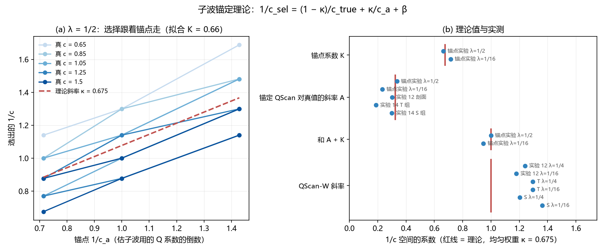

# 子波锚定理论：QScan 选 Q 为什么被压缩

2026-10-30。推导解释实验 12–14 中 QScan 选 Q 的压缩与偏差；锚点实验检验推导的定量预测（预测见 `PLAN_ZH.md`，开跑前已提交，1ac6e24）。

## 1. 记号

- 模型 Q 剖面 Q(z)，真 Q = c_true·Q，扫描 Q = c·Q。记 **u = 1/c_true，v = 1/c**。
- a(t)：模型 Q（c = 1）下到双程时间 t 的累积 t*（`lib.absorption`）。Q 乘 c，t* 变为 a(t)/c，故**一切衰减与色散都对 1/c 线性**：`lib.dictionary` 中第 k 列的传播算子为 exp[b(f)·a(t_k)·v]，b(f) = −πf + 2i f ln(f/f_ref)。
- a₀ = a(1.4 s)：`lib.wavelets` 估子波的浅层窗（1.2–1.6 s）中点。
- 锚点 v_a = 1/c_a：估计输入子波时假设的 Q 系数。现流程 QScan 的 v_a = 1。

## 2. 推导

**子波估计。** `lib.wavelets` 取浅层窗振幅谱，除以假设 Q 下 1.4 s 处的吸收：

  |Ŵ(f)| = √P_s(f) / e^{−πf a₀ v_a} ≈ |W(f)| ρ(f) · e^{−πf a₀ (u − v_a)}，

其中 ρ(f) 是浅层反射系数的谱色。只要 v_a ≠ u，估出的子波就带着一个谱倾斜 e^{−πf a₀(u − v_a)}。

**字典与数据之差。** 局部平稳近似下，t 时刻数据的振幅谱为 W e^{−πf a(t) u}，字典为 Ŵ e^{−πf a(t) v}。反演得到的反射系数要把两者之比吸收进去，相当于对真反射系数做了一个随时间变化的谱倾斜 e^{−πf δ(t)}，其中

  **δ(t) = a(t)(u − v) − a₀(u − v_a)**。

**选择。** QScan 的目标值（lasso）对 v 的依赖只经过 δ(t)。把它在 δ = 0 附近展成二次：

  J(v) ≈ J₀ + Σ_t [φ₁(t) δ(t) + ½ φ₂(t) δ(t)²]，

φ₂ ≥ 0 是 t 时刻对谱倾斜的敏感度，φ₁ 是稀疏项对倾斜的偏好（λ 越大，L1 项越重，φ₁ 越大）。对 v 求极小：

  **v_sel = (1 − κ) u + κ v_a + β**，  **κ = a₀ Σφ₂a / Σφ₂a²**，  β = Σφ₁a / Σφ₂a²。

三种情形：

| 子波 | 选出的 1/c | 1/c 空间斜率 |
|---|---|---|
| 现流程：锚在 v_a = 1 | (1 − κ) u + κ + β | 1 − κ < 1，被拉向锚点 1 |
| 锚在任意 v_a | (1 − κ) u + κ v_a + β | 对真值 1 − κ，对锚点 κ，两者之和为 1 |
| 每个 c 重估（QScan-W，v_a = v） | u + β′，β′ = Σφ₁(a − a₀)/Σφ₂(a − a₀)² | 1；λ 只平移截距 |

和规则 A + K = 1 来自平移不变性：u、v_a、v 同加一个常数，δ(t) 不变。

**κ 的含义与数值。** κ 是 a₀ 与 a(t) 在 φ₂ 加权下的"回归系数"，取值 0–1。信息越集中在浅层（a ≈ a₀），κ 越接近 1，压缩越强。φ₂ 在分析窗 1.2–3.0 s 内均匀时，由模型 Q 直接算得：

  **κ = 0.675，预测斜率 1 − κ = 0.33**（无拟合参数）。

**换到 log c。** 实验都在 log c 上算斜率和偏差。由 v_sel = A u + C，log 斜率 = A u / v_sel。对 QScan-W（A ≈ 1）：β > 0 时选择偏低且 log 斜率 < 1，β < 0 时偏高且 log 斜率 > 1。所以实验 14 H2 里"偏差和斜率随 λ 一起单调变化"其实是同一个参数 β(λ) 的两个表现。

## 3. 检验

### 3.1 已有结果（事后拟合，`analysis/fit_existing.json`）

在 1/c 空间拟合 v_sel = A u + C：

| 方法 | 实验 12 剖面 | 实验 14 T | 实验 14 S | 理论 |
|---|---|---|---|---|
| 现流程 QScan，A | 0.30 | 0.19 | 0.30 | 1 − κ = 0.33 |
| QScan-W(1/4)，A / C | 1.24 / +0.23 | 1.30 / +0.01 | 1.20 / +0.26 | 1 / β |
| QScan-W(1/16)，A / C | 1.18 / +0.06 | 1.29 / −0.29 | 1.36 / −0.22 | 1 / β |
| QScan-W(1/64)，A / C | 1.39 / −0.29 | 1.36 / −0.46 | 1.32 / −0.45 | 1 / β |

由 A 和 C 推出的 log 斜率与直接算的 log 斜率一致（例如 T 组 QScan 0.21 对 0.21，QScan-W(1/16) 1.31 对 1.28）。

### 3.2 锚点实验（`scripts/anchor.py`，`analysis/anchor.json`）

实验 12 的 10 个剖面（c = 0.65–1.5，种子 9701、9702）× 锚点 c_a = 0.7、1.0、1.4，λ = 1/2、1/16，共 30 次扫描。对每个 λ 拟合 v_sel = A u + K v_a + C，区间为按剖面自助重抽样 2000 次的 90% 百分位区间：

| | A（对真值） | K（对锚点） | A + K | 单调（每个剖面） | 收敛 |
|---|---|---|---|---|---|
| λ = 1/2 | 0.34 | **0.66** [0.62, 0.71] | **1.00** [0.81, 1.19] | 10/10 严格单调 | 100% |
| λ = 1/16 | 0.23 | **0.71** [0.68, 0.75] | **0.95** [0.79, 1.14] | 10/10 严格单调 | 99.8% |
| 理论（均匀 φ₂） | 0.33 | 0.675 | 1 | — | — |

锚点取 1、λ = 1/2 时，10 个剖面的选择与实验 12 的 `lib.qscan` 完全相同。

对照开跑前的预测：

1. K 在 0.5–0.9 之间：**满足**（0.66、0.71），与无拟合参数的 κ = 0.675 相差不到 0.04。
2. A + K 接近同一 λ 下 QScan-W 的斜率，差 ±0.2 以内：λ = 1/2 **满足**（1.00 对 0.97）；λ = 1/16 **差 0.23，略超出**（0.95 对 1.18）。A + K 本身符合理论值 1，超出的是 QScan-W 的斜率（见第 4 节）。
3. 每个剖面单调：**满足**（20/20 严格单调）。

## 4. 结论与局限

1. **压缩的定量来源**：现流程 QScan 选出的 1/c 是真值与锚点 1 的加权平均，真值的权重只有 1 − κ ≈ 0.3。κ 由模型 Q 剖面和分析窗几何直接给出（0.675），锚点实验测得 0.66–0.71。
2. **为什么调权重救不了现流程**：λ 只进入 β（平移），不进入 κ。预实验 `qscan_reg_pilot_20261029` 把权重从 2 扫到 2⁻⁷，log 斜率始终只有 0.16–0.37，正是这个原因。锚点实验中两个 λ 的 A 也都在 0.2–0.35。
3. **重估子波为何有效、又为何需要校正**：重估后 κ 项消失，Q 的信息只来自深浅之差 a(t) − a₀，原理上与谱比法相同；但截距 β 由稀疏项决定，随 λ 和数据（构造、反射系数、噪声）变化，所以开发集上定的偏差搬不到新数据（实验 14 H3）。
4. **QScan-W 斜率高于 1（第 5 节补充检验）**：QScan-W 在 1/c 空间的斜率为 1.18–1.39，而一阶理论给 1，固定锚点的扫描满足 A + K ≈ 1。原先猜测的子波归一化在代码上不成立（整体幅度在 B 和罚项中精确抵消）。曲率检验支持另一解释：QScan-W 的目标函数对 1/c 的曲率只有固定锚点的约 1/8，β 对数据衰减的微小依赖被同倍放大。
5. φ₂ 均匀只是近似；κ = 0.675 与实测吻合，说明在这些数据上 Q 的敏感度在分析窗内大致均匀分布。不同的窗口、Q 剖面、信噪比会给出不同的 κ，公式 κ = a₀⟨a⟩/⟨a²⟩ 可直接用于预测。

## 5. 补充检验：目标函数的曲率比

方案 `PLAN_CURV_ZH.md`，计算前提交（50470f2），程序 `scripts/curvature.py`，结果 `analysis/curvature.json`。

**排除归一化。** `lib.dictionary` 把字典每列除以其范数 scale，罚项为 λ·median(scale)/scale_k。子波乘以任何常数 α，scale 变为 α·scale，B 与罚项都不变，目标值也不变。所以子波幅度归一化不能影响选择。

**曲率。** 由第 2 节的二次展开，目标值对 v 的曲率：

- 固定锚点：H_a = Σφ₂ a²；
- 子波随 c 重估：H_w = Σφ₂ (a − a₀)²。

QScan-W 只靠深浅差辨 Q，曲率小。φ₂ 均匀、忽略色散相位项时，**H_a/H_w = ⟨a²⟩/⟨(a − a₀)²⟩ = 8.0**（由模型 Q 算得）。

**实测**（实验 12 的 10 个剖面；H_a 用锚点实验 c_a = 1 的目标值，H_w 用实验 14 开发集 QScan-W 的目标值；在最小点和两侧各两个网格点上拟合二次式）：

| λ | 有效剖面 | 比值中位数 | 90% 区间 | 预测（4–11，区间下限 > 2） |
|---|---|---|---|---|
| 1/2 | 6（4 个 QScan-W 的最小点贴网格边，不算） | 9.8 | [7.9, 22.7] | 满足 |
| 1/16 | 10 | 6.5 | [5.8, 7.8] | 满足 |

**对斜率的含义。** 若稀疏偏好随数据衰减变化（∂φ₁/∂u ≠ 0），斜率偏离 1 的量为 Σ(∂φ₁/∂u)·w / H，其中 w 在固定锚点时为 a，在 QScan-W 时为 a − a₀。若 ∂φ₁/∂u 在时间上均匀，两者之比为 (1 − a₀/⟨a⟩)·H_a/H_w ≈ 0.28 × 8 ≈ 2.3。QScan-W 的超出量 0.18–0.39 对应固定锚点应有 0.08–0.17 的超出；锚点实验测得 +0.00 [−0.19, +0.19]（λ = 1/2）和 −0.05 [−0.21, +0.14]（λ = 1/16），区间容得下，但点估计没有显示出这一量，所以这只是"不矛盾"，不是证实。

结论：QScan-W 的辨 Q 能力（曲率）只有现流程的约 1/8，这一点得到证实，它与 QScan-W 斜率不稳、偏差随数据漂移（实验 14 H3）是同一件事；斜率超出 1 的具体来源仍未单独证实。

## 6. 对论文

可以写成一个带预测的机制结论：

- 对任何"先在浅层用参考 Q 估子波、再扫描 Q"的稀疏反演选 Q 方法，选出的 1/Q 被压向参考值，压缩系数 κ = a₀⟨a⟩/⟨a²⟩ 只取决于吸收剖面和窗口几何，可事先算出；
- 锚点实验在不改任何其他设置的情况下，按理论比例（0.66 对 0.675）移动了选择；
- 每个 c 重估子波可以去掉锚定，但辨 Q 的曲率只剩约 1/8（理论 8.0，实测 6.5–9.8），所以它对稀疏项的偏好更敏感，偏差随数据漂移，这与实验 14 中校正量搬不过去一致。

这比"经验上 QScan 斜率低"更强：它给出了原因、大小，以及不靠调参的修正方向（重估子波）。
