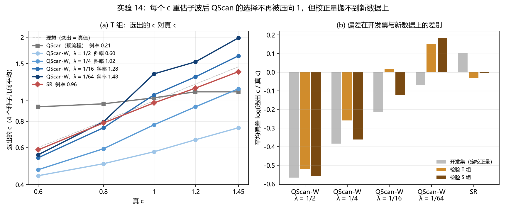

# 实验 14 结果：QScan 选 Q 被压缩的机制——子波锚定与稀疏权重

2026-10-30 完成。方案见 `PLAN_ZH.md`（2026-10-29 21:29 冻结，提交 7acf32a），判定由 `scripts/analyze14.py` 原样给出，数字在 `analysis/summary.json`、`analysis/calibration.json`。

## 判定

| 判定 | 内容 | 结果 | 数字 |
|---|---|---|---|
| H1 锚定 | T 组斜率：QScan-W(0.5) − QScan ≥ 0.2 且区间下限 > 0 | **支持** | 0.39，90% 区间 [0.009, 0.72] |
| H2 权重 | λ 0.5 → 2⁻⁶，偏差与斜率都单调上升 | **支持** | 偏差 −0.52 → −0.26 → +0.02 → +0.15；斜率 0.60 → 1.02 → 1.28 → 1.48；两端差：偏差 0.67 [0.54, 0.81]，斜率 0.89 [0.62, 1.16] |
| H3 可迁移（T 组） | 配对 \|e\|：QScan-W(2⁻⁴)_cal − SR_cal，区间上限 ≤ 0.02 | **相反** | +0.105 [0.054, 0.163] |
| H4 可迁移（S 组） | 同上 | 无法判定 | +0.043 [−0.017, 0.107] |

按 `PLAN_ZH.md` 第 5 节的解释规则：机制结论（H1、H2）在全新数据上成立；H3 相反，所以"偏差校正后的 QScan-W"不推荐作为估 Q 方法，只作机制结论。

## 各方法（检验集）

e = log(选出 c / 真 c)。

| 方法 | T 组斜率 | T 偏差 | T \|e\| | T ±25% | S 组斜率 | S 偏差 | S \|e\| | S ±25% |
|---|---|---|---|---|---|---|---|---|
| QScan（现流程，权重 0.5） | 0.21 | +0.062 | 0.218 | 0.60 | 0.28 | −0.078 | 0.170 | 0.75 |
| QScan-W(1/2) | 0.60 | −0.520 | 0.520 | 0.00 | 0.56 | −0.558 | 0.558 | 0.17 |
| QScan-W(1/4) | 1.02 | −0.259 | 0.259 | 0.35 | 0.84 | −0.362 | 0.366 | 0.17 |
| QScan-W(1/16) | 1.28 | +0.016 | 0.133 | 0.80 | 1.21 | −0.122 | 0.218 | 0.42 |
| QScan-W(1/64) | 1.48 | +0.154 | 0.219 | 0.75 | 1.58 | +0.184 | 0.297 | 0.58 |
| QScan-W(1/16)_cal | 1.28 | +0.230 | 0.238 | 0.60 | 1.21 | +0.091 | 0.162 | 0.75 |
| SR | 0.96 | −0.033 | **0.046** | 1.00 | 0.90 | −0.005 | **0.080** | 0.92 |
| SR_cal | 0.96 | −0.134 | 0.134 | 0.95 | 0.90 | −0.106 | 0.119 | 0.83 |

其余校正版本见 `analysis/summary.json`。

## 解读

1. **子波锚定（H1）**：现流程 QScan 在新构造线上斜率只有 0.21，真 c 从 0.6 到 1.45，选出的几何平均只在 0.94–1.10 之间（图 a 灰线）。每个 c 重估输入子波后，同一权重 0.5 的斜率升到 0.60。区间下限 0.009 刚过 0，单看 H1 证据不算强；但较小权重下斜率升到 1.0–1.5，和原型（实验 12 数据）的方向、幅度一致，机制本身是清楚的。
2. **稀疏权重（H2）**：权重从 1/2 降到 1/64，偏差从 −0.52 单调升到 +0.15，斜率从 0.60 单调升到 1.48，两端差的区间远离 0。权重同时决定偏差和斜率：λ 偏大时选择偏低且压缩，λ 偏小时偏高且"拉伸"（斜率 > 1）。QScan 选出的 Q 不能脱离权重来解释。
3. **偏差校正搬不过去（H3 相反）**：开发集（实验 12 的 20 个剖面）上定出的偏差，在新数据上明显变了，权重越小变得越多（图 b）：

   | | λ = 1/2 | 1/4 | 1/16 | 1/64 | SR |
   |---|---|---|---|---|---|
   | 开发集偏差 | −0.567 | −0.383 | −0.213 | −0.069 | +0.101 |
   | T 组偏差 | −0.520 | −0.259 | +0.016 | +0.154 | −0.033 |
   | S 组偏差 | −0.558 | −0.362 | −0.122 | +0.184 | −0.005 |

   λ = 1/16 在开发集偏 −0.21，到 T 组却几乎无偏，校正反而把它推高到 +0.23，\|e\| 从 0.133 变成 0.238。权重小时，L1 项弱，选择更多由数据本身（构造、反射系数、噪声）决定，所以偏差随数据变；权重 1/2 的偏差在三组之间只差 0.05，最稳定，但它压缩得厉害。原型里留一校正后的 QScan-W(2⁻⁴) 曾优于 SR（0.083 对 0.100），那是同一批数据内部的校正，在新数据上没有复现。
4. **SR**：在新数据上 SR 不校正最好（T 组 \|e\| 0.046，20 个全在 ±25% 内；S 组 0.080）。它在实验 12 上的 +0.10 偏差也没有迁移过来，校正后反而变差（0.134）。所以 H3 用的 SR_cal 对照本身被校正拖累了；与未校正 SR 相比，QScan-W(1/16)_cal 差得更多：T 组 +0.193 [0.138, 0.252]，S 组 +0.081 [0.019, 0.150]（描述）。

## 补偿效果（道集图，描述）

按各方法选出的 c 用 SC-a 补偿，M1（2.30–2.80 s 与理想目标的道相关中位数）的组内平均（`scripts/m1_14.py`，`analysis/gathers_m1.json`；图在 `figures/gathers/`）：

| | 输入 | 真 c | SR | QScan | QScan-W(1/16) | QScan-W(1/16)_cal |
|---|---|---|---|---|---|---|
| T 组（20） | −0.121 | 0.686 | **0.672** | 0.550 | 0.616 | 0.608 |
| S 组（12） | −0.206 | 0.664 | **0.650** | 0.590 | 0.487 | 0.611 |

SR 选出的 c 补偿后与真 c 只差 0.01–0.02；QScan-W 在 T 组好于现流程 QScan，但仍不如 SR。

## 收敛（方案第 5 节）

FISTA 上限 20000 步，同一权重沿 c 网格热启动。不收敛比例（全部求解中）：

| | λ = 1/2 | 1/4 | 1/16 | 1/64 |
|---|---|---|---|---|
| 开发集 | 3.3% | 5.7% | 8.0% | 13.7% |
| T 组 | 4.7% | 7.0% | 9.7% | 15.3% |
| S 组 | 2.8% | 4.4% | 7.8% | 18.3% |

λ = 1/64 超过 10%。不收敛几乎都在网格最左的两个点（c = 0.40、0.46，冷启动处且最难解），c ≥ 0.52 的不收敛只出现在 λ = 1/64（52 个数据集共 20 次，13 次在 c = 0.52）。只算全部 15 个点都收敛的剖面会丢掉大多数，所以敏感性分析只保留"选中点及左右相邻点都收敛"的剖面（`scripts/sens14.py`，`analysis/sensitivity.json`，描述）：

- T 组去掉 3–6 个剖面（主要是 c = 0.6），λ 1/2 → 1/64 的斜率 0.55、1.10、1.24、1.45，偏差 −0.58、−0.26、+0.05、+0.20，仍单调；
- H3 差值在收敛子集上为 +0.129（n = 17，T 组）、+0.043（n = 12，S 组，无剖面被去掉）。

结论不变。不收敛时目标值偏高，会让那一点更不容易被选中，因此 c = 0.4 附近的选择如有偏，是往上偏。

## 运行说明

- 开跑 6 个进程（开发 2、检验 4）。2026-10-30 00:40 起应要求提速，另加 4 个辅助进程（`scripts/extra14.py`，从列表末尾倒着取未做的数据集，用 `.claim` 文件避免重复）。每个数据集的计算是确定的，换进程算结果相同；这只是运行安排，未改方案。之后试图自动补位的脚本因路径编码问题没有启动任何进程。
- 每个数据集耗时 0.4–2 小时（并发越多越慢），全部 52 个于 2026-10-30 约 06:00 完成。
- 道集图（描述，不在方案内）：`scripts/gathers14.py` 对每个检验数据集按各方法选出的 c 用 SC-a（实验 7–13 的流程）补偿，与理想目标比较，`figures/gathers/<id>.png`，面板标 M1（2.30–2.80 s 与理想目标的道相关中位数）。缓存 `cache/` 可重建，不上传。

## 对论文的意义

- 可写的机制结论：QScan 选 Q 被压向 1，主要因为输入子波只按参考 Q 估一次（锚定）；剩下的偏差与斜率由稀疏权重控制。两点都在未见过的构造线、噪声线和测井上复现。
- 不能写的：用开发集定一个常数偏差来校正 QScan-W，然后当作和 SR 并列的方法——偏差随数据变，这条在新数据上被否定。
- 下一步若要让 QScan-W 成为方法，需要不依赖外部校正的权重选择（例如按数据自身定 λ），这需要新的冻结实验。
