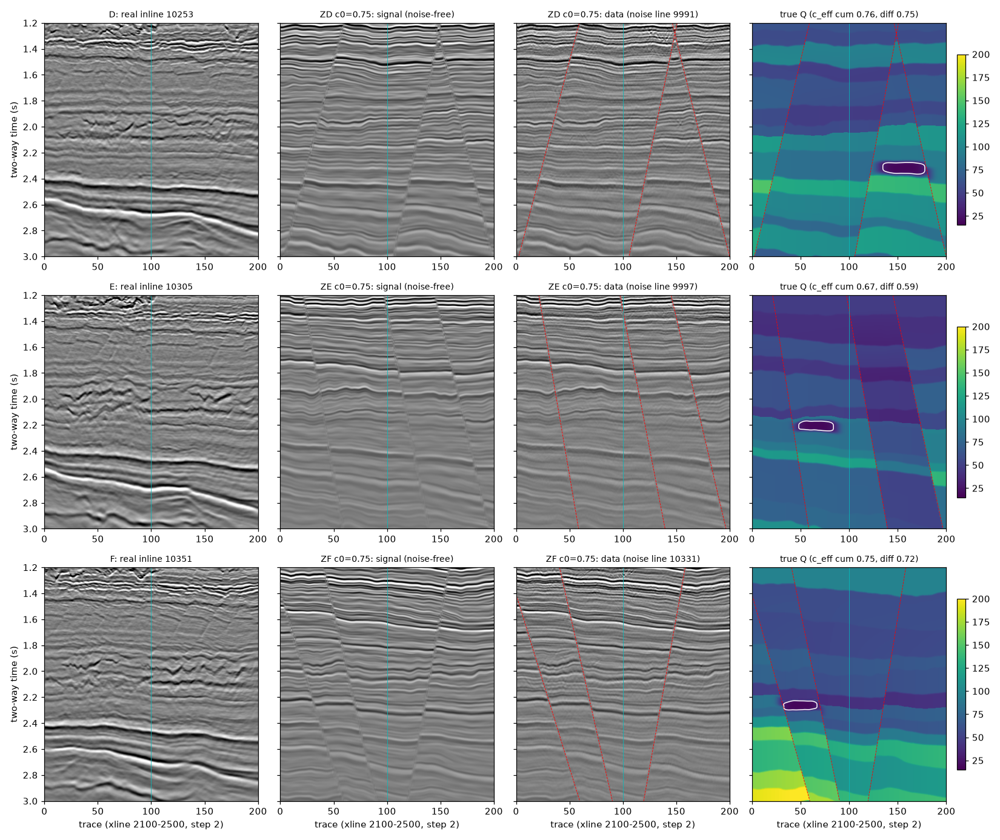
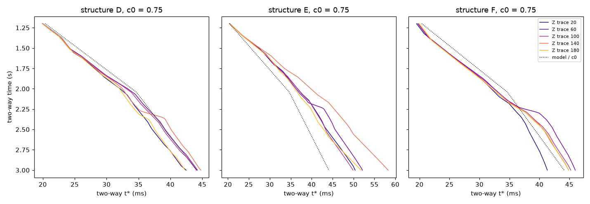

# 断层＋复杂 Q 半合成数据第二批（2026-10-31）

## 为什么要第二批

第一批（`semisynth_fault_q_20261030`）的构造 B、C 已在实验 15 中用作确认检验，A 是开发构造，三者都不再是未见数据。SC-a 上限核查（`sca_ceiling_20261030`）在第一批 Z 组上发现横向相干项（mu_relative = 10）有害，这是事后发现，需要在未见数据上预登记确认。本批数据只为此而建。

## 构建（`scripts/fq2.py`、`scripts/build2.py`）

生成器是第一批的 `fq.py`，代码不改；只换三个新构造的测线和种子，并且只保留 Z 组（复杂 Q）。断层、Q 分层、断块乘子、横向趋势、气藏透镜、正演、信噪比标定的配方都与第一批 `DATA_ZH.md` 相同。

**测线**（Volve MIG_RAW，xline 2100–2500，201 道，1.2–3.0 s，4 ms）：

| 构造 | 构造线 | 噪声线（实现 r = 0 / 1） | 地质种子 | 反射系数种子（r = 0 / 1） |
|---|---|---|---|---|
| D | 10253 | 9991 / 10259 | 15004 | 15130 / 15131 |
| E | 10305 | 9997 / 10287 | 15005 | 15140 / 15141 |
| F | 10351 | 10331 / 10365 | 15006 | 15150 / 15151 |

选线规则如下。
- Volve 共有 193 条 inline（9985–10369 的奇数）。剔除实验 13 的 105 条实测线（9999–10219）。
- 再剔除仓库里任何 `.py`、`.md`、`.json` 中出现过的线号（检查时排除结果文件和实验 13 的线表）。
- 余下的线中，按间距大致均匀挑选。

**c₀** 只取 0.75、1.05。第一批的衰减斜率对比显示 c₀ = 0.75 最接近实测，c₀ = 1.05 次之。c₀ = 1.4 要把噪声放大 2.3–3.3 倍才能对上实测信噪比，会把浅层淹没，造成实测上不存在的带宽塌缩（见上限核查的实测补充）。

## 数据集（12 个）

3 个构造 × c₀ 2 档 × 2 个实现。编号 `Z<构造>_c<c₀>_r<实现>`，如 `ZD_c0.75_r0`。数组与第一批相同（`D`、`signal`、`noise`、`ideal`、`src`、`R`、`tstar`、`invQ`、`block`、`fault_dist`、`gas`），存于 `cache/data/<编号>.npz`，`cache/` 不上传。数据可由脚本、种子和 Volve 数据体完全复现。读取：`fq2.load("ZD_c0.75_r0")`。

## 构建结果（只看数据层面的量；构建时没有运行任何补偿或选 Q 方法）

逐数据集见 `analysis/summary_table.md`、`analysis/summary.csv`；地质参数见 `analysis/geology.json`；图见 `figures/overview.png`、`figures/tstar.png`。

| 编号 | c₀ | c_eff 累积 | c_eff 增量 | 各道增量 5–95% | 噪声倍数 | f_true (Hz) | 衰减斜率（实测） | 气藏下方振幅比 |
|---|---|---|---|---|---|---|---|---|
| ZD_c0.75_r0 | 0.75 | 0.763 | 0.753 | 0.73–0.84 | 1.00 | 80 | -0.0734（-0.1028） | 0.82 |
| ZD_c0.75_r1 | 0.75 | 0.763 | 0.753 | 0.73–0.84 | 0.58 | 82 | -0.0957（-0.1028） | 0.81 |
| ZD_c1.05_r0 | 1.05 | 1.068 | 1.053 | 0.96–1.17 | 1.81 | 83 | -0.0506（-0.1028） | 0.78 |
| ZD_c1.05_r1 | 1.05 | 1.068 | 1.053 | 0.96–1.17 | 1.00 | 83 | -0.0717（-0.1028） | 0.76 |
| ZE_c0.75_r0 | 0.75 | 0.672 | 0.588 | 0.49–0.64 | 0.50 | 69 | -0.1127（-0.0999） | 0.96 |
| ZE_c0.75_r1 | 0.75 | 0.672 | 0.588 | 0.49–0.64 | 0.50 | 77 | -0.1177（-0.0999） | 0.96 |
| ZE_c1.05_r0 | 1.05 | 0.935 | 0.813 | 0.69–0.89 | 0.82 | 83 | -0.0842（-0.0999） | 0.89 |
| ZE_c1.05_r1 | 1.05 | 0.935 | 0.813 | 0.69–0.89 | 0.78 | 79 | -0.0876（-0.0999） | 0.89 |
| ZF_c0.75_r0 | 0.75 | 0.753 | 0.724 | 0.68–0.81 | 0.71 | 79 | -0.0916（-0.1128） | 0.82 |
| ZF_c0.75_r1 | 0.75 | 0.753 | 0.724 | 0.68–0.81 | 1.10 | 80 | -0.0931（-0.1128） | 0.68 |
| ZF_c1.05_r0 | 1.05 | 1.055 | 1.014 | 0.91–1.13 | 1.35 | 81 | -0.0661（-0.1128） | 0.79 |
| ZF_c1.05_r1 | 1.05 | 1.055 | 1.014 | 0.91–1.13 | 2.00 | 82 | -0.0669（-0.1128） | 0.65 |

- **断层**：每个构造 3 条。断距 D 为 43–56 ms，E 为 20–39 ms，F 为 45–54 ms。
- **Q 不是 c × 模型 Q**：E 构造累积与增量口径差 12–15%（0.672 / 0.588），D、F 差 1–4%。各道增量系数的 5–95% 跨度约 ±10%。
- **噪声倍数** 0.50–2.00，比第一批（最高 3.28）低；c₀ = 0.75 的衰减斜率 −0.073 到 −0.118，与实测（−0.100 到 −0.113）同量级。
- **气藏阴影**：振幅比 0.65–0.96，F 最强，E 最弱。

## 使用规则

- 12 个数据集全部封存：冻结检验方案并提交之前，不在其上运行任何补偿或选 Q 方法。
- 用过即在下方登记，之后不再称为未见数据。

## 使用记录

- 2026-10-31 实验 16（`mu_confirm_20261031`，方案 e22f2d8）：全部 12 个数据集作确认检验。从此不再是未见数据。
