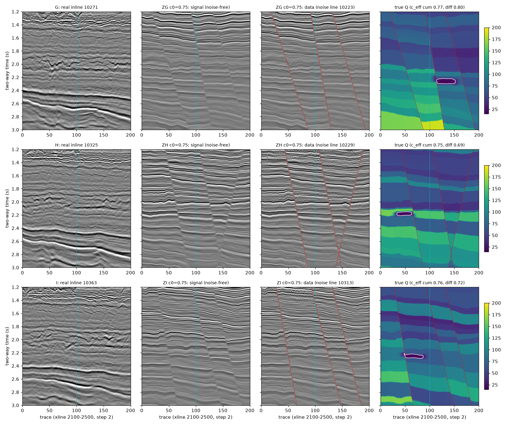
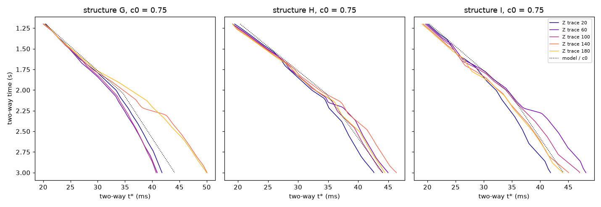

# 断层＋复杂 Q 半合成数据第三批（2026-10-31）

## 为什么要第三批

第一批（A、B、C）和第二批（D、E、F）都已用过。实验 17 在它们上面开发选择 SC-a 的相干项权重 mu_relative，需要一批新的未见数据来确认选择。

## 构建（`scripts/fq3.py`、`scripts/build3.py`）

第一批生成器 `fq.py` 原样调用，配方与第二批完全相同（只保留 Z 组，c₀ = 0.75、1.05），只换测线和种子。

| 构造 | 构造线 | 噪声线（实现 r = 0 / 1） | 地质种子 | 反射系数种子（r = 0 / 1） |
|---|---|---|---|---|
| G | 10271 | 10223 / 10281 | 15007 | 15160 / 15161 |
| H | 10325 | 10229 / 10299 | 15008 | 15170 / 15171 |
| I | 10363 | 10313 / 10337 | 15009 | 15180 / 15181 |

选线规则同第二批：
- 不在实验 13 的实测线中；
- 仓库的脚本、文档、数据说明里都没出现过；
- 构造线与已用构造线（10141、10227、10243、10253、10291、10305、10345、10351）至少相隔 12 个线号，避免构造雷同。

## 数据集（12 个）

编号 `Z<构造>_c<c₀>_r<实现>`，数组同前两批，存于 `cache/data/`，不上传。读取：`fq3.load("ZG_c0.75_r0")`。

## 构建结果（只看数据层面的量；构建时没有运行任何补偿或选 Q 方法）

| 编号 | c₀ | c_eff 累积 | c_eff 增量 | 各道增量 5–95% | 噪声倍数 | f_true (Hz) | 衰减斜率（实测） | 气藏下方振幅比 |
|---|---|---|---|---|---|---|---|---|
| ZG_c0.75_r0 | 0.75 | 0.768 | 0.800 | 0.60–0.85 | 0.58 | 82 | -0.0743（-0.0987） | 0.52 |
| ZG_c0.75_r1 | 0.75 | 0.768 | 0.800 | 0.60–0.85 | 1.10 | 80 | -0.0713（-0.0987） | 0.55 |
| ZG_c1.05_r0 | 1.05 | 1.076 | 1.119 | 0.80–1.19 | 1.10 | 83 | -0.0506（-0.0987） | 0.57 |
| ZG_c1.05_r1 | 1.05 | 1.076 | 1.119 | 0.80–1.19 | 1.90 | 81 | -0.0486（-0.0987） | 0.59 |
| ZH_c0.75_r0 | 0.75 | 0.752 | 0.695 | 0.66–0.76 | 1.16 | 82 | -0.1186（-0.1043） | 0.96 |
| ZH_c0.75_r1 | 0.75 | 0.752 | 0.695 | 0.66–0.76 | 0.67 | 78 | -0.1047（-0.1043） | 0.78 |
| ZH_c1.05_r0 | 1.05 | 1.052 | 0.971 | 0.91–1.07 | 2.21 | 83 | -0.0939（-0.1043） | 0.91 |
| ZH_c1.05_r1 | 1.05 | 1.052 | 0.971 | 0.91–1.07 | 1.49 | 79 | -0.0785（-0.1043） | 0.77 |
| ZI_c0.75_r0 | 0.75 | 0.764 | 0.721 | 0.64–0.83 | 0.86 | 78 | -0.1123（-0.1135） | 0.67 |
| ZI_c0.75_r1 | 0.75 | 0.764 | 0.721 | 0.64–0.83 | 0.61 | 78 | -0.0754（-0.1135） | 0.60 |
| ZI_c1.05_r0 | 1.05 | 1.069 | 1.010 | 0.86–1.16 | 1.64 | 79 | -0.0876（-0.1135） | 0.70 |
| ZI_c1.05_r1 | 1.05 | 1.069 | 1.010 | 0.86–1.16 | 1.16 | 80 | -0.0511（-0.1135） | 0.63 |

- **断层**：每个构造 3 条，断距 G 为 23–56 ms，H 为 26–52 ms，I 为 29–46 ms。
- **噪声倍数**：0.58–2.21。
- **气藏阴影**：振幅比 0.52–0.96，G 最强（约 0.55）。
- **Q 不是 c × 模型 Q**：累积与增量口径相差 4–8%，各道增量系数的 5–95% 跨度约 ±10–20%。

## 使用规则

- 12 个数据集全部封存，供实验 17 的确认阶段使用；
- 在实验 17 的选择结果（`CHOICE.json`）和哈希提交之前，不在其上运行任何补偿或选 Q 方法；
- 用过即在下方登记。

## 使用记录

- 2026-10-31 实验 17（`mu_tune_20261031`，方案 1eab557，选择与哈希 e9b5640）：全部 12 个数据集作确认检验。从此不再是未见数据。
