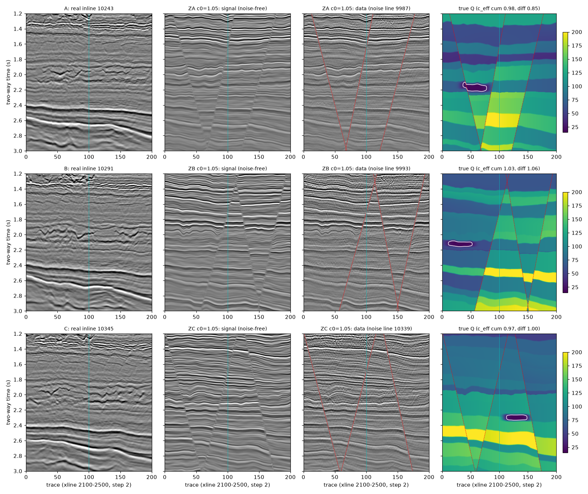
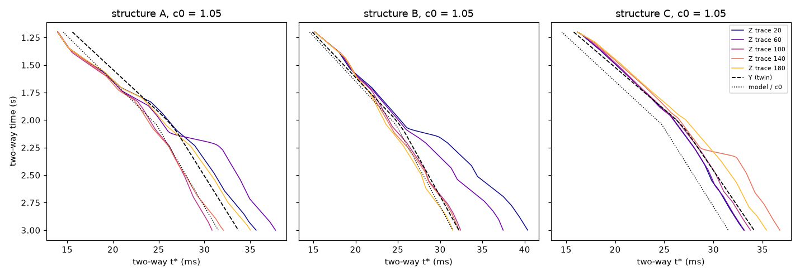

# 新半合成数据：带断层、Q 结构复杂（2026-10-30）

## 为什么要新数据

- 更正记录第 9、10 条：F3/F4（一维 Kennett）、V5（相干规则的开发生成器）从 round3 起被反复使用，已不是未见数据；"组合比最初方法降 55%"等数字带挑选偏差，相对最初方法的收益从未在未见数据上预登记确认。
- 实验 8–14 及锚定理论用的 Volve 半合成数据有两点过于理想：
  1. **真 Q = c × 模型 Q**，Q 剖面形状与求解器的两层模型（78.5 / 135.2，界面 2.04 s）完全相同，只差一个比例，且横向不变；
  2. 构造来自实测测线的平滑时差，**没有断层**。
- 本数据去掉这两点，供今后的预登记检验使用。F3/F4、V5 以及实验 8–14 用过的构造线、噪声线一概不再使用。

## 构建（`scripts/fq.py`、`scripts/build.py`）

沿用实验 8 的配方：F-11 T2 测井反射系数（1 ms，40 ms 块自助填充，横向 η = 0.3 的独立成分）、实测构造、实测浅层子波、实测噪声（倾角对齐后的侧向二次差分）、信噪比按实测标定。不同之处如下。

**测线**（Volve MIG_RAW，xline 2100–2500，201 道，1.2–3.0 s，4 ms；均未在任何实验中作构造线或噪声线用过，三条构造线也不在实验 13 的 104 条实测线中）：

| 构造 | 构造线 | 噪声线（实现 r = 0 / 1） | 地质种子 | 反射系数种子（r = 0 / 1） |
|---|---|---|---|---|
| A | 10243 | 9987 / 10311 | 15001 | 15100 / 15101 |
| B | 10291 | 9993 / 10327 | 15002 | 15110 / 15111 |
| C | 10345 | 10339 / 10361 | 15003 | 15120 / 15121 |

**断层**（每个构造 3 条正断层，地质种子决定）：

- 断面 x_f(t) = x₀ + g·(t − 2.1)，x₀ ∈ [25, 175] 道且相距 ≥ 35 道，|g| = 20–40 道/秒，倾向随机；
- 上盘下降，断距 T·(0.4 + 0.6·(t − 1.0)/2.2)，T = 20–60 ms（随深度增大的生长断层；约 30–90 m，与 Volve 储层段断层量级相当；初版 12–36 ms 在无噪剖面上几乎看不出错断，构建后改大，种子与断面位置不变）；
- 反向映射：每道每个输出时间 t 求地质时间 t_g = t − τ(t) − Σ断距·[在上盘]，正断层在垂直道上产生**地层缺失**（t_g 向上跳变）；缺失段的反射系数丢弃；
- 断面两侧 1.5 道内反射系数减半（破碎带）；
- 约束：2.2–2.9 s 内断面离中心道（"井"，第 100 道）至少 8 道，保证 M1 用的测井段完整。

**Q**（挂在断开后的地质层位上，随断层一起错开）：

1/Q_true(t, x) = [1/Q_model(t_g − δ) / c₀] · exp(−p(t_g) − ramp(t_g)·(ln m_块 + L·(x − 100)/100))，再在气藏透镜内混合到 Q = 18：

- δ ~ U(−0.15, 0.15) s：模型 Q 台阶（2.04 s）的位置被移动；
- p(t_g)：随机分层的 log Q 扰动，层厚 60–250 ms，每层 N(0, 0.25) 截断到 ±0.5，12 ms 平滑；
- m_块：每个断块的 Q 乘子，exp(N(0, 0.2)) 截断到 [0.7, 1.4]，断层两侧 Q 不连续；
- L ~ U(−0.15, 0.15)：横向趋势；
- 断块乘子和横向趋势在 t_g = 1.3–1.8 s 逐渐加入，浅层标定窗（1.2–1.6 s）仍接近模型；
- 气藏透镜：中心 t_g = 2.05–2.35 s、离中心道 ≥ 30 道，半宽 15–25 道，半厚 35–60 ms，超高斯边缘，Q = 18（初版 Q = 30、半厚 25–45 ms 时下方 30–60 Hz 振幅比只有 0.94–1.05，看不出阴影，构建后改强）；
- t* 由 1.0 s 处的模型 t*/c₀ 起沿每道积分 1/Q 得到。c₀ 取 0.75、1.05、1.4。

**正演**：每道一条 t* 剖面。核函数 irfft(S·AA·e^{b t*}) 在 t* 网格（步长 0.1 ms）上预先算好、截到 ±600 ms，网格之间线性插值；其余（1 ms 正演、100–120 Hz 防假频、参考频率 100 Hz、震源按真 t* 在 1.4 s 处重新校正）同实验 8。自检（`scripts/test_fq.py`）：横向不变 t* 时与实验 8 的 `semi.model` 相对误差 6.6×10⁻⁴，t* 落在网格中点时 1.1×10⁻³，不衰减时 1.2×10⁻⁴；断层映射只有缺失、没有重复。

**孪生组 Y**：与 Z 同断层、同反射系数、同噪声、同振幅定标和噪声水平，但 Q 回到旧配方：真 Q = c_eff × 模型 Q（200 ms 平滑），横向不变，无气藏。c_eff 取 Z 的剖面有效值（见下）。Z − Y 的差别只来自 Q 结构。

**有效 Q 系数**（Z 没有单一的"真 c"）：在 1.2–3.0 s 内拟合 t*_true ≈ a_model/c。
- c_eff_cum：按累积 t* 拟合（补偿算子看到的量）；
- c_eff_dif：按相对 1.2 s 的 t* 增量拟合（频谱比、SR 看到的量）；
- 每道一个值存于 `analysis/datasets.json`（`c_eff_cum_trace`、`c_eff_dif_trace`），剖面值取各道 1/c 的中位数。

## 数据集（36 个）

3 个构造 × c₀ 3 档 × 2 个实现（反射系数种子与噪声线一起换）× 2 组（Z、Y）。编号 `<组><构造>_c<c₀>_r<实现>`，如 `ZA_c1.05_r0`。

每个数据集一个 `cache/data/<编号>.npz`（float32，451 × 201，4 ms）：`D`（数据）、`signal`、`noise`、`ideal`（不衰减的真响应，截到真信噪比 ≥ 1 的频带 f_true，同实验 8 的 M1 目标）、`src`（不衰减、全频带）、`R`（1 ms 反射系数，2201 × 201）、`tstar`、`invQ`、`block`（断块编码）、`fault_dist`（到最近断面的道数）、`gas`（透镜权重）。读取：`fq.load("ZA_c1.05_r0")`。数据由脚本、种子和 Volve 数据体完全可复现，`cache/` 不上传。

## 构建结果（只看数据层面的量，没有在任何数据集上运行补偿或选 Q 方法）

完整表见 `analysis/summary_table.md`（逐数据集）和 `analysis/summary.csv`；地质参数 `analysis/geology.json`。

- **真 Q 不再是 c × 模型 Q**。Z 组的有效系数随构造不同而偏离 c₀，且累积口径与增量口径不一致：A 构造 c₀ = 1.05 时累积 0.98、增量 0.85；B 为 1.03、1.06；C 为 0.97、1.00。也就是说，同一个 c₀ 下，"补偿算子需要的 Q"和"频谱比看到的 Q"可以差 15%。
- **横向变化**：各道的增量有效系数 5–95% 分位跨度为 ±10–25%（如 ZB c₀ = 1.05 为 0.76–1.16，ZA c₀ = 1.4 为 0.96–1.38）。任何单一 Q 都不可能对所有道都正确。
- **气藏阴影**：透镜下方 0.1–0.4 s、30–60 Hz 的信号振幅比为 0.51–0.93（B 最强，约 0.5；A 约 0.8–0.9；C 约 0.9）。气藏处 t* 跳升 5–8 ms（`figures/tstar.png`）。
- **断层**：3 个构造各 3 条正断层，断距 8–60 ms，A 为地堑，B、C 为交叉断层；无噪剖面上错断与破碎带清楚可见（`figures/overview.png` 第 2 列）。
- **信噪比标定**：噪声倍数 0.50–3.28，f_true 77–88 Hz（Y 组 B 构造 c₀ = 0.75 为 66–67 Hz），与实验 8 的范围（0.55–2.69）相当，c₀ 越大噪声放大越多。
- **与实测的衰减斜率**（2.0–3.0 s 对 1.2–1.6 s 相干功率、10–60 Hz 的对数斜率，描述性）：实测三条线为 −0.096、−0.088、−0.107；合成数据 c₀ = 0.75 时 −0.074 到 −0.112，最接近实测，c₀ = 1.05、1.4 时衰减弱于实测。这个斜率受噪声线影响很大（同一 c₀ 下两条噪声线可差 0.035），只作参考。
- **Z 与 Y 的差别只在 Q**：同一 c₀、实现下，两组的反射系数、断层、噪声、振幅定标完全相同；Y 的有效系数等于 Z 的累积有效系数（差 < 0.002）。

构建中发现并改正的问题（都在运行任何方法之前）：
1. 断距初版 12–36 ms，无噪剖面上看不出错断，改为 20–60 ms；
2. 气藏初版 Q = 30，下方振幅比 0.94–1.05、没有阴影，改为 Q = 18、加厚；
3. 断层缺失段起初用"相邻样点地质时间差 > 1.5 ms"判定，实测构造把地层局部拉伸到 1.6 倍处被误判，出现方块状空白；改为按断块编码变化判定后，每道最长空缺 ≤ 2 ms。

## 使用规则（2026-10-30 用户回复“继续”后按此执行）

- **A 为开发构造**：可以看、可以调参。
- **B、C 封存**：冻结检验方案并提交之前，不在 B、C 上运行任何补偿或选 Q 方法；每个检验方案写明用到的数据集，用过即在本文件登记，之后不再称为未见数据。
- 本数据是叠后二维剖面，只能用于 Python 一线的方法（反 Q、SC-a、QScan、SR、Wiener 等）。MATLAB 一线（FixedSplit、相干标准版、QScan＋标准版）在一维叠前道集上运行，不能直接用；如要在未见数据上确认"组合相对最初方法"的收益，需要另做叠前版本。

## 使用记录

- 2026-10-30 实验 15（`fault_q_confirm_20261030`，方案 b79fc73）：构造 B、C 的全部 24 个数据集（Z、Y 各 12）作确认检验；构造 A 的 `ZA_c1.05_r0` 作冒烟测试。B、C 从此不再是未见数据，今后的检验需另建新构造。
